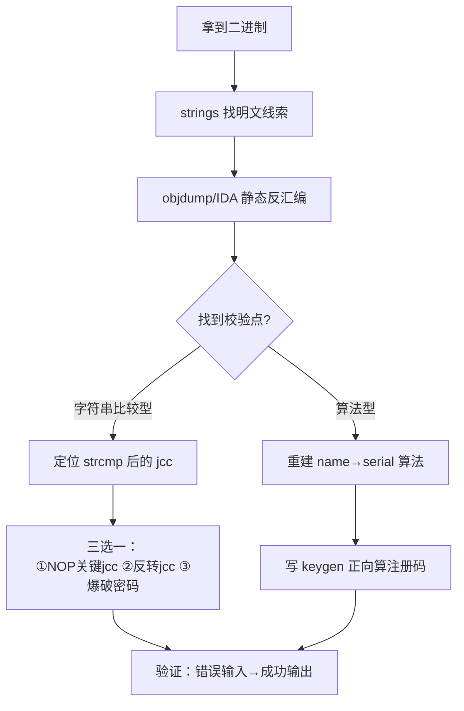

# crackme

> crackme 是逆向学习的靶场：小型"注册/加密"程序，目标是分析其校验逻辑并绕过。本板块把全库知识（汇编/C/内存/调用约定）投入实战。

## 实战方法论（先读这个）

## 静态分析三板斧

| 步骤 | 命令/工具 | 找什么 |
| --- | --- | --- |
| 1. 字符串 | `strings prog \| grep -i xxx` | 明文密码、提示语（"Wrong password"）——锚点 |
| 2. 反汇编 | `objdump -d -M intel prog` | `strcmp@PLT` 后的 `test+jcc`、`cmp` 常量、xor魔数 |
| 3. 定位补丁点 | 看跳转字节（`75 xx`=jne） | 决定成败的那条条件跳转 |

## 破解四流派

| 流派 | 做法 | 适用 | 实战 |
| --- | --- | --- | --- |
| **爆破（patch）** | 改跳转字节：jne→NOP/反转 | 一切"比较型"校验 | [crackme01](crackme01/crackme01.md) |
| **算法重建（keygen）** | 从汇编还原算法，正向算key | name→serial 变换 | [crackme02](crackme02/crackme02.md) |
| **动态调试** | OD/x64dbg/gdb 断在比较处，看内存 | 复杂流程 | 见各调试器章 |
| **补丁常量** | 改 rodata 里的密码/密钥 | 明文存放时 | crackme01 加餐 |

## 动态调试器速查

| 工具 | 平台/位数 | 招牌 | 章节 |
| --- | --- | --- | --- |
| DTDebug | Win 32位 | 滴水教程御用 | [DTdebug调试器](../docs/DTdebug调试器.md) |
| OllyDbg | Win 32位 | 经典动态分析、jcc补丁 | [OllyDbg](../docs/OllyDbg.md) |
| IDA Pro | 全平台 | 静态反汇编+F5伪代码 | [IDAPro](../docs/IDAPro.md) |
| gdb / objdump | Linux | 本库实测环境主力 | 各实战篇 |

## 靶场

* [crackme01：密码校验型](crackme01/crackme01.md) —— strcmp + jcc：爆破入门（真实补丁验证）
* [crackme02：算法型](crackme02/crackme02.md) —— 加权求和+异或魔数：注册机编写（真实keygen验证）

## 本库知识 → 实战对照表

| 实战中会用的 | 来自哪章 |
| --- | --- |
| `75/74/EB/90` 跳转字节含义 | [跳转指令集](../docs/汇编/跳转指令集.md) |
| `test eax,eax` 后读哪套标志 | [EFLAGS寄存器](../docs/汇编/EFLAGS寄存器.md) |
| `strcmp@PLT` 是什么调用 | [编译链接与库](../docs/C语言/编译链接与库.md) |
| `.rodata` 里的密码怎么找 | [常量区](../docs/C语言/常量区.md) |
| `call check` 的栈帧现场 | [堆栈图](../docs/汇编/堆栈图.md) |
| 算型立即数（0xDEADBEEF）的十进制脸 | [进制](../docs/汇编/进制.md) |
