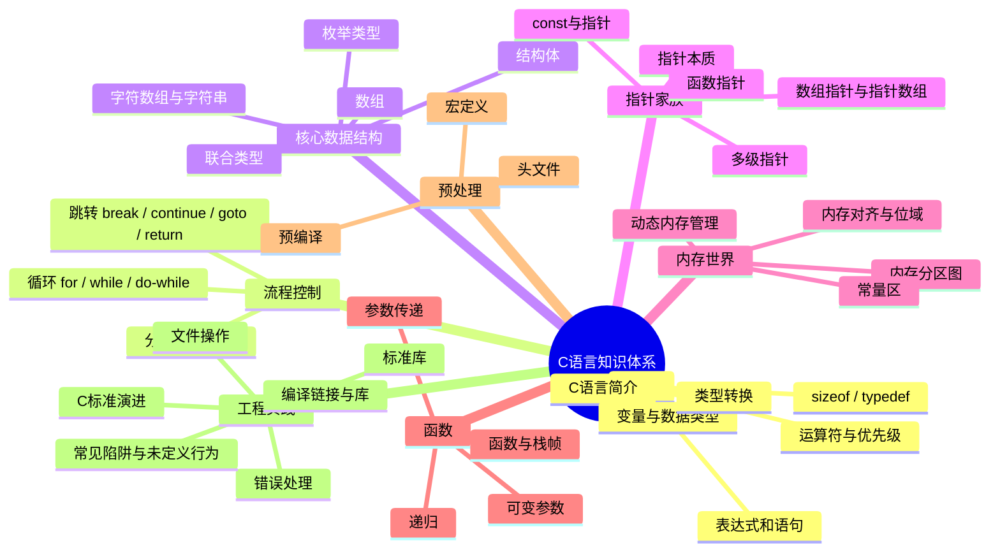

# C语言

> 懂汇编的娃才能学好C语言~ 本知识库以"从内存和汇编看C语言本质"为主线。

## 知识体系总览



## 学习路线


## 章节

* [C语言简介](C语言/C语言简介.md)
* [C语言变量](C语言/C语言变量.md)
* [运算符](C语言/运算符.md)
* [优先级](C语言/优先级.md)
* [表达式和语句](C语言/表达式和语句.md)
* [类型转换](C语言/类型转换.md)
* [内存图](C语言/内存图.md)
* [常量区](C语言/常量区.md)
* [sizeof关键字](C语言/sizeof关键字.md)
* [typedef关键字](C语言/typedef关键字.md)
* [控制语句-分支和跳转](C语言/控制语句-分支和跳转.md)
* [控制语句-循环](C语言/控制语句-循环.md)
* [数组](C语言/数组.md)
* [字符数组与字符串](C语言/字符数组与字符串.md)
* [指针](C语言/指针.md)
* [函数指针](C语言/函数指针.md)
* [函数](C语言/函数.md)
* [可变参数](C语言/可变参数.md)
* [结构体](C语言/结构体.md)
* [联合类型](C语言/联合类型.md)
* [枚举类型](C语言/枚举类型.md)
* [位运算](C语言/位运算.md)
* [内存对齐与位域](C语言/内存对齐与位域.md)
* [内存管理](C语言/内存管理.md)
* [预编译](C语言/预编译.md)
* [宏定义](C语言/宏定义.md)
* [头文件](C语言/头文件头文件.md)
* [标准库](C语言/标准库.md)
* [文件操作](C语言/文件操作.md)
* [错误处理](C语言/错误处理.md)
* [编译链接与库](C语言/编译链接与库.md)
* [常见陷阱与未定义行为](C语言/常见陷阱与未定义行为.md)
* [C标准演进](C语言/C标准演进.md)

## 总结

```
1. C语言的一切都发生在内存里：变量是内存的名字，指针是内存的地址，函数是内存中的指令序列
2. 先掌握"内存图"，再学指针，事半功倍
3. 基础永远值得花费90%的精力去学习加强~
```
