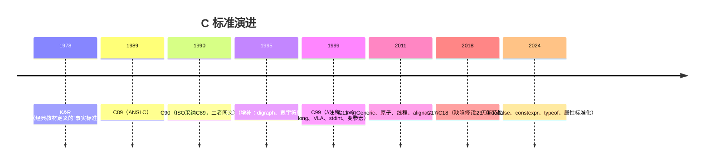
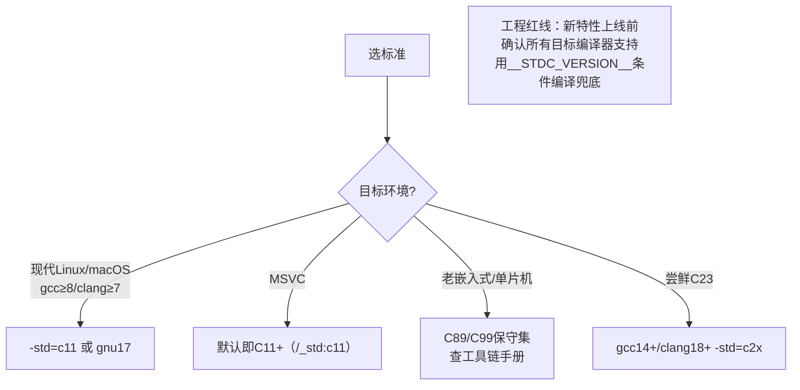

# C标准演进

## 时间线



## 版本检测

```c
/* 编译器宏 __STDC_VERSION__ 的值： */
199409L  /* C94/C95 */
199901L  /* C99 */
201112L  /* C11 */
201710L  /* C17 */
/* C23: 202000L+（编译器实现中，gcc14+/clang18+部分支持） */

#if defined(__STDC_VERSION__) && __STDC_VERSION__ >= 199901L
    /* C99特性可用 */
#endif

gcc -std=c99 / -std=c11 / -std=c17 / -std=c23
gcc -std=gnu11   /* = 指定标准 + 打开GNU扩展（gcc默认带扩展的版本） */
```

## 各版本新特性速查

### C89/C90 —— 一切的基准

* 32个关键字、函数原型、void、const；
* 标准库成型（stdio/stdlib/string/math...）；
* 局部变量必须在块首声明：

```c
void f(void) {
    int i;                 /* ✔ 声明全在块首 */
    for (i = 0; i < 10; i++) {
        int t = i;         /* 新块可以声明 */
    }
}
```

### C99 —— 实用主义大升级（事实上的工程基线）

```c
// 1. 行注释
int x = 10; // C89编译器不认

// 2. 块内任意位置声明变量
for (int i = 0; i < n; i++) { }        // 循环变量作用域限于for

// 3. long long / unsigned long long（至少64位）
long long big = 9000000000LL;

// 4. stdint.h：定宽类型
uint32_t / int64_t / UINT64_MAX

// 5. stdbool.h：布尔
#include <stdbool.h>
bool ok = true;

// 6. 变长数组 VLA
int n; scanf("%d", &n);
int arr[n];

// 7. 指定初始化器
int a[10] = {[9] = 1};
struct P p = {.y = 2};

// 8. 复合字面量（匿名字面对象！）
int *p = (int[]){1, 2, 3};             // 生存期：所在块
draw((struct Point){.x = 1, .y = 2});  // 免定义临时变量

// 9. 变参宏 __VA_ARGS__
#define LOG(fmt, ...) printf(fmt, __VA_ARGS__)

// 10. inline 函数
static inline int sq(int x) { return x * x; }

// 11. restrict 指针
void copy(int *restrict dst, const int *restrict src, size_t n);

// 12. snprintf、声明与代码混排、柔性数组成员 FAM
// 13. 浮点运算遵循 IEEE 754（ Annex F 可选）
```

### C11 —— 现代并发与泛型（第一版打破"单线程"假设）

```c
// 1. _Generic 编译期类型分派（"函数重载"）
#define print_any(x) _Generic((x), \
    int:    print_int,              \
    double: print_double,           \
    char *: print_str)(x)

// 2. 线程库 <threads.h>（可选：__STDC_NO_THREADS__）
#include <threads.h>
thrd_t t;
thrd_create(&t, worker_fn, arg);
thrd_join(t, NULL);

// 3. 原子操作 <stdatomic.h>（可选）
#include <stdatomic.h>
atomic_int counter;
atomic_fetch_add(&counter, 1);        // 无锁计数器

// 4. 对齐支持
_Alignas(16) char buf[16];            // 指定对齐
_Alignof(double);                     // 查询对齐
aligned_alloc(16, 64);                // 对齐分配（malloc替代）

// 5. 匿名结构体/联合体
struct S { int tag; union { int i; double d; }; };   // 直接 s.i 访问

// 6. _Static_assert 编译期断言
_Static_assert(sizeof(int) == 4, "expect 4");

// 7. _Noreturn、gets删除、安全函数（ Annex K 可选）
// 8. quick_exit / at_quick_exit
```

### C17 —— 修复版

无新语言特性：修订C11缺陷、废弃部分 Annex K。**过渡版本**，现代编译器默认标准多为 gnu17。

### C23 —— 大版本（"十年磨一剑"）

```c
// 1. true/false/bool 成为关键字（不再需要 stdbool.h）
bool ok = true;

// 2. nullptr 与 nullptr_t
int *p = nullptr;          // 类型安全的空指针

// 3. typeof / typeof_unqual
typeof(x) y = x;           // gcc扩展转正

// 4. constexpr（对象层面）
constexpr int N = 100;

// 5. auto 类型推断（仅初始化的简单声明）
auto x = 3.5;              // double（auto不可用于数组/复合声明）

// 6. 属性标准化 [[...]]
[[noreturn]] void die(void);
[[deprecated("use f2")]] void f1(void);
[[fallthrough]];           // switch落穿显式标注

// 7. 枚举可指定底层类型
enum E : uint8_t { A, B, C };

// 8. 二进制字面量 + 数字分隔符
int mask = 0b1010'1010;

// 9. #embed（把二进制文件嵌进源码，资源嵌入神器）

// 10. stdckdint.h 溢出检查、strdup/strndup转正、printf新格式%b
```

## 关键特性对照表

| 特性 | C89 | C99 | C11 | C23 |
| --- | --- | --- | --- | --- |
| `//` 注释 | ✘ | ✔ | ✔ | ✔ |
| for内声明变量 | ✘ | ✔ | ✔ | ✔ |
| `long long` | ✘ | ✔ | ✔ | ✔ |
| stdint 定宽类型 | ✘ | ✔ | ✔ | ✔ |
| 变长数组VLA | ✘ | ✔ | 可选 | 可选 |
| 柔性数组成员 | ✘ | ✔ | ✔ | ✔ |
| 复合字面量 | ✘ | ✔ | ✔ | ✔ |
| `_Generic` | ✘ | ✘ | ✔ | ✔ |
| 原子/线程库 | ✘ | ✘ | ✔(可选) | ✔ |
| `_Static_assert` | ✘ | ✘ | ✔ | ✔ |
| `nullptr` | ✘ | ✘ | ✘ | ✔ |
| `constexpr`/`auto` | ✘ | ✘ | ✘ | ✔ |
| 属性 `[[...]]` | ✘ | ✘ | ✘ | ✔ |

## 该用哪个标准？



**实践建议**：

1. 写跨平台库：以 **C99 为底线**（定宽类型、for声明、`//`已普适），C11特性用条件编译保护；
2. VS用户：老MSVC只认真支持C89+C99子集，VS2019+ `/std:c11` 起步；
3. 每个特性引入前问三个问题：目标编译器都支持吗？诊断信息友好吗？团队成员都认识吗？

## 延伸阅读

* 各版本标准草案（免费）：www.open-std.org/JTC1/SC22/WG14/
* cppreference C 版本专题：<https://zh.cppreference.com/w/c/23>
* 《Effective C》Robert Seacord —— 现代C工程实践
