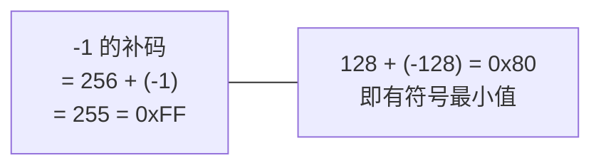
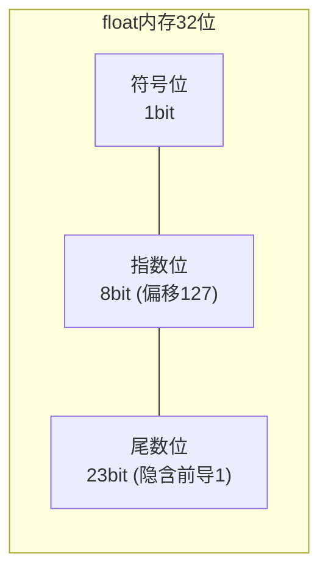
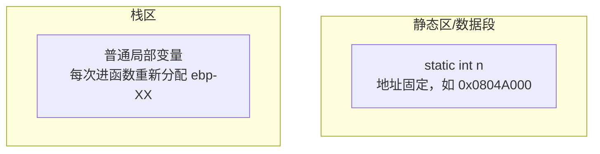

# C语言变量

## 变量的本质

**变量 = 内存中的一块空间 + 一个名字**。编译器把名字映射为地址：

```c
int a = 10;
```

对应汇编（32位）：

```asm
mov  dword ptr [ebp-4], 0Ah   ; 把 10 写入栈上为 a 保留的 4 字节
```

`a` 只是编译期的符号，运行期一切操作最终都是**对地址的读写**。

## 声明 vs 定义

| 概念 | 作用 | 可出现次数 |
| --- | --- | --- |
| **定义** | 分配内存并可选初始化 | 整个程序**只能一次** |
| **声明** | 告诉编译器类型和名字（extern） | 可多次 |

```c
int g_val = 100;        // 定义（分配内存）
extern int g_val;       // 声明（不分配内存，"别处已定义"）
```

## 基本数据类型

### 完整类型表（LP32 / ILP32 / LP64 典型大小）

| 类型 | 32位平台 | 64位平台 | 格式化输出 |
| --- | --- | --- | --- |
| `char` | 1 | 1 | `%c` |
| `short` | 2 | 2 | `%hd` |
| `int` | 4 | 4 | `%d` / `%u` |
| `long` | 4 | 8 (LP64) | `%ld` |
| `long long` | 8 | 8 | `%lld` |
| `float` | 4 | 4 | `%f` |
| `double` | 8 | 8 | `%lf` |
| `long double` | 8/12 | 16 | `%Lf` |
| 指针 `T*` | **4** | **8** | `%p` |
| `size_t` | 4 | 8 | `%zu` |

> 关键结论：**指针大小与平台位数相关，与所指向类型无关**。

标准只保证大小关系（`sizeof(char) <= sizeof(short) <= sizeof(int) <= sizeof(long)`），具体大小由实现决定。用 `sizeof` 验证而不是靠死记。

### 整型：有符号与无符号

同一个 4 字节内存，两种解读：

```c
int      x = -1;    // 32位补码：0xFFFFFFFF，当作有符号数读 = -1
unsigned y = -1;    // 同样 0xFFFFFFFF，当作无符号数读 = 4294967295
```

补码的数学本质（以 8 位为例）：



取值范围（16位 short）：

| 类型 | 范围 | 大小 |
| --- | --- | --- |
| `short` | -32768 ~ 32767 | 2 字节 |
| `unsigned short` | 0 ~ 65535 | 2 字节 |

### 浮点型：IEEE 754

`float`（32位）的内存布局：



```c
float f = 5.5;   // 5.5 = 101.1(二进制) = 1.011 × 2^2
                 // 符号0 | 指数 2+127=129=10000001 | 尾数 01100000000000000000000
                 // 内存: 0x40B00000
```

这解释了经典问题：

```c
float f = 0.1f;
if (f == 0.1) ...          /* 危险！double(0.1) 与 float(0.1f) 二进制不相等 */
```

### char 与字符

```c
char c = 'A';      // 'A' 是整型常量 65
printf("%d", c);   // 65
printf("%c", c);   // A
```

`char` 是否有符号由实现决定，跨平台代码避免依赖（用 `unsigned char`/`signed char` 明确指定）。

## 存储类说明符

### auto（默认，可省略）

```c
auto int x = 10;   // 等价 int x = 10; 块作用域自动存储期
```

### static —— 三种用法

```c
// 1. 修饰局部变量：存放到静态区，生命周期 = 整个程序，但作用域不变
void counter(void) {
    static int n = 0;    // 只初始化一次！
    n++;
    printf("%d\n", n);   // 依次输出 1 2 3 ...
}

// 2. 修饰全局变量：限制链接属性为"内部"，仅本文件可见（避免命名冲突）
static int file_private = 1;

// 3. 修饰函数：仅本文件可调用
static void helper(void) { }
```

**static 局部变量内存图**：



### extern —— 跨文件共享

```c
// file1.c
int g_count = 0;            // 定义

// file2.c
extern int g_count;         // 声明后即可使用
```

### register（现代编译器基本无视）

```c
register int i;             // 建议放寄存器；不可对该变量取地址 &
```

## 作用域与生命周期

| 存储位置 | 作用域 | 生命周期 | 默认初值 |
| --- | --- | --- | --- |
| 局部变量（栈） | 所属 `{}` 块内 | 进入块到离开块 | **未初始化（随机值）** |
| static 局部 | 所属 `{}` 块内 | 整个程序 | 0 |
| 全局变量 | 从声明处到文件尾 | 整个程序 | 0 |
| 全局 static | 本文件 | 整个程序 | 0 |
| malloc 内存 | 指针可达范围 | free 之前 | 未定义 |

作用域嵌套遮蔽（shadowing）：

```c
int x = 1;
{
    int x = 2;          // 内层 x 遮蔽外层 x
    printf("%d", x);    // 2
}
printf("%d", x);        // 1
```

## 类型限定符

```c
const int a = 10;        // 只读：通过 a 修改是编译错误（但内存未必真只读）
volatile int *reg;       // 每次访问都必须真正读写内存（MMIO/信号处理/多线程）
int *restrict p;         // C99：承诺 p 是访问该内存的唯一入口，利于优化
```

`volatile` 典型场景——硬件寄存器：

```c
volatile uint32_t *status = (volatile uint32_t *)0x40010000;
while (*status & 1) { }   // 不加 volatile 会被优化成死循环
```

## 初始化的坑

```c
int a;                       // 栈上：值不确定！
int arr[10];                 // 同样不确定
static int s;                // 静态区：保证为 0

int x = 3.14;                // 隐式截断为 3（编译器通常警告）
char c = 300;                // 300 > 255，截断为 44（实现定义）
```

**建议**：定义即初始化，是C语言防御式编程第一条军规。

## 从汇编看变量

```c
int g = 100;          // 全局：数据段
static int s = 5;     // 静态：数据段（符号不导出）
int main(void) {
    int local = 7;    // 局部：栈
    g = local + s;
    return 0;
}
```

```asm
main:
    push    rbp
    mov     rbp, rsp
    mov     DWORD PTR [rbp-4], 7        ; local = 7（栈上）
    mov     eax, DWORD PTR [rbp-4]      ; 读 local
    add     eax, DWORD PTR s[rip]       ; + s（静态区，rip相对寻址）
    mov     DWORD PTR g[rip], eax       ; 写 g
    mov     eax, 0
    pop     rbp
    ret
```

**三行代码，三种寻址方式**：栈相对寻址（局部）、静态区符号（全局/static）。

## 小结

1. 变量是编译期的名字，运行期全是地址；
2. 定义唯一、声明可多，extern 跨文件；
3. static 改的是**生命周期（局部）和可见性（全局/函数）**；
4. 局部变量不初始化 = 随机值，永远显式初始化；
5. 指针大小由平台位数决定。

## 延伸

* [内存图](内存图.md) —— 各存储区全景
* [类型转换](类型转换.md) —— 有符号/无符号混合运算的灾难现场
* [sizeof关键字](sizeof关键字.md)
