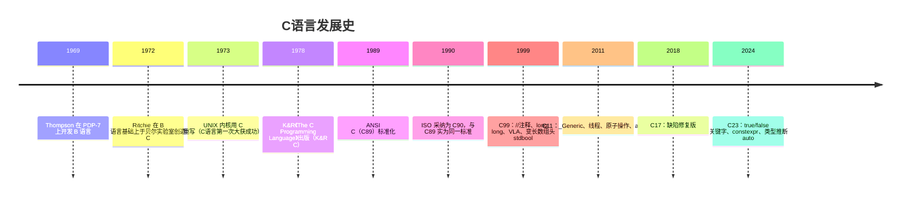
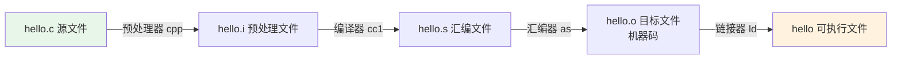

# C语言简介

## 什么是C语言

C语言是一种**面向过程的、静态类型的、编译型**通用程序设计语言。它兼具：

* **高级语言**的抽象能力（变量、函数、结构体、循环）
* **低级语言**的操作能力（指针、位运算、直接内存访问）

因此C被称为"中级语言"，至今仍是操作系统、嵌入式、数据库、编译器等领域的基础语言。

## 历史沿革



## 特点

| 特点 | 说明 |
| --- | --- |
| 简洁 | 仅 32 个关键字（C89），C23 也只有约 40 余个 |
| 高效 | 编译产物接近汇编效率，无运行时开销 |
| 可移植 | 标准化了语言与库，源码级跨平台 |
| 灵活 | 指针可直接操纵内存，限制少 |
| 贴近硬件 | 位运算、内存映射、内联汇编 |
| 危险 | 自由的代价：大量未定义行为，把出错的权利交给程序员 |

## 第一个程序

```c
#include <stdio.h>   /* 预处理指令：包含标准输入输出头文件 */

int main(void)       /* main：程序入口，返回 int */
{
    printf("Hello, C!\n");   /* \n：换行转义符 */
    return 0;        /* 返回值 0 表示程序正常结束 */
}
```

逐行解析：

| 元素 | 含义 |
| --- | --- |
| `#include <stdio.h>` | 预处理阶段把 stdio.h 的内容原地展开 |
| `int main(void)` | 操作系统调用的入口函数；`int` 返回值给 shell（`echo $?` 可查看） |
| `printf` | 格式化输出函数，声明于 stdio.h |
| `return 0` | 0 = 成功，非 0 = 失败 |

编译运行：

```bash
gcc hello.c -o hello   # 一步到位
./hello                # 运行
echo $?                # 查看返回值 → 0
```

## 程序的编译流程

C是编译型语言，从源代码到可执行文件经过**四个阶段**：



```bash
gcc -E hello.c -o hello.i   # 1.预处理：展开头文件、替换宏、条件编译
gcc -S hello.i -o hello.s   # 2.编译：C → 汇编
gcc -c hello.s -o hello.o   # 3.汇编：汇编 → 机器码（目标文件）
gcc hello.o -o hello        # 4.链接：合并目标文件与库，重定位符号
```

详见 [编译链接与库](编译链接与库.md)。

## 从汇编看本质

用 `gcc -S` 看看 main 编译成什么样的汇编（x86-64 AT&T 风格）：

```asm
main:
    push    rbp                 ; 建立栈帧
    mov     rbp, rsp
    mov     edi, OFFSET FLAT:.LC0   ; "Hello, C!\n" 的地址 → 第1个参数
    call    puts                ; printf("\n"结尾)被优化成 puts
    mov     eax, 0              ; 返回值 0 放入 eax
    pop     rbp                 ; 恢复栈帧
    ret                         ; 返回调用者(__libc_start_main)
```

可以看出：

1. **函数就是一段指令**，`call` 跳过去执行，`ret` 跳回来；
2. **参数通过寄存器/栈传递**，返回值放 `eax/rax`；
3. **字符串常量被放到常量区**（.rodata），传给函数的是**地址**。

## 应用领域

* **操作系统**：Linux、Windows 内核大部分由 C 编写
* **嵌入式/单片机**：裸机开发，C 几乎是唯一选择
* **数据库**：MySQL、SQLite、Redis
* **编程语言实现**：Python(CPython)、PHP、Lua 的解释器
* **经典逆向目标**：绝大多数 crackme、PE/ELF 程序由 C 生成

## 与汇编的关系（本库主线）

| C语言概念 | 底层本质 |
| --- | --- |
| 变量 | 内存地址的别名 |
| 赋值 `=` | mov 指令 |
| `if/while` | cmp + 条件跳转(jcc) |
| 函数调用 | call/ret + 栈帧切换 |
| 数组 | 一段连续内存 + 基址+偏移寻址 |
| 指针 | 存放地址的变量 |
| 结构体 | 一块按偏移组织的内存 |

## 延伸阅读

* K&R《C程序设计语言（第2版）》
* 《C Primer Plus》
* 《C陷阱与缺陷》《C专家编程》
* cppreference: <https://zh.cppreference.com/w/c>
