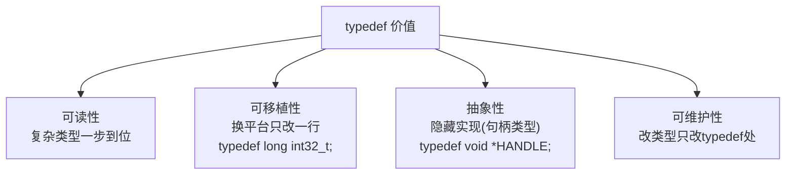

# typedef关键字

## 基本用法

`typedef` 给**已有类型**起别名，编译期完成，不产生新类型语义（对指针等复合类型则建立了类型抽象）：

```c
typedef unsigned char  byte;
typedef unsigned int   uint;
typedef char *         string_t;

byte b = 0xFF;
uint u = 4000000000u;
```

## typedef vs #define

| 对比项 | typedef | #define |
| --- | --- | --- |
| 处理阶段 | 编译器 | 预处理器（纯文本替换） |
| 类型检查 | ✔ 遵守类型系统 | ✘ 无 |
| 能否描述复合类型 | ✔ | ✘ 容易出错 |

**最能体现差异的例子**：

```c
/* 目标：str_arr 是"10个字符串指针"的数组 */

typedef char *STRING10[10];
#define STRING10_DEF char *10         /* ✘ 直接语法错误 */

/* 目标：一次声明 3 个指针 vs 1个指针+2个char */
typedef char *CHAR_PTR;
#define CHAR_PTR_DEF char *

CHAR_PTR     a, b, c;   /* a b c 都是指针 ✔ */
CHAR_PTR_DEF x, y, z;   /* 展开为 char *x, y, z → x是指针，y z是char！✘ */
```

## 四大经典 typedef

### 1. 结构体别名

```c
/* C 中 struct 关键字无法省略，typedef 之后可以 */
typedef struct Node {
    int data;
    struct Node *next;      /* 自引用仍需 struct 前缀（定义内部） */
} Node;

Node n;                     /* 不用写 struct Node */
```

### 2. 数组类型

```c
typedef int Int5[5];        /* Int5 是"含5个int的数组"类型 */
Int5 arr = {1, 2, 3, 4, 5};
Int5 grid[3];               /* 3行5列的二维数组 int grid[3][5] */
```

### 3. 函数指针（typedef 最大的价值所在）

```c
/* 原始写法：可读性灾难 */
int (*cmp)(const void *, const void *);      /* 变量 */

/* typedef 之后：像声明普通变量一样声明函数指针 */
typedef int (*CMP)(const void *, const void *);
CMP cmp;                                     /* 清晰！ */

/* 函数指针数组（跳转表）也瞬间可读 */
CMP handlers[4];
```

详见[函数指针](函数指针.md)。

### 4. 标准库中的 typedef 惯例

```c
typedef unsigned long size_t;      /* stddef.h */
typedef int ssize_t;
typedef long ptrdiff_t;
typedef unsigned long long uint64_t;   /* stdint.h 定宽类型家族 */
/* C23: typedef ... nullptr_t */
```

## 阅读复杂声明——typedef 逐层拆解法

遇到复杂类型，用 typedef 逐层化简：

```c
/* 目标：阅读 int *(*func[5])(int) —— ??? */

/* 第1层：func是数组，元素是某种指针 */
typedef int *(*FUNC_PTR)(int);
FUNC_PTR func[5];          /* func: 5个元素的数组，元素是函数指针 */
/* 结论：func 是"5个指向 int*(*)(int) 函数的指针"组成的数组 */
```

系统方法见[指针](指针.md)的"复杂声明阅读法"（右左法则）。

## typedef 的工程价值



Windows API 就是重度 typedef 用户：

```c
typedef void *HANDLE;
typedef unsigned long DWORD;
typedef const char *LPCSTR;
```

## 小结

1. typedef 是编译器级别的类型别名，`#define` 只是文本替换；
2. `CHAR_PTR a, b;`（都是指针） vs `#define` 版本（只有a是指针）是必考差异；
3. 函数指针、数组类型加 typedef 是可读性救星；
4. 换平台改一行 typedef，实现类型层可移植。
