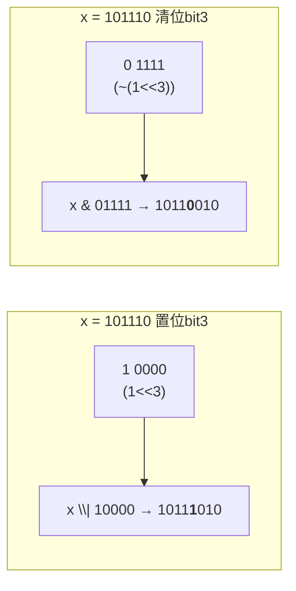
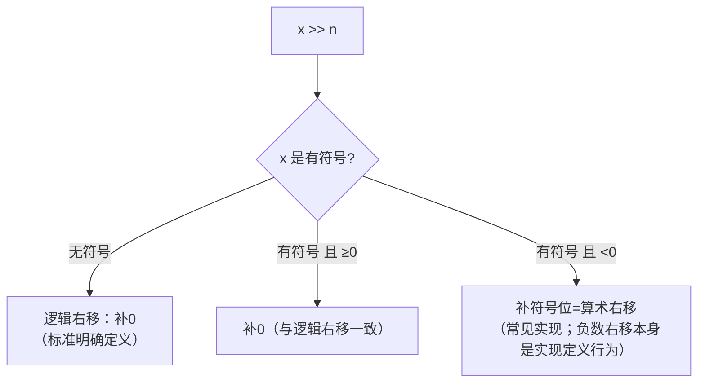

# 位运算

## 六个位运算符

| 运算符 | 名称 | 规则（1位示例） |
| --- | --- | --- |
| `&` | 按位与 | `1&1=1`，其余0（**清零器**） |
| `\|` | 按位或 | `0\|0=0`，其余1（**置位器**） |
| `^` | 按位异或 | 相异为1（**翻转器**） |
| `~` | 按位取反 | 0↔1（单目） |
| `<<` | 左移 | 高移出丢弃，低位补0；**左移n = ×2ⁿ** |
| `>>` | 右移 | 见下：有符号/无符号行为不同 |

**参与位运算的必须首先是整数**（浮点不行）；运算前会做整型提升。

## 掩码技术（最核心的应用）

设 `x` 为任意整数，`mask` 为掩码：

```c
/* 1. 测试第 n 位是否为 1 */
if (x & (1 << n))        /* 第n位=1 则非零为真 */

/* 2. 置位：第 n 位设 1，其余不变 */
x |= (1 << n);

/* 3. 清位：第 n 位清 0，其余不变 */
x &= ~(1 << n);

/* 4. 翻转：第 n 位取反 */
x ^= (1 << n);

/* 5. 一次置多个位 */
x |= (PERM_READ | PERM_WRITE);      /* 见枚举flags模式 */

/* 6. 取低 8 位 */
x & 0xFF

/* 7. 取偶数位（第0,2,4...位） */
x & 0x55555555     /* 0101...0101 */

/* 8. 清低 n 位，保留高位 */
x & (~0u << n)
```

图解置位与清位：



## 异或的妙用

异或三定律：`a^a=0`，`a^0=a`，`交换律/结合律`。

```c
/* 1. 不用临时变量交换（整数可用；注意同一地址会归零！） */
a ^= b;  b ^= a;  a ^= b;      /* 若 a,b 是同一变量 → x^=x → 0，BUG */

/* 2. 找出数组中唯一落单的数（其他都出现两次） */
int single = 0;
for (size_t i = 0; i < n; i++)
    single ^= arr[i];          /* 成对抵消为0，剩单身狗 */

/* 3. 简单加解密（与密钥异或两次还原） */
enc = plain ^ key;
dec = enc  ^ key;              /* == plain */

/* 4. 判断两数符号是否相同 */
if ((a ^ b) >= 0)  /* 同号（最高位相同则异或结果最高位为0） */

/* 5. 交换二进制奇偶位、高低字节：字节交换 */
swap16 = (x << 8) | (x >> 8);  /* 0x1234 → 0x3412（低8位与高8位互换） */
```

## 移位：左移与右移

```c
unsigned u = 0xF0000000u;
u << 1;       /* 0xE0000000：高位丢弃、低位补0 */

int s = -8;
s >> 1;        /* -4：算术右移（高位补符号位）——多数平台行为 */

unsigned v = 0x80000000u;
v >> 1;        /* 0x40000000：逻辑右移（高位补0）——标准保证 */
```



**左移=乘2ⁿ，右移=除2ⁿ**（右移向下取整，`-8>>1=-4` 但 `-7>>1=-4`，与除法`-7/2=-3`向零截断不同！）：

```c
1 << 20            /* 1048576 = 1MB（字节计） */
1 << 30            /* 1GB */
x << 2             /* x*4：比乘法快（编译器也会自动转换） */
```

**移位量必须 < 类型位宽**：`1 << 32`（32位int）是 **UB**；移位计数请用 `unsigned`（`1 << -1` 也是UB）。

## 优先级事故高发区

```c
/* 位运算优先级低于比较运算符！ */
if (x & 1 == 0)        /* 实际 x & (1==0) → x & 0 → 恒0，全错 */
if ((x & 1) == 0)      /* ✔ 必须加括号 */

x & 3 | 4              /* (x&3) | 4：& 高于 | */
x ^ y & z              /* x ^ (y&z)：& 高于 ^ */
/* 结论：位运算表达式中，括号不要省 */
```

## 实战案例

### 1. 二进制打印（调试神器）

```c
void print_bin(unsigned x)
{
    for (int i = 31; i >= 0; i--)       /* 从高位到低位 */
        putchar((x >> i) & 1 ? '1' : '0');
    putchar('\n');
}
/* print_bin(0x0F) → 00000000000000000000000000001111 */
```

### 2. 统计1的个数（popcount）

```c
int count_ones(unsigned x)
{
    int n = 0;
    while (x) {
        x &= x - 1;     /* 每次消去最低位的1 */
        n++;
    }
    return n;
}
/* x=10110 → x-1=10101 → x&(x-1)=10100：最低位的1被抹掉 */
```

### 3. 判断 2 的幂

```c
if (x && !(x & (x - 1)))    /* 只有一个bit为1，且非0 */
    /* x 是 2 的幂：8(1000) & 7(0111) = 0 */
```

### 4. 大小端字节重组

```c
/* 0x12345678 → 0x78563412 */
uint32_t bswap32(uint32_t x) {
    return ((x & 0xFF) << 24) | ((x & 0xFF00) << 8) |
           ((x >> 8) & 0xFF00) | ((x >> 24) & 0xFF);
}
```

### 5. 权限/状态标志（嵌入式LED寄存器）

```c
#define LED1 (1 << 0)
#define LED2 (1 << 1)
#define LED3 (1 << 2)

volatile uint32_t *led_reg = (volatile uint32_t *)0x40020014;
*led_reg |= LED1 | LED3;      /* 点亮LED1、LED3 */
*led_reg &= ~LED2;            /* 熄灭LED2 */
```

## 位运算 vs 乘除法

```c
x << 3        /* x*8 —— 现代编译器会自动优化，别为性能手写（可读性差） */
              /* 但移位语义就是"位级操作"（如位图/掩码），该用就用 */
/* 有符号负数左移：UB！（溢出/符号位问题）只对无符号数放心移位 */
```

## 小结

1. 掩码四板斧：**测试`&`、置位`|`、清位`&~`、翻转`^`**；
2. 异或三大定律衍生：交换（慎用）、找单、加解密；
3. 无符号右移补0有标准保证；**负数右移、有符号溢出左移是UB**；
4. 位运算优先级低于比较——**括号必须写**；
5. 位运算是位图、权限系统、协议解析、寄存器控制的底层语言。
