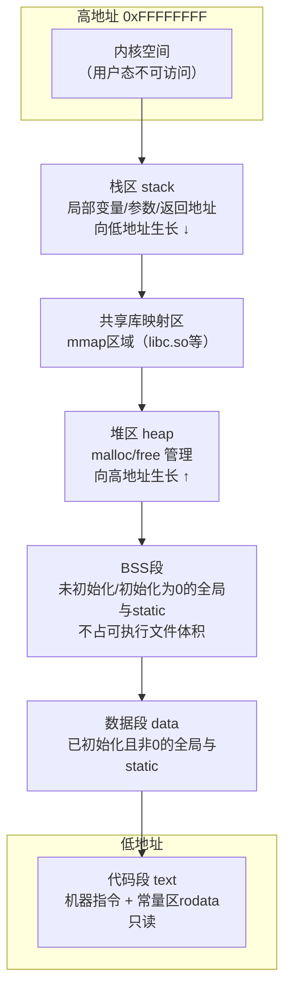
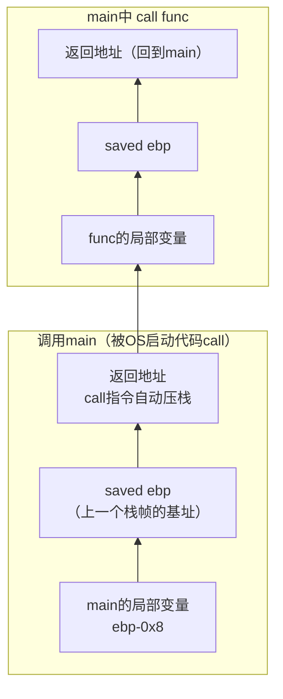
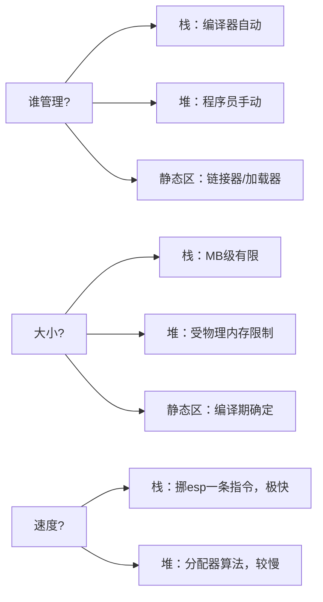

# 内存图

> 学C不看内存图，等于学医不看解剖图。本文是整个知识库的地基。

## 进程内存分区全景

一个C程序被加载进内存后（以32位Linux典型布局为例，地址从上往下看）：



| 分区 | 存放内容 | 管理者 | 生命周期 |
| --- | --- | --- | --- |
| **text 代码段** | 机器指令、字符串常量等只读数据(rodata) | OS加载器 | 程序运行期间 |
| **data 数据段** | 已初始化（非0）的全局/static变量 | 编译期定址 | 程序运行期间 |
| **bss 段** | 未初始化或初始化为0的全局/static | 加载时清零 | 程序运行期间 |
| **heap 堆** | malloc/calloc/realloc 分配 | 程序员手动 | malloc到free |
| **stack 栈** | 局部变量、形参、返回地址、寄存器现场 | 编译器自动 | 函数调用期间 |

## 验证实验

```c
#include <stdio.h>
#include <stdlib.h>

int g_init = 100;        /* data 段 */
int g_uninit;             /* bss  段 */
static int s_val = 5;     /* data 段（不导出符号） */

int main(void)
{
    int local = 1;                            /* 栈 */
    static int s_local = 0;                   /* bss  */
    int *heap = malloc(sizeof(int) * 4);      /* 堆  */
    char *str = "hello";                      /* 字符串本体在 rodata，str 在栈 */

    printf("代码区(函数地址) : %p\n", (void *)main);
    printf("常量区(字符串)   : %p\n", (void *)str);
    printf("data  (g_init)   : %p\n", (void *)&g_init);
    printf("bss   (g_uninit) : %p\n", (void *)&g_uninit);
    printf("栈    (local)    : %p\n", (void *)&local);
    printf("栈static(s_local): %p\n", (void *)&s_local);
    printf("堆    (malloc)   : %p\n", (void *)heap);

    free(heap);
    return 0;
}
```

典型输出（地址因 ASLR 随机化而不同，但**相对大小关系不变**）：

```text
代码区(函数地址) : 0x00401150   ← 最低
常量区(字符串)   : 0x00405004
data  (g_init)   : 0x0040a000
bss   (g_uninit) : 0x0040a014
堆    (malloc)   : 0x01e2b2a0
栈    (local)    : 0x7ffd1c3a   ← 最高（比堆高了一大截）
栈static(s_local): 0x0040a020   ← static局部变量不在栈！
```

## 栈区详解

### 栈帧（Stack Frame）

每次函数调用都在栈上开辟一块**栈帧**：



关键寄存器：

* `esp/rsp`：栈顶指针，永远指向栈顶（低地址端）
* `ebp/rbp`：栈帧基址，函数内通过 `ebp±偏移` 稳定访问局部变量和参数

函数序言/尾声的固定套路：

```asm
func:
    push ebp          ; 保存调用者的ebp
    mov  ebp, esp     ; 建立新栈帧基址
    sub  esp, 16      ; 为局部变量开辟空间
    ...               ; 函数体，用 ebp-4 / ebp-8 访问局部变量
    mov  esp, ebp     ; 回收局部变量空间（leave的低半）
    pop  ebp          ; 恢复调用者ebp（leave的高半）
    ret               ; 弹出返回地址并跳回
```

### 栈的三个事实

1. **生长方向**：向低地址生长（x86/x86-64主流平台）。`esp` 减小 = 分配。
2. **自动回收**：函数 `ret` 后整个栈帧"作废"——但数据还在，只是不再受保护，这就是**悬垂指针/返回局部变量地址**能"碰巧读到值"的原因。
3. **大小有限**：Linux默认通常 8MB。递归过深 → 栈溢出（段错误）。

```bash
ulimit -s          # 查看栈大小
ulimit -s unlimited
```

## 堆区详解

```c
int *p = (int *)malloc(100);   /* 在堆上申请100字节 */
free(p);                       /* 归还 */
```

* 堆向**高地址**生长（`brk`/`mmap` 系统调用扩展）
* 由**分配器**（ptmalloc等）管理：可用块链表、头部元数据、合并空闲块
* 忘记 free = **内存泄漏**；free 后继续用 = **悬垂指针**（use-after-free）
- 详见[内存管理](内存管理.md)

## 静态存储区（data + bss）

```c
int a = 1;         /* data：占可执行文件4字节 */
int b = 0;         /* bss ：不占文件体积，加载时清零 */
int c;             /* bss */
```

用 `size` 命令直接观察：

```text
$ gcc mem.c -o mem && size mem
   text    data     bss     dec     hex filename
   1620     600      12    2232     8b8 mem
```

> 逆向提示：IDA/OD 中 .data/.bss 的内容是**静态分析全局变量的关键**；未初始化全局变量在文件里只有地址没有内容。

## 各区对比速记



## 一图流：定义放置练习

判断下表中每个对象落在哪里：

| 代码 | 区域 |
| --- | --- |
| `char *p = "abc";` 中的 `"abc"` | rodata（常量区） |
| `char arr[] = "abc";` 中的 `arr` | 栈（拷贝了内容） |
| `int a = 10;`（函数内） | 栈 |
| `static int a;`（函数内） | bss |
| `int g = 5;`（函数外） | data |
| `malloc(16)` 返回的内存 | 堆 |
| `main` 函数的机器码 | text |
| `char *p = "abc";` 中的 `p` | 栈 |

## 延伸

* [常量区](常量区.md) —— rodata 深入
* [函数](函数.md) —— 栈帧逐指令推演
* [内存管理](内存管理.md) —— 堆分配器
* [内存对齐与位域](内存对齐与位域.md)
