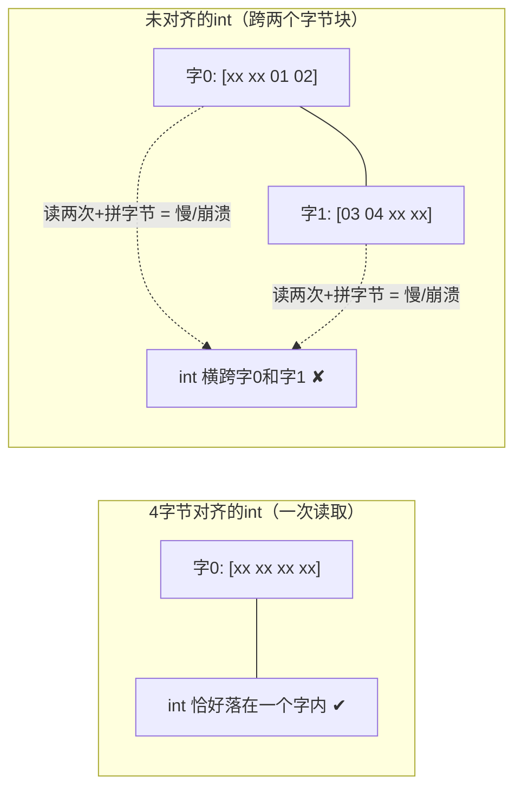
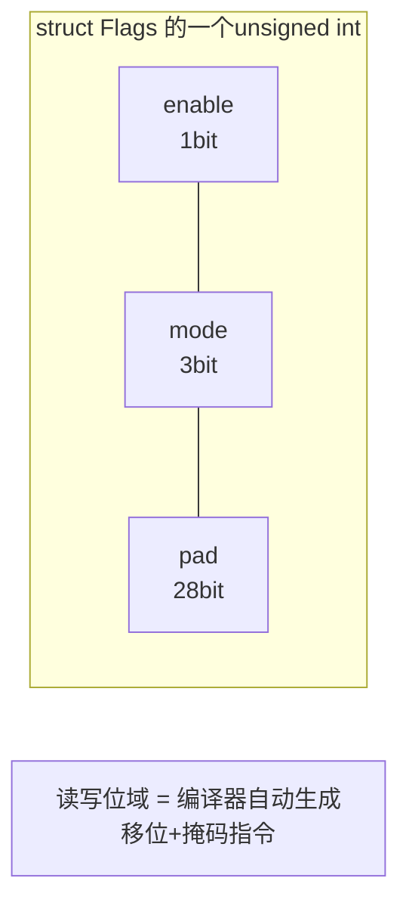

# 内存对齐与位域

## 为什么需要对齐

CPU访问内存不是逐字节的，而是按**字长（word）块**读取。如果数据横跨两个块，就需要两次访问再拼接——慢；某些架构（老ARM、SPARC等）**直接总线错误**：



对齐的三大理由：

1. **性能**：对齐访问单周期完成；未对齐在x86上可用但慢（跨缓存行更惨）；
2. **原子性**：对齐的1/2/4/8字节读写天然是原子的（多线程/信号安全的基石）；
3. **硬件要求**：某些CPU的SIMD指令（movaps）要求16字节对齐，未对齐直接异常。

## 对齐规则（两条）

1. **成员对齐**：每个成员的偏移量必须是 `min(成员自身对齐值, #pragma pack值)` 的整数倍，不足则前面补padding；
2. **整体对齐**：结构体总大小必须是 `最宽成员对齐值` 的整数倍（尾部可能补padding），保证数组里每个元素都对齐。

成员"自然对齐值"= 自身大小（`int`=4，`double`=8；指针=平台位数4/8）。

## 计算实战

```c
struct A {
    char  a;     /* 偏移0，占1 */
                   /* padding 3字节：让b对齐到4 */
    int   b;     /* 偏移4，占4 */
    char  c;     /* 偏移8，占1 */
                   /* padding 3字节：总大小须为4的倍数 */
};
sizeof(struct A);       /* 12，不是6！ */
```

逐格画内存：

```text
偏移:  0    1    2    3    4    5    6    7    8    9   10   11
      [a ] [pad] [pad] [pad] [  b - 4字节  ] [c ] [pad][pad][pad]
```

调整声明顺序消除空洞：

```c
struct B {          /* 按大小降序排列 */
    int   b;        /* 偏移0..3 */
    char  a;        /* 偏移4 */
    char  c;        /* 偏移5 */
                        /* 尾部padding 2 */
};
sizeof(struct B);   /* 8 —— 同样的成员，省了4字节 */
```

**工程结论：结构体成员按大小从大到小排，是最便宜的性能优化。**

再练两题：

```c
struct C {
    char  c1;     /* 偏移0 */
    double d;     /* 需要对齐8 → 偏移8（c1后补7） */
    char  c2;     /* 偏移16 */
};                /* 最宽成员8 → 总大小须是8的倍数 → 24（尾部补7） */

struct D {
    char  buf[9]; /* 偏移0..8（数组对齐取元素对齐=1） */
    int   i;      /* 对齐4 → 偏移12（补3） */
};                /* 总大小16 */
```

## offsetof：亲手测量

```c
#include <stddef.h>
offsetof(struct A, b);    /* 4：b 的偏移量 */
offsetof(struct A, c);    /* 8 */
/* 实现原理：把NULL当结构体指针用（编译期技巧） */
#define my_offsetof(type, m) ((size_t)&(((type *)0)->m))
```

`_Alignof(T)`（C11）查询类型的对齐要求：

```c
_Alignof(int);      /* 4 */
_Alignof(double);   /* 8 */
_Alignof(char);     /* 1 */
```

`_Alignas(N)`（C11）显式指定对齐：

```c
struct E {
    _Alignas(16) char buf[16];   /* 强制16字节对齐（SIMD缓冲区标配） */
};
```

## #pragma pack：打包（取消对齐）

协议解析/网络传输需要"紧凑无空洞"的内存布局：

```c
#pragma pack(push, 1)    /* 保存当前设置，改1字节对齐 */
struct Packet {
    char  type;      /* 偏移0 */
    int   len;       /* 偏移1 —— 无padding！ */
    short crc;       /* 偏移5 */
};                   /* sizeof = 7（完全紧凑） */
#pragma pack(pop)     /* 恢复 */

/* gcc 也可用 __attribute__((packed)) */
struct Packet2 {
    char type;
    int  len  __attribute__((packed));
    short crc __attribute__((packed));
};
```

**packed 的代价**：未对齐成员的访问变慢；对其取指针再间接访问在部分平台是UB。**packed 只用于"内存即数据"（收发报文、读文件格式），不要用于"内存即计算"的场景**。

```c
/* 经典应用：把网络字节流直接映射成结构体 */
struct Packet pkt;
recv(fd, &pkt, sizeof pkt, 0);   /* sizeof=7，与线上格式逐字节一致 */
```

## 位域（bit-field）

在结构体里按**位**切成员——协议头/寄存器/状态标志的利器：

```c
struct IPHeader {
    unsigned int version  : 4;   /* 4 bit */
    unsigned int ihl      : 4;
    unsigned int tos      : 8;
    unsigned int total_len : 16;
    /* 上四位域共32bit → 打包进一个unsigned int，偏移0 */
};

struct Flags {
    unsigned int enable : 1;     /* 单bit开关 */
    unsigned int mode   : 3;     /* 0~7 */
    unsigned int pad    : 28;
};
struct Flags f = {0};
f.enable = 1;
f.mode = 5;
```

**位域规则要点**：

1. 位域成员必须是整型（unsigned/signed int；C99后_Bool也行；实现可扩展允许其他整型）；
2. 总位宽不能超过类型位宽，跨不过去的进下一个存储单元；
3. **位序（从低位还是高位开始排）由实现决定**——跨平台代码不要依赖位域的物理布局！网络协议仍需手工移位；
4. 不能对位域取地址（`&f.mode` ✘，它不是整字节）；
5. 单bit的signed位域只有0和-1（没有1！）——**位域一律用unsigned**。



汇编视角：`f.mode = 5` 编译成"读4字节 → 掩码清目标位 → 移位置入 → 写回"，位域只是**编译器帮你写的位运算**（见[位运算](位运算.md)）。

## 位域 vs 手工位运算

| 对比 | 位域 | 手工位运算 |
| --- | --- | --- |
| 可读性 | ✔ 成员名清晰 | 需要掩码注释 |
| 跨平台布局 | ✘ 实现定义 | ✔ 完全可控 |
| 可移植协议解析 | 不推荐 | **标准做法** |
| 寄存器映射（单平台） | ✔ 嵌入式标配 | 啰嗦 |
| 取地址 | ✘ | ✔ |

```c
/* 跨平台协议解析的正确姿势：手工移位，与位域彻底解耦 */
uint32_t v;
unsigned version = (v >> 28) & 0xF;
unsigned ihl     = (v >> 24) & 0xF;
```

## 弹性组合：union + 位域（寄存器全景）

```c
typedef union {
    uint32_t all;                    /* 整体读写 */
    struct {
        uint32_t enable  : 1;
        uint32_t dir     : 1;
        uint32_t speed   : 2;
        uint32_t reserved: 28;
    } bits;                          /* 分位读写 */
} GPIO_CR;
```

详见[联合类型](联合类型.md)。

## 小结

1. 对齐两规则：成员偏移对齐自身大小；总大小对齐最宽成员；
2. `struct{char,int,char}` = 12 字节；**成员按大小降序排**省内存；
3. `#pragma pack(1)` 打包成7字节，代价是性能/兼容，仅用于内存即数据场景；
4. `_Alignof/_Alignas`（C11）查询/指定对齐；`offsetof` 测偏移；
5. 位域=编译器代劳的位运算，布局实现定义——**跨平台协议靠手工移位，单平台寄存器用位域**。
