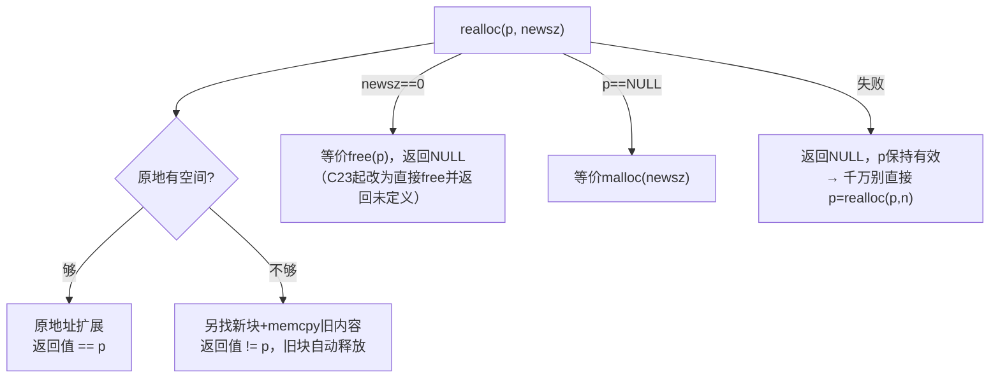
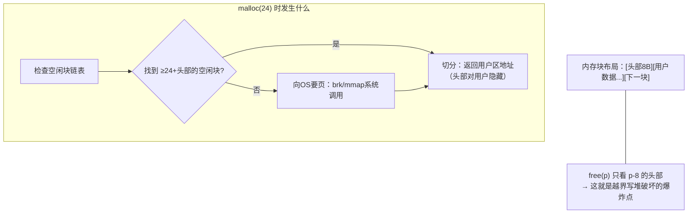
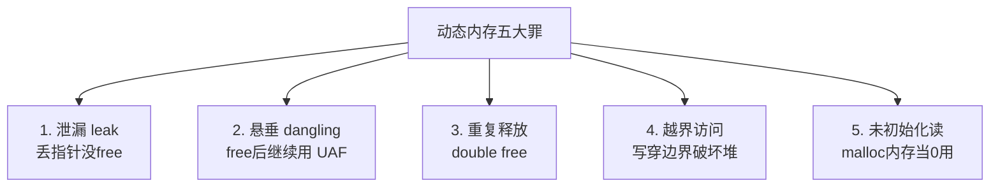

# 内存管理

## 为什么需要动态内存

栈内存三大限制：**编译期定死大小、随函数销毁、容量小（MB级）**。动态内存（堆）打破三者：

```c
/* 需求：用户运行时才输入元素个数 */
int n;
scanf("%d", &n);
int *arr = malloc(n * sizeof(int));   /* 运行期决定大小 ✔ */
/* 栈上 int arr[n]（VLA）也能做，但受栈大小限制且C11可选 */
```

## 四个核心函数（stdlib.h）

| 函数 | 原型 | 行为 |
| --- | --- | --- |
| `malloc` | `void *malloc(size_t size)` | 申请size字节，**不清零** |
| `calloc` | `void *calloc(size_t n, size_t size)` | 申请n*size字节，**清零** |
| `realloc` | `void *realloc(void *p, size_t size)` | 调整大小，**内容保留**，可能搬家 |
| `free` | `void free(void *p)` | 释放；`free(NULL)` 合法且无操作 |

```c
/* malloc：失败返回NULL，必须检查！ */
int *a = malloc(16 * sizeof(int));
if (a == NULL) { perror("malloc"); return -1; }
/* ...用完... */
free(a);
a = NULL;                      /* 防悬垂的标准动作 */

/* calloc：分配+清零一步到位（指针成员自动NULL） */
struct Node *n = calloc(1, sizeof(struct Node));   /* n->next == NULL ✔ */

/* realloc：扩容/缩容 */
int *b = realloc(a, 64 * sizeof(int));
if (b == NULL) { /* a 仍有效！可继续用或释放 */ }
else { a = b; }                /* 成功后 a 指向新块（可能已搬家） */
```

`realloc` 的三种结局（必须掌握）：



**头号雷区**：

```c
p = realloc(p, new_size);     /* ✘ 失败时原p泄漏（NULL覆盖了旧指针） */

/* ✔ 正确姿势 */
int *tmp = realloc(p, new_size);
if (tmp != NULL) p = tmp;
```

## 堆分配器原理一瞥

malloc 背后（ptmalloc/jemalloc/tcmalloc）大致如此：



推论：

1. `malloc(0)` 可能返回非NULL（或NULL，实现定义）；
2. `free` 的地址必须是 malloc 系列返回的**原样地址**——`free(p+1)` 直接崩溃（头部找不到）；
3. 越界写踩到相邻块头部 → **堆损坏**，崩溃点常在"不相干的 malloc/free"（最难查的BUG）；
4. 频繁小块分配慢（分配器开销）→ 内存池/对象池。

## 五大经典错误



```c
/* 1. 内存泄漏 */
void leak(void) {
    int *p = malloc(100);
}                        /* p 出作用域，100字节再也无法释放 */

/* 2. 悬垂指针 use-after-free */
int *p = malloc(sizeof(int));
free(p);
*p = 42;                 /* 💥 UAF：块可能已被再分配给别人 */

/* 3. double free */
free(p);
free(p);                 /* 💥 分配器状态机错乱 → crash（glibc报"double free or corruption"） */

/* 4. 越界 */
int *q = malloc(4 * sizeof(int));
for (int i = 0; i <= 4; i++) q[i] = 0;   /* q[4] 踩了下一块的头部 */

/* 5. 未初始化读 */
int *r = malloc(sizeof(int));
if (*r == 0) { }         /* 💥 值不确定！要清零用 calloc */
```

**工具链**（必会）：

```bash
# Valgrind：泄漏+越界+UAP 全查（慢但全）
valgrind --leak-check=full ./app

# AddressSanitizer：编译期插桩，快且准
gcc -fsanitize=address -g app.c -o app && ./app

# 编译期警告
gcc -Wall -Wextra ...
```

## 检测工具对照

| 工具 | 抓什么 | 代价 |
| --- | --- | --- |
| Valgrind | 泄漏、越界、UAF、double free | 慢10~30倍 |
| ASan (`-fsanitize=address`) | 越界、UAF、double free | 慢2倍，生产可关 |
| UBSan (`-fsanitize=undefined`) | UB（越界移位、空指针等） | 几乎零开销 |
| `mtrace` (glibc) | 泄漏 | 需代码埋点 |

## 正确的内存管理范式

```c
/* 范式1：谁分配谁释放（分配函数配对free函数） */
char *read_file(const char *path);        /* 返回malloc的缓冲 */
void  free_buffer(char *buf);             /* 明确的释放接口 */
/* 调用者：buf = read_file(p); ... free_buffer(buf); */

/* 范式2：一次分配到位（减少次数与碎片） */
typedef struct {
    size_t len;
    int    data[];             /* 灵活数组成员：头+数据一锅端 */
} Vec;
Vec *v = malloc(sizeof(Vec) + n * sizeof(int));

/* 范式3：引用计数（复杂所有权） */
obj->refcnt++;                /* 借用 */
if (--obj->refcnt == 0) free(obj);   /* 归还时判零释放 */

/* 范式4：内存池（高频小对象） */
/* 先 malloc 一大块，自己切成小块用链表串起来，
   统一释放——游戏引擎/服务器的标准优化 */
```

**RAII心法（C版）**：每个 `malloc` 在写下的一刻，就确定它的 `free` 在哪——写不出配对路径的分配不要写。

## 常见笔试题

```c
/* 题1：malloc(0) 返回？ */
void *p = malloc(0);     /* 实现定义：NULL或唯一指针；两种都要能free */

/* 题2：下面的代码有什么错？ */
char *get(void) {
    char buf[32] = "hi";
    return buf;          /* ✘ 返回栈地址（悬垂），与malloc无关但常配套考 */
}

/* 题3：free(NULL)？ */
free(NULL);              /* 合法，无操作 —— 所以 free后置NULL 是完美防御 */

/* 题4：为什么 malloc 返回 void* ？ */
/* 分配器不知道用途；void* 可隐式转任意指针类型（类型由调用者决定） */
```

## 小结

1. malloc不清零（calloc清零）；**返回值必须判NULL**；
2. realloc 别写 `p = realloc(p, n)`——失败会丢原指针；
3. free 用原样地址；free 后置 NULL 防悬垂/double free；
4. 五大罪：泄漏、UAF、double free、越界、未初始化读；
5. 上线前 Valgrind/ASan 过一遍，是C项目的生存底线。
