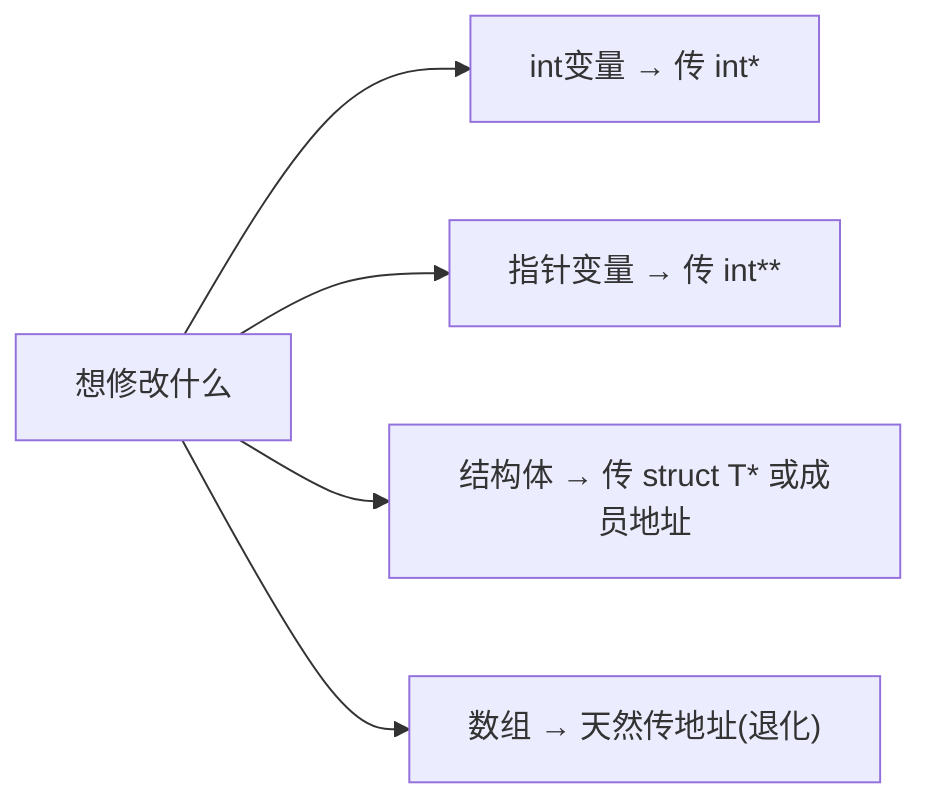
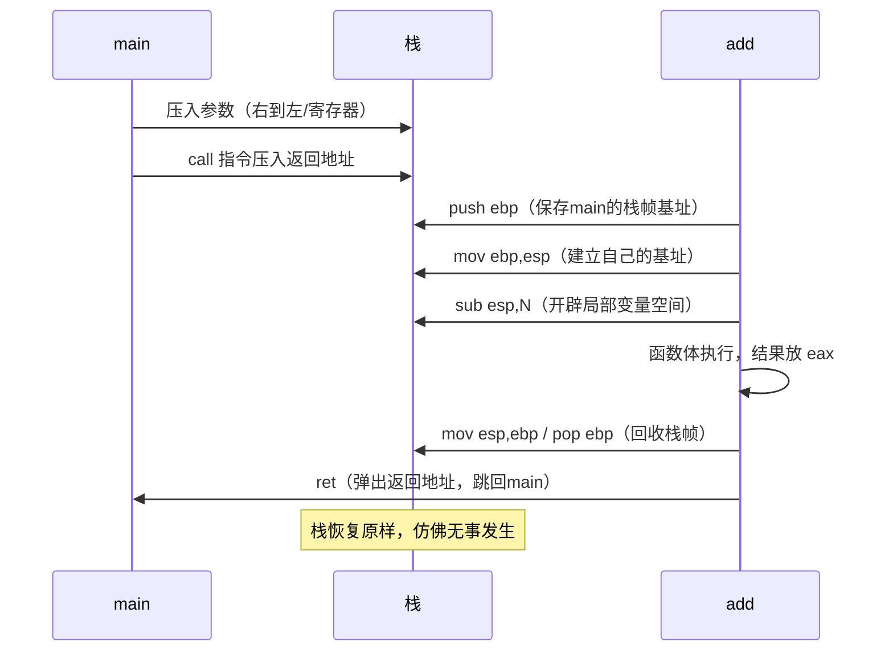
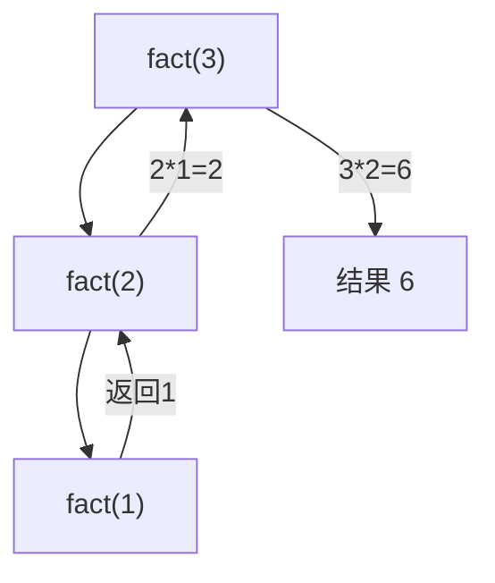

# 函数

## 函数的定义与声明

```c
/* 函数原型（声明）：告诉编译器"有这个函数"，通常放头文件 */
int add(int a, int b);

/* 定义：函数体实体 */
int add(int a, int b)
{
    return a + b;
}

/* 老式声明（已废弃） */
int add();          /* C中不写参数=不定参，并非无参！无参必须写(void) */
int add(void);      /* ✔ 明确无参 */
```

## 参数传递：C只有值传递

**传过去的是"值的拷贝"**，函数内改形参不影响实参：

```c
void change(int x) { x = 100; }

int a = 1;
change(a);
printf("%d", a);    /* 仍是1！x只是a的副本 */
```

**想让函数改外面的变量？传地址！** 这是C的通用解法：



```c
void swap(int *a, int *b)
{
    int t = *a; *a = *b; *b = t;
}

int x = 1, y = 2;
swap(&x, &y);       /* x=2, y=1 ✔ */

void swap_bad(int a, int b) { int t=a; a=b; b=t; }   /* 只交换副本，白忙 */
```

## 返回值

```c
/* 返回值通过寄存器 eax/rax 传回（够小时） */
int get(void) { return 42; }

/* 结构体较大时：隐藏参数模式——调用者传一块内存地址，被调者往里填 */
typedef struct { int a[100]; } Big;
Big make(void) { Big b = {0}; return b; }   /* 编译器生成 memcpy 式返回 */
```

**绝不能返回局部变量的地址/指针**（栈帧已回收，悬垂）：

```c
int *bad(void) { int x = 1; return &x; }    /* 💥 UB */

/* 正确姿势三选一 */
int *ok1(void) { static int x = 1; return &x; }        /* 静态区 */
int *ok2(void) { int *p = malloc(4); return p; }        /* 堆（调用者free） */
void ok3(int *out) { *out = 1; }                        /* 输出参数 */
```

## 调用过程全景：栈帧的生与死

`main` 调用 `add(1, 2)` 的完整时序：



32位 `__cdecl` 典型汇编（`add(1,2)`）：

```asm
; 调用方 main
    push 2
    push 1                  ; 参数从右到左压栈
    call add
    add  esp, 8             ; cdecl：调用方清理参数（平衡栈）
    mov  [result], eax      ; 接住返回值

; 被调方 add
    push ebp
    mov  ebp, esp           ; 新栈帧
    mov  eax, [ebp+8]       ; 参数1（ebp+8 = 第一个参数）
    add  eax, [ebp+12]      ; 参数2
    pop  ebp
    ret                     ; 返回值已在eax
```

栈帧内存布局（32位，从高到低）：

```text
高地址
  [参数2]         ebp+12
  [参数1]         ebp+8
  [返回地址]      ebp+4     ← call压入
  [saved ebp]     ebp       ← push ebp
  [局部变量]      ebp-4, ebp-8 ...
低地址 (esp指向这)
```

> **逆向黄金规律**：`[ebp+8]` 起是参数，`[ebp-4]` 起是局部变量。在OD/IDA里看到这个模式，函数边界、参数个数一目了然。

## 调用约定

| 约定 | 参数传递 | 清栈者 | 典型场景 |
| --- | --- | --- | --- |
| `__cdecl` | 栈，右→左 | 调用者 | **C默认**（可支持变参） |
| `__stdcall` | 栈，右→左 | 被调者 | Win32 API |
| `__fastcall` | 寄存器(ECX/EDX)+栈 | 被调者 | 性能敏感 |
| System V AMD64 | 前六个整型参数：rdi rsi rdx rcx r8 r9 | 调用者 | Linux x64 |
| Microsoft x64 | rcx rdx r8 r9 | 调用者 | Windows x64 |

> 变长参数（printf）只能用于调用者清栈的约定——因为只有调用者知道到底压了几个参数。

## 递归

函数调用自己。**每层递归有独立栈帧，各层局部变量互不干扰**：

```c
/* 阶乘：n! */
long fact(int n)
{
    if (n <= 1) return 1;        /* 基线条件：递归必须有的出口 */
    return n * fact(n - 1);      /* 递归条件 */
}

/* 斐波那契：朴素版是反面教材 O(2^n) */
long fib(int n) {
    if (n < 2) return n;
    return fib(n-1) + fib(n-2);  /* 重复计算爆炸 */
}
```



**递归的代价**：每层压栈。`fact(100000)` → 栈溢出（默认8MB栈）。编译器开 `-O2` 且递归是**尾递归**（return 的就是递归调用本身）时，可优化成循环（不压栈）：

```c
/* 尾递归形式：乘法结果作为参数传递 */
long fact_tail(int n, long acc)
{
    if (n <= 1) return acc;
    return fact_tail(n - 1, acc * n);   /* gcc -O2 会优化成循环 */
}
```

## main 函数完全体

```c
int main(void);                              /* 最简 */
int main(int argc, char *argv[]);            /* 接收命令行参数 */
int main(int argc, char *argv[], char *envp[]);  /* 扩展：环境变量（非标准但常见） */
```

* 返回值 `0` 表示成功（宏 `EXIT_SUCCESS`），非0失败（`EXIT_FAILURE`）；
* C99起 main 可不写 return（隐式返回0），但**建议显式写**；
* 真正调用 main 的是 C 运行时库（crt0），它还负责：初始化全局对象、准备env、`exit` 时调用 atexit 注册的清理函数。

## 内联与性能（C99 inline）

```c
static inline int square(int x) { return x * x; }
/* 编译器把调用点替换为函数体（无栈帧开销） */
/* 现代实践：小函数直接 static inline 放头文件；性能靠 -O2 优化 */
```

## C11 _Noreturn 与属性

```c
_Noreturn void fatal(void);   /* 声明"此函数永不返回"（exit/abort/死循环） */
```

## 函数设计原则

```c
/* 1. 单一职责：一个函数做一件事 */
/* 2. 参数守恒：只读参数加 const，输出用指针 */
void copy(int *dst, const int *src, size_t n);   /* dst写 src读，接口自解释 */

/* 3. 检查所有可能失败的输入 */
char *dup_lower(const char *s)
{
    if (s == NULL) return NULL;          /* 防御式编程 */
    ...
}

/* 4. 函数不超过一屏（约50行），圈复杂度别失控 */
```

## 小结

1. C只有**值传递**；改外部对象必须传地址；
2. 返回值走 `eax/rax`；大结构体走"隐藏指针"；
3. 栈帧：`[ebp+8]`=参数、`[ebp-4]`=局部变量——逆向看函数的第一反射；
4. 递归=栈帧叠加，基线条件是出口，深递归会爆栈，尾递归可被优化；
5. 不返回局部变量地址，main 的返回值就是进程退出码。
