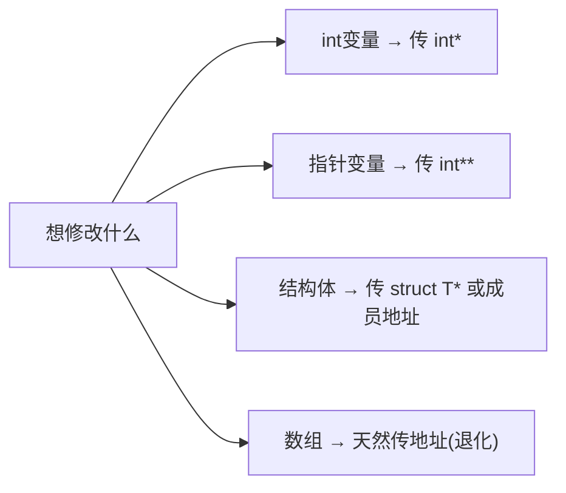
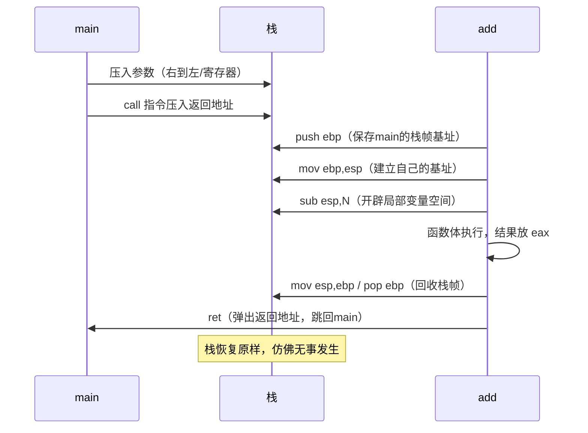
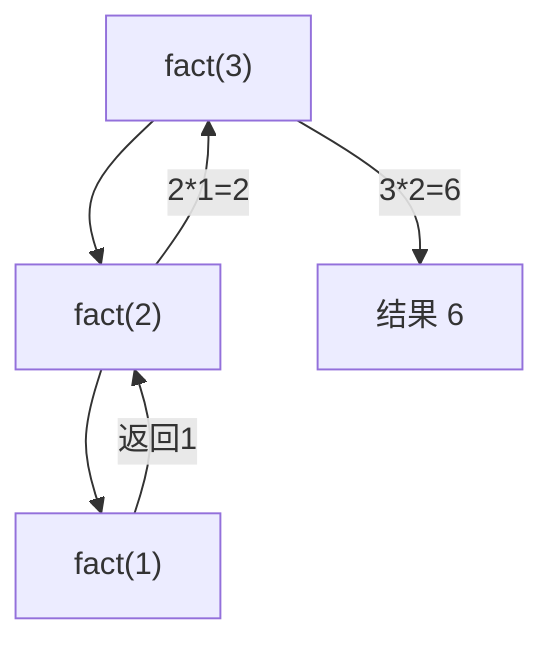
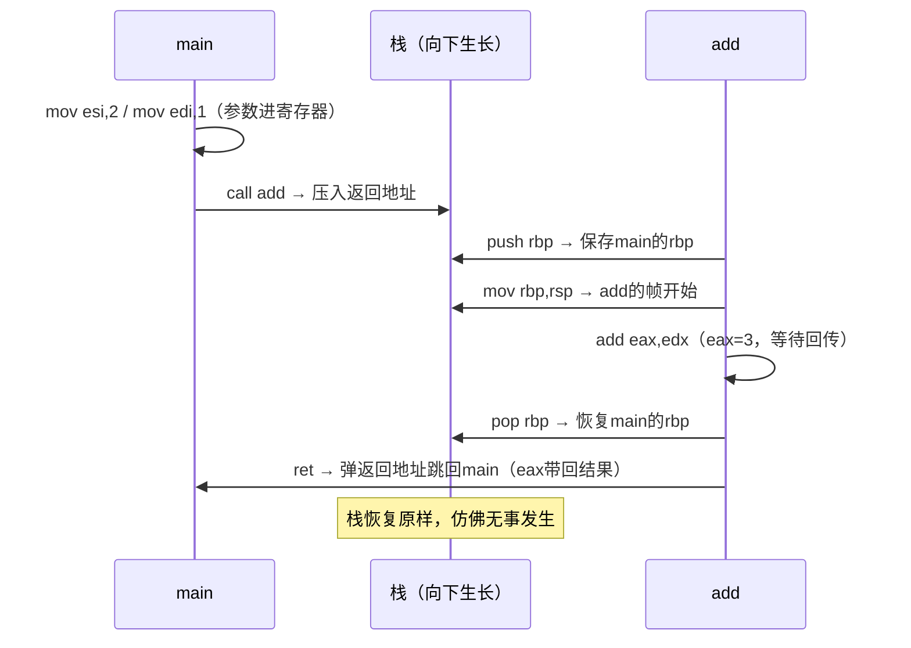

# 函数

## 函数的定义与声明

```c
/* 函数原型（声明）：告诉编译器"有这个函数"，通常放头文件 */
int add(int a, int b);

/* 定义：函数体实体 */
int add(int a, int b)
{
    return a + b;
}

/* 老式声明（已废弃） */
int add();          /* C中不写参数=不定参，并非无参！无参必须写(void) */
int add(void);      /* ✔ 明确无参 */
```

## 参数传递：C只有值传递

**传过去的是"值的拷贝"**，函数内改形参不影响实参：

```c
void change(int x) { x = 100; }

int a = 1;
change(a);
printf("%d", a);    /* 仍是1！x只是a的副本 */
```

**想让函数改外面的变量？传地址！** 这是C的通用解法：



```c
void swap(int *a, int *b)
{
    int t = *a; *a = *b; *b = t;
}

int x = 1, y = 2;
swap(&x, &y);       /* x=2, y=1 ✔ */

void swap_bad(int a, int b) { int t=a; a=b; b=t; }   /* 只交换副本，白忙 */
```

## 返回值

```c
/* 返回值通过寄存器 eax/rax 传回（够小时） */
int get(void) { return 42; }

/* 结构体较大时：隐藏参数模式——调用者传一块内存地址，被调者往里填 */
typedef struct { int a[100]; } Big;
Big make(void) { Big b = {0}; return b; }   /* 编译器生成 memcpy 式返回 */
```

**绝不能返回局部变量的地址/指针**（栈帧已回收，悬垂）：

```c
int *bad(void) { int x = 1; return &x; }    /* 💥 UB */

/* 正确姿势三选一 */
int *ok1(void) { static int x = 1; return &x; }        /* 静态区 */
int *ok2(void) { int *p = malloc(4); return p; }        /* 堆（调用者free） */
void ok3(int *out) { *out = 1; }                        /* 输出参数 */
```

## 调用过程全景：栈帧的生与死

`main` 调用 `add(1, 2)` 的完整时序：



32位 `__cdecl` 典型汇编（`add(1,2)`）：

```asm
; 调用方 main
    push 2
    push 1                  ; 参数从右到左压栈
    call add
    add  esp, 8             ; cdecl：调用方清理参数（平衡栈）
    mov  [result], eax      ; 接住返回值

; 被调方 add
    push ebp
    mov  ebp, esp           ; 新栈帧
    mov  eax, [ebp+8]       ; 参数1（ebp+8 = 第一个参数）
    add  eax, [ebp+12]      ; 参数2
    pop  ebp
    ret                     ; 返回值已在eax
```

栈帧内存布局（32位，从高到低）：

```text
高地址
  [参数2]         ebp+12
  [参数1]         ebp+8
  [返回地址]      ebp+4     ← call压入
  [saved ebp]     ebp       ← push ebp
  [局部变量]      ebp-4, ebp-8 ...
低地址 (esp指向这)
```

> **逆向黄金规律**：`[ebp+8]` 起是参数，`[ebp-4]` 起是局部变量。在OD/IDA里看到这个模式，函数边界、参数个数一目了然。

## 调用约定

| 约定 | 参数传递 | 清栈者 | 典型场景 |
| --- | --- | --- | --- |
| `__cdecl` | 栈，右→左 | 调用者 | **C默认**（可支持变参） |
| `__stdcall` | 栈，右→左 | 被调者 | Win32 API |
| `__fastcall` | 寄存器(ECX/EDX)+栈 | 被调者 | 性能敏感 |
| System V AMD64 | 前六个整型参数：rdi rsi rdx rcx r8 r9 | 调用者 | Linux x64 |
| Microsoft x64 | rcx rdx r8 r9 | 调用者 | Windows x64 |

> 变长参数（printf）只能用于调用者清栈的约定——因为只有调用者知道到底压了几个参数。

## 递归

函数调用自己。**每层递归有独立栈帧，各层局部变量互不干扰**：

```c
/* 阶乘：n! */
long fact(int n)
{
    if (n <= 1) return 1;        /* 基线条件：递归必须有的出口 */
    return n * fact(n - 1);      /* 递归条件 */
}

/* 斐波那契：朴素版是反面教材 O(2^n) */
long fib(int n) {
    if (n < 2) return n;
    return fib(n-1) + fib(n-2);  /* 重复计算爆炸 */
}
```



**递归的代价**：每层压栈。`fact(100000)` → 栈溢出（默认8MB栈）。编译器开 `-O2` 且递归是**尾递归**（return 的就是递归调用本身）时，可优化成循环（不压栈）：

```c
/* 尾递归形式：乘法结果作为参数传递 */
long fact_tail(int n, long acc)
{
    if (n <= 1) return acc;
    return fact_tail(n - 1, acc * n);   /* gcc -O2 会优化成循环 */
}
```

## main 函数完全体

```c
int main(void);                              /* 最简 */
int main(int argc, char *argv[]);            /* 接收命令行参数 */
int main(int argc, char *argv[], char *envp[]);  /* 扩展：环境变量（非标准但常见） */
```

* 返回值 `0` 表示成功（宏 `EXIT_SUCCESS`），非0失败（`EXIT_FAILURE`）；
* C99起 main 可不写 return（隐式返回0），但**建议显式写**；
* 真正调用 main 的是 C 运行时库（crt0），它还负责：初始化全局对象、准备env、`exit` 时调用 atexit 注册的清理函数。

## 内联与性能（C99 inline）

```c
static inline int square(int x) { return x * x; }
/* 编译器把调用点替换为函数体（无栈帧开销） */
/* 现代实践：小函数直接 static inline 放头文件；性能靠 -O2 优化 */
```

## C11 _Noreturn 与属性

```c
_Noreturn void fatal(void);   /* 声明"此函数永不返回"（exit/abort/死循环） */
```

## 函数设计原则

```c
/* 1. 单一职责：一个函数做一件事 */
/* 2. 参数守恒：只读参数加 const，输出用指针 */
void copy(int *dst, const int *src, size_t n);   /* dst写 src读，接口自解释 */

/* 3. 检查所有可能失败的输入 */
char *dup_lower(const char *s)
{
    if (s == NULL) return NULL;          /* 防御式编程 */
    ...
}

/* 4. 函数不超过一屏（约50行），圈复杂度别失控 */
```

## 实战：编译提取汇编逐行解析（真实输出）

> 以下汇编全部为**真实编译产物**，指令逐字来自 gcc 输出，`;` 注释为整理所加。提取流程见 `.opencode/skills/c-dev/SKILL.md`；环境噪音说明见[数组·实战](数组.md)。
> 实测环境：Ubuntu 24.04 / gcc 13.3.0 / x86-64（System V ABI）/ Intel 语法

### 实验1：一次调用的全景 —— 寄存器传参、栈帧生灭、eax 回传

```c
int add(int a, int b)
{
    int s = a + b;
    return s;
}
int main(void)
{
    int r = add(1, 2);
    return r + 3;        /* 6 → 实测退出码6 ✔ */
}
```

```asm
add:
    endbr64
    push    rbp                      ; ① 保存调用者的rbp
    mov     rbp, rsp                 ; ② 建立自己的栈帧基址
    mov     DWORD PTR -20[rbp], edi  ; ③ 参数a（从edi搬到栈槽[rbp-20]）
    mov     DWORD PTR -24[rbp], esi  ; ④ 参数b（esi → [rbp-24]）
    mov     edx, DWORD PTR -20[rbp]  ; 取a
    mov     eax, DWORD PTR -24[rbp]  ; 取b
    add     eax, edx                 ; a+b
    mov     DWORD PTR -4[rbp], eax   ; s = 3（s住[rbp-4]）
    mov     eax, DWORD PTR -4[rbp]   ; ⑤ 返回值装入eax —— 返回值约定！
    pop     rbp                      ; ⑥ 恢复调用者rbp
    ret                               ; ⑦ 弹返回地址，跳回main

main:
    endbr64
    push    rbp
    mov     rbp, rsp
    sub     rsp, 16
    mov     esi, 2                   ; ★第2参数 → esi（寄存器传参，不压栈！）
    mov     edi, 1                   ; ★第1参数 → edi
    call    add                      ; call自动把返回地址压栈，跳进add
    mov     DWORD PTR -4[rbp], eax   ; r = 返回值（从eax接住）
    mov     eax, DWORD PTR -4[rbp]
    add     eax, 3                   ; r+3 = 6
    leave
    ret
```

调用时序（栈的生灭一图流）：



x86-64 System V 参数寄存器顺序（前6个整型参数）：**rdi, rsi, rdx, rcx, r8, r9**；返回值：**rax**。32位世界（cdecl）则是全部压栈、`[ebp+8]` 起取参——两代调用约定的分水岭。

### 实验2：第 7 个参数去哪了 —— 栈传参实锤

```c
int seven(int a, int b, int c, int d, int e, int f, int g)
{
    return a + b + c + d + e + f + g;    /* 28 */
}
int main(void) { return seven(1,2,3,4,5,6,7); }   /* 28 → 实测退出码28 ✔ */
```

```asm
seven:
    endbr64
    push    rbp
    mov     rbp, rsp
    mov     DWORD PTR -4[rbp], edi     ; 参数1 a
    mov     DWORD PTR -8[rbp], esi     ; 参数2 b
    mov     DWORD PTR -12[rbp], edx    ; 参数3 c
    mov     DWORD PTR -16[rbp], ecx    ; 参数4 d
    mov     DWORD PTR -20[rbp], r8d    ; 参数5 e
    mov     DWORD PTR -24[rbp], r9d    ; 参数6 f
    mov     edx, DWORD PTR -4[rbp]     ; —— 六个累加开始 ——
    mov     eax, DWORD PTR -8[rbp]
    add     edx, eax                   ; a+b
    ...（c/d/e/f 同款累加，略）
    mov     eax, DWORD PTR 16[rbp]     ; ★★参数7 g：从[rbp+16]读——栈上传来的！
    add     eax, edx                   ; +g
    pop     rbp
    ret

main:
    endbr64
    push    rbp
    mov     rbp, rsp
    push    7                          ; ★第7参数先压栈（在call之前！）
    mov     r9d, 6                     ; 参数6 → r9d
    mov     r8d, 5                     ; 参数5 → r8d
    mov     ecx, 4                     ; 参数4 → ecx
    mov     edx, 3                     ; 参数3 → edx
    mov     esi, 2                     ; 参数2 → esi
    mov     edi, 1                     ; 参数1 → edi
    call    seven
    add     rsp, 8                     ; ★调用者清理栈参数（对齐到16字节）
    leave
    ret
```

栈帧布局（seven 内部视角）：

| 槽位 | 内容 | 来源 |
| --- | --- | --- |
| `[rbp+16]` | **第7个及以后的参数** | 调用方 `push` |
| `[rbp+8]` | 返回地址 | call 自动压栈 |
| `[rbp+0]` | 保存的 rbp | push rbp |
| `[rbp-4 .. -24]` | 参数1~6 的栈槽拷贝 | 序言从寄存器搬下来 |

**`[rbp+16]` 是 x86-64 逆向的第一反射**（32位 cdecl 时代是 `[ebp+8]`）：IDA 里看到函数从 `[rbp+16]` 读东西，立即断定它至少有 7 个参数。`add rsp,8` 也暴露了调用方传了几个栈参数——`rsp+N` 的 N 就是栈参数区大小。

### 实验3：递归的三副面孔 —— -O0 / -O1 / -O2 实测对比

```c
long fact(int n)                        /* 普通递归 */
{
    if (n <= 1) return 1;
    return n * fact(n - 1);
}
long fact_tail(int n, long acc)         /* 尾递归 */
{
    if (n <= 1) return acc;
    return fact_tail(n - 1, acc * n);
}
int main(void) { return (int)(fact(5) + fact_tail(5, 1)); }  /* 240 ✔ */
```

**-O0：真·递归 —— call 自己，栈帧层层叠加**：

```asm
fact:
    endbr64
    push    rbp
    mov     rbp, rsp
    push    rbx                     ; ★保存rbx——因为n要"活过"递归调用！
    sub     rsp, 24
    mov     DWORD PTR -20[rbp], edi ; n
    cmp     DWORD PTR -20[rbp], 1   ; n <= 1 ?
    jg      .L2
    mov     eax, 1                  ; 基线：return 1
    jmp     .L3
.L2:
    mov     eax, DWORD PTR -20[rbp]
    movsx   rbx, eax                ; ★n存进rbx（callee-saved，call不会破坏）
    mov     eax, DWORD PTR -20[rbp]
    sub     eax, 1
    mov     edi, eax                ; 参数 = n-1
    call    fact                    ; ★★递归调用——再压一个栈帧！
    imul    rax, rbx                ; 返回后：n × fact(n-1)（rbx里的n还活着）
.L3:
    mov     rbx, QWORD PTR -8[rbp]  ; 恢复rbx
    leave
    ret
```

看点：**n 必须在 `call fact` 之后依然可用**，所以它被放进 callee-saved 的 `rbx`（普通寄存器 rax/rcx/rdx 都会被子调用毁掉）——递归与调用约定联手的经典场景。每层递归压一次帧，`fact(100000)` 就是这么把 8MB 栈撑爆的。

**-O1：fact_tail 变成"尾调用"形态（call 后紧跟 ret）**：

```asm
fact_tail:
    endbr64
    mov     rax, rsi                ; acc
    cmp     edi, 1
    jle     .L12
    sub     rsp, 8                  ; 对齐
    movsx   rax, edi
    imul    rsi, rax                ; 新acc = acc*n
    sub     edi, 1                  ; 新n
    call    fact_tail               ; ★尾调用：call完直接ret，无后事要办
    add     rsp, 8
    ret
.L12:
    ret
```

**-O2：gcc 直接把两个递归都消成循环 —— 一个 call 都不剩！**

```asm
fact:                                ; 普通递归也被"递归消除"成循环！
    endbr64
    mov     edx, 1                  ; acc = 1
    cmp     edi, 1
    jle     .L1
    movsx   rcx, edi                ; i = n
    ...
.L4:
    imul    rdx, rcx                ; acc *= i   ← 循环体，没有call！
    mov     rcx, rax                ; i--
    cmp     rax, rsi
    jne     .L4                     ; 循环回跳
.L1:
    mov     rax, rdx
    ret
                                    ; fact_tail 同样被消成循环（形态几乎相同）

main:                               ; -O2：连main都直接算完了
    endbr64
    mov     eax, 240
    ret
```

三副面孔的启示：

| 优化等级 | fact（普通递归） | fact_tail（尾递归） |
| --- | --- | --- |
| -O0 | 真递归，层层压栈 | 真递归 |
| -O1 | 真递归 | 尾调用形态（call+ret紧邻） |
| -O2 | **递归消除：变循环** | 变循环 |

1. **"递归慢/会爆栈"只对未优化的代码成立**——现代编译器能把满足模式的递归彻底改写成循环（零栈增长）；
2. 但这是**编译器的恩赐不是语言的保证**：形状不满足模式（如 `n*fact(n-1)` 的复杂变换gcc也处理了，但更复杂的就不行）、或可移植性要求高的代码，别指望一定被消除；
3. 逆向时在二进制里看到 `imul`+回跳循环，源码可能是 for 也可能是被消除的递归——**优化后的二进制会"说谎"**。

### 汇编视角总结表（全部实测）

| C概念 | 机器形态 |
| --- | --- |
| 函数定义 | 一段带符号地址的指令 + 序言(push rbp/mov rbp,rsp) + 尾声(pop rbp/ret) |
| 参数（前6个整型） | rdi, rsi, rdx, rcx, r8, r9 |
| 参数（第7个起） | 调用方push → 被调方从 `[rbp+16]` 起 |
| 返回值 | eax/rax（大结构体走隐藏指针，见[结构体](结构体.md)） |
| 调用 | call（压返回地址+跳转）/ ret（弹出+跳回） |
| 递归 | call自己；活过调用的局部值放callee-saved寄存器(rbx) |
| 尾递归（-O1） | call后紧跟ret；(-O2)被消除成循环 |
| void函数 | 不设eax直接ret（返回值寄存器内容是垃圾，调用方不该读） |

## 小结

1. C只有**值传递**；改外部对象必须传地址；
2. 返回值走 `eax/rax`；大结构体走"隐藏指针"；
3. 栈帧：x86-64下 `[rbp+16]`=栈传参数起点（32位cdecl是`[ebp+8]`）、`[rbp-4]`起=局部变量——逆向看函数的第一反射；
4. 递归=栈帧叠加，基线条件是出口，深递归会爆栈，尾递归可被优化——实测-O2连普通递归都可能被消成循环；
5. 不返回局部变量地址，main 的返回值就是进程退出码。
