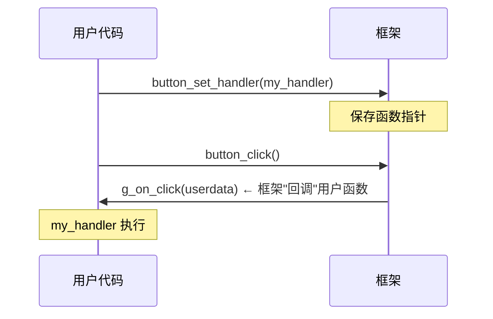
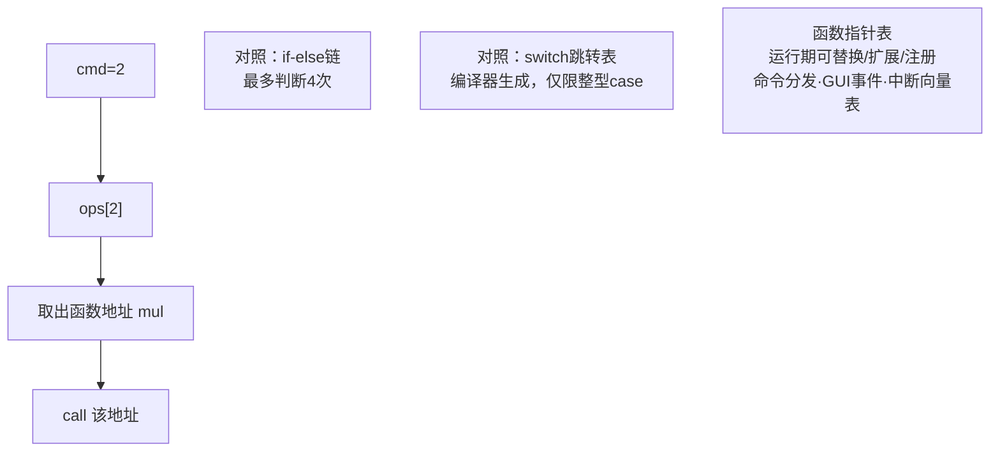

# 函数指针

## 函数名也是地址

函数编译后是一段机器码，函数名就是**那段代码的首地址**（代码段text里的一个符号）：

```asm
add:
    lea  eax, [rdi + rsi]    ; add 的代码
    ret
...
    mov  rsi, 2
    mov  rdi, 1
    call add                 ; call 的目标立即数/寄存器 = add的地址
```

**函数指针 = 存放函数地址的变量**。有了它，"调用谁"就能**运行期决定**——这是C一切多态、回调、插件机制的地基。

## 语法：三步看懂

```c
int add(int a, int b) { return a + b; }

/* 1. 声明函数指针变量 */
int (*fp)(int, int) = add;      /* (*fp) 是"指针"，指向 int(int,int) 型函数 */

/* 2. 调用（两种写法完全等价） */
fp(1, 2);                       /* 简洁式 */
(*fp)(1, 2);                    /* 课本式：*fp 是函数，加()调用 */

/* 3. 取地址（两种也都对） */
fp = add;                       /* 函数名即地址（同数组名） */
fp = &add;                      /* 显式取地址，结果一样 */

/* 函数名不是变量：可赋给指针、但不存在"函数名++" */
```

**为什么必须带括号**：`(*fp)` 的 `()` 把 `*` 和 `fp` 先绑定为指针；不写括号 `int *fp(int,int)` 是"返回int*的函数声明"——完全另一个东西（见[优先级](优先级.md)）。

## typedef：可读性救星

```c
/* 原始形态（可读性灾难） */
int (*handler)(int, void *);            /* 变量声明 */
void register_cb(int (*cb)(int, void *));   /* 参数里套函数指针 */
int (*table[4])(int, int);              /* 函数指针数组 */

/* typedef 之后：一切清爽 */
typedef int (*Handler)(int, void *);
Handler h;                              /* 变量 */
void register_cb(Handler cb);           /* 参数 */
Handler table[4];                       /* 数组 */
```

工程铁律：**函数指针出现两次以上的代码，必须typedef**。

## 用途一：回调函数（callback）

"把我的函数交给你，合适的时候你来调我"：

```c
#include <stdio.h>
#include <stdlib.h>

/* 模拟按钮点击：框架方持有回调指针 */
typedef void (*ClickHandler)(void *userdata);

static ClickHandler g_on_click = NULL;
static void *g_userdata = NULL;

void button_set_handler(ClickHandler h, void *ud) {
    g_on_click = h;  g_userdata = ud;
}
void button_click(void) {
    if (g_on_click != NULL)          /* 调用前必判空！ */
        g_on_click(g_userdata);      /* 框架不知道会执行什么 */
}

/* 用户方：注册自己的行为 */
void my_handler(void *ud) {
    printf("clicked! count=%d\n", (*(int *)ud)++);
}

int main(void)
{
    int count = 0;
    button_set_handler(my_handler, &count);
    button_click();      /* clicked! count=0 */
    button_click();      /* clicked! count=1 */
    return 0;
}
```



**C标准库里的回调现场**：

```c
/* qsort：比较策略由调用者注入 → 同一个函数排任意类型 */
int cmp_int(const void *a, const void *b)
{
    return (*(const int *)a - *(const int *)b);  /* 负=a前 正=b前 0=相等 */
}
int arr[] = {5, 2, 9, 1, 7};
qsort(arr, 5, sizeof(int), cmp_int);
/* arr → 1 2 5 7 9；换个cmp就能倒序/按字符串排/按结构体成员排 */
```

```c
/* bsearch：同款回调 */
void *found = bsearch(&key, arr, 5, sizeof(int), cmp_int);
```

## 用途二：跳转表（转移表）

消灭 if-else 链 / switch：**把函数地址排成数组，用下标直接"跳"**：

```c
#include <stdio.h>

int add(int a, int b) { return a + b; }
int sub(int a, int b) { return a - b; }
int mul(int a, int b) { return a * b; }
int divide(int a, int b) { return b ? a / b : 0; }

int main(void)
{
    /* 函数指针数组：下标即命令 */
    int (*ops[4])(int, int) = { add, sub, mul, divide };

    int a = 10, b = 3, cmd;
    printf("cmd(0+,1-,2*,3/): ");
    scanf("%d", &cmd);

    if (cmd < 0 || cmd > 3) {          /* 越界检查：跳转表的命门 */
        printf("bad cmd\n");
        return 1;
    }
    printf("%d\n", ops[cmd](a, b));    /* 一行完成分发 */
    return 0;
}
```



> 这就是**中断向量表、GUI消息循环、shell命令表**的统一原理。操作系统启动时把中断号→处理函数的映射放在一张表里，硬件触发时直接按号索引调用——**没有函数指针就没有现代操作系统**。

## 用途三：插件/动态加载

```c
/* dlopen/dlsym (POSIX)：运行期加载 .so 并取函数地址 */
#include <dlfcn.h>

void *h = dlopen("./plugin.so", RTLD_NOW);
int (*encode)(const char *) = dlsym(h, "encode");
int r = encode("hello");
dlclose(h);
/* gcc main.c -ldl —— 插件架构（Vim、Nginx模块、CRIU...）全靠这套机制 */
```

## 用途四：结构体内嵌函数指针（"C面向对象"）

```c
/* 把"方法"塞进结构体 —— Linux内核VFS的经典玩法 */
typedef struct File {
    const char *name;
    int  (*read)(struct File *self, char *buf, int n);   /* "虚函数" */
    int  (*write)(struct File *self, const char *buf, int n);
} File;

/* 不同"驱动"提供不同实现 → 同一接口不同行为 = 多态 */
int disk_read(File *self, char *buf, int n)  { /* 真实磁盘逻辑 */ return n; }
int pipe_read(File *self, char *buf, int n)  { /* 管道逻辑 */ return 0; }

File f = { .name = "sda", .read = disk_read };
f.read(&f, buf, 100);        /* 调到 disk_read —— 这就是"对象方法调用" */
```

## 陷阱清单

```c
/* 1. 调用未初始化的函数指针 → 跳到野地址执行，SIGSEGV/SIGILL */
Handler h;
h();                      /* 💥 */

/* 2. 签名不匹配的强转调用 → 栈布局错乱，UB */
int (*bad)(void) = (int (*)(void))add;   /* add(int,int) */
bad();                    /* 💥 寄存器/栈里没有参数 */

/* 3. 返回栈上回调捕获悬垂数据 */
void set_cb(void) {
    int local = 0;
    register_cb(my_handler, &local);   /* 💥 local 出作用域即悬垂 */
}

/* 4. 忘记判空 */
if (cb) cb(x);            /* ✔ 惯用判空 */

/* 5. C++里函数指针与lambda/重载的兼容性——C没有这问题，保持简单 */
```

## 从汇编看函数指针调用

```c
fp(1, 2);
```

```asm
    mov  edi, 1            ; 参数
    mov  esi, 2
    call [fp]              ; 间接调用：从fp变量里取地址去call
```

**与普通调用的唯一区别**：`call` 的目标是**从内存读出来的**（间接跳转），而非编译期常量。代价：多一次内存读 + CPU间接分支预测更难——高频路径上函数指针有真实开销（见[控制语句](控制语句-循环.md)的分支预测讨论）。

## 实战：编译提取汇编逐行解析（真实输出）

> 以下汇编全部为**真实编译产物**，指令逐字来自 gcc 输出，`;` 注释为整理所加。提取流程见 `.opencode/skills/c-dev/SKILL.md`；环境噪音说明见[数组·实战](数组.md)。
> 实测环境：Ubuntu 24.04 / gcc 13.3.0 / x86-64（System V ABI）/ Intel 语法

### 实验1：取函数地址与间接调用 —— lea 拿地址，call 寄存器

```c
int add(int a, int b) { return a + b; }
int sub(int a, int b) { return a - b; }

int apply(int (*op)(int, int), int x, int y)
{
    return op(x, y);                    /* 间接调用 */
}
int main(void)
{
    return apply(add, 10, 3) + apply(sub, 10, 3);   /* 13+7=20 → 实测退出码20 ✔ */
}
```

**-O0**：

```asm
apply:
    endbr64
    push    rbp
    mov     rbp, rsp
    sub     rsp, 16
    mov     QWORD PTR -8[rbp], rdi      ; 参数1：op（函数地址）——就是个8字节值
    mov     DWORD PTR -12[rbp], esi     ; x
    mov     DWORD PTR -16[rbp], edx     ; y
    mov     edx, DWORD PTR -16[rbp]     ; 第3参数 → edx
    mov     eax, DWORD PTR -12[rbp]     ; 第2参数 → eax
    mov     rcx, QWORD PTR -8[rbp]      ; ★取出函数地址 → rcx
    mov     esi, edx                    ; 摆参数：esi = y
    mov     edi, eax                    ; edi = x
    call    rcx                         ; ★★间接调用：call 寄存器！
    leave
    ret

main:
    ...
    mov     edx, 3                      ; y=3
    mov     esi, 10                     ; x=10
    lea     rax, add[rip]               ; ★取函数地址：lea（和取变量地址同一招！）
    mov     rdi, rax                    ; 第1参数 = add的地址
    call    apply
    mov     ebx, eax                    ; 结果存rbx（callee-saved，跨调用存活）
    mov     edx, 3
    mov     esi, 10
    lea     rax, sub[rip]               ; 第二次：换 sub 的地址
    mov     rdi, rax
    call    apply
    add     eax, ebx
    ...
```

三个关键观察：

1. **取函数地址 = `lea add[rip]`**——函数名和变量名一样是"符号地址"，lea 一视同仁；
2. **函数指针就是个8字节的值**：rdi 里传递、栈槽里存放，与 `long` 无异；
3. **`call rcx` 与 `call add` 的唯一区别**：目标地址从寄存器现取（间接），而非编译期立即数（直接）。

**-O2：apply 变成尾跳转，main 整个消失**：

```asm
apply:
    endbr64
    mov     rax, rdi            ; 目标函数地址
    mov     edi, esi            ; 参数左移：x→edi
    mov     esi, edx            ; y→esi
    jmp     rax                 ; ★尾调用变成 jmp（不再call+ret，零栈帧开销）

main:                            ; apply(add,10,3)+apply(sub,10,3)
    endbr64
    mov     eax, 20             ; ★★编译期全部算完——函数指针被"看穿"
    ret
```

**去虚化（devirtualization）**：编译器看清了传进 apply 的是常量 add/sub，直接内联求值——间接调用在优化器面前"透明"。这正是"函数指针有开销"只在冷路径成立的原因。

### 实验2：函数指针数组（跳转表）—— 与 switch 跳转表同宗同源

```c
int inc(int v) { return v + 1; }
int dec(int v) { return v - 1; }
int dbl(int v) { return v * 2; }
int neg(int v) { return -v;    }

int dispatch(int op, int v)
{
    static int (*table[4])(int) = { inc, dec, dbl, neg };  /* 跳转表 */
    if (op < 0 || op > 3)
        return -100;
    return table[op](v);
}
int main(void) { return dispatch(2, 6) + dispatch(0, 1); }  /* 12+2=14 ✔ */
```

**-O2 真实输出**：

```asm
dispatch:
    endbr64
    movsx   rax, edi                    ; op（符号扩展）
    mov     edi, esi                    ; v 提前放进edi——为目标函数备好参数
    cmp     eax, 3                      ; 越界检查
    ja      .L7                         ; 无符号比较防负数（与switch同款套路！）
    lea     rdx, table.0[rip]           ; 表基址
    jmp     QWORD PTR [rdx+rax*8]       ; ★查表+间接jmp（8字节表项×比例因子——SIB!）
.L7:
    mov     eax, -100
    ret

    .section .data.rel.ro.local         ; ★表放这个段：重定位后只读
    .align 32
table.0:
    .quad   inc                         ; table[0]：函数地址8字节（.quad）
    .quad   dec
    .quad   dbl
    .quad   neg

main:                                   ; -O2：查表被编译期解决——去虚化
    endbr64
    mov     edi, 6
    call    dbl                         ; ★直接 call dbl，跳转表根本没运行！
    mov     edi, 1
    mov     edx, eax
    call    inc                         ; 直接 call inc
    add     eax, edx
    ret
```

与 switch 跳转表（见[分支·实战](控制语句-分支和跳转.md)）逐点对照：

| | switch跳转表 | 函数指针跳转表 |
| --- | --- | --- |
| 表项内容 | 标签**相对偏移**（4字节） | 函数**绝对地址**（8字节，需重定位） |
| 所在段 | `.rodata` | `.data.rel.ro`（重定位完才只读） |
| 分发指令 | `jmp rax`（先查表算地址） | `jmp [rdx+rax*8]`（一步到位） |
| 可否运行期修改 | ✘ 编译期定死 | ✔ 表是数据，可注册/替换 |
| -O2 去虚化 | 常量case直接算 | 常量表项直接call目标函数 |

**本质统一**：两者都是"下标 → 执行地址"的数组 + SIB 寻址一次分发。区别只在"表是代码的附属（switch）还是数据（函数指针）"——后者因此获得了运行期的灵活性，代价是多了8字节×N 的内存和一次真间址（未被去虚化时）。

### 逆向识别口诀（实测归纳）

* `lea rax, xxx[rip]` + `mov rdi,rax` + `call f` → **在给函数传函数指针（注册回调）**；
* `call rcx/rax`（call 寄存器）→ **间接调用现场**——向上追寄存器来源即可找到函数指针；
* `.data.rel.ro` 段里一串 `.quad` 函数名 → **函数指针表（vtable/命令表）**，IDA 会标为 `__func_ptr`；
* `jmp [reg+reg*8]` → 函数指针表分发（与 `call` 版的区别：这是尾调用形态）。

### 汇编视角总结表（全部实测）

| C语法 | 机器形态 |
| --- | --- |
| `fp = add`（取函数地址） | `lea rax, add[rip]` |
| `fp(x,y)` / `op(x,y)` | `call rcx`（间接） |
| 返回 `op(...)`（尾位置） | `jmp rax`（-O2 尾调用） |
| 函数指针数组 `table[i]` | `.quad` 表 + `jmp [rdx+rax*8]` |
| 常量函数指针 | -O2 去虚化：直接 `call` 目标/整体折叠 |

## 小结

1. 函数名=代码段地址；函数指针=能装这个地址的变量；
2. `(*fp)` 必须带括号；`fp()` 与 `(*fp)()` 等价；
3. 出现两次以上的函数指针必须 typedef；
4. 回调（qsort）、跳转表（命令分发）、插件（dlsym）、"对象方法"（结构体内嵌）四大应用；
5. 调用前判空；签名必须严格匹配；跨作用域数据别让回调悬垂；
6. 新增实测：取函数地址=lea、调用=call寄存器、尾位置=jmp；表在 `.data.rel.ro`（8字节绝对地址，与switch的4字节相对偏移表对照记忆）；-O2 会把常量间接调用去虚化成直接call。
