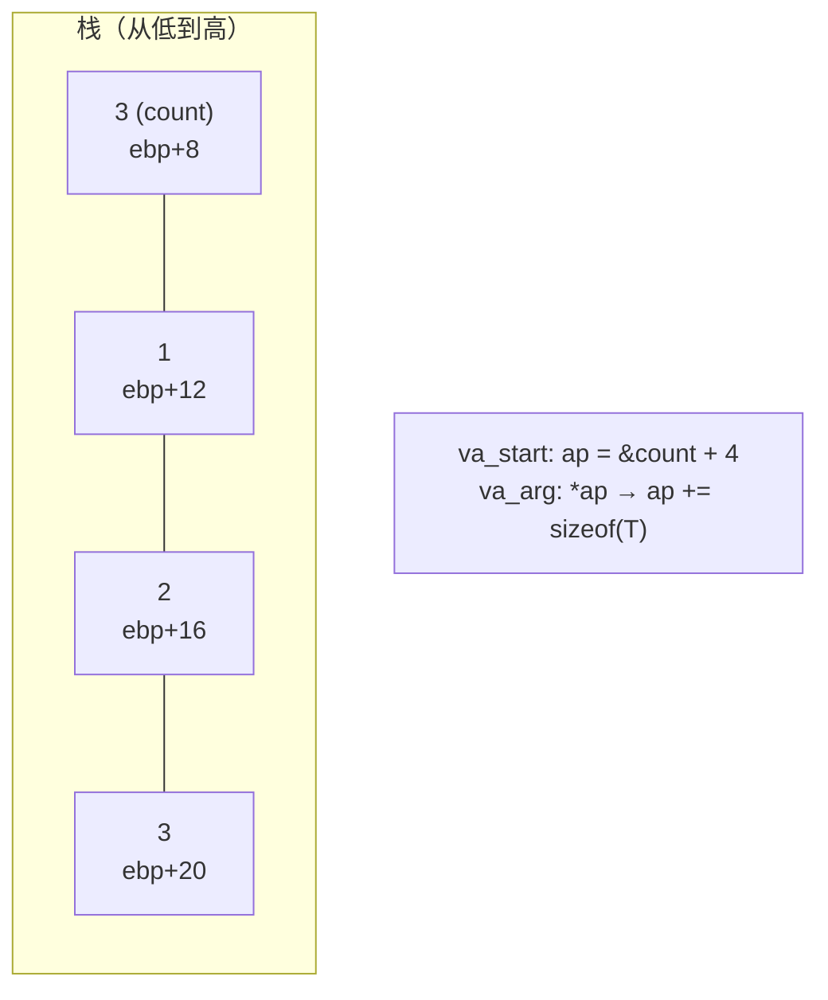

# 可变参数

## 什么是可变参数函数

参数个数/类型可变的函数：`printf("x=%d y=%s", x, y)`——声明里用 `...`：

```c
int printf(const char *fmt, ...);     /* ... 只能放在参数表最后 */
```

C标准库中：`printf/scanf/fprintf/sprintf/snprintf`、`execl` 等都是变参函数。

## va_list 四件套（stdarg.h）

```c
#include <stdarg.h>

/* 需求：求任意个整数的和 sum(3, 1,2,3)=6 */
int sum(int count, ...)
{
    va_list ap;              /* ① 声明参数遍历器（本质：指向栈上参数区的指针） */
    va_start(ap, count);     /* ② 初始化：从 count 之后的第一个参数开始 */
    int total = 0;
    for (int i = 0; i < count; i++)
        total += va_arg(ap, int);   /* ③ 逐个取：类型必须正确！ */
    va_end(ap);              /* ④ 收尾（某些实现需要恢复栈状态） */
    return total;
}

sum(3, 1, 2, 3);       /* 6 */
sum(5, 10, 20, 30, 40, 50);   /* 150 */
```

四步铁律：

| 步骤 | 宏 | 作用 |
| --- | --- | --- |
| ① | `va_list ap;` | 声明遍历器 |
| ② | `va_start(ap, last)` | 定位起点（last = `...` 前的最后一个**具名**参数） |
| ③ | `va_arg(ap, T)` | 取下一个参数并**按T解读**；ap前移 |
| ④ | `va_end(ap)` | 结束（必须调用） |

**至少要有一个具名参数**（va_start 需要锚点）：`int f(...)` 在标准C中非法。

## 原理：栈上参数只是排排坐

32位 cdecl 下调用 `sum(3, 1, 2, 3)` 的栈：



`va_list` 在x86-32上不过是个 `char*`：**va_start 算出第一个变参地址，va_arg 顺着类型大小往前走**。函数**根本不知道传了几个参数**——`count` 是调用者"顺便"告诉它的人情。

64位 System V 下变参走寄存器区+栈，`va_list` 变成结构体（寄存器保存区+溢出参数区），原理仍同：**约定好布局，按序遍历**。

## 自己实现 mini_printf

变参最完整的实战——读格式串决定下一个类型：

```c
#include <stdio.h>
#include <stdarg.h>

void mini_printf(const char *fmt, ...)
{
    va_list ap;
    va_start(ap, fmt);
    for (const char *p = fmt; *p; p++) {
        if (*p != '%') { putchar(*p); continue; }
        switch (*++p) {                 /* 看格式符 → 决定va_arg类型 */
        case 'd': printf("%d", va_arg(ap, int));    break;
        case 'f': printf("%f", va_arg(ap, double)); break;  /* float提升! */
        case 'c': putchar(va_arg(ap, int));         break;  /* char提升! */
        case 's': fputs(va_arg(ap, const char *), stdout);  break;
        case '%': putchar('%');                     break;
        default:  putchar('%'); putchar(*p);        break;
        }
    }
    va_end(ap);
}

mini_printf("name=%s age=%d gpa=%f\n", "Tom", 18, 3.6);
```

## 三大天坑

### 1. 默认参数提升（必须与va_arg类型匹配）

```c
float f = 1.5f;
printf("%f", f);        /* ✔ %f按double读，float传入前已自动提升double */

short s = 7;
/* 若自己写的变参函数用 va_arg(ap, short) 取 —— ✘！
   传入的实际是int（提升），按short走步长就全乱了 */
/* 铁律：va_arg的类型只可能是：int/unsigned int/double/指针/长整型
   —— 小类型必须按提升后的类型取！ */
```

### 2. 传错类型 = UB（运行期无人检查）

```c
printf("%d", 3.14);       /* 💥 按int解读double位模式，输出乱码 */
printf("%s", 42);         /* 💥 把42当地址解引用 → 段错误 */
printf("%ld", (int)1);    /* 💥 64位下栈布局错位，后面参数全歪 */
/* gcc -Wall 能对printf这种已知函数查格式串（-Wformat），自定义函数
   可用 __attribute__((format(printf,1,2))) 挂上同样检查 */
```

### 3. va_list 的复用与传递

```c
/* 同一个ap被两个函数遍历 → 需要拷贝 */
void log2(const char *tag, const char *fmt, va_list ap)
{
    vprintf(fmt, ap);          /* vprintf：吃va_list的printf（转发标准姿势） */
}

void log1(const char *fmt, ...)
{
    va_list ap, ap2;
    va_start(ap, fmt);
    va_copy(ap2, ap);          /* C99：复制一份，各自遍历互不干扰 */
    vprintf(fmt, ap);
    log2("tag", fmt, ap2);
    va_end(ap);
    va_end(ap2);
}
```

`vprintf/vfprintf/vsnprintf` 家族 = **变参转发的唯一正确姿势**（日志库的标配）。

## 替代方案对比

| 方案 | 优点 | 缺点 |
| --- | --- | --- |
| `...` + va_list | 调用方便 printf 风格 | 无类型检查、坑多、必须至少一个具名参数 |
| 数组+长度 `f(int n, int a[])` | 类型安全、可遍历 | 只能同类型、调用处要造数组 |
| 结构体打包 `f(Args *a)` | 类型安全、任意类型组合 | 啰嗦 |
| C11 `_Generic` 宏分发 | 按类型选函数（"重载"） | 编译期静态选择，非真变参 |

```c
/* C11 _Generic 实现"类型安全打印"（编译期就查类型） */
#include <stdio.h>
#define print_any(x) _Generic((x), \
    int:    printf("%d\n", (x)),   \
    double: printf("%f\n", (x)),   \
    char *: printf("%s\n", (x)))(x)   /* 万一类型不在列表 → 编译错误！ */
```

## 小结

1. `...` 只能在参数表**最后**，且前面至少有一个具名参数；
2. va_list四步：声明→start(锚点)→逐个arg(类型必须对)→end；
3. 变参只有提升后的类型：**int、double、指针**——char/float/short按"提升型"取；
4. 传错类型没有任何运行期保护（printf格式串错误=UB）；
5. 转发用 `v*printf` 家族 + `va_copy`；要类型安全用数组/结构体/C11 _Generic。
