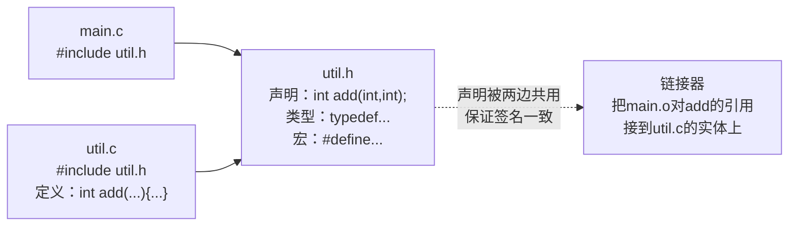

# 头文件

## 头文件解决什么问题

**多文件共享声明**。编译器按"翻译单元"（一个.c）独立编译，互相看不见。想让 main.c 用 func.c 里定义的函数，必须在 main.c 中**提前声明**——把声明集中到一个 .h 里，谁用谁 include。



**头文件是"接口契约"，.c 是"实现"**。契约只有一份，就不会出现两个文件声明不一致的事故。

## 头文件里放什么

| 放 ✔ | 不放 ✘ |
| --- | --- |
| 函数**声明**（原型） | 函数**定义**（体） |
| `extern` 全局变量声明 | 全局变量定义（`int g;`） |
| 类型定义（struct/typedef/enum/union） | 静态函数/变量定义 |
| 宏定义 | 会产生符号的任何东西 |
| `static inline` 函数（C99，无外部符号） | typedef 之外的普通函数 |

```c
/* util.h —— 标准模板 */
#ifndef UTIL_H            /* ① include guard */
#define UTIL_H

#include <stdio.h>        /* ② 只 include 本头文件自身需要的 */

#define MAX_NAME 32       /* ③ 宏 */

typedef struct Point {    /* ④ 类型 */
    int x, y;
} Point;

extern int g_count;       /* ⑤ 全局变量声明（定义在某个.c里） */

int add(int a, int b);    /* ⑥ 函数声明 */

#endif /* UTIL_H */
```

```c
/* util.c */
#include "util.h"

int g_count = 0;          /* 全局变量在此定义（恰好一处） */

int add(int a, int b)     /* 函数定义 */
{
    return a + b;
}
```

## include guard：为什么必须

头文件会被多次展开（A.h包含B.h，main.c又同时包含A.h和B.h → B.h内容出现两次）。**重复声明**（函数原型、extern）是合法的，但**重复定义**（结构体定义、typedef）直接编译错误：

```c
/* b.h 被包含两次时：
   struct B { int x; };  ← 第二次出现 → "重定义struct B" 编译错误 */

/* guard 让第二次及以后的 include 变成空文件 */
#ifndef B_H
#define B_H
struct B { int x; };
#endif
/* 第二次进入时 B_H 已定义，#ifndef 不成立 → 整体跳过 */

/* 替代方案：#pragma once（非标准，主流编译器全支持，更简洁防笔误） */
#pragma once
struct B { int x; };
```

## #include 的搜索路径

```c
#include <stdio.h>     /* 只搜系统目录（/usr/include、-I路径等） */
#include "util.h"      /* 先搜当前文件目录 → 再搜 -I → 系统 */
```

```bash
gcc -I/path/to/myinc main.c       # 追加自定义头文件目录
echo | gcc -E -v -x c - 2>&1 |    # 查看完整搜索路径清单
    grep '^ '
```

**路径写法建议**：项目内 include 写相对项目根的路径（`#include "lib/util.h"`），并用 `-I` 指根目录，避免 `../../` 地狱。

## 常用标准头文件

| 头文件 | 内容 |
| --- | --- |
| `<stdio.h>` | printf/scanf/fopen/fread 文件与标准IO |
| `<stdlib.h>` | malloc/free/exit/atoi/qsort/rand |
| `<string.h>` | strcpy/strlen/memcpy/memset |
| `<math.h>` | sqrt/pow/sin/abs |
| `<ctype.h>` | isdigit/isalpha/tolower 字符判断 |
| `<stddef.h>` | size_t/NULL/offsetof |
| `<stdint.h>` | int8_t/uint32_t/int64_t 定宽类型 (C99) |
| `<stdbool.h>` | bool/true/false (C99) |
| `<assert.h>` | assert 断言 |
| `<errno.h>` | errno 与错误码 |
| `<time.h>` | time/clock/strftime |
| `<limits.h>` | INT_MAX/CHAR_BIT 类型极限 |
| `<float.h>` | DBL_MAX/FLT_EPSILON |
| `<iso646.h>` | and/or/not 别名 (C99) |
| `<locale.h>` | setlocale |
| `<signal.h>` | signal/raise 信号处理 |
| `<setjmp.h>` | setjmp/longjmp 非局部跳转 |
| `<stdarg.h>` | va_list 可变参数 |

## 多文件项目结构（示例）

```text
project/
├── include/          # 对外头文件（被外部使用）
│   └── libx.h
├── src/              # 源码与内部头文件
│   ├── libx.c
│   ├── libx_internal.h   # 只被 libx.c 自己 include
│   └── main.c
└── Makefile
```

```makefile
gcc -Iinclude src/main.c src/libx.c -o app
```

## 头文件的典型错误

```c
/* 1. 头文件里定义变量 → 多个.c包含 → 链接期重复定义 */
int g_count = 0;           /* ✘ 在.h里；✔ extern在.h + 定义在一个.c */

/* 2. 头文件循环包含 */
/* a.h: #include "b.h"  /  b.h: #include "a.h"
   guard 能阻止无限递归，但必有一方"看不到"另一方类型 → 编译错误
   解法：前向声明 struct B;（指针成员够用） */
struct B;                  /* 前向声明：a.h 只声明，不包含 b.h */
struct A { struct B *link; };   /* 指针只需要"知道B是个类型" */

/* 3. 忘记 guard → 重定义错误 */

/* 4. 头文件互相依赖对方宏 → 展开顺序敏感 → 偶发编译错误 */
```

## 小结

1. 头文件=接口契约：声明、类型、宏；**定义一律进.c**；
2. include guard（或 `#pragma once`）是头文件身份证，必写；
3. `<>` 找系统、`""` 先找本地；项目用 `-I` 统一根路径；
4. 循环包含用**前向声明**解；
5. 全局变量：.h 里 `extern`，.c 里一处定义。
