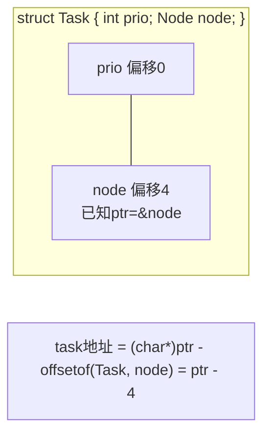

# 宏定义

## 两种宏

```c
/* 对象宏（object-like）：简单替换 */
#define PI 3.14159
#define MAX_BUF 4096

/* 函数宏（function-like）：带参数替换 */
#define SQUARE(x) ((x) * (x))
```

## 函数宏的正确写法：括号！括号！括号！

**每个参数加括号，整体再加括号**——原因看反例：

```c
/* 错误示范 */
#define SQUARE(x) x * x

SQUARE(3)        /* 3*3 = 9 碰巧对 */
SQUARE(1 + 2)    /* 展开为 1 + 2 * 1 + 2 = 5！应为9 ✘ */
SQUARE(a) + 1    /* 展开为 a * a + 1 —— 若a=3得10 ✔ 碰巧对 */

#define SQUARE(x) ((x) * (x))    /* ✔ 标准写法 */
SQUARE(1 + 2)    /* ((1+2) * (1+2)) = 9 ✔ */
```

图解展开事故：

```mermaid
graph LR
    A["SQUARE(1+2)"] -->|“#define SQUARE x*x”| B["1 + 2 * 1 + 2<br>= 1+2+2 = 5 ✘"]
    A -->|“#define SQUARE ((x)*(x))”| C["((1+2)*(1+2))<br>= 9 ✔"]
```

## 参数副作用：宏会重复求值

```c
#define MAX(a, b) ((a) > (b) ? (a) : (b))

int x = 5, y = 3;
int m = MAX(x++, y);    /* 展开 ((x++) > (y) ? (x++) : (y))
                            x 被加两次！m = 6，x = 7 —— 与直觉完全不同 */
```

**宏不调用函数，是文本展开**：参数出现几次就求值几次。带副作用的表达式（`i++`、`f()`）禁止传给宏。

## do-while(0) 惯用法

多语句宏必须包进 `do { } while(0)`：

```c
/* 错误示范 */
#define SWAP(a, b)  int t = a; a = b; b = t;
/* 问题1：变量t可能重名；问题2：if中使用直接炸 */
if (x > y)
    SWAP(x, y);      /* 展开 int t=x; x=y; y=t; —— if 只管第一句！
                        else 还会配对失败 */

/* ✔ 工程标准写法 */
#define SWAP_INT(a, b) do { \
    int t_ = (a); (a) = (b); (b) = t_; \
} while (0)

if (x > y)
    SWAP_INT(x, y);   /* do{...}while(0) 是一条语句，if 正确包裹 */
/* while(0) 优化后被删除，零开销；且不接收尾随分号破坏 if-else */
```

## # 与 ## 在宏中的应用

```c
/* # 字符串化：断言失败打印表达式本身 */
#define ASSERT(cond) \
    do { if (!(cond)) \
        fprintf(stderr, "ASSERT failed: %s\n", #cond); \
    } while (0)
ASSERT(a < 10);     /* 打印 "ASSERT failed: a < 10" */

/* ## 记号拼接：批量生成代码 */
#define GENgetter(field) \
    int get_##field(void) { return s_##field; }
```

## 宏 vs 函数 vs inline

| 对比 | 宏 | 函数 | static inline |
| --- | --- | --- | --- |
| 处理时机 | 预处理（文本） | 编译/运行 | 编译 |
| 类型检查 | ✘ 无（双刃剑：可"泛型"） | ✔ | ✔ |
| 调用开销 | 无（原地展开） | 有（可被优化掉） | 无/极低 |
| 参数副作用 | **重复求值** | 一次 | 一次 |
| 调试 | 难（行号是展开处） | 易 | 易 |
| 递归 | ✘ | ✔ | ✔ |

```c
/* 现代建议：要性能用 static inline 函数；宏只留给"必须文本展开"的场景：
   1. 常量（#define MAX 100）
   2. 泛型容器（#参数拼接、typeof技巧）
   3. 编译期反射（#字符串化 + ##拼接）
   4. LOG宏（需要 __FILE__/__LINE__ 取调用处信息——函数做不到） */
```

## 经典宏赏析

```c
/* 1. 数组长度 */
#define ARRAY_SIZE(a) (sizeof(a) / sizeof((a)[0]))

/* 2. 取范围 [min,max] 夹逼 */
#define CLAMP(v, lo, hi) ((v) < (lo) ? (lo) : ((v) > (hi) ? (hi) : (v)))

/* 3. min/max（Linux内核版：临时变量避免副作用——gcc扩展typeof） */
#define min(x, y) ({              \
    typeof(x) _x = (x);           \
    typeof(y) _y = (y);           \
    _x < _y ? _x : _y; })

/* 4. 容器之母：从成员地址反推容器地址（Linux链表核心宏） */
#define container_of(ptr, type, member) ({          \
    const typeof(((type *)0)->member) *_mptr = (ptr); \
    (type *)((char *)_mptr - offsetof(type, member)); })
/* 已知成员指针ptr，求"包含它的type结构体"的地址：
   成员地址 - 成员在结构体中的偏移 = 结构体首地址 */

/* 5. C99变参宏 */
#define LOG(fmt, ...) printf("[LOG] " fmt "\n", __VA_ARGS__)
/* C23/GNU: __VA_OPT__ 处理空参数 */
```

`container_of` 图解：



## #undef 与重定义

```c
#define BUF 100
#undef BUF         /* 取消 */
#define BUF 256    /* 重定义前必须先undef（否则警告/报错） */
```

## 阅读宏的心法

1. 遇到宏，**脑内展开**成文本再看；
2. 多行宏看 `\` 续行当作一行；
3. 看不懂就 `gcc -E` 看展开产物；
4. 疑心重一点：宏没有类型、没有作用域、没有求值次数保证。

## 小结

1. 函数宏 = 文本替换：**参数加括号、整体加括号**；
2. 副作用参数会被展开多次——`MAX(i++, j)` 是经典事故；
3. 多语句宏用 `do{}while(0)` 包裹；
4. 宏无类型检查也无类型安全，现代代码优先 `static inline`；
5. `container_of`、变参LOG 是宏不可替代的巅峰应用。
