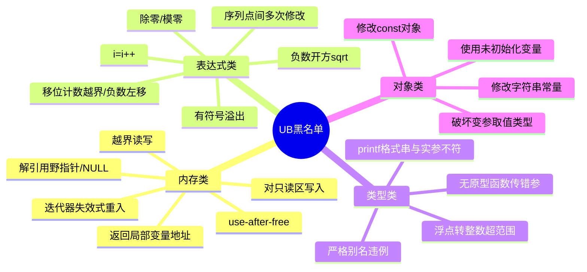

# 常见陷阱与未定义行为

## 什么是未定义行为（UB）

标准明说：**出现这种情况，程序可以发生任何事**——崩溃、静默出错、看似正常、甚至格式化硬盘（理论上）。UB是C语言"高性能"的代价：

```c
int a[3];
a[100000] = 1;         /* UB：越界。可能崩，可能写坏别人，可能没事 */
```

**UB最阴险之处**：`-O0`下碰巧正常，`-O2`下行为突变——因为优化器以"没有UB"为前提推理，可以删除它认为"不可能"的代码。

同族概念对比：

| 术语 | 含义 | 后果 |
| --- | --- | --- |
| 未定义行为 UB | 标准撒手不管 | **任何结果** |
| 未指定行为 unspecified | 有几种可能，不告诉你选哪种（如求值顺序） | 有限集合内的一种 |
| 实现定义行为 implementation-defined | 编译器文档必须说明（如char有无符号） | 每个编译器确定 |

```c
f() + g();             /* 未指定：f和g先执行哪个？不可依赖 */
char c = 200;          /* 实现定义：c是-56还是200看编译器 */
*(int *)0 = 1;         /* UB：解引用NULL */
```

## UB 完整黑名单（高频25条）



逐条速记（都是真题）：

```c
/* ── 内存类 ── */
int a[5]; a[10] = 0;                 /* 越界 */
int *p = NULL; *p;                   /* NULL解引用 */
free(p); *p = 1;                     /* use-after-free */
int *f(void){int x=0; return &x;}    /* 返回栈地址 */
char *s = "abc"; s[0]='A';           /* 写rodata */
int *q = malloc(4); q[9]=0; free(q); /* 堆越界，free时可能崩溃 */

/* ── 表达式类 ── */
i = i++;                             /* 两次修改 */
f(i++, i++);                         /* 实参无序+两次修改 */
a[i] = i++;                          /* 下标与副作用无序 */
INT_MAX + 1;                         /* 有符号溢出（无符号回绕是合法的！） */
1 << 32;                             /* 32位int移位≥位宽 */
-1 << 3;                             /* 负数左移 */
x / 0;   x % 0;                      /* 除零（整数除零；浮点得Inf不是UB） */

/* ── 类型类 ── */
float f=1.0; *(int*)&f = 0;          /* 严格别名 */
double d=1e300; (char)d;             /* 超范围浮点→整数 */
printf("%s", 123);                   /* 格式不符 */
abs(INT_MIN);                        /* 负数最小值取反溢出 */

/* ── 对象类 ── */
int x; if (x == 0) ...               /* 未初始化读 */
const int c = 0; *(int*)&c = 1;      /* 改const */
```

## 经典陷阱逐个击破

### 1. i = i++ 的真面目

```c
int i = 0;
i = i++;
/* i被修改两次（i++一次、赋值一次），两次之间没有序列点 → UB
   gcc算出0或1都可能，不同优化等级结果不同 —— 面试答案就三个字：未定义 */
```

### 2. 有符号溢出 vs 无符号回绕

```c
int i = INT_MAX;
i + 1;                 /* UB！有符号溢出 */

unsigned u = UINT_MAX;
u + 1;                 /* 合法！回绕到0 —— 无符号运算是模2^N */
/* 这就是为什么size_t倒序循环安全：0-1 回绕成巨大值仍能判断 */
```

### 3. 越界一根指针毁掉整个堆

```c
int *p = malloc(16);
p[4] = 1;              /* 越界4字节：踩进堆管理元数据 */
free(p);               /* 💥 glibc: "free(): invalid next size" 崩溃在free而非越界处 */
/* 教训：崩溃点≠出错点。上ASan，让第一现场自己跳出来 */
```

### 4. 未初始化变量"看起来能跑"

```c
int x;                       /* 栈随机值 */
if (x) printf("yes");        /* 行为随机：Debug下可能恒yes，Release恒no
                               —— 编译器把"未初始化读"当UB自由处理 */
/* -O2下gcc甚至直接删除整个if（"既然UB，就当它没发生"） */
```

### 5. strcmp 的返回值

```c
if (strcmp(a, b) == -1) ...   /* ✘：只保证0/正/负，不是-1 */
if (strcmp(a, b) < 0) ...     /* ✔ */
```

### 6. 无符号下标倒序死循环

```c
for (size_t i = n - 1; i >= 0; i--)   /* size_t恒>=0：死循环
                                          且n=0时 i=SIZE_MAX 越界 */
for (size_t i = n; i-- > 0; )         /* ✔ 经典惯用法："goes to zero" */
```

### 7. 结构体浅拷贝 double free

```c
struct S { char *name; } a = {malloc(10)}, b = a;
free(a.name);
free(b.name);              /* 💥 同一地址释放两次 */
```

### 8. memcpy 重叠区

```c
memcpy(buf+1, buf, 10);    /* UB（重叠），用 memmove */
```

### 9. 运算优先级二连

```c
if (x & 1 == 0) ...        /* x & (1==0) → 恒0 */
int r = 5 % -2;            /* C99起定义：商向零取整 → r=-1? 实为1，符号随被除数 */
```

### 10. scanf 忘记 &

```c
int n;
scanf("%d", n);            /* 💥 把n的"值"当地址写入 → 踩随机内存
                               gcc -Wall 警告 "format expects type int*, but argument has int" */
```

## 防御体系（工程 checklist）

```bash
# 每次构建的最低配置
gcc -std=c11 -Wall -Wextra -Wshadow -Wconversion app.c

# CI里跑三件套
gcc -fsanitize=address  ...   # 内存错误
gcc -fsanitize=undefined ...  # UB
valgrind ./app                # 泄漏+内存（慢速全查）
```

编码习惯：

1. **定义即初始化**，指针置NULL，free后置NULL；
2. **所有边界**（数组、malloc、strcpy、fread）用前算一遍：`n-1` 留给`\0`了吗？
3. 混合符号运算前显式转型，警惕 `sizeof` 与负数比较；
4. 副作用表达式（i++）不进宏、不进函数实参；
5. 每个C程序员都该读一遍《C陷阱与缺陷》。

## 面试快问快答

| 问题 | 答案要点 |
| --- | --- |
| `i=i++` 结果？ | UB，序列点间两次修改 |
| 有符号溢出？ | UB；无符号回绕合法 |
| `char *p="a"; p[0]='b'` | 段错误（写rodata） |
| `sizeof` 与负数比较？ | size_t提升 → 恒真/恒假事故 |
| gets 为什么被除名？ | 无法限制长度 → 缓冲区溢出（C11删除） |
| `free(p)` 后 `p` 的值？ | 悬垂指针，值未变但不可再用；置NULL防御 |
| `int a[3]; a[3]` 越界一格？ | 仍是UB（"off-by-one也非法"） |
| 优化后行为变了说明什么？ | 代码里有UB被放大，不是"编译器有bug" |

## 小结

1. UB=标准撒手，**任何结果**；优化器以"无UB"前提推理，所以-O2才暴露问题；
2. 黑名单高频区：**内存类（越界/悬垂/野指针）+ 表达式类（双修改/有符号溢出/除零）**；
3. 无符号回绕是特性、有符号溢出是UB——方向别记反；
4. 防御三板斧：`-Wall -Wextra`、ASan/UBSan、Valgrind；
5. 崩溃点≠出错点，工具让第一现场现形。
