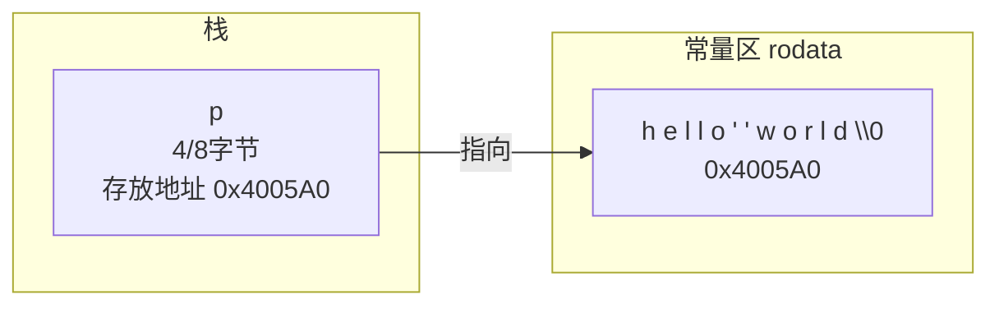
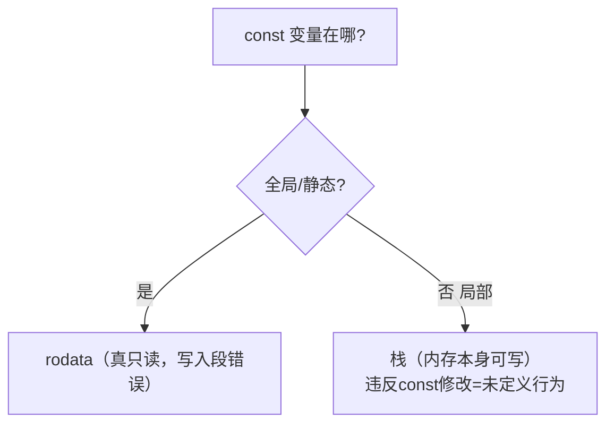

# 常量区

## 什么是常量区

常量区即可执行文件/进程中的**只读数据段（.rodata）**，存放：

1. **字符串字面量**（`"hello"`）
2. **const 修饰的全局/静态变量**
3. 编译期可确定的只读表（如 `switch` 跳转表有时也放这里）

特点：**加载后页面权限为只读，写入触发段错误（SIGSEGV）**。

## 字符串字面量

```c
char *p = "hello world";
```

内存布局：



**两个致命误区**：

```c
/* 误区1：试图修改字符串常量 → 段错误 */
char *p = "hello";
p[0] = 'H';            /* 💥 SIGSEGV：rodata 只读 */

/* 正确：用字符数组，内容在栈上，可修改 */
char arr[] = "hello";
arr[0] = 'H';          /* ✔ */
```

`char arr[] = "hello"` 与 `char *p = "hello"` 的本质区别：

| 写法 | 内容在哪 | 可否修改 | sizeof |
| --- | --- | --- | --- |
| `char arr[] = "hello";` | **栈**（逐字节拷贝） | ✔ | 6（含`\0`） |
| `char *p = "hello";` | **rodata** | ✘ 段错误 | 4/8（指针大小） |

**相同字面量会被编译器合并**（只存一份）：

```c
char *a = "hello";
char *b = "hello";
printf("%p %p\n", a, b);   /* 多数编译器输出相同地址 */
printf(a == b ? "same" : "diff");   /* 标准允许两种结果 */
```

## const 与常量区的关系

**const 只是编译期"不许通过该名字改"的约定，放哪取决于存储期**：

```c
const int g_c = 10;        /* 全局const：通常放 rodata，真只读 */
static const int s_c = 5;  /* 同上 */

int main(void)
{
    const int l_c = 10;    /* 局部const：依然在栈上！ */
    int *p = (int *)&l_c;
    *p = 20;               /* 改的不是 rodata —— 多数平台能改成功（但属于钻空子） */
    printf("%d\n", l_c);   /* 编译器可能直接优化成 10 */
}
```



> 结论：**const ≠ 放进常量区**；const 表达的是**类型系统层面的只读承诺**，物理只读取决于所在段。

## 立即数 vs 常量区

不是所有"常量"都占内存：

```c
int x = 100;          /* 100 是立即数，直接编码进 mov 指令 */
char *s = "abc";      /* "abc" 需要地址，必须在 rodata 占6字节 */
int arr[3] = {1,2,3}; /* 局部数组：立即数可能嵌入指令序列逐个赋值 */
```

汇编对比：

```asm
mov  DWORD PTR [rbp-4], 100      ; int x = 100：立即数，无内存开销
lea  rax, [rip + .LC0]           ; "abc"：lea 取 rodata 地址
mov  QWORD PTR [rbp-16], rax     ; 存给 s
```

## 实验：亲眼看到段错误

```c
#include <stdio.h>

int main(void)
{
    char *p = "read only";
    printf("%p\n", (void *)p);   /* 打印地址，可用 cat /proc/PID/maps 查看所在段 */
    p[0] = 'R';                  /* 写 rodata → SIGSEGV */
    return 0;
}
```

```text
$ ./a.out
0x55d20a7b9004
Segmentation fault (core dumped)     ← 内核发现写只读页，发送SIGSEGV
```

`/proc/PID/maps` 中可看到该地址落在 `r--p`（只读）映射区。

## 常量区在逆向中的意义

* 字符串常量是**最快定位功能代码**的锚点：IDA 中 `Shift+F12` 打开 Strings 窗口，从 "Wrong password!" 反查引用函数；
* 破解时把 rodata 中的 "Register Fail" 改成 "Register OK" 不会改变程序逻辑，但修改**常量区内容**（直接改文件）是 crackme 常见手段之一——注意这改的是**文件**而非运行时内存；
* `const` 变量参与运算时编译器会直接内联其值，逆向时**搜不到内存访问**。

## 小结

1. 字符串字面量在 rodata，**永远不要试图修改**；需要修改用 `char arr[]`；
2. `char *p="x"`（指向常量）与 `char a[]="x"`（数组拷贝）是C语言面试第一题；
3. const 局部变量在栈，const 全局在 rodata；
4. 立即数编码在指令里，不占数据段。
