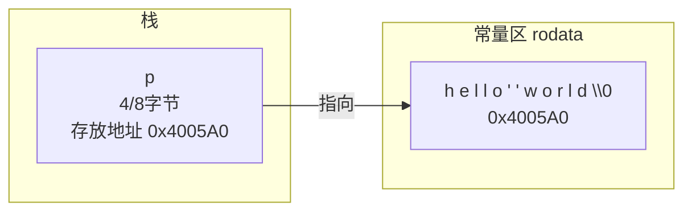
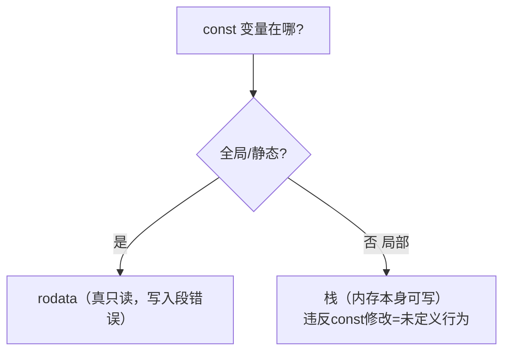

# 常量区

## 什么是常量区

常量区即可执行文件/进程中的**只读数据段（.rodata）**，存放：

1. **字符串字面量**（`"hello"`）
2. **const 修饰的全局/静态变量**
3. 编译期可确定的只读表（如 `switch` 跳转表有时也放这里）

特点：**加载后页面权限为只读，写入触发段错误（SIGSEGV）**。

## 字符串字面量

```c
char *p = "hello world";
```

内存布局：



**两个致命误区**：

```c
/* 误区1：试图修改字符串常量 → 段错误 */
char *p = "hello";
p[0] = 'H';            /* 💥 SIGSEGV：rodata 只读 */

/* 正确：用字符数组，内容在栈上，可修改 */
char arr[] = "hello";
arr[0] = 'H';          /* ✔ */
```

`char arr[] = "hello"` 与 `char *p = "hello"` 的本质区别：

| 写法 | 内容在哪 | 可否修改 | sizeof |
| --- | --- | --- | --- |
| `char arr[] = "hello";` | **栈**（逐字节拷贝） | ✔ | 6（含`\0`） |
| `char *p = "hello";` | **rodata** | ✘ 段错误 | 4/8（指针大小） |

**相同字面量会被编译器合并**（只存一份）：

```c
char *a = "hello";
char *b = "hello";
printf("%p %p\n", a, b);   /* 多数编译器输出相同地址 */
printf(a == b ? "same" : "diff");   /* 标准允许两种结果 */
```

## const 与常量区的关系

**const 只是编译期"不许通过该名字改"的约定，放哪取决于存储期**：

```c
const int g_c = 10;        /* 全局const：通常放 rodata，真只读 */
static const int s_c = 5;  /* 同上 */

int main(void)
{
    const int l_c = 10;    /* 局部const：依然在栈上！ */
    int *p = (int *)&l_c;
    *p = 20;               /* 改的不是 rodata —— 多数平台能改成功（但属于钻空子） */
    printf("%d\n", l_c);   /* 编译器可能直接优化成 10 */
}
```



> 结论：**const ≠ 放进常量区**；const 表达的是**类型系统层面的只读承诺**，物理只读取决于所在段。

## 立即数 vs 常量区

不是所有"常量"都占内存：

```c
int x = 100;          /* 100 是立即数，直接编码进 mov 指令 */
char *s = "abc";      /* "abc" 需要地址，必须在 rodata 占6字节 */
int arr[3] = {1,2,3}; /* 局部数组：立即数可能嵌入指令序列逐个赋值 */
```

汇编对比：

```asm
mov  DWORD PTR [rbp-4], 100      ; int x = 100：立即数，无内存开销
lea  rax, [rip + .LC0]           ; "abc"：lea 取 rodata 地址
mov  QWORD PTR [rbp-16], rax     ; 存给 s
```

## 实验：亲眼看到段错误

```c
#include <stdio.h>

int main(void)
{
    char *p = "read only";
    printf("%p\n", (void *)p);   /* 打印地址，可用 cat /proc/PID/maps 查看所在段 */
    p[0] = 'R';                  /* 写 rodata → SIGSEGV */
    return 0;
}
```

```text
$ ./a.out
0x55d20a7b9004
Segmentation fault (core dumped)     ← 内核发现写只读页，发送SIGSEGV
```

`/proc/PID/maps` 中可看到该地址落在 `r--p`（只读）映射区。

## 常量区在逆向中的意义

* 字符串常量是**最快定位功能代码**的锚点：IDA 中 `Shift+F12` 打开 Strings 窗口，从 "Wrong password!" 反查引用函数；
* 破解时把 rodata 中的 "Register Fail" 改成 "Register OK" 不会改变程序逻辑，但修改**常量区内容**（直接改文件）是 crackme 常见手段之一——注意这改的是**文件**而非运行时内存；
* `const` 变量参与运算时编译器会直接内联其值，逆向时**搜不到内存访问**。

## 实战：编译提取汇编逐行解析（真实输出）

> 以下汇编全部为**真实编译产物**，指令逐字来自 gcc 输出，`;` 注释为整理所加。提取流程见 `.opencode/skills/c-dev/SKILL.md`；环境噪音说明见[数组·实战](数组.md)。
> 实测环境：Ubuntu 24.04 / gcc 13.3.0 / x86-64（System V ABI）/ Intel 语法

### 实验1：`char *s="hello"` 与 `char a[]="world"` 的分道扬镳

```c
char *g_str = "hello";          /* 全局指针："hello"本体在哪？ */

int main(void)
{
    char arr[] = "world";       /* 局部数组：内容拷到栈 */
    char *p = "hello";          /* 局部指针：指向rodata */
    return arr[0] + p[0] + g_str[1];  /* 'w'+'h'+'e'=324 → 实测退出码68(324%256) ✔ */
}
```

```asm
	.section	.rodata                ; ★字符串本体住rodata（只读段）
.LC0:
	.string	"hello"
	.section	.data.rel.local        ; 全局指针住"可重定位data"
g_str:
	.quad	.LC0                      ; ★内容是.LC0的地址（链接期重定位填真值）

main:
    ...
    mov     DWORD PTR -14[rbp], 1819438967   ; ★"world"前4字节'w''o''r''l'被打包成
                                             ; 一个32位立即数(0x6C726F77)写进栈！
    mov     WORD PTR -10[rbp], 100           ; 第5字节'd'(100)+'\0' → 16位立即数
                                             ; —— char arr[]初始化=按立即数拷进栈
    lea     rax, .LC0[rip]                   ; 取"hello"地址
    mov     QWORD PTR -24[rbp], rax          ; p = .LC0（栈上存的是指针）
    movzx   eax, BYTE PTR -14[rbp]           ; arr[0]='w'：直接读栈（可写！）
    movsx   edx, al
    mov     rax, QWORD PTR -24[rbp]          ; 取p
    movzx   eax, BYTE PTR [rax]              ; p[0]='h'：间址读rodata（只读！）
    movsx   eax, al
    add     edx, eax
    mov     rax, QWORD PTR g_str[rip]        ; 读全局指针的值(=hello的地址)
    add     rax, 1                           ; +1 → "ello"的e
    movzx   eax, BYTE PTR [rax]              ; g_str[1]='e'
    movsx   eax, al
    add     eax, edx
    ...
```

四条铁证据：

1. **字符串字面量在 `.rodata`**（`.LC0` 标签，`.string` 指示）；
2. **全局指针 `g_str` 的"值"是 `.quad .LC0`**——它存的是地址，且因需要重定位放在 `.data.rel.local`（与函数指针表同款待遇）；
3. **`char arr[]="world"` 的初始化是往栈上写立即数**：`0x6C726F77`（"worl"的小端打包）+ `0x0064`（"d\0"）——**内容被逐字节拷进栈，与rodata再无关系**，所以可安全修改；
4. `char *p="hello"` 栈上只存8字节指针，内容仍在rodata——`p[0]='x'` 必段错误。

### 实验2：相同字面量被合并 —— 一个 .LC0 服务所有指针

```c
int main(void)
{
    char *x = "shared";
    char *y = "shared";
    return x == y;             /* 实测退出码1 ✔ —— 指向同一地址！ */
}
```

汇编里只有一个 `.LC0: .string "shared"`，两处 `lea rax,.LC0[rip]` 取的是**同一个地址**——所以 `x == y` 为真。这是编译器节能（合并重复常量），不是语言保证（标准允许两种结果），但主流编译器皆如此。

### 实验3：写 rodata 的下场 —— 实测 SIGSEGV

```c
int main(void)
{
    char *p = "read only";
    p[0] = 'R';                 /* 写rodata */
    return 0;
}
```

```asm
    lea     rax, .LC0[rip]      ; p = "read only"
    mov     QWORD PTR -8[rbp], rax
    mov     rax, QWORD PTR -8[rbp]
    mov     BYTE PTR [rax], 82  ; p[0]='R'：往rodata写 —— 指令本身毫无异常
    ...
```

```text
$ ./a.out
Segmentation fault (core dumped)     ← 指令合法，段权限不合法：内核发现写"r--p"页
$ echo $?
139                                   ← 128+11 = SIGSEGV
```

**编译器不拦、CPU不拦、拦它的是内存管理单元（MMU）**：rodata 页被映射为只读（`/proc/PID/maps` 里可见 `r--p`），写入触发页保护异常。这就是"常量区"三个字的物理含义——**不是编译器的温柔约束，是页表的铁闸**。

### 汇编视角总结表（全部实测）

| C写法 | 住哪 | 机器形态 |
| --- | --- | --- |
| `"hello"` 本体 | `.rodata` | `.string "hello"`（.LC0标签） |
| `char *p = "hello"` | 栈上8字节指针 | `lea rax,.LC0[rip]` + `mov [rbp-N],rax` |
| `char a[] = "world"` | 栈（内容拷贝） | **立即数写入**（0x6C726F77…） |
| 全局 `char *g="hello"` | `.data.rel.local` 存地址 | `g: .quad .LC0`（待重定位） |
| 写 `p[0]='R'` | 💥 | 指令正常生成，运行期MMU拦截→SIGSEGV |

## 小结

1. 字符串字面量在 rodata，**永远不要试图修改**；需要修改用 `char arr[]`；
2. `char *p="x"`（指向常量）与 `char a[]="x"`（数组拷贝）是C语言面试第一题——实测前者8字节指针，后者立即数拷进栈；
3. const 局部变量在栈，const 全局在 rodata；
4. 立即数编码在指令里，不占数据段——实测 "world" 直接变成指令里的 0x6C726F77；
5. 相同字面量被编译器合并成同一个 .LC0；
6. 新增实测：只读保护由MMU页权限执行——汇编指令照常生成，运行期才炸。
