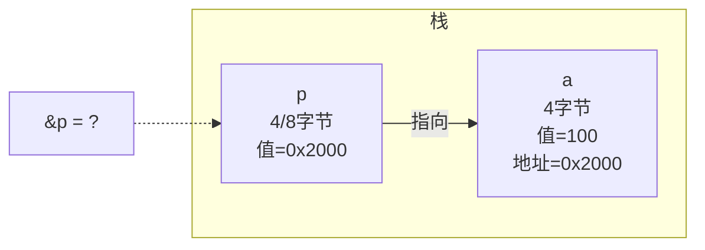
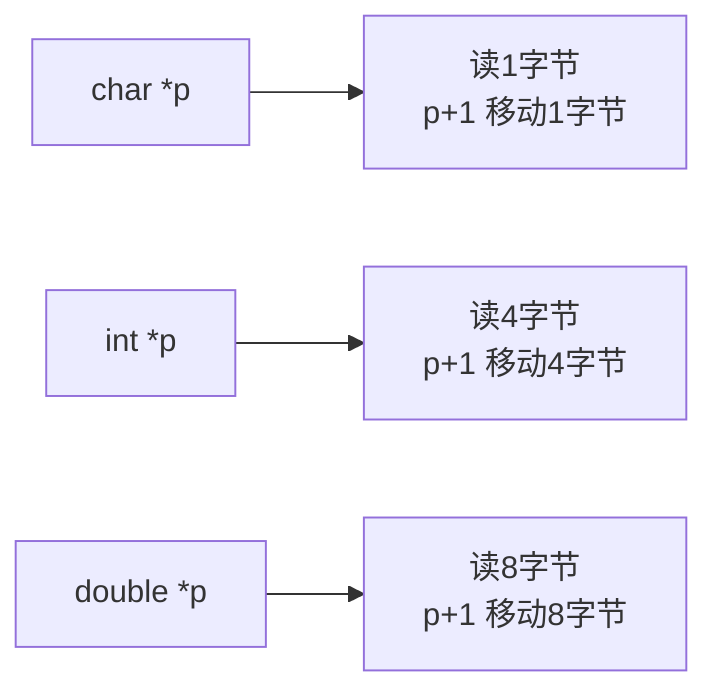
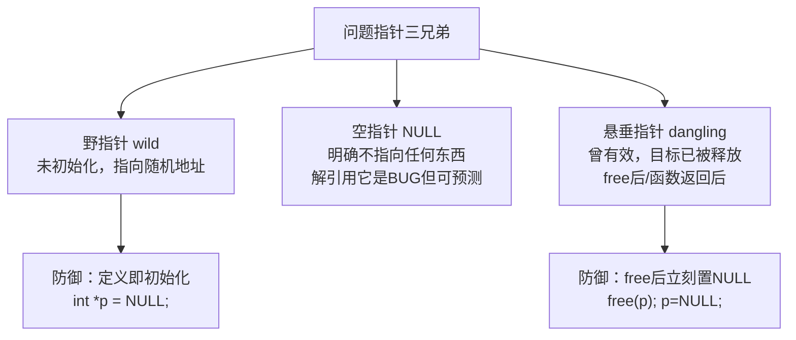
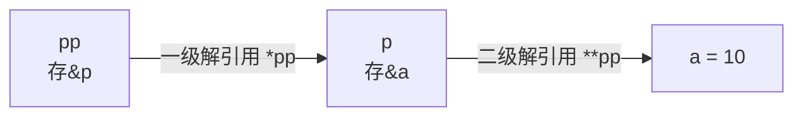
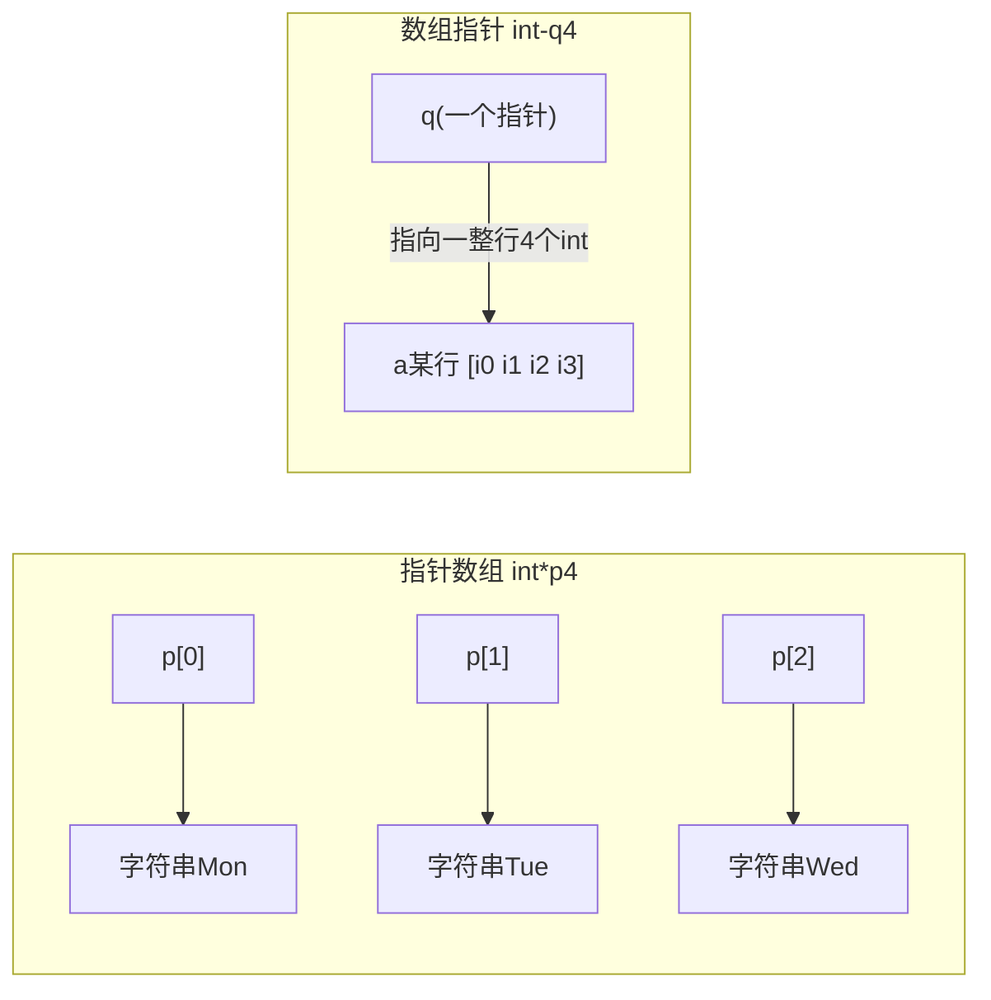

# 指针

> 指针是C语言的灵魂。指针不难，难的是没建立"地址"的直觉——本文全部用内存图说话。

## 指针的本质

**指针变量 = 存放内存地址的变量**。它自己也在内存里，也有地址。

```c
int a = 100;
int *p = &a;      /* p 存的是 a 的地址 */
```



两个核心运算符：

| 符号 | 用法 | 含义 |
| --- | --- | --- |
| `&` | `&a` | 取 a 的地址（"a住在哪"） |
| `*`（声明中） | `int *p` | p 是指向 int 的指针 |
| `*`（表达式中） | `*p` | 解引用：顺着地址取值（"去a家串门"） |

```c
*p == 100       /* 解引用读 */
*p = 200;       /* 解引用写：a 变成 200 */
*&a == a        /* 互为逆运算 */
```

## 指针的大小

**所有类型的指针大小相同**（由平台位数决定）——因为无论指向什么，存的都是地址：

```c
sizeof(char *) == sizeof(int *) == sizeof(double *) == sizeof(struct Big *)
/* 32位: 全是4；64位: 全是8 */
```

**指针类型决定的是"解引用时读几个字节、怎么解读、加减的步长"**：



## 指针运算

```c
int a[5] = {10, 20, 30, 40, 50};
int *p = a;          /* 指向 a[0] */

p + 1                /* 指向 a[1]：地址+4，不是+1 */
*(p + 2)             /* 30 */
p++                  /* p 移到下一个元素（指针本身是变量，可以++） */
p - q                /* 两指针相减 = 元素个数（不是字节数！仅限同一数组内） */
p < q                /* 同一数组内可比较大小（地址比较） */
```

**合法操作范围**：指针运算只对**同一数组内部**（或越界一格）有定义，跨数组运算是UB。

## 野指针、空指针与悬垂指针



```c
/* 野指针：未初始化 */
int *p;
*p = 10;              /* 💥 写入随机地址，UB */

/* 悬垂指针1：free 后继续用 */
int *q = malloc(sizeof(int));
free(q);
*q = 5;               /* 💥 use-after-free */

/* 悬垂指针2：返回局部变量地址 */
int *bad(void) {
    int local = 42;
    return &local;    /* 💥 栈帧已回收，地址作废 */
}

/* 正确判空习惯 */
if (p != NULL) { }    /* 用前必判 */
free(p); p = NULL;    /* 释放即置空（可防double free） */
```

## 指针与数组

详见[数组](数组.md)。最核心的对应关系：

```c
int a[10];
int *p = a;           /* 数组名 = 首元素地址 */

a[i] ≡ *(a+i) ≡ p[i] ≡ *(p+i)

/* 区别：a 是地址常量（不可 a++），p 是变量（可任意移动） */
```

## 多级指针

**指针的指针**：存放"指针的地址"：

```c
int    a  = 10;
int   *p  = &a;       /* p  → a */
int  **pp = &p;       /* pp → p */

**pp = 20;            /* a 变成 20 */
```



### 为什么需要二级指针：在被调函数中修改调用者的指针

```c
/* 需求：函数内部分配内存，让调用者的指针指向它 */

void alloc_bad(int *p) {          /* 拿到的是指针的"值拷贝" */
    p = malloc(16);               /* 只改了副本，外面还是NULL ✘ */
}

void alloc_ok(int **pp) {         /* 传指针的地址 */
    *pp = malloc(16);             /* 改到调用者的指针本身 ✔ */
}

int *q = NULL;
alloc_ok(&q);                     /* q 现在有效 */
```

**规律：想在函数内修改"X类型"的变量，就必须传"X的地址"。**

## 指针数组 与 数组指针

一对最容易混淆的组合：

| 声明 | 读法 | 本质 |
| --- | --- | --- |
| `int *p[4]` | p是数组，元素是int* | **指针数组**（一筐指针） |
| `int (*p)[4]` | p是指针，指向"含4个int的数组" | **数组指针**（一个指针） |

```c
/* 拆解依据：[]优先级高于*，()改变结合 */

int *p[4];        /* p先与[4]结合 → 数组 → 每个元素 int* */
int (*q)[4];      /* (*q)先结合 → 指针 → 指向 int[4] */

/* 指针数组：经典用途——字符串表 */
const char *week[] = {"Mon", "Tue", "Wed"};
week[1]                       /* "Tue" 的地址 */
printf("%s", week[1]);        /* Tue */

/* 数组指针：经典用途——接住二维数组名 */
int a[3][4];
int (*row)[4] = a;            /* row 指向第0行 */
row[1][2]                     /* a[1][2] */
```



## const 与指针：四种组合

**记忆法：const 在 `*` 左边修饰"被指物"，在 `*` 右边修饰"指针本身"**：

```c
const int *p;        /* ① 指向常量的指针：*p 只读，p 可移动 */
int const *p;        /* 同①（const int 和 int const 等价） */
int *const p;        /* ② 常量指针：p 只读（不可移动），*p 可写 */
const int *const p;  /* ③ 双只读：p 和 *p 都不能改 */
int *p;              /* ④ 都能改 */
```

| 声明 | p 可改? | *p 可改? | 典型用途 |
| --- | --- | --- | --- |
| `int *p` | ✔ | ✔ | 普通指针 |
| `const int *p` | ✔ | ✘ | 函数参数"只读数组"：`void f(const int *a, size_t n)` |
| `int *const p` | ✘ | ✔ | 固定指向某缓冲区 |
| `const int *const p` | ✘ | ✘ | 只读配置表 |

工程铁律：**函数参数里，只读数据一律加 `const T *`**——既防自己写错，也给调用者安全感，还利于优化。

## void 指针：万能信使

```c
void *v;                    /* 可接收任何类型指针 */
v = &i;  v = &d;  v = arr;  /* ✔ 全部隐式转换 */

/* 但：不能解引用、不能做步进运算（不知道步长） */
*v;                         /* ✘ */
v + 1;                      /* ✘（GNU扩展允许按1字节，非标准） */

/* 必须先转换回具体类型 */
int *pi = (int *)v;         /* C中void*→T*可隐式，C++必须显式 */
```

`void*` 是通用接口的基石：`malloc` 返回 `void*`、`qsort`/`memcmp` 接收 `void*`、`pthread_create` 的参数也是 `void*`。

## 函数指针简介

```c
int add(int a, int b) { return a + b; }

int (*fp)(int, int) = add;   /* 注意()：(*fp)整体结合 */
fp(1, 2);                    /* 调用，&add/add 都可以取 */
(*fp)(1, 2);                 /* 等价写法 */
```

函数指针详见[专章](函数指针.md)。

## 复杂声明阅读法：右左法则

**从标识符出发，先右后左，遇`()`先闯进去**：

```c
int *p[4];
/* p → 右[]: 是数组(4) → 左*: 元素是指针 → 左int: 指向int
   = 4个"指向int的指针"组成的数组 */

int (*p)[4];
/* p → 左(*p): 是指针 → 右[4]: 指向含4元素的数组 → int
   = 指向"int[4]"的指针 */

int *f(void);
/* f → 右(void): 是函数(无参) → 左*: 返回指针 → int
   = 返回int*的函数 */

int (*f)(void);
/* f → 左(*f): 是指针 → 右(void): 指向"无参函数" → int: 返回int
   = 指向"int(void)函数"的指针 */

char *(*f)(int);
/* f → (*f)指针 → (int)指向带int参数的函数 → char*: 且该函数返回char*
   = 指向"char* f(int)"的函数指针 */

int (*arr[5])(int, int);
/* arr → [5]数组 → (* )元素是指针 → (int,int)指向双参函数 → int 返回int
   = 5个"函数指针"的数组（跳转表！） */
```

## 从汇编看指针

```c
int a = 100;
int *p = &a;
*p = 200;
```

```asm
; 32位示例
mov  DWORD PTR [ebp-4], 100      ; a = 100          （ebp-4 是 a）
lea  eax, [ebp-4]                ; 取 a 的地址（不读内存）
mov  DWORD PTR [ebp-8], eax      ; p = &a           （ebp-8 是 p）
mov  eax, DWORD PTR [ebp-8]      ; 读出 p 的值（a的地址）
mov  DWORD PTR [eax], 200        ; *p = 200：间接寻址写入
```

**指针操作 = 间接寻址**：先访问指针变量拿到地址，再用该地址访问目标。`[]`方括号寻址在CPU眼里就是 `[reg]`。

## 典型错误清单

```c
/* 1. 解引用未初始化指针 */
int *p;  *p = 1;

/* 2. 返回局部变量地址 */
int *f(void) { int x = 1; return &x; }

/* 3. 忘记取地址 */
int n;  scanf("%d", n);           /* 💥 应为 &n（编译器通常不报错） */

/* 4. 指针类型不匹配强读 */
double d = 3.14;
int *pi = (int *)&d;              /* *pi 得到的是 d 的低4字节重新解释，不是3 */

/* 5. 常量区写入 */
char *s = "abc";  s[0] = 'x';     /* 💥 rodata 只读 */

/* 6. 越界后 free 崩溃 */
int *q = malloc(4);  q[9] = 1;    /* 破坏堆元数据 */
```

## 小结

1. 指针=存地址的变量；类型决定**解读方式与步长**，不决定大小；
2. 野指针靠初始化、悬垂靠置NULL、空指针靠判空；
3. 修改"X类型"就传"X的地址"——二级指针的由来；
4. `int *p[4]`（指针数组）vs `int (*p)[4]`（数组指针）：看`*`和`[]`谁先绑定；
5. const 靠 `*` 分界：左锁内容右锁指针；
6. 右左法则读一切复杂声明。
