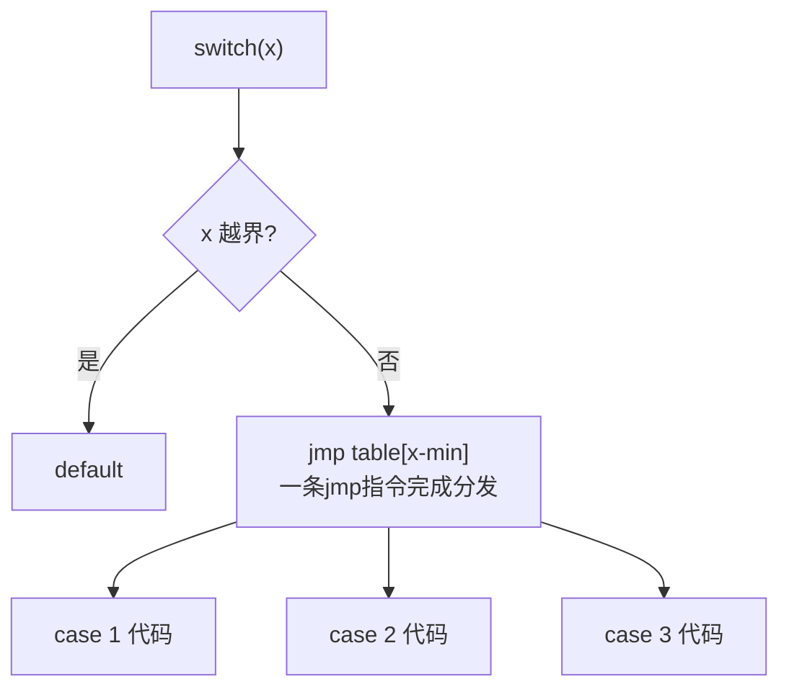

# 控制语句-分支和跳转

## if / else

```c
if (score >= 90)
    grade = 'A';
else if (score >= 80)     /* else if 只是嵌套的简写 */
    grade = 'B';
else
    grade = 'C';
```

### 悬空 else（dangling else）

**else 总是与离它最近的、还没配对的 if 结合**：

```c
if (a)
    if (b)
        x = 1;
else                    /* 缩进是骗人的！实际属于内层 if(b) */
    x = 2;
```

等价结构：

```c
if (a) {
    if (b) x = 1;
    else   x = 2;       /* ← else 其实在这 */
}
```

**防御原则**：条件语句一律加大括号，即使只有一行。

### 常见条件错误

```c
if (x = 5) { }        /* 赋值恒真，本意 == */
if (x == 5); { }      /* 语句分隔符多余，块无条件执行 */
if (0 <= x < 10) { }  /* 等价 (0<=x)<10 → 0或1 <10 恒真！数学写法在C中是BUG */
if (x > 2 && x < 10) { }  /* ✔ 正确写法 */
```

## switch / case

多路分支，`case` 标签必须是**整型常量表达式**：

```c
switch (cmd) {
    case 1:
        printf("start\n");
        break;              /* 忘记break → 落穿 fall-through */
    case 2:
        printf("stop\n");
        break;
    case 3:                 /* 多个case共享一段代码 */
    case 4:
        printf("quit\n");
        break;
    default:
        printf("unknown\n");
        break;
}
```

### fall-through：特性还是陷阱

```c
switch (x) {
    case 1:
        prepare();      /* 执行完自动落入 case 2 —— 若非有意，就是BUG */
    case 2:
        run();
        break;
}
```

有意利用时务必注释说明，或用 C17 `[[fallthrough]]` 属性显式声明。

### switch 只能判整型

```c
switch (x) { case 1.5: }      /* ✘ 编译错误：浮点不行 */
char c = 'A';
switch (c) { case 'A': }      /* ✔ char属于整型家族 */
```

### 从汇编看 switch：跳转表优化

case 值**连续密集**时，编译器把 switch 编译成**跳转表**（jumptable）而非一串 cmp：



```asm
; 伪汇编：case 1..5 连续
    mov  eax, [x]
    sub  eax, 1            ; 归零
    cmp  eax, 4            ; 越界检查
    ja   .default
    jmp  [table + eax*4]   ; 间接跳转，O(1)分发
table:  .dd case1, case2, case3, case4, case5
```

> 逆向视角：**跳转表是识别 switch 的铁证**——IDA 中看到 `jmp [eax*4+xxx]` 加一串连续地址，就是 switch。case 稀疏时退化为 if-else 链（cmp/je 串）。

## goto：被冤枉的指令

```c
/* goto 的两个正当用途 */

/* 1. 多层嵌套循环一次跳出 */
for (i = 0; i < N; i++)
    for (j = 0; j < M; j++)
        for (k = 0; k < K; k++)
            if (found(i, j, k))
                goto done;      /* break 只能跳一层 */
done:
    printf("found\n");

/* 2. 统一错误处理出口（内核代码标准写法） */
int ret = do_something();
if (ret < 0) goto err1;
ret = do_more();
if (ret < 0) goto err2;
return 0;
err2:  cleanup_2();
err1:  cleanup_1();
return ret;
```

**禁止**：用 goto 向后跳（制造意大利面）、用 goto 跳进作用域。

> Linux 内核大量使用 goto 做错误清理；单入口多出口的函数用 goto 收敛出口，可读性反而更好。

## break / continue / return

| 语句 | 作用于 | 效果 |
| --- | --- | --- |
| `break` | 最近一层 switch / 循环 | **彻底跳出** |
| `continue` | 最近一层循环 | 跳过本轮剩余语句，**进入下一轮条件判断** |
| `return` | 函数 | 结束函数，可带返回值 |
| `goto` | 函数内任意标签 | 无条件跳转 |

```c
for (int i = 0; i < 10; i++) {
    if (i % 2 == 0)
        continue;      /* 偶数跳过打印 */
    if (i > 7)
        break;         /* 大于7直接退出 */
    printf("%d ", i);  /* 输出: 1 3 5 7 */
}
```

> 注意：continue 在 while 循环里跳回**条件判断**，若自增写在 continue 之后，可能死循环：
>
> ```c
> int i = 0;
> while (i < 10) {
>     if (i == 5) continue;   /* i永远=5，死循环！ */
>     i++;
> }
> ```

## 分支与汇编对照表

| C语句 | x86 汇编模式 |
| --- | --- |
| `if (a==b)` | `cmp a,b` + `je/jne` |
| `if (a<b)` | `cmp` + `jl/jge`（有符号）`jb/jae`（无符号） |
| `if (a&&b)` | 短路：第一个判断不满足直接跳过第二个 |
| `if-else` | 条件跳转 + `jmp` 汇合 |
| `switch` 密集case | 跳转表 `jmp [reg*4+table]` |
| `switch` 稀疏case | cmp/je 链 |
| `goto` | 单条 `jmp` |
| `break` | `jmp` 到循环出口 |
| `continue` | `jmp` 到条件判断处 |

## 小结

1. else 配对**最近的if**，条件语句一律写大括号；
2. `0<=x<10` 是数学写法不是C写法；`=` 与 `==` 用"常量在左"防御；
3. switch 密集 case 编译成跳转表（O(1)），是逆向识别 switch 的特征；
4. goto 只推荐两种用法：跳出多层循环、统一错误出口。
