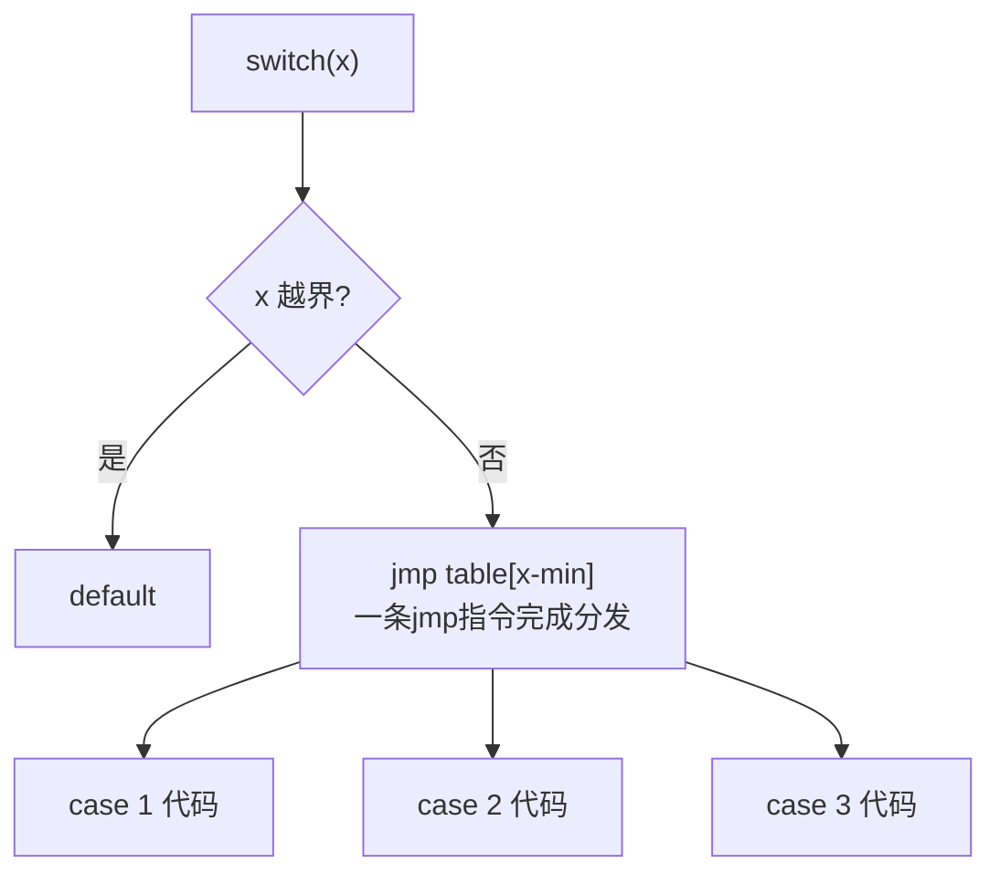

# 控制语句-分支和跳转

## if / else

```c
if (score >= 90)
    grade = 'A';
else if (score >= 80)     /* else if 只是嵌套的简写 */
    grade = 'B';
else
    grade = 'C';
```

### 悬空 else（dangling else）

**else 总是与离它最近的、还没配对的 if 结合**：

```c
if (a)
    if (b)
        x = 1;
else                    /* 缩进是骗人的！实际属于内层 if(b) */
    x = 2;
```

等价结构：

```c
if (a) {
    if (b) x = 1;
    else   x = 2;       /* ← else 其实在这 */
}
```

**防御原则**：条件语句一律加大括号，即使只有一行。

### 常见条件错误

```c
if (x = 5) { }        /* 赋值恒真，本意 == */
if (x == 5); { }      /* 语句分隔符多余，块无条件执行 */
if (0 <= x < 10) { }  /* 等价 (0<=x)<10 → 0或1 <10 恒真！数学写法在C中是BUG */
if (x > 2 && x < 10) { }  /* ✔ 正确写法 */
```

## switch / case

多路分支，`case` 标签必须是**整型常量表达式**：

```c
switch (cmd) {
    case 1:
        printf("start\n");
        break;              /* 忘记break → 落穿 fall-through */
    case 2:
        printf("stop\n");
        break;
    case 3:                 /* 多个case共享一段代码 */
    case 4:
        printf("quit\n");
        break;
    default:
        printf("unknown\n");
        break;
}
```

### fall-through：特性还是陷阱

```c
switch (x) {
    case 1:
        prepare();      /* 执行完自动落入 case 2 —— 若非有意，就是BUG */
    case 2:
        run();
        break;
}
```

有意利用时务必注释说明，或用 C17 `[[fallthrough]]` 属性显式声明。

### switch 只能判整型

```c
switch (x) { case 1.5: }      /* ✘ 编译错误：浮点不行 */
char c = 'A';
switch (c) { case 'A': }      /* ✔ char属于整型家族 */
```

### 从汇编看 switch：跳转表优化

case 值**连续密集**时，编译器把 switch 编译成**跳转表**（jumptable）而非一串 cmp：



```asm
; 伪汇编：case 1..5 连续
    mov  eax, [x]
    sub  eax, 1            ; 归零
    cmp  eax, 4            ; 越界检查
    ja   .default
    jmp  [table + eax*4]   ; 间接跳转，O(1)分发
table:  .dd case1, case2, case3, case4, case5
```

> 逆向视角：**跳转表是识别 switch 的铁证**——IDA 中看到 `jmp [eax*4+xxx]` 加一串连续地址，就是 switch。case 稀疏时退化为 if-else 链（cmp/je 串）。

## goto：被冤枉的指令

```c
/* goto 的两个正当用途 */

/* 1. 多层嵌套循环一次跳出 */
for (i = 0; i < N; i++)
    for (j = 0; j < M; j++)
        for (k = 0; k < K; k++)
            if (found(i, j, k))
                goto done;      /* break 只能跳一层 */
done:
    printf("found\n");

/* 2. 统一错误处理出口（内核代码标准写法） */
int ret = do_something();
if (ret < 0) goto err1;
ret = do_more();
if (ret < 0) goto err2;
return 0;
err2:  cleanup_2();
err1:  cleanup_1();
return ret;
```

**禁止**：用 goto 向后跳（制造意大利面）、用 goto 跳进作用域。

> Linux 内核大量使用 goto 做错误清理；单入口多出口的函数用 goto 收敛出口，可读性反而更好。

## break / continue / return

| 语句 | 作用于 | 效果 |
| --- | --- | --- |
| `break` | 最近一层 switch / 循环 | **彻底跳出** |
| `continue` | 最近一层循环 | 跳过本轮剩余语句，**进入下一轮条件判断** |
| `return` | 函数 | 结束函数，可带返回值 |
| `goto` | 函数内任意标签 | 无条件跳转 |

```c
for (int i = 0; i < 10; i++) {
    if (i % 2 == 0)
        continue;      /* 偶数跳过打印 */
    if (i > 7)
        break;         /* 大于7直接退出 */
    printf("%d ", i);  /* 输出: 1 3 5 7 */
}
```

> 注意：continue 在 while 循环里跳回**条件判断**，若自增写在 continue 之后，可能死循环：
>
> ```c
> int i = 0;
> while (i < 10) {
>     if (i == 5) continue;   /* i永远=5，死循环！ */
>     i++;
> }
> ```

## 分支与汇编对照表

| C语句 | x86 汇编模式 |
| --- | --- |
| `if (a==b)` | `cmp a,b` + `je/jne` |
| `if (a<b)` | `cmp` + `jl/jge`（有符号）`jb/jae`（无符号） |
| `if (a&&b)` | 短路：第一个判断不满足直接跳过第二个 |
| `if-else` | 条件跳转 + `jmp` 汇合 |
| `switch` 密集case | 跳转表 `jmp [reg*4+table]` |
| `switch` 稀疏case | cmp/je 链 |
| `goto` | 单条 `jmp` |
| `break` | `jmp` 到循环出口 |
| `continue` | `jmp` 到条件判断处 |

## 实战：编译提取汇编逐行解析（真实输出）

> 以下汇编全部为**真实编译产物**（非手写示意），指令逐字来自 gcc 输出，`;` 注释为整理所加。提取命令与流程见 `.opencode/skills/c-dev/SKILL.md`；`endbr64`/金丝雀等环境噪音说明见[数组·实战](数组.md)。
> 实测环境：Ubuntu 24.04 / gcc 13.3.0 / x86-64（System V ABI）/ Intel 语法

### 实验1：if/else —— cmp + 条件跳转；-O2 化身为 cmov

```c
int max(int a, int b)
{
    if (a > b)
        return a;
    else
        return b;
}
int main(void) { return max(3, 9); }    /* 实测退出码9 ✔ */
```

**-O0（有跳转的经典形态）**：

```asm
max:
    endbr64
    push    rbp
    mov     rbp, rsp
    mov     DWORD PTR -4[rbp], edi     ; 参数a → 栈槽[rbp-4]
    mov     DWORD PTR -8[rbp], esi     ; 参数b → [rbp-8]
    mov     eax, DWORD PTR -4[rbp]     ; 取a
    cmp     eax, DWORD PTR -8[rbp]     ; a-b → 只置EFLAGS不存差值
    jle     .L2                        ; a<=b（带符号比较）→ 跳else
    mov     eax, DWORD PTR -4[rbp]     ; return a（真分支）
    jmp     .L3                        ; 跳过else，到汇合点
.L2:
    mov     eax, DWORD PTR -8[rbp]     ; return b（假分支）
.L3:
    pop     rbp
    ret
```

**-O2（无分支！条件传送）**：

```asm
max:
    endbr64
    cmp     edi, esi          ; 比较
    mov     eax, esi          ; 先假设结果是b
    cmovge  eax, edi          ; a>=b 则改选a —— cmov按标志挑结果，零跳转！
    ret
main:
    endbr64
    mov     eax, 9            ; max(3,9) 直接常量折叠
    ret
```

解读：**if/else = `cmp`（减法置标志）+ `jcc`（条件跳转）**；`jle` 是"带符号小于等于"，无符号版本是 `jbe`——EFLAGS 的带符号/无符号两套标志正是[汇编·EFLAGS](../汇编/EFLAGS寄存器.md)的主场。-O2 更绝：两条路的结果都备好，`cmovge` 按标志**无跳转**地二选一，彻底绕开分支预测惩罚。老代码（VC6/老gcc）是 jcc 形态，现代编译器越来越多用 cmov——逆向时两种都要认识。

### 实验2：密集 switch —— 跳转表（jump table）实锤

```c
int dense(int x)
{
    switch (x) {
    case 0: return 10;
    case 1: return 21;
    case 2: return 32;
    case 3: return 43;
    case 4: return 54;
    case 5: return 65;
    default: return -1;
    }
}
int main(void) { return dense(4); }    /* 实测退出码54 ✔ */
```

```asm
dense:
    endbr64
    push    rbp
    mov     rbp, rsp
    mov     DWORD PTR -4[rbp], edi     ; x
    cmp     DWORD PTR -4[rbp], 5       ; x > 5 ?
    ja      .L2                        ; ★无符号比较：负数当巨大无符号数同样落default
                                       ;   ——一次检查同时防住上下两端！
    mov     eax, DWORD PTR -4[rbp]     ; 取x
    lea     rdx, 0[0+rax*4]            ; rdx = x*4（表项是4字节long）
    lea     rax, .L4[rip]              ; 取跳转表基址
    mov     eax, DWORD PTR [rdx+rax]   ; 读表项（SIB寻址——和数组下标一模一样！）
    cdqe                               ; 符号扩展
    lea     rdx, .L4[rip]              ; 表基址再来一次
    add     rax, rdx                   ; 目标地址 = 表基址 + 表项偏移
    notrack jmp rax                    ; ★间接跳转：一次分发O(1)

    .section .rodata                   ; ─── 跳转表本体放在rodata段 ───
    .align 4
.L4:
    .long   .L9-.L4                    ; case0 的偏移
    .long   .L8-.L4                    ; case1 的偏移
    .long   .L7-.L4                    ; case2
    .long   .L6-.L4                    ; case3
    .long   .L5-.L4                    ; case4
    .long   .L3-.L4                    ; case5
    .text
.L9:  mov eax, 10;  jmp .L10           ; case 0
.L8:  mov eax, 21;  jmp .L10           ; case 1
.L7:  mov eax, 32;  jmp .L10           ; case 2
.L6:  mov eax, 43;  jmp .L10           ; case 3
.L5:  mov eax, 54;  jmp .L10           ; case 4
.L3:  mov eax, 65;  jmp .L10           ; case 5
.L2:  mov eax, -1                      ; default
.L10:
    pop     rbp
    ret
```

五个必看细节：

1. **越界检查只有一次**：`cmp 5; ja`——`ja` 无符号比较让负数自动变"巨大数"落入 default，一条指令管住上下两端；
2. **跳转表放在 `.rodata`**：它就是一张"下标→代码位置"的数组，`x*4+表基址` 的查表动作与 `a[i]` 完全同构（见[数组·SIB寻址](数组.md)）；
3. 表项存**相对偏移**（`.L9-.L4`）而非绝对地址——位置无关代码（PIE）的要求；
4. 每个 case 末尾 `jmp .L10` 跳到汇合出口——**"忘写break会落穿"的机器形态**就是这个 jmp：若源码故意落穿，编译器不生成这个 jmp，执行会滑进下一个case体；
5. `notrack jmp rax`：CET 间接跳转（与 endbr64 配套）。

> 逆向识别口诀：**`jmp rax` 前有 `[reg*4+表]` 取项 + rodata 里一串 `.long` 偏移 = switch跳转表**（IDA自动标注为 jumptable）。

### 实验3：稀疏 switch —— 退化成 cmp/je 链（自带二分味）

```c
int sparse(int x)
{
    switch (x) {
    case 0:    return 1;
    case 100:  return 2;
    case 1000: return 3;
    default:   return 0;
    }
}
int main(void) { return sparse(100); }   /* 实测退出码2 ✔ */
```

```asm
sparse:
    endbr64
    push    rbp
    mov     rbp, rsp
    mov     DWORD PTR -4[rbp], edi     ; x
    cmp     DWORD PTR -4[rbp], 1000    ; 先和1000比（中间值）
    je      .L2                        ;   命中 case 1000
    jg      .L3                        ;   x>1000 → default（剪掉一半搜索空间！）
    cmp     DWORD PTR -4[rbp], 0       ; 下半区再比 0
    je      .L4                        ;   命中 case 0
    cmp     DWORD PTR -4[rbp], 100     ; 再比 100
    je      .L5                        ;   命中 case 100
    jmp     .L3                        ; 都不是 → default
.L4:  mov eax, 1;  jmp .L6
.L5:  mov eax, 2;  jmp .L6
.L2:  mov eax, 3;  jmp .L6
.L3:  mov eax, 0
.L6:
    pop     rbp
    ret
```

case 间隔 0/100/1000 太稀疏——造表要 1001 项，纯属浪费。编译器退回 `cmp/je` 链，并按**二分搜索**排序比较（先比中值 1000，`jg` 剪枝）：最多 3 次比较必出结果，O(log n) 分发。

### 实验4：goto —— 一条 je 的事；标签是 nop 空垫

```c
int find(int grid[3][3], int target)
{
    int i, j;
    for (i = 0; i < 3; i++)
        for (j = 0; j < 3; j++)
            if (grid[i][j] == target)
                goto found;          /* 两层一次跳出 */
    return -1;
found:
    return i * 3 + j;                /* 命中位置 */
}
int main(void) { int g[3][3]={{1,2,3},{4,5,6},{7,8,9}};
                 return find(g, 5); }        /* 4 → 实测退出码4 ✔ */
```

```asm
find:
    ...
    mov     DWORD PTR -8[rbp], 0       ; i = 0
    jmp     .L2                        ; 外层先检查
.L7:                                   ; ── 外层体 ──
    mov     DWORD PTR -4[rbp], 0       ;   j = 0
    jmp     .L3                        ;   内层先检查
.L6:                                   ;   ── 内层体 ──
    mov     eax, DWORD PTR -8[rbp]     ;   取 i
    movsx   rdx, eax
    mov     rax, rdx
    add     rax, rax                   ;   rax = 2i
    add     rax, rdx                   ;   rax = 3i ←行宽3元素
    sal     rax, 2                     ;   rax = 12i（3元素×4字节=行字节数）
    mov     rdx, rax
    mov     rax, QWORD PTR -24[rbp]    ;   数组基址
    add     rdx, rax                   ;   行首
    mov     eax, DWORD PTR -4[rbp]     ;   取 j
    cdqe
    mov     eax, DWORD PTR [rdx+rax*4] ;   读 grid[i][j]（SIB寻址再现）
    cmp     DWORD PTR -28[rbp], eax    ;   == target ?
    je      .L10                       ;   ★goto found 就是一条je直达标签！
    add     DWORD PTR -4[rbp], 1       ;   j++
.L3:
    cmp     DWORD PTR -4[rbp], 2       ;   j<=2?
    jle     .L6                        ;   内层回跳
    add     DWORD PTR -8[rbp], 1       ;   i++
.L2:
    cmp     DWORD PTR -8[rbp], 2       ;   i<=2?
    jle     .L7                        ;   外层回跳
    mov     eax, -1                    ; 没找到
    jmp     .L8                        ; 跳出口
.L10:                                  ; ← found: 标签落在空垫上
    nop
.L5:                                   ; 计算 i*3+j
    mov     edx, DWORD PTR -8[rbp]     ; 取 i
    mov     eax, edx
    add     eax, eax                   ; 2i
    add     edx, eax                   ; 3i
    mov     eax, DWORD PTR -4[rbp]     ; 取 j
    add     eax, edx                   ; 3i+j
.L8:
    pop     rbp
    ret
```

goto 的真实形态：**一条 `je .L10` 直接穿透两层循环结构**到达 found 标签；标签必须落在指令上，gcc 垫了个 `nop`。"跳出多层循环"在机器层面就是绕过两层 `jle` 回跳——比 break 层层弹出直达得多，这也是内核代码偏爱 goto 出错路径的底层理由。

顺带两个彩蛋：① 行偏移 `12i` 用 `add/add/sal` 三条指令算（2i+i=3i，再×4），比单条 `imul` 更快——乘法分解是编译器常态；② 汇编里**根本不存在"循环"**，只有"往前执行+往回跳的jle"——循环是给源代码读者看的高层概念。

### 汇编视角总结表（全部实测）

| C语法 | -O0典型形态 | -O2进化 |
| --- | --- | --- |
| if/else | `cmp` + `jcc` + `jmp` 汇合 | **`cmov` 条件传送**（无分支） |
| switch 密集case | rodata偏移表 + `jmp rax` 间接跳 | 同左，更紧凑 |
| switch 稀疏case | `cmp/je` 链（二分排序） | 同左 + 常量折叠 |
| goto | 单条 `jmp/je` + nop空垫 | 同左 |
| && 短路 | 两次判断串联，前者假直接跳过后者 | 可能合并/化简 |

## 小结

1. else 配对**最近的if**，条件语句一律写大括号；
2. `0<=x<10` 是数学写法不是C写法；`=` 与 `==` 用"常量在左"防御；
3. switch 密集 case 编译成跳转表（O(1)），是逆向识别 switch 的特征——实测表在 `.rodata`、存相对偏移；
4. goto 只推荐两种用法：跳出多层循环、统一错误出口——实测它就是一条直达的 je/jmp；
5. 新增：**if/else 在 -O2 下常变成 cmov 无分支代码**；识别它别再找 jcc。
