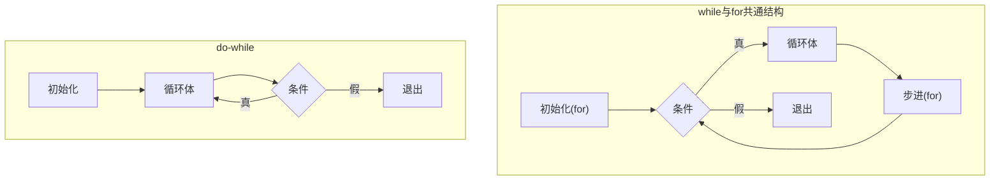
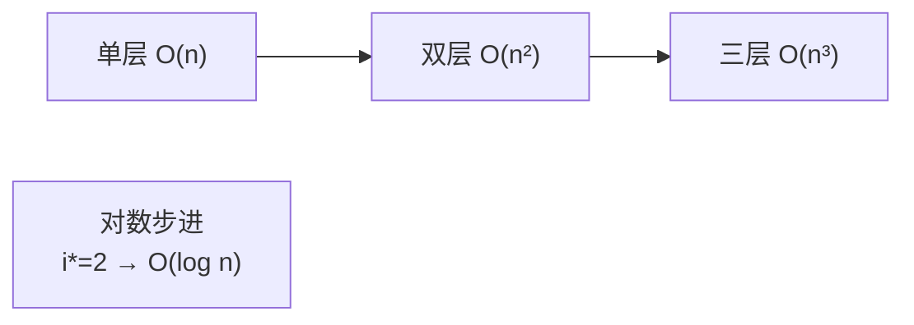

# 控制语句-循环

## 三种循环

```c
/* 1. while：先判断后执行，最少执行0次 */
while (条件)
    语句;

/* 2. do-while：先执行后判断，最少执行1次 */
do
    语句;
while (条件);        /* ← 注意这个分号！ */

/* 3. for：初始化/条件/步进三段式 */
for (初始化; 条件; 步进)
    语句;
```

执行流程对比：



## 三种循环互相改写

任何循环都能用三种形式之一表达：

```c
int i = 0;                      /* for 版 */
for (i = 0; i < n; i++) { f(i); }

i = 0;                          /* while 版 */
while (i < n) { f(i); i++; }

i = 0;                          /* do-while 版（注意n=0时会错！多跑一次） */
if (n > 0)
    do { f(i); i++; } while (i < n);
```

**选择标准**：次数确定用 for；条件主导用 while；至少执行一次（菜单、输入校验）用 do-while。

## 无限循环

```c
for (;;)          /* 最经典：三段全空 */
    { }

while (1)
    { }

while (true)      /* C99: #include <stdbool.h> */
    { }
```

无限循环 + break 是**状态机/服务器主循环**的标准骨架：

```c
for (;;) {
    Request *r = get_request();
    if (r == NULL) break;      /* 唯一出口 */
    handle(r);
}
```

## 循环控制细节

### for 的隐藏特性

```c
/* C99起可在for内声明变量（作用域仅限循环） */
for (int i = 0; i < n; i++) { }        /* i 出循环即销毁 */

/* 逗号表达式让两个变量同步变化 */
for (i = 0, j = n - 1; i < j; i++, j--) { }

/* 三个表达式都可以为空 */
for (; i < n;) { i++; }                /* 等价 while(i<n){i++;} */
```

### 死循环事故现场

```c
/* 事故1：continue跳过步进 */
int i = 0;
while (i < 10) {
    if (data[i] < 0) continue;   /* 💥 i++ 被跳过，i卡死 */
    process(data[i]);
    i++;
}

/* 事故2：分号提前结束循环 */
for (int i = 0; i < 10; i++);    /* ← 分号！循环空转10次 */
    sum += i;                    /* 只执行一次，i=10 */

/* 事故3：无符号回绕 */
for (size_t i = n - 1; i >= 0; i--)  /* 💥 size_t 永不为负，i>=0 恒真 */
    { }
```

### 循环效率

```c
/* 长度计算提到循环外（现代编译器常自动优化，但语义上 strlen 每轮调用是O(n²)） */
for (size_t i = 0; i < strlen(s); i++)   /* 慢：O(n²) */
for (size_t i = 0, len = strlen(s); i < len; i++)   /* 快：O(n) */

/* 循环展开（space换time，编译器 -O3 也会做） */
for (int i = 0; i < n; i += 4) {
    a[i]   += b[i];
    a[i+1] += b[i+1];
    a[i+2] += b[i+2];
    a[i+3] += b[i+3];
}
```

> 分支预测视角：循环条件判断每轮执行一次，CPU分支预测器对"继续循环"几乎总是猜对，**唯独最后一次退出必错**。这就是循环为什么快而杂乱跳转慢的底层原因。

## 从汇编看循环

```c
int sum = 0;
for (int i = 0; i < 10; i++)
    sum += i;
```

```asm
    mov  DWORD PTR [rbp-4], 0      ; sum = 0
    mov  DWORD PTR [rbp-8], 0      ; i = 0
    jmp  .L2                       ; 先跳去检查条件
.L3:
    mov  eax, [rbp-8]
    add  [rbp-4], eax              ; sum += i
    add  DWORD PTR [rbp-8], 1      ; i++
.L2:
    cmp  DWORD PTR [rbp-8], 9      ; i <= 9 ?
    jle  .L3                       ; 条件成立 → 继续循环
```

循环 = **条件跳转往回跳**。逆向时看到 `jle/jl` 跳回上方，即可断定这是循环体尾部。

do-while 编译后只有**一次跳转**（循环尾判断），比 while（先 jmp 到判断，再每次回跳）少一条指令——这就是编译器**循环反转优化**（loop inversion）的动机：把 while 改写为 `if(条件) do {...} while(条件)` 的形式。

## 嵌套循环：二维数组遍历

```c
int a[3][4];
for (int i = 0; i < 3; i++)        /* 外层：行 */
    for (int j = 0; j < 4; j++)    /* 内层：列 */
        a[i][j] = i * 4 + j;
```

**缓存友好原则**：内存中数组按行连续存放，**行优先遍历**（最后一维连续变化）比列优先快数倍——性能敏感代码必守的规则。

时间复杂度直观图：



## 实战：编译提取汇编逐行解析（真实输出）

> 以下汇编全部为**真实编译产物**（非手写示意），指令逐字来自 gcc 输出，`;` 注释为整理所加。提取流程见 `.opencode/skills/c-dev/SKILL.md`；`endbr64`/金丝雀等环境噪音说明见[数组·实战](数组.md)。
> 实测环境：Ubuntu 24.04 / gcc 13.3.0 / x86-64（System V ABI）/ Intel 语法

### 实验1：while / do-while / for —— 三兄弟的真实结构

```c
int lw(int n)   /* while：先判断 */
{
    int s = 0, i = 0;
    while (i < n) { s += i; i++; }
    return s;
}
int ld(int n)   /* do-while：后判断 */
{
    int s = 0, i = 0;
    do { s += i; i++; } while (i < n);
    return s;
}
int lf(int n)   /* for：三段式 */
{
    int s = 0;
    for (int i = 0; i < n; i++) s += i;
    return s;
}
int main(void) { return lw(5) + ld(5) + lf(5); }  /* 30 → 实测退出码30 ✔ */
```

**-O0 三函数对比**（省略序言，s在`[rbp-8]`、i在`[rbp-4]`、n在`[rbp-20]`）：

```asm
lw:                                  ; while：先判断
    mov     DWORD PTR -8[rbp], 0     ; s=0
    mov     DWORD PTR -4[rbp], 0     ; i=0
    jmp     .L2                      ; ★一进来先跳到"检查"
.L3:                                 ; ── 循环体 ──
    mov     eax, DWORD PTR -4[rbp]   ; 取i
    add     DWORD PTR -8[rbp], eax   ; s += i
    add     DWORD PTR -4[rbp], 1     ; i++
.L2:                                 ; ── 条件检查 ──
    mov     eax, DWORD PTR -4[rbp]   ; 取i
    cmp     eax, DWORD PTR -20[rbp]  ; i vs n
    jl      .L3                      ; i<n → 回跳循环体
    mov     eax, DWORD PTR -8[rbp]   ; return s
    ...

ld:                                  ; do-while：后判断
    mov     DWORD PTR -8[rbp], 0     ; s=0
    mov     DWORD PTR -4[rbp], 0     ; i=0
.L6:                                 ; ── 循环体（直接开始！没有先跳检查）──
    mov     eax, DWORD PTR -4[rbp]
    add     DWORD PTR -8[rbp], eax   ; s += i
    add     DWORD PTR -4[rbp], 1     ; i++
    mov     eax, DWORD PTR -4[rbp]
    cmp     eax, DWORD PTR -20[rbp]  ; ★检查在体后
    jl      .L6                      ; 回跳
    ...

lf:                                  ; for：与 while 逐字节相同！
    ...（结构与lw完全一致，仅标签名.L9/.L10不同）
```

两个铁结论：

1. **for 与 while 生成完全相同的代码**——先 `jmp` 去检查、体、`jl` 回跳。for 的三段式只是 while 的语法糖，机器不看糖衣；
2. **do-while 少一条 jmp**：进函数直接执行体，检查在尾部。"至少执行一次"就是"没有入口跳转"——这也是 do-while 天生略快一点的原因。

**main（-O0）的意外收获——callee-saved 寄存器实战**：

```asm
main:
    push    rbp
    mov     rbp, rsp
    push    rbx                 ; ★保存rbx——main要用它存跨call的中间结果
    mov     edi, 5
    call    lw
    mov     ebx, eax            ; lw的结果放rbx（call不会破坏它！）
    mov     edi, 5
    call    ld
    add     ebx, eax            ; 累加
    mov     edi, 5
    call    lf
    add     eax, ebx            ; 最终和
    mov     rbx, QWORD PTR -8[rbp]
    leave
    ret
```

`rbx` 是 **callee-saved** 寄存器：任何函数用它之前必须保存恢复（所以 lw/ld/lf 不敢弄丢它），于是 main 敢把中间结果放在 rbx 里**横跨三次 call**——[调用约定](函数.md)的活体展示。

### 实验2：continue / break —— 都是一条 jmp，只是落点不同

```c
int cb(int n)
{
    int s = 0;
    for (int i = 0; i < n; i++) {
        if (i & 1)
            continue;        /* 跳过奇数 */
        if (i > 8)
            break;           /* 大于8退出 */
        s += i;
    }
    return s;                /* 0+2+4+6+8 = 20 */
}
int main(void) { return cb(20); }      /* 实测退出码20 ✔ */
```

```asm
cb:
    ...
    mov     DWORD PTR -8[rbp], 0       ; s=0
    mov     DWORD PTR -4[rbp], 0       ; i=0
    jmp     .L2                        ; for：先跳检查
.L7:                                  ; ── 体 ──
    mov     eax, DWORD PTR -4[rbp]     ; 取i
    and     eax, 1                     ; i & 1
    test    eax, eax
    jne     .L9                        ; ★continue → 跳.L9（绕过剩余体）
    cmp     DWORD PTR -4[rbp], 8       ; i > 8 ?
    jg      .L10                       ; ★break → 跳.L10（直奔出口）
    mov     eax, DWORD PTR -4[rbp]     ; 只有偶数≤8才走到这：
    add     DWORD PTR -8[rbp], eax     ;   s += i
    jmp     .L4                        ; 正常走完 → 去步进
.L9:
    nop                                ; ← continue 的落点：空垫！
.L4:
    add     DWORD PTR -4[rbp], 1       ; i++（continue也滑到这——步进没有被跳过！）
.L2:
    mov     eax, DWORD PTR -4[rbp]
    cmp     eax, DWORD PTR -20[rbp]    ; i<n?
    jl      .L7
    jmp     .L6                        ; 循环自然结束
.L10:
    nop                                ; ← break 的落点：空垫
.L6:
    mov     eax, DWORD PTR -8[rbp]     ; return s
    ...
```

看清两个落点，"continue 陷阱"豁然开朗：

* **continue = `jne .L9`**：绕过本轮剩余语句，落在步进**之前**的 nop 垫上，然后滑进 `i++`。for 的步进在"检查之外、体之后"，所以 **for + continue 不会死循环**；
* 而 **while 循环的 continue 直接跳回检查**（步进写在体里被绕过）——`while(i<n){ if(...) continue; i++; }` 就是这么死的；
* **break = `jg .L10`**：越过检查直奔出口，一条 jmp 破一层。

### 实验3：循环反转 —— for"先判断"被 -O2 改造成"守卫 + do-while"

```c
long acc(int n)
{
    volatile long s = 0;      /* volatile：s必须住内存，防闭式化/寄存器化 */
    for (int i = 0; i < n; i++)
        s += i;
    return s;
}
int main(void) { return (int)acc(5); }   /* 10 → 实测退出码10 ✔ */
```

```asm
acc:
    endbr64
    mov     QWORD PTR -8[rsp], 0     ; s=0（★-O2无push rbp！直接用rsp寻址）
    test    edi, edi                 ; ── 入口守卫：n<=0? ──
    jle     .L2                      ;   是 → 直接出口（保住"零次循环"语义）
    movsx   rdi, edi
    xor     eax, eax                 ; i=0（住寄存器）
.L3:                                 ; ── do-while 体 ──
    mov     rdx, QWORD PTR -8[rsp]   ; 读s（volatile：每轮必须真访存）
    add     rdx, rax                 ; s += i
    add     rax, 1                   ; i++
    mov     QWORD PTR -8[rsp], rdx   ; 写回s
    cmp     rdi, rax                 ; i到头？
    jne     .L3                      ; 尾部检查回跳——反转完成！
.L2:
    mov     rax, QWORD PTR -8[rsp]   ; return s
    ret
```

**for（先判断）被改造成"入口守卫 + do-while"**：语义不变（n≤0 一次不执行），但 -O0 的"每轮先跳去检查再跳回来"（2跳/轮）变成"尾部一次 jne"（1跳/轮）。这就是**循环反转（loop inversion）**优化。

> 逆向口诀：发布版二进制里的循环**几乎都是"守卫 + do-while"形态**——`test/jle` 开头 + 尾部 `cmp/jne` 回跳，就是被反转过的循环。

### -O2 的"过份聪明"警告

同一实验的 lw/ld/lf 在 -O2 下被 gcc **两轮一迭代展开 + 强度削减**：核心循环变成 `lea edx, 1[rdx+rax*2]`（一条指令补上两轮的和 2i+1）+ `add eax,2`，甚至数学闭式直接消除循环。看不懂发布版汇编时，先怀疑优化器，再怀疑人生——**用 volatile 或外部函数调用可以"冻住"结构**做教学对照。

### 汇编视角总结表（全部实测）

| C语法 | -O0形态 | -O2形态 |
| --- | --- | --- |
| while / for | `jmp`先检查 + 体 + `jl`回跳（2跳/轮） | 守卫`test/jle` + do-while（1跳/轮） |
| do-while | 体 + 尾部检查（1跳/轮） | 同左（天生就是反转形态） |
| continue | `jmp`到步进前的nop垫 | 同左（可直插步进） |
| break | `jmp`到出口nop垫 | 同左 |
| 循环变量 | 住内存`[rbp-4]`，每轮读写 | 住寄存器 |
| 可闭式化循环 | 老实循环 | 整个消失（数学公式替代） |

## 小结

1. 三循环可互换：次数用 for，条件用 while，至少一次用 do-while；
2. for 内声明变量（C99）、逗号表达式是合法且好用的特性；
3. 无符号倒序循环用 `i > 0` 配合 `i-1` 访问，避免 `i >= 0` 死循环；
4. 循环 = 往回跳的条件跳转；while 被"循环反转"优化成 do-while 骨架；
5. 多维数组**行优先**遍历对缓存友好；
6. 新增实测：**for 与 while 机器码逐字节相同**；continue 落在"步进前"、break 落在"出口"——for 的 continue 不死循环、while 的会，落点说明一切。
