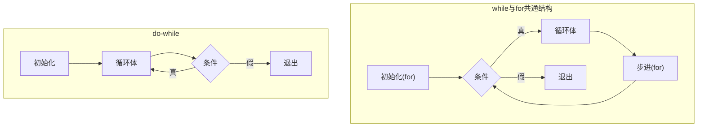
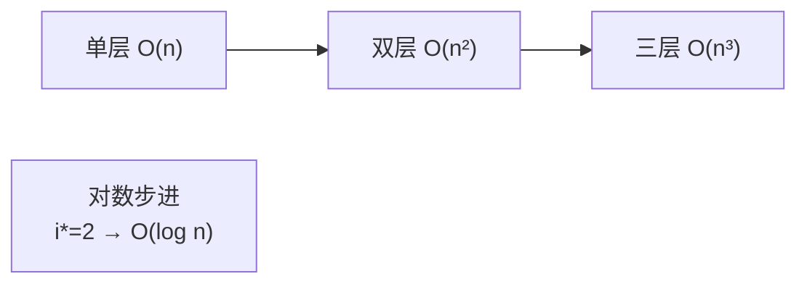

# 控制语句-循环

## 三种循环

```c
/* 1. while：先判断后执行，最少执行0次 */
while (条件)
    语句;

/* 2. do-while：先执行后判断，最少执行1次 */
do
    语句;
while (条件);        /* ← 注意这个分号！ */

/* 3. for：初始化/条件/步进三段式 */
for (初始化; 条件; 步进)
    语句;
```

执行流程对比：



## 三种循环互相改写

任何循环都能用三种形式之一表达：

```c
int i = 0;                      /* for 版 */
for (i = 0; i < n; i++) { f(i); }

i = 0;                          /* while 版 */
while (i < n) { f(i); i++; }

i = 0;                          /* do-while 版（注意n=0时会错！多跑一次） */
if (n > 0)
    do { f(i); i++; } while (i < n);
```

**选择标准**：次数确定用 for；条件主导用 while；至少执行一次（菜单、输入校验）用 do-while。

## 无限循环

```c
for (;;)          /* 最经典：三段全空 */
    { }

while (1)
    { }

while (true)      /* C99: #include <stdbool.h> */
    { }
```

无限循环 + break 是**状态机/服务器主循环**的标准骨架：

```c
for (;;) {
    Request *r = get_request();
    if (r == NULL) break;      /* 唯一出口 */
    handle(r);
}
```

## 循环控制细节

### for 的隐藏特性

```c
/* C99起可在for内声明变量（作用域仅限循环） */
for (int i = 0; i < n; i++) { }        /* i 出循环即销毁 */

/* 逗号表达式让两个变量同步变化 */
for (i = 0, j = n - 1; i < j; i++, j--) { }

/* 三个表达式都可以为空 */
for (; i < n;) { i++; }                /* 等价 while(i<n){i++;} */
```

### 死循环事故现场

```c
/* 事故1：continue跳过步进 */
int i = 0;
while (i < 10) {
    if (data[i] < 0) continue;   /* 💥 i++ 被跳过，i卡死 */
    process(data[i]);
    i++;
}

/* 事故2：分号提前结束循环 */
for (int i = 0; i < 10; i++);    /* ← 分号！循环空转10次 */
    sum += i;                    /* 只执行一次，i=10 */

/* 事故3：无符号回绕 */
for (size_t i = n - 1; i >= 0; i--)  /* 💥 size_t 永不为负，i>=0 恒真 */
    { }
```

### 循环效率

```c
/* 长度计算提到循环外（现代编译器常自动优化，但语义上 strlen 每轮调用是O(n²)） */
for (size_t i = 0; i < strlen(s); i++)   /* 慢：O(n²) */
for (size_t i = 0, len = strlen(s); i < len; i++)   /* 快：O(n) */

/* 循环展开（space换time，编译器 -O3 也会做） */
for (int i = 0; i < n; i += 4) {
    a[i]   += b[i];
    a[i+1] += b[i+1];
    a[i+2] += b[i+2];
    a[i+3] += b[i+3];
}
```

> 分支预测视角：循环条件判断每轮执行一次，CPU分支预测器对"继续循环"几乎总是猜对，**唯独最后一次退出必错**。这就是循环为什么快而杂乱跳转慢的底层原因。

## 从汇编看循环

```c
int sum = 0;
for (int i = 0; i < 10; i++)
    sum += i;
```

```asm
    mov  DWORD PTR [rbp-4], 0      ; sum = 0
    mov  DWORD PTR [rbp-8], 0      ; i = 0
    jmp  .L2                       ; 先跳去检查条件
.L3:
    mov  eax, [rbp-8]
    add  [rbp-4], eax              ; sum += i
    add  DWORD PTR [rbp-8], 1      ; i++
.L2:
    cmp  DWORD PTR [rbp-8], 9      ; i <= 9 ?
    jle  .L3                       ; 条件成立 → 继续循环
```

循环 = **条件跳转往回跳**。逆向时看到 `jle/jl` 跳回上方，即可断定这是循环体尾部。

do-while 编译后只有**一次跳转**（循环尾判断），比 while（先 jmp 到判断，再每次回跳）少一条指令——这就是编译器**循环反转优化**（loop inversion）的动机：把 while 改写为 `if(条件) do {...} while(条件)` 的形式。

## 嵌套循环：二维数组遍历

```c
int a[3][4];
for (int i = 0; i < 3; i++)        /* 外层：行 */
    for (int j = 0; j < 4; j++)    /* 内层：列 */
        a[i][j] = i * 4 + j;
```

**缓存友好原则**：内存中数组按行连续存放，**行优先遍历**（最后一维连续变化）比列优先快数倍——性能敏感代码必守的规则。

时间复杂度直观图：



## 小结

1. 三循环可互换：次数用 for，条件用 while，至少一次用 do-while；
2. for 内声明变量（C99）、逗号表达式是合法且好用的特性；
3. 无符号倒序循环用 `i > 0` 配合 `i-1` 访问，避免 `i >= 0` 死循环；
4. 循环 = 往回跳的条件跳转；while 被"循环反转"优化成 do-while 骨架；
5. 多维数组**行优先**遍历对缓存友好。
