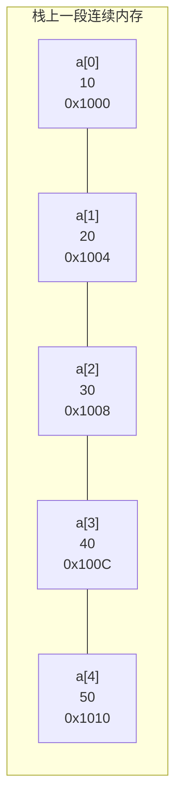
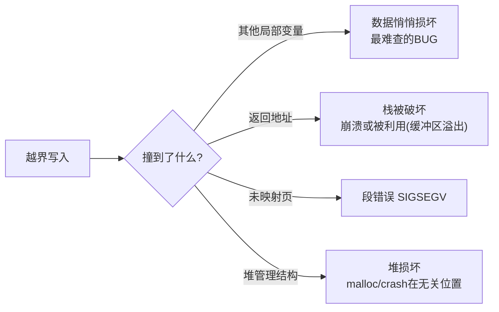
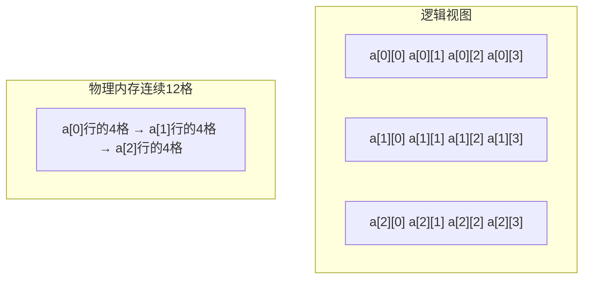
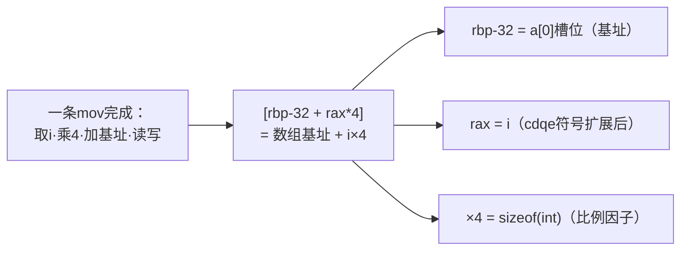
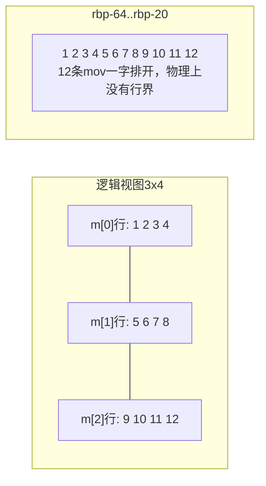

# 数组

## 本质：一段连续内存

```c
int a[5] = {10, 20, 30, 40, 50};
```

内存布局（假设首地址 0x1000，int占4字节）：



**数组名 a 的值 = 首元素地址 = 0x1000**。`a[i]` 的寻址就是一条指令：

```asm
mov  eax, [a + i*4]      ; 基址+变址*比例因子，一拍定址
```

这就是数组快的原因：**O(1) 随机访问是"算"出来的地址，不是"找"出来的**。

## 初始化

```c
int a[5] = {1, 2, 3};            /* 部分：剩余清零 {1,2,3,0,0} */
int b[5] = {0};                  /* 全零的标准写法 */
int c[]  = {1, 2, 3, 4};         /* 长度自动推导为4 */
int d[5] = { [2] = 9 };          /* C99指定初始化：{0,0,9,0,0} */
int e[]  = { [4] = 1 };          /* 长度由最大下标决定：5 */

char s[10] = "hi";               /* {'h','i',0,0,...,0} 剩余清零 */
int x[3]  = {1,2,3,4};           /* ✘ 编译错误：初始项过多 */
int y[3];                        /* ⚠ 未初始化：内容随机 */
```

## 下标的本质：*(a + i)

`a[i]` 与 `*(a + i)` **完全等价**，且**指针加法已包含步长（sizeof(元素类型)）**：

```c
int a[5] = {10, 20, 30, 40, 50};
a[2] == *(a + 2)      /* 30，true */
2[a] == *(2 + a)      /* 30，也true！交换律成立（仅学术价值，别在工程中写） */
```

加法时地址的移动量：

```c
int    *p = a;  p + 1;   /* 地址 +4 */
double *q = ...; q + 1;  /* 地址 +8 */
char   *r = ...; r + 1;  /* 地址 +1 */
/* 指针±n = 地址 ± n*sizeof(指向类型) */
```

## 数组越界：C不做检查

```c
int a[5];
a[5]   = 1;      /* 没有运行时检查！写到了数组外 */
a[100] = 2;      /* 可能段错误，也可能悄悄破坏别的变量 */
```

C把检查成本从每个程序中省掉了，后果自负：



> 缓冲区溢出是安全漏洞之王（栈溢出覆盖返回地址→ROP），本质就是数组越界写。详见[常见陷阱与未定义行为](常见陷阱与未定义行为.md)。

## 数组作为函数参数：退化

**数组传参时退化为指向首元素的指针**，数组大小信息丢失：

```c
void func(int arr[10])     /* 编译器实际处理为 void func(int *arr) */
{
    sizeof(arr);           /* = 4/8，指针大小，不是40！ */
    /* 10 这个信息完全丢失 */
}

/* C惯用法：数组+长度成对传递 */
void func2(int arr[], size_t n);
void func3(int *arr, size_t n);      /* 与上等价 */
```

**修改形参数组 = 修改原数组**（传的是地址）：

```c
void fill(int a[], size_t n) {
    for (size_t i = 0; i < n; i++)
        a[i] = 0;          /* 直接改到调用者的内存 */
}
```

## 二维数组

```c
int a[3][4];       /* 3行4列 = 12个int，内存中仍是"一行连续" */
```



关键推导：

```c
a            /* int(*)[4]：指向第0行的指针（行指针） */
a[i]         /* 第i行首元素地址，类型 int*（一维数组退化的结果） */
a[i][j]      /* 元素，等价 *(*(a + i) + j) */
sizeof(a)    /* 48：整个数组 */
sizeof(a[0]) /* 16：第0行（一个"含4个int的数组"） */

/* 寻址：base + (i*4 + j)*sizeof(int) —— 二维也是一维算出来的 */
```

**二维数组传参**——形参必须带列数：

```c
void print(int a[][4], int rows);       /* ✔ 列数4必须给出，行数可省 */
void print(int (*a)[4], int rows);      /* 完全等价的指针写法 */
void print(int **a);                    /* ✘ 类型不匹配！int**不是int(*)[4] */
```

## 变长数组 VLA（C99）

```c
int n = get_size();
int arr[n];             /* 运行期确定大小（gcc支持，MSVC不支持） */
void func(int n, int m, int a[n][m]);   /* VLA参数，维度可以用先出现的参数 */
```

> VLA 无法静态初始化、大小不可超栈限制、C11 起变为可选特性（`__STDC_NO_VLA__`）。生产代码慎用，需要动态大小优先考虑 malloc。

## 数组 vs 指针：四大区别

| 对比 | 数组 `int a[10]` | 指针 `int *p` |
| --- | --- | --- |
| 内存 | 分配10个int的空间 | 只分配指针自身4/8字节 |
| sizeof | 40 | 4/8 |
| 可否整体赋值 | ✘ `a = b` 编译错误 | ✔ `p = q` |
| 数组名是地址但**不是左值**（不可a++） | ✔ | ✔ 可移动 |
| 退化 | 传参时退化为指针 | 本来就是 |

> `a++` 编译错误的原因：数组名是**地址常量**（符号表里的链接期常量），没有"存放数组名的变量"可以让它自增；而 p 是真变量。

## 常用操作实现

```c
/* 逆序 */
for (size_t i = 0; i < n / 2; i++) {
    int t = a[i]; a[i] = a[n-1-i]; a[n-1-i] = t;
}

/* 找最大值 */
int max = a[0];
for (size_t i = 1; i < n; i++)
    if (a[i] > max) max = a[i];

/* 冒泡排序（相邻比较，稳定） */
for (size_t i = 0; i < n - 1; i++)
    for (size_t j = 0; j + 1 < n - i; j++)
        if (a[j] > a[j+1]) { int t = a[j]; a[j] = a[j+1]; a[j+1] = t; }
```

## 实战：编译提取汇编逐行解析（真实输出）

> 本节汇编**全部为真实编译产物**（非手写示意），指令逐字来自 gcc 输出，`;` 后中文注释为整理时所加。可复现实验流程见 `.opencode/skills/c-dev/SKILL.md`。

**实测环境**：Ubuntu 24.04 LTS / gcc 13.3.0 / x86-64（System V ABI）/ Intel 语法

```bash
gcc -S -O0 -masm=intel -fno-asynchronous-unwind-tables arr1_basic.c -o arr1_O0.s
gcc -S -O2 -masm=intel -fno-asynchronous-unwind-tables arr2_sum.c   -o arr2_O2.s
# -masm=intel：Intel语法（贴近Windows逆向）；-fno-asynchronous-unwind-tables：去掉.cfi噪音
```

### 阅读前须知：真实汇编里的三条"环境噪音"

刚接触真实汇编会发现它比教材多几样东西，先排除干扰再读正文：

| 现象 | 是什么 | 与数组的关系 |
| --- | --- | --- |
| `endbr64` | Intel CET 间接分支保护指令 | 无关，每函数开头都有，忽略 |
| `fs:40` 金丝雀 | Ubuntu 默认开 `-fstack-protector-strong`：**函数里有局部数组就启用**。从线程段取8字节随机值存 `[rbp-8]`，返回前校验，被改就 `call __stack_chk_fail` | 强相关：它就是防"数组越界写破坏栈"的哨兵——越界第一个撞的常是它 |
| `.p2align` / `.size` / `.ident` / `.note` | 对齐与元数据 | 无关，本文裁剪 |

`leave` = `mov rsp, rbp` + `pop rbp`（回收栈帧）；`ret` 从 `[rsp]` 弹出返回地址跳回。

### 实验1：一维数组的定义与访问

```c
int main(void)
{
    int a[5] = {10, 20, 30, 40, 50};   /* 栈上5个int */
    int i = 2;

    a[0] = 100;                        /* 常量下标：写 */
    a[i]  = 200;                       /* 变量下标：写 */
    a[9]  = 999;                       /* 越界写：编译器毫无反应！ */
    int x = a[3] + a[i];               /* 常量+变量下标：读 */

    return x;                          /* 40 + 200 = 240 → 实测退出码240 ✔ */
}
```

`gcc -S -O0` 真实输出（main，逐行注解）：

```asm
main:
    endbr64                            ; CET保护，忽略
    push    rbp                        ; 保存调用者rbp
    mov     rbp, rsp                   ; 建立栈帧
    sub     rsp, 48                    ; 开48字节：金丝雀8+a[5]20+i4+x4，对齐补齐
    mov     rax, QWORD PTR fs:40       ; ┐ 栈金丝雀：有局部数组→自动开栈保护
    mov     QWORD PTR -8[rbp], rax     ; ┘ 随机值存[rbp-8]
    xor     eax, eax                   ; 清零eax（canary配套动作）

    mov     DWORD PTR -32[rbp], 10     ; a[0]=10
    mov     DWORD PTR -28[rbp], 20     ; a[1]=20
    mov     DWORD PTR -24[rbp], 30     ; a[2]=30
    mov     DWORD PTR -20[rbp], 40     ; a[3]=40
    mov     DWORD PTR -16[rbp], 50     ; a[4]=50 ← 初始化=5条mov立即数，无循环无拷贝
    mov     DWORD PTR -40[rbp], 2      ; i = 2

    mov     DWORD PTR -32[rbp], 100    ; a[0]=100：常量下标→偏移编译期折叠！
    mov     eax, DWORD PTR -40[rbp]    ; 取 i
    cdqe                               ; eax符号扩展→rax（下标是有符号int，寻址要64位）
    mov     DWORD PTR -32[rbp+rax*4], 200   ; a[i]=200：基址+变址×比例因子！

    mov     DWORD PTR 4[rbp], 999      ; a[9]=999：-32+9×4=+4 → 越界！
                                       ; 命中[rbp+4]＝保存的rbp高4字节
                                       ; 没有任何检查指令——编译器"毫无反应"

    mov     edx, DWORD PTR -20[rbp]    ; a[3]读：常量下标折叠为固定偏移-20
    mov     eax, DWORD PTR -40[rbp]    ; 取 i
    cdqe
    mov     eax, DWORD PTR -32[rbp+rax*4]   ; a[i]读：SIB寻址
    add     eax, edx                   ; a[3] + a[i]
    mov     DWORD PTR -36[rbp], eax    ; x=
    mov     eax, DWORD PTR -36[rbp]    ; 返回值送eax（低8位=240）

    mov     rdx, QWORD PTR -8[rbp]     ; ┐ 校验金丝雀：取回[rbp-8]
    sub     rdx, QWORD PTR fs:40       ; │ 与原值相减
    je      .L3                        ; │ 相等=没被越界破坏→放行
    call    __stack_chk_fail@PLT       ; ┘ 否则崩溃 "*** stack smashing detected ***"
.L3:
    leave                              ; mov rsp,rbp / pop rbp（注意：pop的rbp已被a[9]污染！）
    ret                                ; 返回，实测退出码240
```

栈帧布局一览（编译器实际分配）：

| 槽位 | 存放 | 谁写的 |
| --- | --- | --- |
| `[rbp+8]` | **返回地址** | call指令自动压栈（`a[10]`的落点！） |
| `[rbp+0..7]` | **保存的rbp** | push rbp（`a[9]`命中其高4字节） |
| `[rbp-8]` | 栈金丝雀 | fs:40 |
| `[rbp-16 .. -32]` | `a[4]→a[0]`（各占4字节） | 初始化mov |
| `[rbp-36]` | x | 表达式结果 |
| `[rbp-40]` | i | mov立即数 |

三条铁律从汇编里自己长出来了：

1. **常量下标 → 编译期折叠**：`a[0]`、`a[3]` 直接变成 `[rbp-32]`、`[rbp-20]`，和访问普通变量没有任何区别；
2. **变量下标 → SIB寻址**：`[rbp-32+rax*4]`，比例因子4就是`sizeof(int)`——本文开头"寻址公式 `a[i] → *(基址+i*sizeof(元素))`"的一条指令化身；
3. **越界没有任何检查**：`a[9]=999` 被编译成 `mov DWORD PTR 4[rbp], 999`，覆写保存的rbp高4字节；但main的退出路径（leave/ret用rsp不用rbp）恰好不再依赖rbp，**侥幸跑完、退出码240正常**——UB"看起来能跑"的活证据。

SIB寻址图解：



**越界的真实边界在哪？** 加时赛实验：

```c
int main(void)
{
    int a[5] = {10, 20, 30, 40, 50};
    a[10] = 999;        /* rbp-32 + 10*4 = rbp+8 → 返回地址！ */
    return 0;
}
```

```asm
    mov     DWORD PTR 8[rbp], 999      ; a[10] → [rbp+8]＝返回地址槽位，实测一模一样
```

```text
$ ./a.out
Segmentation fault (core dumped)      ← ret 把 999 当地址跳转 → SIGSEGV
$ echo $?
139                                    ← 128+11＝被11号信号(SIGSEGV)杀死
```

`a[9]` 毁saved rbp侥幸存活，`a[10]` 毁返回地址当场毙命。**栈溢出攻击（覆写返回地址劫持控制流）的原理不过这一行**，配套实战见 crackme。

### 实验2：循环累加 —— -O0 与 -O2 的真实差距

```c
int sum(int a[], int n)
{
    int s = 0;
    for (int k = 0; k < n; k++)
        s += a[k];
    return s;
}

int main(void)
{
    int a[8] = {1, 2, 3, 4, 5, 6, 7, 8};
    return sum(a, 8);      /* 36 → 实测退出码36 ✔ */
}
```

**-O0 的 sum（教材式：s、k、基址每轮都从内存重新读）**：

```asm
sum:
    endbr64
    push    rbp
    mov     rbp, rsp
    mov     QWORD PTR -24[rbp], rdi    ; 参数1：数组地址——8字节！形参int a[]实为指针
    mov     DWORD PTR -28[rbp], esi    ; 参数2：n
    mov     DWORD PTR -8[rbp], 0       ; s = 0（在内存[rbp-8]）
    mov     DWORD PTR -4[rbp], 0       ; k = 0（在内存[rbp-4]）
    jmp     .L2                        ; 先跳去检查条件（"先判断"结构）
.L3:                                   ; ─── 循环体 ───
    mov     eax, DWORD PTR -4[rbp]     ; 读k（访存！）
    cdqe
    lea     rdx, 0[0+rax*4]            ; rdx = k*4（lea做乘法，不访存）
    mov     rax, QWORD PTR -24[rbp]    ; 重新取出数组基址（访存！）
    add     rax, rdx                   ; 基址 + k*4
    mov     eax, DWORD PTR [rax]       ; 读 a[k]
    add     DWORD PTR -8[rbp], eax     ; s += a[k]（s在内存里加减）
    add     DWORD PTR -4[rbp], 1       ; k++（同样在内存里）
.L2:                                   ; ─── 条件检查 ───
    mov     eax, DWORD PTR -4[rbp]     ; 又读一遍k
    cmp     eax, DWORD PTR -28[rbp]    ; k 与 n 比较
    jl      .L3                        ; k<n → 回跳继续
    mov     eax, DWORD PTR -8[rbp]     ; 返回值 = s
    pop     rbp
    ret
```

**-O2 的 sum（发布式：无栈帧、指针走查、每轮4条指令）**：

```asm
sum:
    endbr64
    test    esi, esi                   ; n==0?
    jle     .L4                        ; n<=0 直接返回0（边界处理折叠进入口）
    movsx   rsi, esi                   ; n符号扩展到64位
    xor     eax, eax                   ; s=0——全程活在寄存器eax里
    lea     rdx, [rdi+rsi*4]           ; 一次算出"末尾指针"＝基址+n*4
.L3:
    add     eax, DWORD PTR [rdi]       ; s += *p
    add     rdi, 4                     ; p++（指针走查！）
    cmp     rdi, rdx                   ; p 到末尾了吗
    jne     .L3                        ; 没到继续——注意：do-while形态（循环尾比较）
    ret
.L4:
    xor     eax, eax
    ret
```

**-O2 的 main（终极形态）**：

```asm
main:
    endbr64
    mov     eax, 36                    ; 数组+求和整个被编译期常量折叠！
    ret                                ; 运行期根本不存在这个数组
```

三层对比：

| 层面 | -O0 | -O2 |
| --- | --- | --- |
| 栈帧 | 标准 `push rbp` / `sub rsp` | **完全没有**（参数寄存器直用，s常驻寄存器） |
| 寻址 | 每轮重读k、重取基址、lea算k*4 | 编译成**指针走查**：`add rdi,4`——下标寻址被优化成指针自增 |
| 循环结构 | 先jmp去检查（while式） | 循环尾 `cmp/jne`（do-while式，少一次跳转） |
| main | 数组老老实实8条mov放栈上 | **`mov eax,36`**——整个数组被编译期吃掉 |

> 逆向提示：IDA/OllyDbg 里看到的发布版代码就是 -O2 的样子——**"下标循环"在真实二进制里几乎总以"指针走查"形态出现**，识别特征是 `add reg,4` 与 `cmp` 的固定搭配。

### 实验3：a[k] / *(a+k) / 指针走查 —— 三种写法的同一性证明

```c
int sum_index(const int *a, int n)     /* 写法1：下标 */
{
    int s = 0;
    for (int k = 0; k < n; k++)
        s += a[k];
    return s;
}

int sum_deref(const int *a, int n)     /* 写法2：*(a+k) */
{
    int s = 0;
    for (int k = 0; k < n; k++)
        s += *(a + k);
    return s;
}

int sum_ptr(const int *a, int n)       /* 写法3：指针走查 */
{
    int s = 0;
    for (const int *p = a; p < a + n; p++)
        s += *p;
    return s;
}
```

`-O2` 真实输出对比：

**sum_index 与 sum_deref 逐字节完全相同**（仅标签名 `.L3/.L4` 与 `.L9/.L10` 不同）：

```asm
sum_index:                        ; sum_deref 与此完全一致
    endbr64
    test    esi, esi
    jle     .L4
    movsx   rsi, esi
    xor     eax, eax
    lea     rdx, [rdi+rsi*4]      ; 末指针
.L3:
    add     eax, DWORD PTR [rdi]  ; ← 核心循环体4条指令
    add     rdi, 4                ; ← 三个函数完全相同
    cmp     rdi, rdx              ; ←
    jne     .L3                   ; ←
    ret
```

**sum_ptr** 核心循环体同样是这4条，仅边界处理不同（源码把 `p<a+n` 写在循环顶部，所以入口先比较一次再进do-while）：

```asm
sum_ptr:
    endbr64
    movsx   rsi, esi
    xor     eax, eax
    lea     rdx, [rdi+rsi*4]
    cmp     rdi, rdx              ; 入口先判 p<a+n
    jnb     .L15                  ; 不满足直接返回
.L14:
    add     eax, DWORD PTR [rdi]  ; 循环体与上面完全相同
    add     rdi, 4
    cmp     rdi, rdx
    jb      .L14
    ret
.L15:
    ret
```

```asm
main:                             ; -O2：三个求和全部编译期折叠
    endbr64
    mov     eax, 30               ; 10×3
    ret
```

结论：**`a[k]`、`*(a+k)`、`p++` 只是写给编译器的三种拼法，语义相同 → 机器码相同**。"指针比数组快"是流传已久的谣言——在优化器眼里没有区别（差异只在 -O0 这种不优化的教学模式下）。

### 实验4：数组传参 = 传地址 = 别名

```c
int first(int arr[5])          /* 形参写作数组，实为 int *arr */
{
    arr[0] = arr[0] + 1;       /* 通过地址改到 main 的数组 */
    return arr[1];
}

int main(void)
{
    int a[5] = {7, 8, 9, 10, 11};
    int r = first(a);          /* 传数组名 = 传首元素地址 */
    return r + a[0];           /* 8 + 8 = 16 → 实测退出码16 ✔ */
}
```

```asm
first:
    endbr64
    push    rbp
    mov     rbp, rsp
    mov     QWORD PTR -8[rbp], rdi    ; 收到的rdi就是地址；注意：形参里的"5"在汇编里荡然无存！
    mov     rax, QWORD PTR -8[rbp]
    mov     eax, DWORD PTR [rax]      ; arr[0] 读：间接寻址[rax]
    lea     edx, 1[rax]               ; +1（lea做算术：edx=rax+1）
    mov     rax, QWORD PTR -8[rbp]
    mov     DWORD PTR [rax], edx      ; arr[0]= 写：写穿地址——改的是main的内存！
    mov     rax, QWORD PTR -8[rbp]
    mov     eax, DWORD PTR 4[rax]     ; arr[1]：基址+4（比例因子再现）
    pop     rbp
    ret

main:
    ...
    mov     DWORD PTR -32[rbp], 7     ; a[0]=7（共5条初始化mov，略）
    lea     rax, -32[rbp]             ; 取a[0]的地址
    mov     rdi, rax                  ; 第1参数＝地址（不是值！）
    call    first
    mov     DWORD PTR -36[rbp], eax   ; r = 8（arr[1]的值）
    mov     edx, DWORD PTR -32[rbp]   ; 读a[0]——已经是8了，被first改过！
    mov     eax, DWORD PTR -36[rbp]   ; r = 8
    add     eax, edx                  ; 8+8
    ...
```

证明链：`lea rax,-32[rbp]`（取址）→ `rdi`（传址）→ `[rax]`（间址写）→ main 里 `a[0]` 读出 8。**全程没有任何数组拷贝发生**——所谓"退化"不是损失，是本来面目：数组传参就是传首地址，形参 `int arr[5]` 里的 `5` 纯属装饰，编译器看都不看。

### 实验5：二维数组的寻址公式

```c
int get(int a[3][4], int i, int j)   /* 形参退化为 int (*a)[4] */
{
    return a[i][j];
}

int main(void)
{
    int m[3][4] = {{1,  2,  3,  4},
                   {5,  6,  7,  8},
                   {9, 10, 11, 12}};
    return get(m, 2, 3);              /* 12 → 实测退出码12 ✔ */
}
```

```asm
get:
    endbr64
    push    rbp
    mov     rbp, rsp
    mov     QWORD PTR -8[rbp], rdi    ; a：行指针 int(*)[4]（第1参数rdi）
    mov     DWORD PTR -12[rbp], esi   ; i（第2参数esi）
    mov     DWORD PTR -16[rbp], edx   ; j（第3参数edx）
    mov     eax, DWORD PTR -12[rbp]   ; 取 i
    cdqe
    sal     rax, 4                    ; rax = i*16 ←左移4位＝×16＝行宽(4列×4字节)！
    mov     rdx, rax
    mov     rax, QWORD PTR -8[rbp]    ; 基址
    add     rdx, rax                  ; rdx = base + i*16（第i行行首）
    mov     eax, DWORD PTR -16[rbp]   ; 取 j
    cdqe
    mov     eax, DWORD PTR [rdx+rax*4]   ; 读 base + i*16 + j*4 ！
    pop     rbp                       ; 返回值已在eax
    ret
```

`a[i][j]` 的地址 = **`base + i×行宽 + j×元素大小` = `base + i×16 + j×4`**——`sal rax,4`（i×16）就是"跨行"，`[rdx+rax*4]`（j×4）就是"行内取列"。与本文开头"`a[i][j] ≡ *(*(a+i)+j)`，二维也是一维算出来的"完全互证。

main 的初始化把 12 个值**一字排开**（连续性的铁证）：

```asm
main:
    ...
    mov     DWORD PTR -64[rbp], 1     ; m[0][0]
    mov     DWORD PTR -60[rbp], 2     ; m[0][1]
    mov     DWORD PTR -56[rbp], 3     ; m[0][2]
    mov     DWORD PTR -52[rbp], 4     ; m[0][3]
    mov     DWORD PTR -48[rbp], 5     ; m[1][0] ← 下一行紧贴上一行，没有边界！
    ...（共12条，省略）
    mov     DWORD PTR -20[rbp], 12    ; m[2][3] ← 最后一格
    lea     rax, -64[rbp]             ; 传首地址（整个数组只有一个地址入口）
    mov     edx, 3                    ; j=3（第3参数）
    mov     esi, 2                    ; i=2（第2参数）
    mov     rdi, rax                  ; a=首地址（第1参数）
    call    get
    ...
```



### 实验6：全局数组的三种归宿（.data / .bss / 栈）

```c
int g_init[4] = {1, 2, 3, 4};     /* 已初始化非0 → .data 段 */
int g_zero[4] = {0};              /* 全0 → .bss 段（显式{0}也一样！） */
int g_bss[4];                     /* 未初始化 → .bss 段 */

int main(void)
{
    int local[4] = {5, 6, 7, 8};  /* 局部 → 栈 */
    g_bss[0] = g_init[3] + g_zero[1] + local[1];   /* 4+0+6=10 → 实测退出码10 ✔ */
    return g_bss[0];
}
```

`gcc -S -O0` 真实输出（数据段部分原样保留）：

```asm
	.globl	g_init
	.data                       ┐ .data段：初始值真实落盘
	.align 16                    │ （可执行文件里躺着这16字节）
g_init:                         │
	.long	1                    │
	.long	2                    │
	.long	3                    │
	.long	4                    ┘
	.globl	g_zero
	.bss                        ┐ .bss段：只记录"16字节零"
	.align 16                    │ 不占文件体积，加载时由OS清零
g_zero:                         │ （显式{0}初始化同样进bss——全0=没信息量）
	.zero	16                   ┘
	.globl	g_bss
	.bss
g_bss:
	.zero	16

main:
    ...
    mov     DWORD PTR -32[rbp], 5       ; local[0]=5（局部数组：栈，rbp相对寻址）
    ...（4条初始化mov）
    mov     edx, DWORD PTR g_init[rip+12]  ; g_init[3]：rip相对寻址＋常量折叠+12
    mov     eax, DWORD PTR g_zero[rip+4]   ; g_zero[1]：+4
    add     edx, eax
    mov     eax, DWORD PTR -28[rbp]         ; local[1]：又见rbp相对寻址
    add     eax, edx
    mov     DWORD PTR g_bss[rip], eax       ; 写全局数组：rip相对寻址
    mov     eax, DWORD PTR g_bss[rip]
    ...
```

`size` 命令实测（对比空程序基线）：

```text
$ size empty.bin arr6_global.bin
   text    data     bss
   1228     544       8     ← 空程序基线
   1478     616      48     ← bss +40（两个.bss数组共32字节+运行时增量）
                                data增量含g_init落盘的16字节
```

三种归宿的寻址对照：

| 对象 | 位置 | 寻址方式 | 特征 |
| --- | --- | --- | --- |
| 局部数组 | 栈 | `[rbp-32+rax*4]` | rbp相对；函数返回即失效 |
| 全局数组 | .data/.bss | `g_init[rip+12]` | **rip相对**（位置无关代码标配）；全程有效 |
| .data 内容 | 可执行文件 | `.long 1` | 逆向时直接在文件/内存里看到初值 |
| .bss 内容 | 无 | `.zero 16` | 文件里只有符号和大小，内容全靠加载器清零 |

> 逆向提示：IDA 里 D 段（.data）符号有初值可直接读，B 段（.bss）只有地址没有内容——静态分析全局变量时先看它在哪个段。

### 汇编视角总结表：数组C语法 → 指令映射（全部实测）

| C代码 | 编译产物（实测） | 说明 |
| --- | --- | --- |
| 局部 `int a[5]={...}` | 5条 `mov DWORD PTR [rbp-XX], imm` | 栈上逐个立即数填充 |
| 全局 `int g[4]={1,2,3,4}` | `.data` 里 `.long 1`×4 | 初值落盘进文件 |
| 全局 `int g[4];` | `.bss` 里 `.zero 16` | 不占文件体积 |
| `a[0]` / `a[3]` | `[rbp-32]` / `[rbp-20]` | 常量下标编译期折叠 |
| `a[i]` | `mov eax,[rbp-32+rax*4]` | SIB：基址+变址×比例 |
| `a[i][j]` | `sal rax,4` + `mov eax,[rdx+rax*4]` | 行宽乘法+列比例因子 |
| `f(a)` | `lea rax,-32[rbp]` → `rdi` | 传参＝取首地址 |
| 形参 `arr[k]` | `add eax,[rdi]` + `add rdi,4` | 指针走查（-O2） |
| 越界 `a[9]` / `a[10]` | `mov [rbp+4]` / `mov [rbp+8]` | 无检查！命中saved rbp/返回地址 |

## 小结

1. 数组=连续内存+O(1)下标寻址（基址+变址×比例）；
2. `a[i] ≡ *(a+i)`，指针运算自带步长——实验3用逐字节相同的机器码给出终极证明；
3. **C不做越界检查**，越界是UB重灾区——实验1实测：`a[9]`覆写saved rbp侥幸存活、`a[10]`覆写返回地址当场段错误；
4. 传参退化成指针，必须带长度参数——实验4的汇编里形参数组的"5"荡然无存；
5. 二维数组物理上仍是一维，`a[i][j] ≡ *(*(a+i)+j)`，传参必须带列数——实验5的 `sal rax,4` 即行宽乘法；
6. -O2会把下标循环重写成指针走查、把常量数组整个编译期吃掉（`mov eax,36`）——**逆向看到的循环长的是-O2的样子**。
