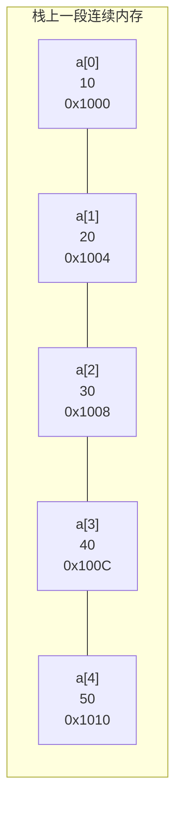
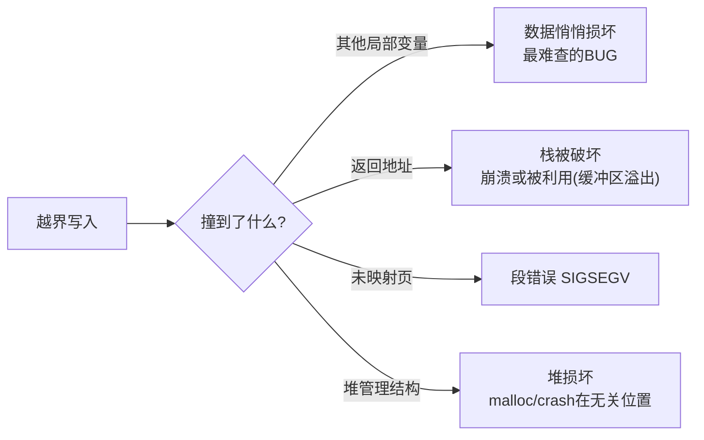
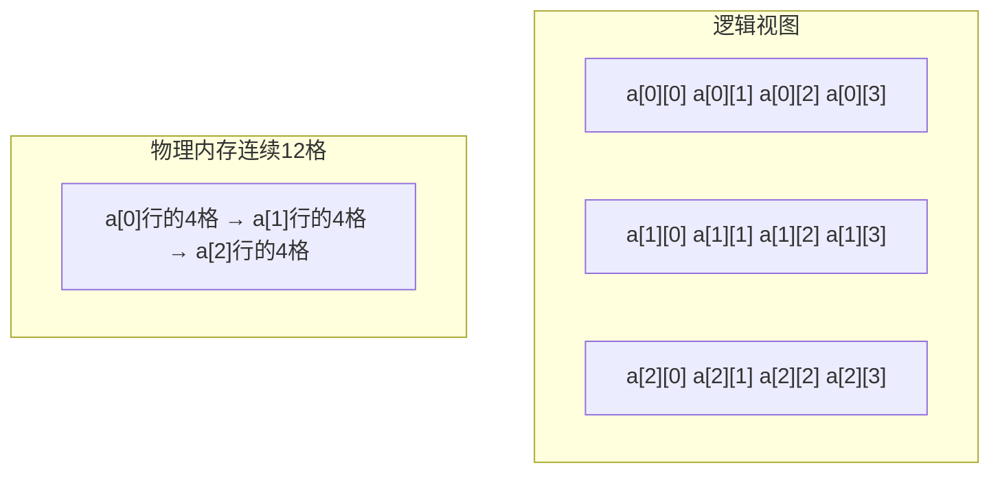

# 数组

## 本质：一段连续内存

```c
int a[5] = {10, 20, 30, 40, 50};
```

内存布局（假设首地址 0x1000，int占4字节）：



**数组名 a 的值 = 首元素地址 = 0x1000**。`a[i]` 的寻址就是一条指令：

```asm
mov  eax, [a + i*4]      ; 基址+变址*比例因子，一拍定址
```

这就是数组快的原因：**O(1) 随机访问是"算"出来的地址，不是"找"出来的**。

## 初始化

```c
int a[5] = {1, 2, 3};            /* 部分：剩余清零 {1,2,3,0,0} */
int b[5] = {0};                  /* 全零的标准写法 */
int c[]  = {1, 2, 3, 4};         /* 长度自动推导为4 */
int d[5] = { [2] = 9 };          /* C99指定初始化：{0,0,9,0,0} */
int e[]  = { [4] = 1 };          /* 长度由最大下标决定：5 */

char s[10] = "hi";               /* {'h','i',0,0,...,0} 剩余清零 */
int x[3]  = {1,2,3,4};           /* ✘ 编译错误：初始项过多 */
int y[3];                        /* ⚠ 未初始化：内容随机 */
```

## 下标的本质：*(a + i)

`a[i]` 与 `*(a + i)` **完全等价**，且**指针加法已包含步长（sizeof(元素类型)）**：

```c
int a[5] = {10, 20, 30, 40, 50};
a[2] == *(a + 2)      /* 30，true */
2[a] == *(2 + a)      /* 30，也true！交换律成立（仅学术价值，别在工程中写） */
```

加法时地址的移动量：

```c
int    *p = a;  p + 1;   /* 地址 +4 */
double *q = ...; q + 1;  /* 地址 +8 */
char   *r = ...; r + 1;  /* 地址 +1 */
/* 指针±n = 地址 ± n*sizeof(指向类型) */
```

## 数组越界：C不做检查

```c
int a[5];
a[5]   = 1;      /* 没有运行时检查！写到了数组外 */
a[100] = 2;      /* 可能段错误，也可能悄悄破坏别的变量 */
```

C把检查成本从每个程序中省掉了，后果自负：



> 缓冲区溢出是安全漏洞之王（栈溢出覆盖返回地址→ROP），本质就是数组越界写。详见[常见陷阱与未定义行为](常见陷阱与未定义行为.md)。

## 数组作为函数参数：退化

**数组传参时退化为指向首元素的指针**，数组大小信息丢失：

```c
void func(int arr[10])     /* 编译器实际处理为 void func(int *arr) */
{
    sizeof(arr);           /* = 4/8，指针大小，不是40！ */
    /* 10 这个信息完全丢失 */
}

/* C惯用法：数组+长度成对传递 */
void func2(int arr[], size_t n);
void func3(int *arr, size_t n);      /* 与上等价 */
```

**修改形参数组 = 修改原数组**（传的是地址）：

```c
void fill(int a[], size_t n) {
    for (size_t i = 0; i < n; i++)
        a[i] = 0;          /* 直接改到调用者的内存 */
}
```

## 二维数组

```c
int a[3][4];       /* 3行4列 = 12个int，内存中仍是"一行连续" */
```



关键推导：

```c
a            /* int(*)[4]：指向第0行的指针（行指针） */
a[i]         /* 第i行首元素地址，类型 int*（一维数组退化的结果） */
a[i][j]      /* 元素，等价 *(*(a + i) + j) */
sizeof(a)    /* 48：整个数组 */
sizeof(a[0]) /* 16：第0行（一个"含4个int的数组"） */

/* 寻址：base + (i*4 + j)*sizeof(int) —— 二维也是一维算出来的 */
```

**二维数组传参**——形参必须带列数：

```c
void print(int a[][4], int rows);       /* ✔ 列数4必须给出，行数可省 */
void print(int (*a)[4], int rows);      /* 完全等价的指针写法 */
void print(int **a);                    /* ✘ 类型不匹配！int**不是int(*)[4] */
```

## 变长数组 VLA（C99）

```c
int n = get_size();
int arr[n];             /* 运行期确定大小（gcc支持，MSVC不支持） */
void func(int n, int m, int a[n][m]);   /* VLA参数，维度可以用先出现的参数 */
```

> VLA 无法静态初始化、大小不可超栈限制、C11 起变为可选特性（`__STDC_NO_VLA__`）。生产代码慎用，需要动态大小优先考虑 malloc。

## 数组 vs 指针：四大区别

| 对比 | 数组 `int a[10]` | 指针 `int *p` |
| --- | --- | --- |
| 内存 | 分配10个int的空间 | 只分配指针自身4/8字节 |
| sizeof | 40 | 4/8 |
| 可否整体赋值 | ✘ `a = b` 编译错误 | ✔ `p = q` |
| 数组名是地址但**不是左值**（不可a++） | ✔ | ✔ 可移动 |
| 退化 | 传参时退化为指针 | 本来就是 |

> `a++` 编译错误的原因：数组名是**地址常量**（符号表里的链接期常量），没有"存放数组名的变量"可以让它自增；而 p 是真变量。

## 常用操作实现

```c
/* 逆序 */
for (size_t i = 0; i < n / 2; i++) {
    int t = a[i]; a[i] = a[n-1-i]; a[n-1-i] = t;
}

/* 找最大值 */
int max = a[0];
for (size_t i = 1; i < n; i++)
    if (a[i] > max) max = a[i];

/* 冒泡排序（相邻比较，稳定） */
for (size_t i = 0; i < n - 1; i++)
    for (size_t j = 0; j + 1 < n - i; j++)
        if (a[j] > a[j+1]) { int t = a[j]; a[j] = a[j+1]; a[j+1] = t; }
```

## 小结

1. 数组=连续内存+O(1)下标寻址（基址+变址×比例）；
2. `a[i] ≡ *(a+i)`，指针运算自带步长；
3. **C不做越界检查**，越界是UB重灾区；
4. 传参退化成指针，必须带长度参数；
5. 二维数组物理上仍是一维，`a[i][j] ≡ *(*(a+i)+j)`，传参必须带列数。
