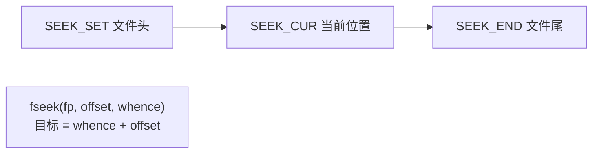

# 文件操作

## FILE 与流

标准IO把文件抽象成**流（stream）**，`FILE *` 是流的句柄（内部含缓冲区、位置指示器、错误标志）：

```c
#include <stdio.h>

int main(void)
{
    FILE *fp = fopen("data.txt", "r");   /* 打开 → 得到句柄 */
    if (fp == NULL) {                    /* 失败必检查！ */
        perror("fopen");                 /* 打印 "fopen: No such file..." */
        return 1;
    }

    char line[256];
    while (fgets(line, sizeof line, fp) != NULL)   /* 逐行读 */
        fputs(line, stdout);                       /* 写到屏幕 */

    fclose(fp);                          /* 关闭：刷新缓冲+释放资源 */
    return 0;
}
```

## fopen 模式表

| 模式 | 读 | 写 | 文件存在 | 文件不存在 | 位置 |
| --- | --- | --- | --- | --- | --- |
| `"r"` | ✔ | ✘ | 打开 | **失败NULL** | 头部 |
| `"w"` | ✘ | ✔ | **清空** | 新建 | 头部 |
| `"a"` | ✘ | ✔ | 保留 | 新建 | **尾部（每次写强制跳尾）** |
| `"r+"` | ✔ | ✔ | 打开 | 失败 | 头部（读改写） |
| `"w+"` | ✔ | ✔ | 清空 | 新建 | 头部 |
| `"a+"` | ✔ | ✔ | 保留 | 新建 | 读在头，写在尾 |
| 加`b`（如`"rb"`） | 二进制模式：Windows下不转换`\r\n`↔`\n`（Linux下无差别，**建议始终带b，语义明确**） | | | | |

## 写文件家族

```c
/* 三个层级：字符/字符串/格式化 */
fputc('A', fp);                  /* 写单字符 */
fputs("hello\n", fp);            /* 写字符串（不加\0，不自动换行） */
fprintf(fp, "id=%d,name=%s\n", id, name);   /* 格式化写（日志/配置） */

/* 快捷：三个stdout版 */
putchar('A');                    /* fputc('A', stdout) */
puts("hi");                      /* fputs("hi",stdout) + 自动加\n */
printf(...);
```

**写不等于落盘**：写入先进 FILE 的用户态缓冲区，`fclose/fflush` 才真正触发 `write` 系统调用（见缓冲一节）。

## 读文件家族

```c
int    c   = fgetc(fp);          /* 读单字符；返回int是为了能装下EOF(-1)！ */
char *ok = fgets(buf, n, fp);    /* 读一行（最多n-1字符，自动加\0）
                                    读到EOF或换行停止，\n 保留在串里
                                    返回NULL = 读完了 */
int    n   = fscanf(fp, "%d,%s", &id, name);   /* 格式化读
                                    返回成功匹配的项目数（不是字节数！）*/
size_t m  = fread(buf, 1, 256, fp);   /* 二进制块读：返回实际读到的块数 */
```

**为什么 fgetc 返回 int 而不是 char**：

```c
/* 读一个内容为 0xFF 的字节 */
char c = fgetc(fp);
if (c == EOF) ...     /* 💥 0xFF 的char可能等于-1（若有符号char）→ 误判文件结束！ */

int c = fgetc(fp);    /* ✔ 0x000000FF（值）与 EOF(-1,0xFFFFFFFF)可区分 */
while ((c = fgetc(fp)) != EOF)
    putchar(c);
```

## 文本 vs 二进制

```c
/* 二进制读：结构体整体落盘/读回 */
#pragma pack(push, 1)
typedef struct { int id; char name[20]; double score; } Rec;
#pragma pack(pop)

Rec r = {1001, "Tom", 92.5};
FILE *fp = fopen("db.bin", "wb");
fwrite(&r, sizeof r, 1, fp);          /* 整块写出 */
fclose(fp);

Rec r2;
fp = fopen("db.bin", "rb");
fread(&r2, sizeof r2, 1, fp);         /* 整块读回 */
fclose(fp);
```

> 二进制结构体文件**不可移植**（对齐/字节序/类型大小随平台变）——数据库/索引文件要么固定格式手工序列化，要么约定编译选项。

### 完整拷贝示例（fread/fwrite）

```c
int copy_file(const char *src, const char *dst)
{
    FILE *in = fopen(src, "rb");
    if (!in) return -1;
    FILE *out = fopen(dst, "wb");
    if (!out) { fclose(in); return -1; }

    char buf[4096];
    size_t n;
    while ((n = fread(buf, 1, sizeof buf, in)) > 0)   /* 4KB块读 */
        if (fwrite(buf, 1, n, out) != n) {            /* 检查写完整 */
            fclose(in); fclose(out);
            return -1;
        }
    fclose(in);
    return fclose(out) == 0 ? 0 : -1;    /* fclose返回EOF表示刷新失败 */
}
```

## 随机访问：fseek / ftell / rewind

```c
fseek(fp, 0, SEEK_SET);    /* 绝对定位到文件头（ whence+offset ） */
fseek(fp, -4, SEEK_END);   /* 定位到"文件尾-4" */
fseek(fp, 10, SEEK_CUR);   /* 从当前位置+10 */
ftell(fp);                 /* 当前位置（相对头部的字节偏移） */
rewind(fp);                /* 回头（= fseek(fp,0,SEEK_SET) + 清错误） */

/* 经典：取文件大小 */
fseek(fp, 0, SEEK_END);
long size = ftell(fp);
rewind(fp);
```

 whence 图解：



## 缓冲：std IO 的三层境界


```c
setvbuf(fp, NULL, _IOFBF, 8192);   /* 全缓冲（默认）：满了才刷 */
setvbuf(fp, NULL, _IONBF, 0);      /* 无缓冲：每次写直达（stderr默认！） */
setvbuf(fp, NULL, _IOLBF, 0);      /* 行缓冲：遇\n刷（stdout连终端时） */
fflush(fp);                        /* 手动刷缓冲；fflush(NULL)刷新所有输出流 */
```

* `stdout` 连**终端**时行缓冲（交互体验好），重定向到文件时全缓冲（效率高）；
* `stderr` **永远无缓冲**——错误消息必须立刻可见；
* 推论：printf调试信息没出现？输出还在缓冲区里，崩溃前没刷出。加 `fflush(stdout)` 或结尾 `\n`。

## 错误处理：feof / ferror

```c
/* 读循环结束的三种原因：读完了 / 出错了 / 格式不匹配 */
size_t n = fread(buf, 1, sizeof buf, fp);
if (n < sizeof buf) {
    if (ferror(fp))      perror("read error");    /* I/O错误 */
    else if (feof(fp))   /* 正常读到文件尾 */ ;
}
clearerr(fp);            /* 清除 EOF 和错误标志 */
```

**经典误用**：`while (!feof(fp))` 是**错的**——feof 只有在**读失败之后**才为真，用它当循环条件会**多处理一次尾巴**。正确姿势：`while (fgets(...) != NULL)`，用读函数返回值驱动循环。

## 临时文件与删除

```c
FILE *t = tmpfile();               /* 匿名临时文件，fclose自动删除 ✔ 安全 */
remove("old.txt");                 /* 删除文件 */
rename("a.txt", "b.txt");          /* 重命名/移动 */
```

## 标准流与 main 的第三参数

| 流 | 宏 | 默认 | 缓冲 |
| --- | --- | --- | --- |
| 标准输入 | `stdin` | 键盘 | 全/行 |
| 标准输出 | `stdout` | 屏幕 | 行（终端时） |
| 标准错误 | `stderr` | 屏幕 | **无** |

```c
fprintf(stderr, "fatal: %s\n", msg);    /* 错误必须走stderr，与正常输出分流 */
/* shell: app 1>out.log 2>err.log 分别重定向 */
```

## 小结

1. fopen 必判NULL；`"w"`清空、`"a"`跳尾、`"r"`失败——模式表必须背；
2. **fgetc/getchar 返回 int**（区分EOF与0xFF）；
3. `fgets` 安全读行（有界），`gets` 已从C11删除（无界=溢出）；
4. fread/fwrite 按块搬二进制；fseek/ftell 随机定位；
5. feof 不能当循环条件（读失败后才置位）；错误走 stderr 无缓冲；
6. fclose 的返回值也值得检查（缓冲刷盘失败的最后一击）。
