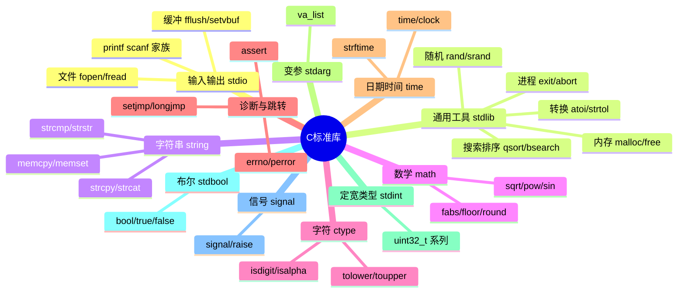

# 标准库

> C标准库 = 标准规定的函数/类型/宏集合，随编译器提供。会用标准库的C程序员，等于多了几十个"内置专家"。

## 全景图



## string.h：内存与字符串

| 函数 | 功能 | 注意 |
| --- | --- | --- |
| `strlen(s)` | 长度（不含\0） | O(n) |
| `strcpy/strncpy` | 拷贝 | 不查边界；strncpy源长不补\0 |
| `strcat/strncat` | 追加 | 同上 |
| `strcmp/strncmp` | 比较 | 相等返回0 |
| `strchr/strrchr` | 找字符（首/末次） | 返回地址或NULL |
| `strstr` | 找子串 | KMP？标准库没有，朴素实现 |
| `strspn/strcspn` | 字符集合跨度 | 解析器常用 |
| `strtok` | 切分 | **破坏原串**+static状态不可重入 |
| `strdup` | malloc+拷贝 | POSIX扩展，用完要free |
| **memcpy(d,s,n)** | 拷贝n字节 | **src/dst不能重叠**！ |
| **memmove(d,s,n)** | 拷贝n字节 | **允许重叠**（内部判断方向） |
| **memset(d,c,n)** | 填充n字节 | 清零数组/结构体神器 |
| `memcmp(a,b,n)` | 比较n字节 | 定长比较不依赖\0 |

**memset 三大惯用法**：

```c
int arr[100];
memset(arr, 0, sizeof arr);              /* 数组清零 ✔（0可以，1不行！） */

struct Point p;
memset(&p, 0, sizeof p);                 /* 结构体清零 */

/* ⚠ memset按字节填充，只能可靠地置0（和-1）：
   memset(arr, 1, ...) → 每个int变成 0x01010101，不是1！ */

/* memset清零结构体对浮点/指针是否安全？C标准保证：全0字节对整数类型=0；
   浮点0.0/NULL指针在实际平台全零位模式成立（POSIX强制），工程上通用 */
```

**memcpy vs memmove**：

```c
char buf[10] = "abcdef";
memcpy(buf + 2, buf, 4);      /* 💥 重叠！结果未定义（可能"ababab"） */
memmove(buf + 2, buf, 4);     /* ✔ "ababcd"（先判断方向再拷） */
```

## stdlib.h：通用工具

### 字符串→数值（注意安全性梯队）

```c
atoi("42")          /* 简单但不安全：溢出/非法输入都是UB！ */
atol / atof         /* 同族问题 */

/* ✔ 工程正解：strto* 家族（带错误检测） */
char *end;
long v = strtol("123abc", &end, 10);   /* end指向'c'：能知道停在哪 */
if (end == input)  /* 完全没转换 */ ;
if (errno == ERANGE)  /* 溢出 */ ;

strtol(s, &end, 16)      /* 16进制：也接受"0x1F" */
strtoul(s, NULL, 0)      /* 0 = 自动推断进制：0x→16，0开头→8，否则10 */
strtod("3.14", &end)     /* 浮点 */
```

### qsort / bsearch

```c
/* 任意类型排序：靠回调比较（见函数指针章） */
int cmp_int(const void *a, const void *b) {
    int x = *(const int *)a, y = *(const int *)b;
    return (x > y) - (x < y);       /* ✔ 无溢出写法（直接相减会溢出） */
}
int arr[] = {5, 2, 9, 1, 7};
qsort(arr, 5, sizeof(int), cmp_int);

/* 结构体按分数排 */
typedef struct { char name[16]; int score; } Stu;
int cmp_stu(const void *a, const void *b) {
    return ((const Stu *)b)->score - ((const Stu *)a)->score;  /* 降序 */
}
qsort(class, n, sizeof(Stu), cmp_stu);

void *hit = bsearch(&key, arr, 5, sizeof(int), cmp_int);   /* 二分查找 */
```

### 随机数

```c
srand(time(NULL));           /* 播种（不播的话每次运行序列相同——调试有用） */
int r = rand();              /* 0 ~ RAND_MAX */
int dice = rand() % 6 + 1;   /* 1~6（%有轻微偏差，玩具够用） */
/* rand()质量差且rand_r不可重入；严肃场景用PCG/xoshiro或getrandom()系统调用 */
```

### 进程控制

```c
exit(0);          /* 正常退出：刷新全部流、调用atexit注册的钩子、回传退出码 */
atexit(cleanup);  /* 注册退出钩子（最多32个，注册顺序的逆序执行） */
abort();          /* 异常终止：不刷缓冲，产生core dump */
```

## ctype.h：字符分类

```c
isdigit('9')      /* 非零 */
isalpha('a') / isalnum / isspace / isupper / islower
isxdigit('F')     /* 十六进制字符 */
tolower('A')      /* 'a'；toupper 反向 */

/* 遍历过滤数字： */
char s[] = "a1b2c3";
for (char *p = s; *p; p++)
    if (isdigit((unsigned char)*p))   /* ⚠ 传unsigned char！
                                         负值char传入是UB */
        putchar(*p);
```

## math.h：数学

```c
sqrt(2.0)         /* 1.414...；负数参数 → 返回NaN并置errno=EDOM */
pow(2, 10)        /* 1024.0（浮点幂，比1<<10慢） */
fabs(-3.5)        /* 3.5（浮点绝对值；整数用 abs/llabs） */
floor(2.7)        /* 2.0（向下取整，返回double！） */
ceil(2.1)         /* 3.0 */
round(2.5)        /* 3.0（C99：四舍五入，.5远离零） */
fmod(7, 3)        /* 1.0（浮点取模） */

/* NaN/Inf 判断（不能直接==比较！NaN!=NaN） */
isnan(x) / isinf(x)
```

## time.h：时间

```c
time_t now = time(NULL);              /* Unix纪元秒数 */
clock_t c = clock();                  /* CPU时间（CLOCKS_PER_SEC换算） */
/* 测耗时 */
clock_t t0 = clock();
do_work();
double sec = (double)(clock() - t0) / CLOCKS_PER_SEC;

/* 格式化 */
time_t t = time(NULL);
struct tm *lt = localtime(&t);        /* 拆解为年月日时分秒（注意返回static缓冲，非线程安全） */
char buf[64];
strftime(buf, sizeof buf, "%Y-%m-%d %H:%M:%S", lt);
printf("%s\n", buf);                 /* 2026-11-10 14:30:00 */
```

## assert.h：断言

```c
#include <assert.h>
assert(ptr != NULL);          /* 假 → 打印表达式+文件行号并abort */

#define NDEBUG                /* 定义后 assert 变成空操作 —— 常在release构建加 */
gcc -DNDEBUG app.c            /* 性能敏感路径的断言会消失，别放副作用进assert */
assert(free_all() == 0);      /* ✘ NDEBUG时free_all()也不执行了！ */

/* C11 静态断言：编译期检查 */
_Static_assert(sizeof(int) == 4, "int must be 4B");
```

详见[错误处理](错误处理.md)。

## stdint.h / stdbool.h / stddef.h（C99三小件）

```c
#include <stdint.h>
uint8_t u8;  int32_t i32;  uint64_t u64;      /* 定宽类型：协议/哈希/文件格式的标配 */
int_least16_t / uint_fast32_t                  /* 最小宽度/最快类型 */
INT32_MAX / UINT64_MAX / SIZE_MAX              /* 各自极限宏 */

#include <stdbool.h>
bool ok = true;    /* C99前：typedef int bool 自己造 */

#include <stddef.h>
size_t n;          /* 内存/数组尺寸的无符号类型 */
NULL               /* ((void *)0) */
offsetof(type, member);   /* 成员偏移 */
```

**铁律：涉及二进制格式、网络、内存布局的整数，一律用定宽类型**，`int`/`long`只用于"普通计数"。

## signal.h：信号

```c
#include <signal.h>
void on_sigint(int sig) { /* 异步上下文：只做volatile标志位，别调printf */ }
signal(SIGINT, on_sigint);      /* Ctrl+C 时回调 */
raise(SIGTERM);                 /* 给自己发信号 */

/* volatile sig_atomic_t 是信号处理函数与主流程间唯一可移植的通信类型 */
volatile sig_atomic_t g_stop = 0;
```

## POSIX 常用扩展（非ISO C但事实标准）

`unistd.h` 的 `read/write/open/close`、`fork/exec`、`getopt`；`dlfcn.h` 的 `dlopen`；`pthread.h` 线程。详见平台文档——**ISO C 是全集里最小的公共子集**。

## 使用标准库的好习惯

```c
/* 1. 用 snprintf 而不是 sprintf（有界） */
char buf[64];
snprintf(buf, sizeof buf, "%s=%d", name, val);

/* 2. 用 strtol 而不是 atoi（可检测错误） */
/* 3. 用 memcmp/memcpy 处理"内存块"，str*处理"字符串"——别混用 */
/* 4. 编译时开 Wall：gets/strcpy 这类危险函数会有警告 */
gcc -Wall -Wextra -std=c11 ...
```

## 小结

1. string.h 记三巨头：`memcpy`（不重叠）/`memmove`（可重叠）/`memset`（置0神器）；
2. 数值转换用 `strto*`（可检测），`atoi` 族是UB温床；
3. qsort+回调 = 通吃任意类型排序；bsearch配套二分；
4. 定宽整数（stdint.h）是跨平台严肃代码的门槛；
5. 查手册：`man 3 printf`——man是最好的老师。
