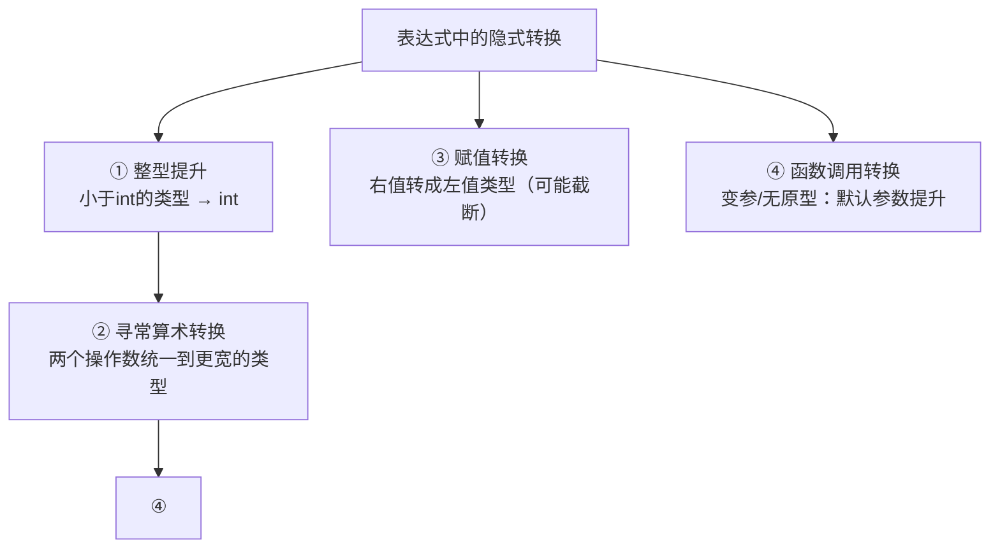

# 类型转换

## 隐式转换无处不在

C是**弱类型检查 + 大量隐式转换**的语言。同一表达式里类型不同时，编译器自动"统一口径"：

```c
int    i = 3;
double d = i + 1.5;    /* i 被隐式转为 double → 4.5 */
char   c = 'A';
int    r = c + 1;      /* 'A'(65) 提升 int → 66 → 'B' */

if (-1 < sizeof(int))  /* 💡 经典：恒为假！见下文 */
    ;
```

## 转换规则总图



## 整型提升（Integer Promotion）

`char`、`short`、位域等**小于 int 的类型**，参与运算时一律**先提升为 int**（若int装不下则unsigned int）：

```c
char a = 100, b = 100;
int c = a + b;         /* 200！a和b各自提升为int再相加。
                          若"结果也是char"的理解是错的——中间计算在int上进行 */

printf("%d\n", sizeof('a'));   /* C: 4（'a'是int）
                                 C++: 1 —— C/C++著名差异 */
```

**为什么 `printf("%d\n", sizeof('a'))` 在C里是4？** 字符常量本身类型就是int（整型提升直接写进标准）。

## 寻常算术转换（Usual Arithmetic Conversions）

两个操作数类型不同时，**低阶转高阶**。排序（从低到高）：

```text
int → unsigned int → long → unsigned long → long long → unsigned long long
     → float → double → long double
```

```c
int i = -1;
unsigned u = 1;

if (i < u)            /* i 被转为 unsigned！
                         (unsigned)(-1) = 4294967295
                         4294967295 < 1 → 假！ */
    printf("less");   /* 不会执行 —— -1 < 1u 居然为假 */
```

**有符号与无符号混合运算 = 隐式转换第一事故源**：

```c
/* 事故1：经典死循环 */
unsigned int i;
for (i = n - 1; i >= 0; i--)   /* i永远 >= 0，死循环！ */

/* 事故2：sizeof与负数 */
if (-1 < sizeof(int))          /* sizeof是size_t无符号
                                  -1 转成超大无符号数 → 比较为假！ */

/* 事故3：无符号回绕 */
unsigned char uc = 255;
uc + 1;                        /* int域内=256（提升）；但赋值回来： */
uc += 1;                       /* 回绕成 0 —— 无符号运算是模2^N */
```

## 赋值转换： narrowing（窄化）

右值类型转成左值类型，**超范围直接截断**（编译器一般只给警告）：

```c
int   big  = 300;
char  small = big;            /* 300 = 0x12C → 截取低8位 0x2C = 44 */

double d = 3.99;
int    i = d;                 /* 3：浮点转整数丢弃小数（向零截断） */

int j = -3.99;                /* -3：向零截断，不是-4 */

long  l = 5000000000L;
int   k = l;                 /* 实现定义：常见取低32位 */
```

**截断的本质**：取低位字节重新解释（见位运算的二进制视角）。

## 浮点与整数互转

```c
double d = 5.75;
int    i = (int)d;        /* 5：直接砍掉小数 */

int    n = 7;
double f = n / 2;         /* 3.0：整数先除完（3）再转double！ */
double g = n / 2.0;       /* 3.5 ✔ */
double h = (double)n / 2; /* 3.5 ✔ 显式转换其中一个操作数 */
```

**float ↔ double ↔ int 的精度问题**：

```c
float  f = 0.1f;
double d = 0.1;
f == d;        /* 假！0.1的二进制是无限循环小数，
                  float(23位尾数)与double(52位尾数)存的近似值不同 */

(int)(3.9999999999) + 0.5;   /* 老式四舍五入技巧：加0.5再截断 */
/* 正数四舍五入：(int)(x + 0.5)；现代C用 round() */
```

## 显式转换（强制转换）

```c
(目标类型)表达式        /* C 风格 */
int    *ip = malloc(16);
char   *cp = (char *)ip;         /* 指针重新解读 */
double  ratio = (double)hits / total;  /* 提升精度，防止整数除法 */

/* 常见必要性场景 */
unsigned char *byte_view = (unsigned char *)&value;  /* 按字节查看内存 */
```

**指针转换的规则**：

```c
/* 1. void* ↔ T*：C中自由隐式（C++需显式） */
int *p = malloc(4);              /* void* → int* 隐式 ✔ */

/* 2. T1* → T2*（对齐且大小合理时重解释），解引用结果是重新解读 */
float f = 1.5f;
int   *ip = (int *)&f;           /* *ip = f 的位模式按int读（不是1！） */

/* 3. 指针与整数互转：intptr_t（<stdint.h>）才是正道 */
uintptr_t addr = (uintptr_t)p;   /* 可安全往返 */
int *q = (int *)addr;

/* 4. 函数指针转换：谨慎，标准仅保证"可往返" */
```

## 默认参数提升（变参函数）

`printf` 这类变参函数没有原型约束，可变部分参数做**默认提升**：

| 实际类型 | 提升为 |
| --- | --- |
| `char` / `short` | `int` |
| `float` | `double` |

```c
float f = 1.5f;
printf("%f\n", f);        /* %f 读的是double ✔（float已提升） */
printf("%f\n", 1.5);      /* 字面量1.5本来就是double */

char c = 'A';
printf("%c %d\n", c, c);  /* %c读int低16位？不——%c按int接收 ✔ */
/* 这就是为什么没有 %hf 这种"float打印符"——float进varargs必变double */
```

详见[可变参数](可变参数.md)。

## 安全转换与危险转换速查

| 转换 | 危险度 | 说明 |
| --- | --- | --- |
| 小整型 → 大整型（同符号） | 安全 | 值不变 |
| int → double / long → double | ⚠ | 2^53以上long可能丢精度 |
| 大整型 → 小整型 | **高** | 截断高位 |
| 有符号 ↔ 无符号（同宽度） | **高** | 位不变、值巨变 |
| 负数 → 无符号 | **高** | 变成超大正数 |
| 浮点 → 整数 | ⚠ | 丢小数；超范围是UB！ |
| `(int)1e300` | **UB** | 超出int表示范围，未定义！ |
| 整数 → 浮点 | 安全 | 可能丢精度（大整数） |
| `T1*` ↔ `T2*` | ⚠ | 重解释，注意对齐与严格别名 |
| `T*` ↔ `void*` | 安全 | C中隐式自由 |

**严格别名规则（strict aliasing）速览**：通过"不兼容类型"的指针写内存再读，是UB。char* 例外（可别名任何对象）：

```c
float f = 1.0;
int *ip = (int *)&f;
*ip = 0x3F800000;        /* 💥 UB：int指针写float对象（-fno-strict-aliasing才"能跑"） */
/* 合法替代：memcpy(&u, &f, 4) 按位拷贝 */
```

## 防御性实践

```c
/* 1. 混合符号比较前显式统一 */
size_t n = ...;
if (i < (int)n)          /* 或反过来 (int64_t)i < (int64_t)n */

/* 2. 窄化赋值加显式转换，自文档化"我知道在截断" */
unsigned char c = (unsigned char)(x & 0xFF);

/* 3. 除法前先转 */
double ratio = (double)success / (double)total;

/* 4. 打开编译器警告，让工具抓转换 */
/* gcc: -Wall -Wconversion -Wsign-conversion */
```

## 小结

1. 小于int先**整型提升**；不同类型走**寻常算术转换**（向更宽类型对齐）；
2. **有符号vs无符号混合 = 事故之王**：`-1 < 1u` 为假、`i>=0` 死循环、`-1 < sizeof(...)` 恒假；
3. 赋值窄化直接截断；浮点超范围转整数是**UB**；
4. 变参函数里 float→double、char/short→int 自动发生；
5. 严谨代码开 `-Wconversion`，显式转换自文档化。
