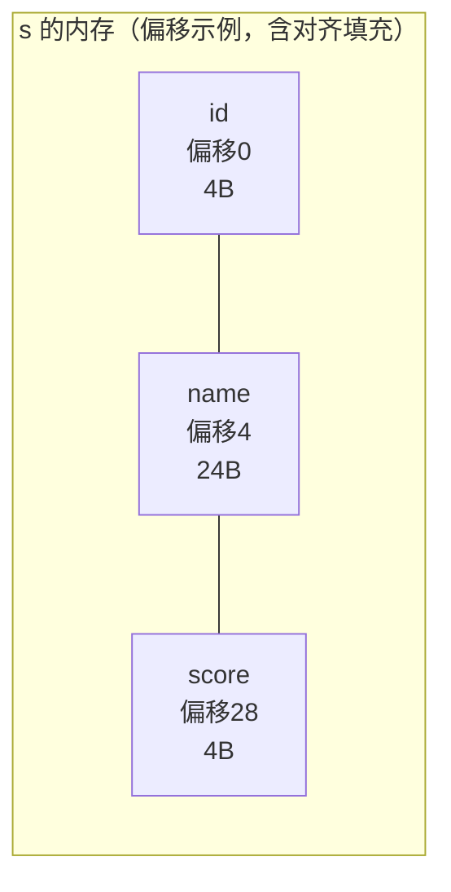

# 结构体

## 定义与使用

结构体把多个不同类型的成员**打包进一块连续内存**：

```c
struct Student {
    int    id;         /* 学号 */
    char   name[24];   /* 姓名 */
    float  score;      /* 成绩 */
};                     /* ← 这个分号必须有！经典丢分点 */

struct Student s1 = {1001, "Tom", 92.5f};   /* 按序初始化 */
struct Student s2 = {.score = 88.0f};        /* C99指定初始化：其余清零 */

s1.score = 95.0f;                 /* . 访问成员 */
strcpy(s1.name, "Jerry");
```

**typedef 惯用法**（免去 struct 前缀）：

```c
typedef struct Student {
    int id;
    char name[24];
    float score;
} Student;

Student s;
```

## 内存布局

```c
struct Student s;   /* 32位平台 */
```



* 成员按声明顺序排布，地址依次增大；
* 中间可能因**对齐**插入填充（padding）；
* 整体大小是"最宽成员对齐值"的整数倍（详见[内存对齐与位域](内存对齐与位域.md)）；
* `offsetof(struct Student, score)` 可查成员偏移。

## 成员访问：`.` 与 `->`

```c
Student s;
Student *p = &s;

s.score     = 90;    /* 变量用 . */
(*p).score  = 90;    /* 指针先解引用再用 . */
p->score    = 90;    /* (*p). 的语法糖，指针专用 */
```

`p->m` 编译后就是：**取p的值当地址 + 偏移量直接访问**——`[p + offsetof(成员)]`。

## 赋值与传参：整体值拷贝

```c
Student a = {1, "A", 90};
Student b = a;              /* ✔ 整体赋值：逐字节拷贝（数组也是成员，一起拷） */
Student c;
c = a;                      /* ✔ 同类型可整体赋值 */

/* 传参同样是拷贝：大结构体传值 = 性能灾难 */
void print(Student s);          /* 拷贝32字节过栈 */
void print(const Student *s);   /* ✔ 只传4/8字节地址，工程标准写法 */
```

```c
/* 函数返回结构体：同样返回值拷贝（小结构体走寄存器/隐藏指针） */
Student make(int id) { Student s = {id, "", 0}; return s; }
```

## 结构体数组与嵌套

```c
/* 数组：批量管理记录 */
Student class[50];
class[0].id = 1001;
for (int i = 0; i < 50; i++)
    class[i].score = 0;

/* 嵌套 */
struct Date { int y, m, d; };
struct Record {
    int id;
    struct Date day;      /* 嵌套结构体成员 */
};
struct Record r = {1, {2026, 11, 10}};
r.day.m = 11;
```

## 自引用：链表的基石

```c
typedef struct Node {
    int data;
    struct Node *next;    /* 指向"同类结构体"的指针 ✔ */
} Node;

/* 为什么不能写成 Node *next？
   在定义内部，typedef 别名 Node 还没生效，必须用全名 struct Node。
   指针大小固定，所以"包含指向自己的指针"不会无限递归。 */

/* 链表操作 */
Node n1 = {1, NULL}, n2 = {2, NULL}, n3 = {3, NULL};
n1.next = &n2;  n2.next = &n3;

for (Node *p = &n1; p != NULL; p = p->next)   /* 遍历 */
    printf("%d ", p->data);                   /* 1 2 3 */
```


## 动态分配结构体

```c
#include <stdlib.h>

Node *node_new(int data)
{
    Node *n = malloc(sizeof(Node));    /* sizeof(*n) 更稳 */
    if (n == NULL) return NULL;
    n->data = data;
    n->next = NULL;
    return n;
}

/* 注意：malloc 只分配内存不清零；
   想清零用 calloc(1, sizeof(Node))，所有成员置0（含指针） */
```

## 灵活数组成员（FAM, C99）

**一次 malloc 同时分配"头 + 变长数据"**的高效技巧：

```c
typedef struct Buffer {
    size_t len;
    char   data[];      /* 灵活数组成员：不占struct大小，紧贴在末尾 */
} Buffer;

Buffer *buf_new(size_t n)
{
    Buffer *b = malloc(sizeof(Buffer) + n * sizeof(char));  /* 头+数据一体 */
    b->len = n;
    return b;
    /* b->data[0..n-1] 全部可用，一次分配、一次释放 */
}
```

## 位域简述

结构体内可以按**位**指定成员宽度（常用于协议头、寄存器映射）：

```c
struct Flags {
    unsigned int enable : 1;   /* 1 bit */
    unsigned int mode   : 3;   /* 3 bit */
    unsigned int reserved : 28;
};
```

详见[内存对齐与位域](内存对齐与位域.md)。

## 结构体的对比与陷阱

```c
/* 1. 不能用 == 直接比较两个结构体（编译错误） */
Student a, b;
if (a == b) { }                 /* ✘ */
if (memcmp(&a, &b, sizeof a) == 0) { }  /* ⚠ padding内容不定，不严格可靠 */

/* 2. 分号丢失 → 后面的全被当成类型 */
struct A { int x; }             /* ← 少了分号 */
int main(void) { }              /* 编译器：main 是 struct A 类型的变量?! */

/* 3. 结构体赋值含指针成员时是浅拷贝 */
struct S { char *p; };
struct S a = {malloc(10)}, b = a;   /* b.p 与 a.p 指向同一块 → double free风险 */
```

## 从汇编看结构体

```c
struct P { int x; int y; } p = {3, 4};
int sum(struct P *s) { return s->x + s->y; }
```

```asm
sum:
    mov  eax, [ecx]        ; s->x：基址+偏移0
    add  eax, [ecx+4]      ; s->y：基址+偏移4
    ret
; 结构体成员访问 = 基址寄存器 + 编译期常量偏移
; 二维数组 a[i][j] 的偏移是运行期算的，结构体偏移在编译期就定死了
```

## 实战：编译提取汇编逐行解析（真实输出）

> 以下汇编全部为**真实编译产物**，指令逐字来自 gcc 输出，`;` 注释为整理所加。提取流程见 `.opencode/skills/c-dev/SKILL.md`；环境噪音说明见[数组·实战](数组.md)。
> 实测环境：Ubuntu 24.04 / gcc 13.3.0 / x86-64（System V ABI）/ Intel 语法

### 实验1：成员访问 —— 偏移是编译期常量，padding 在偏移里现形

```c
struct S {
    char   c;    /* 偏移0 */
    int    i;    /* 偏移4（1~3被padding吃掉） */
    short  s2;   /* 偏移8 */
    double d;    /* 偏移16（10~15 padding：double要8字节对齐） */
};               /* sizeof = 24 */

int    get_i(struct S *p) { return p->i; }
short  get_s(struct S *p) { return p->s2; }
double get_d(struct S *p) { return p->d; }
void   set_c(struct S *p, char v) { p->c = v; }
```

**-O2 真实输出**——四个访问器，每个就一条指令：

```asm
get_i:
    endbr64
    mov     eax, DWORD PTR 4[rdi]     ; p->i：基址+偏移4 —— 偏移写死在指令里！
    ret
get_s:
    endbr64
    movzx   eax, WORD PTR 8[rdi]      ; p->s2：偏移8，WORD=2字节，movzx零扩展
    ret
get_d:
    endbr64
    movsd   xmm0, QWORD PTR 16[rdi]   ; p->d：偏移16，QWORD=8字节
    ret                                  ; ★浮点返回值走 xmm0（不是eax！）
set_c:
    endbr64
    mov     BYTE PTR [rdi], sil       ; p->c = v：偏移0，BYTE=1字节，v在sil
    ret                                  ;   （第2参数低8位）
```

一张偏移表 = 整个结构体的"解剖图"：

| 成员 | 指令里的偏移 | 宽度 | 揭示的padding |
| --- | --- | --- | --- |
| `c` | `[rdi]`+0 | BYTE 1 | — |
| `i` | `[rdi+4]` | DWORD 4 | 1~3（3字节空洞） |
| `s2` | `[rdi+8]` | WORD 2 | — |
| `d` | `[rdi+16]` | QWORD 8 | 10~15（6字节空洞） |

**`p->成员` = `基址寄存器 + 编译期常量偏移`**——和数组下标（运行期算出的变址）唯一的区别就在这：结构体偏移在编译期就烧进指令。逆向时连续看到 `[rdi+0]/[rdi+4]/[rdi+8]/[rdi+16]`，马上能反推出结构体布局——**这就是IDA "结构体还原"的原理**。另一个彩蛋：**double 返回值走 xmm0**，整型走 rax——浮点有自己的返回寄存器。

### 实验2：小结构体（8字节）—— 打包进一个寄存器整存整取

```c
struct Pair { int x; int y; };               /* 恰好8字节 */

struct Pair mk(int x, int y) { struct Pair p = {x, y}; return p; }
int addp(struct Pair p) { return p.x + p.y; }
```

**-O2 真实输出**——结构体被当作"一个64位整数"位操作：

```asm
mk:
    endbr64
    sal     rsi, 32             ; y 左移32位 —— 去高32位窗口
    mov     eax, edi            ; x 放低32位
    or      rax, rsi            ; ★打包：高32位=y，低32位=x —— 8字节结构体=1个rax！
    ret                          ; 整个结构体从rax返回

addp:
    endbr64
    mov     rax, rdi            ; p（整个结构体在rdi里传进来的！）
    shr     rax, 32             ; 拆包：p.y = 高32位
    add     eax, edi            ; + p.x（低32位直接用edi）
    ret
```

x86-64 System V 的结构体分类规则（实测印证）：

| 结构体大小 | 传递方式 |
| --- | --- |
| ≤8字节 | **整体塞进一个寄存器**（位打包，如上） |
| ≤16字节 | 拆成两个寄存器（如rdi:rsi 各装一半） |
| >16字节 | **整体拷贝到栈上传递**（见实验3） |
| 作为**返回值**且>16字节 | 调用者传"隐藏指针"，被调者往里填 |

**"结构体传值很贵"是个大小问题**：8字节的 Pair 传值零开销（一条 mov），32字节的 Big 传值要拷一整块。工程上传 `const T*` 是稳妥的默认选择。

### 实验3：大结构体传值 —— 整块拷上栈；指针版一览无余

```c
struct Big { long a, b, c, d; };             /* 32字节 */

long first(struct Big v)        { return v.a + v.d; }   /* 传值 */
long firstp(const struct Big *v) { return v->a + v->d; } /* 传指针 */
```

**-O2 真实输出**——同一件事的两种代价：

```asm
first:                              ; 传值：结构体已被调用方整块拷到栈上
    endbr64
    mov     rax, QWORD PTR 8[rsp]   ; v.a：从自己栈帧上方读（[rsp]=返回地址，[rsp+8]起是拷贝）
    add     rax, QWORD PTR 32[rsp]  ; v.d：+32字节处
    ret                              ; ★调用方为此付出：32字节栈拷贝 + push

firstp:                             ; 传指针：只收到8字节地址
    endbr64
    mov     rax, QWORD PTR [rdi]    ; v->a：间址读，偏移0
    add     rax, QWORD PTR 24[rdi]  ; v->d：偏移24
    ret                              ; ★调用方只付出：一条 lea + mov rdi
```

对照表：

| | first（传值） | firstp（传指针） |
| --- | --- | --- |
| 被调方取成员 | `[rsp+8]`、`[rsp+32]` | `[rdi]`、`[rdi+24]` |
| 调用方代价 | 拷32字节上栈 | 传8字节地址 |
| 被调方能否改原对象 | ✘（改的是拷贝） | ✔ |

### 汇编视角总结表（全部实测）

| C语法 | 机器形态 |
| --- | --- |
| `p->m` | `mov eax, [rdi+常量偏移]`（偏移编译期定死） |
| `s.m`（局部结构体） | `[rbp-XX+偏移]` 同理 |
| 小结构体传参/返回 | 位打包进 rax（`sal/or` 拆装） |
| 大结构体传参 | 整块拷上栈，被调方 `[rsp+8]` 起读 |
| 大结构体返回 | 隐藏指针（rdi传入目标地址） |
| 浮点成员/返回 | `movsd` + xmm0 寄存器族 |
| 结构体整体赋值 | 逐成员mov / `rep movs`（大块） |

## 小结

1. 结构体 = 一块连续内存 + 编译期偏移表；`.` 与 `->` 一个针对变量一个针对指针；
2. 同类型结构体可整体赋值（值拷贝）；大结构体传参传指针（`const T *`）；
3. 自引用必须用 `struct Node *`，链表/树由此而生；
4. FAM（`data[]`）实现一次分配"头+数据"；
5. 结构体不能 `==`；赋值是浅拷贝，指针成员要小心；
6. 新增实测：成员偏移直接烧在指令里（逆向还原结构体的原理）；≤8字节结构体位打包进单寄存器；>16字节传值是整块拷栈——"结构体传值贵不贵"看大小。
