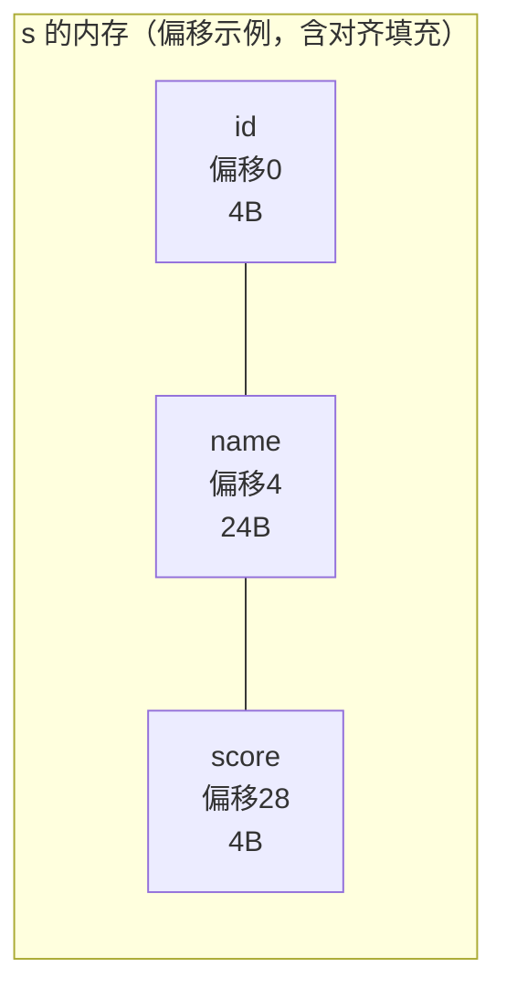

# 结构体

## 定义与使用

结构体把多个不同类型的成员**打包进一块连续内存**：

```c
struct Student {
    int    id;         /* 学号 */
    char   name[24];   /* 姓名 */
    float  score;      /* 成绩 */
};                     /* ← 这个分号必须有！经典丢分点 */

struct Student s1 = {1001, "Tom", 92.5f};   /* 按序初始化 */
struct Student s2 = {.score = 88.0f};        /* C99指定初始化：其余清零 */

s1.score = 95.0f;                 /* . 访问成员 */
strcpy(s1.name, "Jerry");
```

**typedef 惯用法**（免去 struct 前缀）：

```c
typedef struct Student {
    int id;
    char name[24];
    float score;
} Student;

Student s;
```

## 内存布局

```c
struct Student s;   /* 32位平台 */
```



* 成员按声明顺序排布，地址依次增大；
* 中间可能因**对齐**插入填充（padding）；
* 整体大小是"最宽成员对齐值"的整数倍（详见[内存对齐与位域](内存对齐与位域.md)）；
* `offsetof(struct Student, score)` 可查成员偏移。

## 成员访问：`.` 与 `->`

```c
Student s;
Student *p = &s;

s.score     = 90;    /* 变量用 . */
(*p).score  = 90;    /* 指针先解引用再用 . */
p->score    = 90;    /* (*p). 的语法糖，指针专用 */
```

`p->m` 编译后就是：**取p的值当地址 + 偏移量直接访问**——`[p + offsetof(成员)]`。

## 赋值与传参：整体值拷贝

```c
Student a = {1, "A", 90};
Student b = a;              /* ✔ 整体赋值：逐字节拷贝（数组也是成员，一起拷） */
Student c;
c = a;                      /* ✔ 同类型可整体赋值 */

/* 传参同样是拷贝：大结构体传值 = 性能灾难 */
void print(Student s);          /* 拷贝32字节过栈 */
void print(const Student *s);   /* ✔ 只传4/8字节地址，工程标准写法 */
```

```c
/* 函数返回结构体：同样返回值拷贝（小结构体走寄存器/隐藏指针） */
Student make(int id) { Student s = {id, "", 0}; return s; }
```

## 结构体数组与嵌套

```c
/* 数组：批量管理记录 */
Student class[50];
class[0].id = 1001;
for (int i = 0; i < 50; i++)
    class[i].score = 0;

/* 嵌套 */
struct Date { int y, m, d; };
struct Record {
    int id;
    struct Date day;      /* 嵌套结构体成员 */
};
struct Record r = {1, {2026, 11, 10}};
r.day.m = 11;
```

## 自引用：链表的基石

```c
typedef struct Node {
    int data;
    struct Node *next;    /* 指向"同类结构体"的指针 ✔ */
} Node;

/* 为什么不能写成 Node *next？
   在定义内部，typedef 别名 Node 还没生效，必须用全名 struct Node。
   指针大小固定，所以"包含指向自己的指针"不会无限递归。 */

/* 链表操作 */
Node n1 = {1, NULL}, n2 = {2, NULL}, n3 = {3, NULL};
n1.next = &n2;  n2.next = &n3;

for (Node *p = &n1; p != NULL; p = p->next)   /* 遍历 */
    printf("%d ", p->data);                   /* 1 2 3 */
```


## 动态分配结构体

```c
#include <stdlib.h>

Node *node_new(int data)
{
    Node *n = malloc(sizeof(Node));    /* sizeof(*n) 更稳 */
    if (n == NULL) return NULL;
    n->data = data;
    n->next = NULL;
    return n;
}

/* 注意：malloc 只分配内存不清零；
   想清零用 calloc(1, sizeof(Node))，所有成员置0（含指针） */
```

## 灵活数组成员（FAM, C99）

**一次 malloc 同时分配"头 + 变长数据"**的高效技巧：

```c
typedef struct Buffer {
    size_t len;
    char   data[];      /* 灵活数组成员：不占struct大小，紧贴在末尾 */
} Buffer;

Buffer *buf_new(size_t n)
{
    Buffer *b = malloc(sizeof(Buffer) + n * sizeof(char));  /* 头+数据一体 */
    b->len = n;
    return b;
    /* b->data[0..n-1] 全部可用，一次分配、一次释放 */
}
```

## 位域简述

结构体内可以按**位**指定成员宽度（常用于协议头、寄存器映射）：

```c
struct Flags {
    unsigned int enable : 1;   /* 1 bit */
    unsigned int mode   : 3;   /* 3 bit */
    unsigned int reserved : 28;
};
```

详见[内存对齐与位域](内存对齐与位域.md)。

## 结构体的对比与陷阱

```c
/* 1. 不能用 == 直接比较两个结构体（编译错误） */
Student a, b;
if (a == b) { }                 /* ✘ */
if (memcmp(&a, &b, sizeof a) == 0) { }  /* ⚠ padding内容不定，不严格可靠 */

/* 2. 分号丢失 → 后面的全被当成类型 */
struct A { int x; }             /* ← 少了分号 */
int main(void) { }              /* 编译器：main 是 struct A 类型的变量?! */

/* 3. 结构体赋值含指针成员时是浅拷贝 */
struct S { char *p; };
struct S a = {malloc(10)}, b = a;   /* b.p 与 a.p 指向同一块 → double free风险 */
```

## 从汇编看结构体

```c
struct P { int x; int y; } p = {3, 4};
int sum(struct P *s) { return s->x + s->y; }
```

```asm
sum:
    mov  eax, [ecx]        ; s->x：基址+偏移0
    add  eax, [ecx+4]      ; s->y：基址+偏移4
    ret
; 结构体成员访问 = 基址寄存器 + 编译期常量偏移
; 二维数组 a[i][j] 的偏移是运行期算的，结构体偏移在编译期就定死了
```

## 小结

1. 结构体 = 一块连续内存 + 编译期偏移表；`.` 与 `->` 一个针对变量一个针对指针；
2. 同类型结构体可整体赋值（值拷贝）；大结构体传参传指针（`const T *`）；
3. 自引用必须用 `struct Node *`，链表/树由此而生；
4. FAM（`data[]`）实现一次分配"头+数据"；
5. 结构体不能 `==`；赋值是浅拷贝，指针成员要小心。
