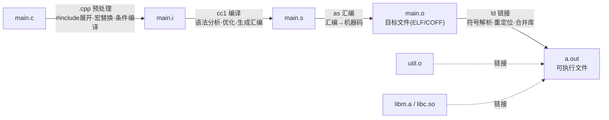
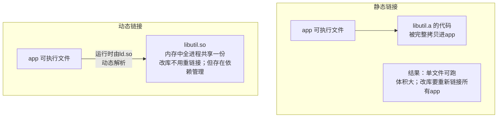

# 编译链接与库

## 四阶段全景



```bash
gcc -E main.c -o main.i      # 只预处理
gcc -S main.i -o main.s      # 到汇编（-O2看优化结果的最佳工具）
gcc -c main.s -o main.o      # 到目标文件
gcc main.o util.o -o app     # 链接成可执行
gcc main.c -o app            # 以上四步一键完成
```

## 目标文件里有什么

`main.o` 不是"纯机器码"，而是**带符号表和重定位表的半成品**：

```text
main.o 的结构（ELF视角）
├── .text    机器指令（printf 调用处留着空洞：call <待填地址>）
├── .data    已初始化全局变量
├── .bss     未初始化全局（仅占位，不占文件）
├── .rodata  字符串常量等
├── 符号表   本文件定义的符号（main、g_count）+ 引用的外部符号（printf → UND）
└── 重定位表 记录"哪里有洞要补、补的是哪个符号"
```

**链接器干的就两件事**：

1. **符号解析（resolve）**：把每个 `UND` 引用配到一个定义上。配不上 → `undefined reference`；配到多个 → `multiple definition`；
2. **重定位（relocate）**：算出每个符号最终地址，把 .text/.data 里的"洞"填上。

```bash
# 观察工具链
nm main.o          # 看符号：T=定义 D=数据 U=引用(UND)
objdump -d main.o  # 反汇编（看 call 的重定位空洞）
objdump -r main.o  # 看重定位表
readelf -a a.out   # ELF全景
```

## 两个最经典的链接错误

```text
/tmp/ccX.o: in function `main':
main.c:(.text+0x18): undefined reference to `func'
/* 符号解析失败：声明了 func 但没提供定义
   → 没链接 util.c？函数名拼错？库没加 -l？ */

multiple definition of `g_count'; util.o:.../main.o:...
/* 一个符号出现两个强定义 → 头文件里定义了全局变量！
   → .h 里改 extern，.c 里一处定义 */
```

**强符号与弱符号**（默认规则）：

| 定义形态 | 强弱 | 规则 |
| --- | --- | --- |
| 函数定义、初始化的全局 | 强 | 强符号只能有一个 |
| 未初始化的全局 `int g;` | 弱 | 强弱共存时取强；全弱时取其中一个（+警告） |
| `__attribute__((weak))` 显式弱 | 弱 | 库/插件预留覆盖点 |

## 静态库（.a）与动态库（.so）



```bash
# 制作静态库：ar 打包目标文件
gcc -c util.c -o util.o
ar rcs libutil.a util.o            # r=插入 c=创建 s=索引
gcc main.c -L. -lutil -o app       # -L指定库目录 -l库名(去lib前缀.a后缀)
./app                              # 独立运行 ✔

# 制作动态库（共享对象）
gcc -shared -fPIC util.c -o libutil.so    # -fPIC: 位置无关代码（必加）
gcc main.c -L. -lutil -Wl,-rpath,. -o app # 运行时在当前目录找so
./app                              # 依赖 libutil.so
```

**静态库链接顺序陷阱**：链接器从左到右扫，`liba` 引用的符号必须在**其后**出现——`-lutil -lmath` 与 `-lmath -lutil` 可能一个成功一个失败（循环依赖时用 `-Wl,--start-group ... --end-group`）。

**动态库的运行时查找**（`ldd app` 查看依赖）：

```text
查找顺序：RPATH(rpath) → LD_LIBRARY_PATH → /etc/ld.so.cache → /lib,/usr/lib
找不到 → error while loading shared libraries: libutil.so: cannot open...
```

## .bss 的省空间魔术

```c
int big[1000000];        /* 未初始化全局：文件里只记"要100万个0" */
```

可执行文件里 .bss **不占体积**（`size app` 可见 bss 巨大而文件很小）——加载器映射零页按需分配。这就是"未初始化全局变量不写进文件"的真相（见[内存图](内存图.md)）。

## 编译器优化等级

```bash
gcc -O0    # 不优化（调试默认：变量都老老实实在栈上，gdb友好）
gcc -O1/-O2 # 常用发布等级：内联、循环优化、死代码消除、强度削减...
gcc -O3    # 更激进（向量化等），可能体积变大
gcc -Os    # 优化体积（嵌入式）
gcc -Og    # 优化但保持可调试性
```

**优化带来的"灵异现象"**（UB被优化放大的经典）：

```bash
# 未定义行为在-O0下"碰巧正常"，-O2下行为突变（被删除/重排）
# 排查：gcc -fsanitize=undefined 或换-O0复现对比
```

## 从源码到运行的完整链路（Linux）


## 构建自动化：Makefile 入门

```makefile
CC     = gcc
CFLAGS = -Wall -Wextra -O2 -std=c11
OBJS   = main.o util.o

app: $(OBJS)
	$(CC) $(OBJS) -o $@

main.o: main.c util.h
	$(CC) $(CFLAGS) -c main.c -o $@

util.o: util.c util.h
	$(CC) $(CFLAGS) -c util.c -o $@

clean:
	rm -f *.o app
# make：只重编译改动过的文件（按文件时间戳依赖推导）
```

## 小结

1. 四阶段：预处理→编译→汇编→链接；`gcc -E/-S/-c` 逐段拆解观察；
2. 链接=符号解析+重定位；`undefined reference`=符号没定义，`multiple definition`=头文件里放了定义；
3. 静态库`ar`打包进可执行文件；动态库`-shared -fPIC`运行时共享；
4. 链接顺序左依赖右；动态库运行时靠 RPATH/LD_LIBRARY_PATH 查找；
5. 优化等级会放大UB——"-O0能跑-O2崩"时先怀疑未定义行为。
