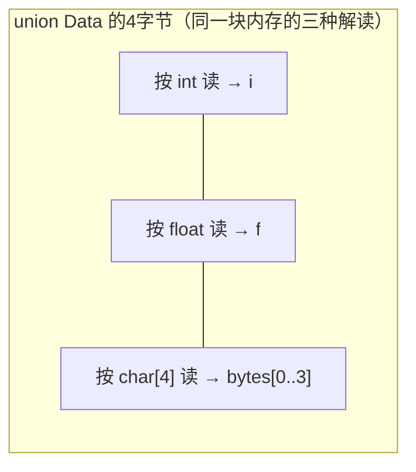
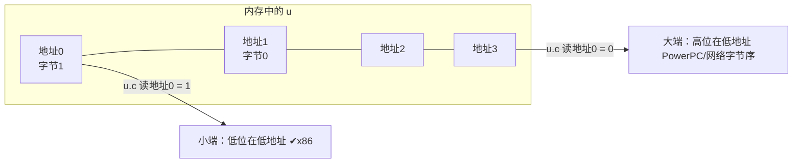

# 联合类型

## 本质：所有成员共享同一块内存

联合（union）的大小 = **最大成员的大小**，所有成员**从同一地址开始**：

```c
union Data {
    int   i;        /* 4字节 */
    float f;        /* 4字节 */
    char  bytes[4]; /* 4字节 */
};
```



```c
union Data d;
d.i = 0x40490FDB;                  /* 写int */
printf("%f\n", d.f);               /* 同一4字节按float解读 → 3.141592... */
printf("%02X %02X %02X %02X\n",
       d.bytes[0], d.bytes[1],     /* 逐字节看内存：DB 0F 49 40（小端） */
       d.bytes[2], d.bytes[3]);
```

**写一个成员、读另一个成员 = 重新解读同一块内存**（C11前严格说是实现定义行为，实践中是标准操作）。

## 大小与对齐

```c
union U {
    char  c[5];    /* 5字节 */
    double d;      /* 8字节，对齐要求8 */
};
sizeof(union U);       /* 8：取最大成员，并按最严格成员对齐 */
/* 规则：大小 ≥ 最大成员，且是"最大对齐值"的整数倍 */

union V {
    char c[9];
    int  i;
};
sizeof(union V);       /* 12：≥9 且是4的倍数 */
```

## 经典应用

### 1. 判断大小端（面试高频）

```c
int is_little_endian(void)
{
    union { int i; char c; } u;
    u.i = 1;
    return u.c;      /* 低地址字节是1 → 小端 */
}
```



### 2. 寄存器/硬件位域映射

```c
typedef union {
    uint32_t all;            /* 整体读写 */
    struct {
        uint32_t enable   : 1;
        uint32_t mode     : 3;
        uint32_t reserved : 28;
    } bits;                  /* 分位读写 */
} CtrlReg;

volatile CtrlReg *ctrl = (volatile CtrlReg *)0x40010000;
ctrl->bits.enable = 1;       /* 置某个位 */
ctrl->all = 0;               /* 一次清零整个寄存器 */
```

嵌入式/驱动开发的标准技巧：**union（整体视图）+ struct位域（细节视图）套娃**。

### 3. 节省内存的"多选一"存储

```c
/* 同一时刻只需要一种值时，union省内存（解释器Variable的经典实现） */
typedef struct Var {
    enum Type type;     /* 记录当前有效成员是哪个（类型标签） */
    union {
        long   i;
        double d;
        char  *s;
    } v;                /* 大小=最大成员8字节，而不是 8+8+8=24 */
} Var;
```

> **tagged union（带标签的联合）**是C实现"变体类型"的唯一正统手段，几乎所有解释器内核都在用。

## 初始化规则

```c
union U { int i; char c; };
union U a = {10};          /* ✔ 初始化第一个成员 i=10 */
union U b = {.c = 'x'};    /* C99指定初始化器 */
static union U z;          /* 静态存储期：所有字节清0 */
```

**活成员规则**：只有最后写入的成员是"活的"，读其他成员是把内存按另一种类型重新解释。

## 结构体 vs 联合

| 对比 | struct | union |
| --- | --- | --- |
| 内存 | 各占各的，总大小≥Σ成员 | 共享一块，总大小=最大成员 |
| 成员同时有效？ | ✔ 全部同时有效 | ✘ 同一时刻一个 |
| 用途 | 聚合"都有的属性" | 复用"二选一的存储" |

```c
struct S { int i; double d; };   /* sizeof=16，i和d都活着 */
union  U { int i; double d; };   /* sizeof=8，i和d抢同一块 */
```

## 匿名联合/结构体（C11标准，C89/99为GNU扩展）

```c
typedef struct {
    enum { POINT, CIRCLE } kind;
    union {                    /* 匿名：无成员名 */
        struct { int x, y; }  point;
        struct { int x, y, r; } circle;
    };                         /* 直接访问：v.point.x */
} Shape;
```

## 从汇编看union

union 全部成员偏移都是 **0**，访问不产生任何额外结构开销：

```asm
; d.i = 5
mov  DWORD PTR [d], 5
; d.bytes[2] = 7
mov  BYTE PTR [d+2], 7      ; 还是同一块内存的另一个地址而已
```

## 小结

1. union = **一块内存多种解读**，大小=最大成员（对齐到最严格成员）；
2. 判断大小端、寄存器位域映射、tagged union 省内存是三大实战场景；
3. 同一时刻只有最后写入的成员是"活的"；
4. struct聚合、union复用——看需求选。
