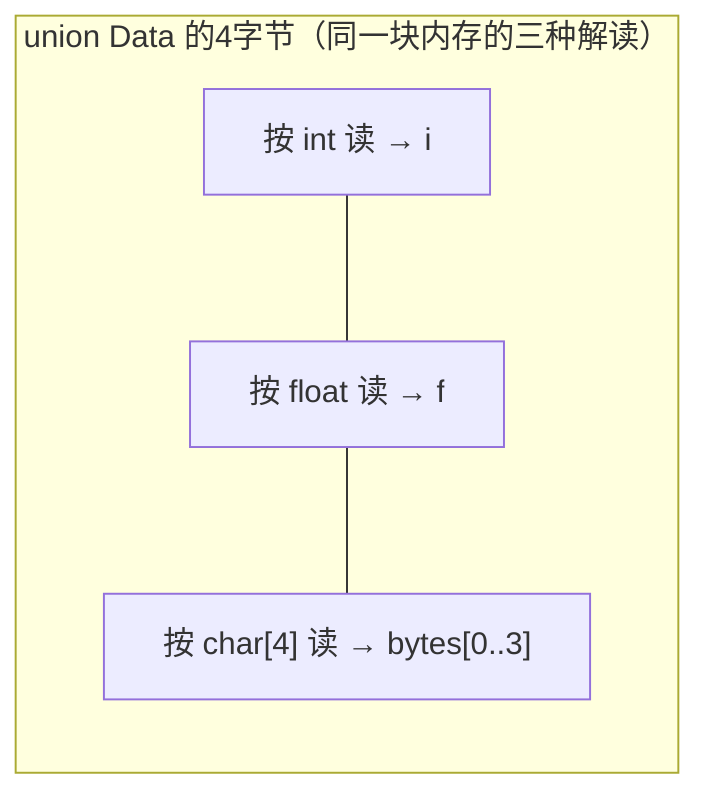
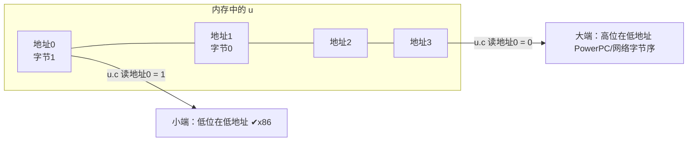

# 联合类型

## 本质：所有成员共享同一块内存

联合（union）的大小 = **最大成员的大小**，所有成员**从同一地址开始**：

```c
union Data {
    int   i;        /* 4字节 */
    float f;        /* 4字节 */
    char  bytes[4]; /* 4字节 */
};
```



```c
union Data d;
d.i = 0x40490FDB;                  /* 写int */
printf("%f\n", d.f);               /* 同一4字节按float解读 → 3.141592... */
printf("%02X %02X %02X %02X\n",
       d.bytes[0], d.bytes[1],     /* 逐字节看内存：DB 0F 49 40（小端） */
       d.bytes[2], d.bytes[3]);
```

**写一个成员、读另一个成员 = 重新解读同一块内存**（C11前严格说是实现定义行为，实践中是标准操作）。

## 大小与对齐

```c
union U {
    char  c[5];    /* 5字节 */
    double d;      /* 8字节，对齐要求8 */
};
sizeof(union U);       /* 8：取最大成员，并按最严格成员对齐 */
/* 规则：大小 ≥ 最大成员，且是"最大对齐值"的整数倍 */

union V {
    char c[9];
    int  i;
};
sizeof(union V);       /* 12：≥9 且是4的倍数 */
```

## 经典应用

### 1. 判断大小端（面试高频）

```c
int is_little_endian(void)
{
    union { int i; char c; } u;
    u.i = 1;
    return u.c;      /* 低地址字节是1 → 小端 */
}
```



### 2. 寄存器/硬件位域映射

```c
typedef union {
    uint32_t all;            /* 整体读写 */
    struct {
        uint32_t enable   : 1;
        uint32_t mode     : 3;
        uint32_t reserved : 28;
    } bits;                  /* 分位读写 */
} CtrlReg;

volatile CtrlReg *ctrl = (volatile CtrlReg *)0x40010000;
ctrl->bits.enable = 1;       /* 置某个位 */
ctrl->all = 0;               /* 一次清零整个寄存器 */
```

嵌入式/驱动开发的标准技巧：**union（整体视图）+ struct位域（细节视图）套娃**。

### 3. 节省内存的"多选一"存储

```c
/* 同一时刻只需要一种值时，union省内存（解释器Variable的经典实现） */
typedef struct Var {
    enum Type type;     /* 记录当前有效成员是哪个（类型标签） */
    union {
        long   i;
        double d;
        char  *s;
    } v;                /* 大小=最大成员8字节，而不是 8+8+8=24 */
} Var;
```

> **tagged union（带标签的联合）**是C实现"变体类型"的唯一正统手段，几乎所有解释器内核都在用。

## 初始化规则

```c
union U { int i; char c; };
union U a = {10};          /* ✔ 初始化第一个成员 i=10 */
union U b = {.c = 'x'};    /* C99指定初始化器 */
static union U z;          /* 静态存储期：所有字节清0 */
```

**活成员规则**：只有最后写入的成员是"活的"，读其他成员是把内存按另一种类型重新解释。

## 结构体 vs 联合

| 对比 | struct | union |
| --- | --- | --- |
| 内存 | 各占各的，总大小≥Σ成员 | 共享一块，总大小=最大成员 |
| 成员同时有效？ | ✔ 全部同时有效 | ✘ 同一时刻一个 |
| 用途 | 聚合"都有的属性" | 复用"二选一的存储" |

```c
struct S { int i; double d; };   /* sizeof=16，i和d都活着 */
union  U { int i; double d; };   /* sizeof=8，i和d抢同一块 */
```

## 匿名联合/结构体（C11标准，C89/99为GNU扩展）

```c
typedef struct {
    enum { POINT, CIRCLE } kind;
    union {                    /* 匿名：无成员名 */
        struct { int x, y; }  point;
        struct { int x, y, r; } circle;
    };                         /* 直接访问：v.point.x */
} Shape;
```

## 从汇编看union

union 全部成员偏移都是 **0**，访问不产生任何额外结构开销：

```asm
; d.i = 5
mov  DWORD PTR [d], 5
; d.bytes[2] = 7
mov  BYTE PTR [d+2], 7      ; 还是同一块内存的另一个地址而已
```

## 实战：编译提取汇编逐行解析（真实输出）

> 以下汇编全部为**真实编译产物**，指令逐字来自 gcc 输出，`;` 注释为整理所加。提取流程见 `.opencode/skills/c-dev/SKILL.md`；环境噪音说明见[数组·实战](数组.md)。
> 实测环境：Ubuntu 24.04 / gcc 13.3.0 / x86-64（System V ABI）/ Intel 语法

### 实验1：union 读低字节 —— "共享内存"意味着 union 整个蒸发

```c
union U {
    int  i;
    char c[4];
};

int lowbyte(int x)
{
    union U u;
    u.i = x;             /* 写int成员 */
    return u.c[0];       /* 读char成员 = 同一块内存按字节看 */
}
int main(void) { return lowbyte(0x1234AB78) & 0xFF; }  /* 0x78 → 实测退出码120 ✔ */
```

**-O2 真实输出**——union 消失得无影无踪：

```asm
lowbyte:
    endbr64
    movsx   eax, dil             ; ★就这一条：取参数低8位（dil=edi低字节），符号扩展
    ret                                ; u、u.i、u.c[0] —— 全都没有了！
```

写 `u.i = x` 再读 `u.c[0]`，编译器看出这**就是取 x 的最低字节**——union 不分配内存、不产生指令，直接化简为 `movsx eax, dil`（u.i 偏移0，u.c[0] 偏移也是0：**两个成员同一地址**，所以"换成员看"=换一种寄存器视图）。这就是"共享内存"的终极证明：**union 是写给编译器看的"视角切换许可"，机器层面只是换了个寄存器名**。

### 实验2：float 的位模式 —— movd：一条指令在两套寄存器间搬家

```c
unsigned fbits(float f)
{
    union { float f; unsigned u; } v;
    v.f = f;
    return v.u;               /* 同一4字节按unsigned解读 */
}
float frombits(unsigned u)
{
    union { float f; unsigned u; } v;
    v.u = u;
    return v.f;
}
int main(void) { return fbits(1.0f) == 0x3F800000u
                     && frombits(0x3F800000u) == 1.0f; }   /* 实测退出码1 ✔ */
```

**-O2**：

```asm
fbits:
    endbr64
    movd    eax, xmm0          ; ★MOVD：32位原样搬运，浮点寄存器xmm0 → 整数寄存器eax
    ret                            ; 不转换、不计算——纯"位模式平移"！

frombits:
    endbr64
    movd    xmm0, edi          ; 反方向：整数寄存器 → 浮点寄存器
    ret
```

`fbits(1.0f) == 0x3F800000` 成立（IEEE754里1.0的位模式）——而完成这一切的只是一条 `movd`。**union 类型双关（type punning）在编译器手里就是一条寄存器搬运指令**：

* 这也解释了为什么"用指针强转读float位模式"（`*(unsigned*)&f`）是UB（违反严格别名，见[类型转换](类型转换.md)）而 union 是**标准许可**的做法（C11 起明文）；
* `movd` 是连接整数世界（eax/edi）与浮点世界（xmm0）的虫洞——顺带解答"[实验2·u2d](类型转换.md)"里 float↔int 转换指令为什么长那样：转换指令内部也在干搬家的活。

### 汇编视角总结表（全部实测）

| C写法 | 机器形态 |
| --- | --- |
| `u.i = x; return u.c[0];` | `movsx eax, dil`（union蒸发，直接取低字节） |
| float↔unsigned 位模式互看 | `movd eax,xmm0` / `movd xmm0,edi`（一条指令） |
| union 整体大小 | 编译期算好（无运行期开销） |
| union 在栈上（-O0，地址被取走时） | 真分配一块"最大成员"的内存 |

## 小结

1. union = **一块内存多种解读**，大小=最大成员（对齐到最严格成员）；
2. 判断大小端、寄存器位域映射、tagged union 省内存是三大实战场景；
3. 同一时刻只有最后写入的成员是"活的"；
4. struct聚合、union复用——看需求选；
5. 新增实测：能被看穿的 union **零指令**（低字节直接读寄存器、float位模式一条movd）——"共享内存"的本质是**视角切换许可**，不是物理搬运。
