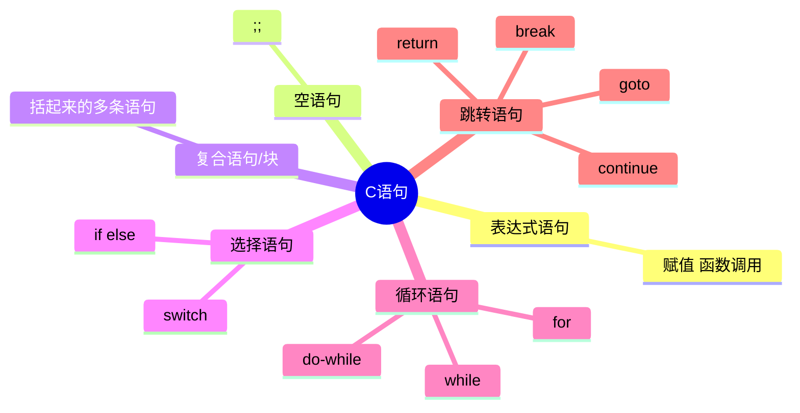

# 表达式和语句

## 基本概念

* **表达式（Expression）**：由运算符和操作数组成、**能计算出一个值**的式子。
* **语句（Statement）**：程序执行的单位。C规定语句以分号 `;` 结尾（复合语句除外）。

```c
42              /* 表达式：值为 42 */
x = 42          /* 表达式：值 = 42（赋值表达式的值就是所赋的值） */
x = 42;         /* 语句：表达式语句 */
;               /* 空语句：只有分号 */
```

**任何表达式加分号就是表达式语句**——这是C和许多语言不同的地方：

```c
2 + 3;          /* 合法但无意义：计算结果被丢弃（编译器可能警告） */
x == 5;         /* 合法但几乎肯定是笔误：本意 x = 5 */
```

## 语句分类



### 表达式语句

```c
c = a + b;        /* 赋值 */
printf("hi");     /* 函数调用 */
```

### 空语句

```c
;                       /* 什么也不做 */
while (getchar() != '\n')
    ;                   /* 经典用途：吃掉一行输入 */
```

### 复合语句（块）

```c
{
    int t = x;          /* 块内声明的变量出了块就销毁（C99前必须在块首声明） */
    x = y;
    y = t;
}
```

## 左值与右值

| 概念 | 定义 | 例子 |
| --- | --- | --- |
| **左值 (lvalue)** | 能定位到一块内存、**可被赋值**的表达式 | `x`、`arr[i]`、`*p`、`s.m`、`p->m` |
| **右值 (rvalue)** | 只有值、没有可定位内存 | `42`、`x+y`、`f(x)` 的返回值 |

```c
int x, y;
x = y;         /* x 左值（写入），y 此处作为右值（读出） */
x + 1 = y;     /* ✘ 编译错误：x+1 不是左值 */
int *p = &x;   /* & 要求操作数是左值 */
```

记忆：**左值 = 内存；右值 = 值**。赋值 `=` 左边必须是左值。

## 副作用与序列点

**副作用**：表达式求值之外对环境产生的改变（修改变量、写文件、IO）。

```c
x = 5;              /* 副作用：x 被修改 */
printf("a");        /* 副作用：输出字符 */
y = x + 1;          /* 求值 + 副作用 */
```

**序列点（Sequence Point）**：程序执行中"此前所有副作用必须完成、此后副作用尚未发生"的时间点：

| 序列点位置 | 例子 |
| --- | --- |
| `&&` `||` 左操作数求值后 | `i++ < 10 && arr[i]`：左边完事才轮到右边 |
| `?:` 问号处 | `c ? f() : g()` 只执行其中之一 |
| 逗号运算符 `,` 处 | `i++, j++` 先后有序 |
| 函数调用前所有实参求值完 | 但**实参之间无序**！ |
| `return`、完整表达式末尾 | `x = i++ * 2;` 之后 i 已+1 |

两个序列点之间**多次修改同一对象** → **未定义行为**：

```c
i = i++;                  /* UB！i 被改两次 */
f(i++, i++);              /* UB！实参求值顺序未指定 */
a[i] = i++;               /* UB！ */
i++ * i++;                /* UB！ */
```

详见[常见陷阱与未定义行为](常见陷阱与未定义行为.md)。

## 语句与汇编的对应

选择/循环语句在底层都是 `cmp + jcc（条件跳转）`：

```c
if (a > b)
    c = a;
else
    c = b;
```

```asm
    mov  eax, [a]
    cmp  eax, [b]      ; 比较设置 EFLAGS
    jle  .L2           ; a <= b 则跳到 else
    mov  ecx, [a]
    mov  [c], ecx      ; c = a
    jmp  .L3
.L2:
    mov  ecx, [b]
    mov  [c], ecx      ; c = b
.L3:
```

> **条件跳转正是现代CPU分支预测的对象**——这是"为什么有序分支比无序跳转性能好"的根源，也是 `switch` 跳转表优化的动机。详见[控制语句](控制语句-分支和跳转.md)。

## 小结

1. 表达式求值，语句执行；表达式加分号即成语句；
2. 左值=可定位内存，右值=值；`&` 与赋值左侧要求左值；
3. 副作用是程序真正的"效果"，序列点决定副作用生效顺序；
4. 序列点之间改两次同一变量 = UB，面试必考。
