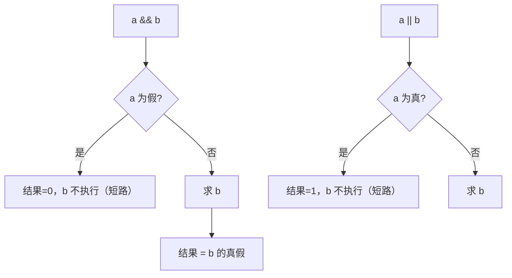

# 运算符

## 运算符总览

```mermaid
mindmap
  root((C运算符))
    算术
      + - * / %
      ++ --
    关系
      > >= < <=
      == !=
    逻辑
      && 
      || 
      !
    位运算
      & | ^ ~
      >> <<
    赋值
      = 
      复合赋值 += -= 等
    条件
      ?:
    指针/成员
      * & 
      -> . 
      []
    其他
      , 逗号
      sizeof
      (类型) 强转
```

## 算术运算符

```c
int a = 7, b = 2;
a / b        // 3  —— 整数除法，向零截断！
a % b        // 1  —— 取模（两操作数必须都是整数）
7 / -2       // -3 （C99起：商向零取整，故 -3 余 1）
7 % -2       // 1  （结果符号与被除数相同）
```

经典陷阱：

```c
double avg = (1 + 2) / 2;    // = 1.0 ！整数先除完再转 double
double avg = (1 + 2) / 2.0;  // = 1.5 ✔
```

浮点数不能取模 `%`（用 `fmod`）。

## 自增自减

**前缀：先加后用；后缀：先用后加**。

```c
int i = 5, r;
r = ++i;    // i=6, r=6
r = i++;    // i=6, r=5
```

从汇编看后缀 `i++`（`r = i++`）：

```asm
mov  eax, [ebp-4]    ; 1. 先把 i 的值取出来（这就是"旧值"）
add  dword ptr [ebp-4], 1   ; 2. 再把 i 加 1
mov  [ebp-8], eax    ; 3. r = 旧值
```

后缀版本多一次"保存旧值"的动作——语义上就是**先用后加**。

> ⚠️ 未定义行为警告：`i = i++ + 1;`、`f(i++, i++)` 在同一表达式内多次修改 i 是 **UB**，详见[常见陷阱与未定义行为](常见陷阱与未定义行为.md)。

## 关系与逻辑运算符

```c
/* 关系运算结果只有 0 和 1 */
int r = (3 > 2);    // r = 1
int e = (3 == 3.0); // 1

/* 逻辑运算符的短路特性 —— 这是特性，不是缺陷！ */
if (p != NULL && p->count > 0) { }   // p为NULL时不会解引用
if (i < n || arr[i] != 0) { }        // 前半成立则后半不执行

/* 逻辑非 */
!0   // 1
!5   // 0
!!x  // 把任意值归一化为 0/1
```

短路求值流程：



> C99 起可包含 `#include <iso646.h>` 用 `and/or/not` 代替 `&&/||/!`。

## 位运算符

见[位运算](位运算.md)专章（`& | ^ ~ << >>`）。

## 赋值运算符

```c
x = y = 5;        // 赋值是右结合表达式，先 y=5 再 x=5
x += 1;           // 复合赋值等价 x = x + 1，但 x 只求值一次
```

陷阱：`=` 与 `==` 写错：

```c
if (x = 0) { }    // 永假！本意 x == 0
if (0 = x) { }    // 编译错误（字面量不能作左值）—— 防御写法：常量放左边
```

## 条件运算符 ?:

C语言唯一的**三目运算符**：

```c
int max = (a > b) ? a : b;
// 嵌套：三目可代替小型 if-else 链
const char *s = (n == 0) ? "zero" : (n > 0) ? "pos" : "neg";
```

## 指针与成员运算符

| 运算符 | 含义 |
| --- | --- |
| `&x` | 取 x 的地址（左值→右值） |
| `*p` | 解引用（地址→值） |
| `a[i]` | 数组下标，本质 `*(a + i)` |
| `p->m` | 等价 `(*p).m` |
| `s.m` | 结构体成员访问 |

## 逗号运算符

```c
int x = (1, 2, 3);        // x = 3：依次求值，取最后一个
for (i = 0, j = 9; i < j; i++, j--) { }   // 最常见用法
```

> 注意区分：`int a, b;` 中的逗号是**分隔符**不是运算符。

## 类型转换运算符

```c
int  i = 300;
char c = (char)i;              // 显式截断
double d = (double)i / 2;      // 提升精度
void *p = malloc(16);
int  *q = (int *)p;            // 指针类型转换
```

详见[类型转换](类型转换.md)。

## 运算符优先级速查

完整表格见[优先级](优先级.md)。最常用速记：

```
括号成员第一；        () [] -> .
单目运算第二；        ! ~ ++ -- (类型) * & sizeof
乘除模三，加减四；    * / %   + -
移位五，关系六；      << >>   > >= < <=
等于不等排第七；      == !=
位与异或和位或；      & ^ |     （三四八五六不算）
逻辑与，逻辑或；      && ||
条件高于赋值！        ?:  低于 || 但高于 =
逗号运算最低。        ,
```

## sizeof 运算符

见[专章](sizeof关键字.md)。注意它是**运算符不是函数**，对类型使用时必须加括号：`sizeof(int)`。

## 实战：编译提取汇编逐行解析（真实输出）

> 以下汇编全部为**真实编译产物**，指令逐字来自 gcc 输出，`;` 注释为整理所加。提取流程见 `.opencode/skills/c-dev/SKILL.md`；环境噪音说明见[数组·实战](数组.md)。
> 实测环境：Ubuntu 24.04 / gcc 13.3.0 / x86-64（System V ABI）/ Intel 语法

### 实验1：`i++` 与 `++i` —— "先用后加"是两个物理动作

```c
int post(void) { int i = 5; int r = i++; return r * 100 + i; }  /* 506 */
int pre(void)  { int i = 5; int r = ++i; return r * 100 + i; }  /* 606 */
int main(void) { return post() + pre(); }   /* 1112 → 实测退出码88(1112%256) ✔ */
```

```asm
post:                               ; r = i++
    ...
    mov     DWORD PTR -8[rbp], 5    ; i = 5（i住[rbp-8]）
    mov     eax, DWORD PTR -8[rbp]  ; ★①先把旧值5捞出来存进eax —— "保存旧值"
    lea     edx, 1[rax]             ; ★②算 i+1（lea做加法）
    mov     DWORD PTR -8[rbp], edx  ; ★③i = 6（写回）
    mov     DWORD PTR -4[rbp], eax  ; ④r = eax —— 用的是旧值5！
    ...

pre:                                ; r = ++i
    ...
    mov     DWORD PTR -8[rbp], 5    ; i = 5
    add     DWORD PTR -8[rbp], 1    ; ★①直接加：i = 6（一步到位）
    mov     eax, DWORD PTR -8[rbp]  ; ②再读 —— 拿到的是新值6
    mov     DWORD PTR -4[rbp], eax  ; r = 6
    ...
```

教科书说"后缀先用后加、前缀先加后用"——汇编里这就是字面意思：**后缀版多一次"旧值暂存eax"，前缀版直接改完再读**。顺带注意 `lea edx, 1[rax]`：加1不用 add 指令而用 lea——不改标志位、不访存，编译器的小心思。

### 实验2：除法与取模 —— 一条 idiv 出双份结果；除以常量变魔数

```c
int divmod(int a, int b) { return a / b + a % b; }   /* 7/2=3 + 7%2=1 = 4 */
int div10(int x)         { return x / 10; }          /* 123/10=12 */
int main(void) { return divmod(7,2) + div10(123); }  /* 16 → 实测退出码16 ✔ */
```

**-O0**（老实人：除两次）：

```asm
divmod:
    ...
    mov     eax, DWORD PTR -4[rbp]   ; 取a
    cdq                              ; ★符号扩展：eax→edx:eax（把32位被除数
                                     ;   扩成64位，负数时edx=0xFFFFFFFF）
    idiv    DWORD PTR -8[rbp]        ; 除以b → 商在eax，余数在edx（一次全出！）
    mov     ecx, eax                 ; 存走商
    mov     eax, DWORD PTR -4[rbp]   ; —— 又来一遍（-O0不复用结果）——
    cdq
    idiv    DWORD PTR -8[rbp]
    mov     eax, edx                 ; 这次取余数
    add     eax, ecx                 ; 商+余数
    ...
```

**-O2**（聪明人：除一次，商余一起用）：

```asm
divmod:
    endbr64
    mov     eax, edi
    cdq
    idiv    esi                      ; ★一次idiv：eax=商、edx=余数
    add     eax, edx                 ; 直接相加 —— "a/b + a%b"两条指令的加法
    ret

div10:                               ; -O2：除以常量10根本不除！
    endbr64
    movsx   rax, edi
    sar     edi, 31                  ; edi = (x<0) ? -1 : 0 —— 符号掩码
    imul    rax, rax, 1717986919     ; ★★魔数0x66666667！乘法替代除法
    sar     rax, 34                  ; 再右移34位（高位补符号完成向零取整）
    sub     eax, edi                 ; 负数修正
    ret
```

两条冷知识：

1. **`idiv` 天生双输出**：商进 eax、余数进 edx——`a/b` 和 `a%b` 硬件上是一趟活。`cdq` 是它的固定前奏（把被除数符号扩展成64位，保证负数除法正确）；
2. **除以常量 = 魔数乘法**：除法指令在 x86 上要 20~40 周期，乘法只要 3 周期——编译器用 `imul 0x66666667 + sar 34` 算出 `x/10`（Granlund–Montgomery 算法）。**逆向看到莫名其妙的 0x66666667，先怀疑是除以常量**（10 的魔数；3→0x55555556，7→0x92492493……）。

### 汇编视角总结表（全部实测）

| C运算 | 机器形态 |
| --- | --- |
| `i++`（作右值） | 旧值暂存寄存器 → 计算 → 写回 → 用旧值 |
| `++i`（作右值） | 直接加 → 读新值 |
| `a + b` | `add` / 乘小常数 `lea`（强度削减） |
| `a * b`（变量） | `imul` |
| `a / b`（变量） | `cdq` + `idiv`（商eax余数edx） |
| `x / 常量` | **魔数乘法**（imul + sar） |
| `a > b` 比较 | `cmp` + `setcc/jcc`（见[类型转换·实战](类型转换.md)） |

## 小结

1. 整数除法向零截断，浮点 `%` 非法；
2. 短路求值是写安全条件语句的基石；
3. 复合赋值只求值一次，`x[i++] += 1` 比 `x[i++] = x[i++] + 1` 安全（后者是UB）；
4. 优先级记不住就加括号——可读性 > 炫技；
5. 新增实测：后缀++=旧值暂存、前缀++=先改后读；idiv一次出商余；除以常量=魔数乘法（逆向识别0x66666667）。
