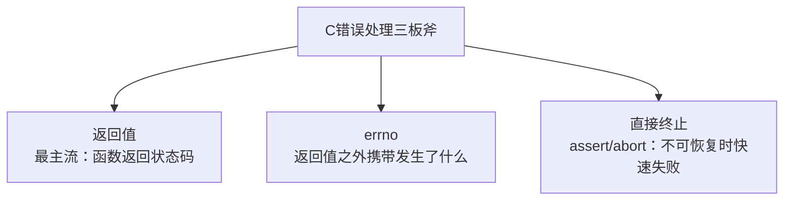
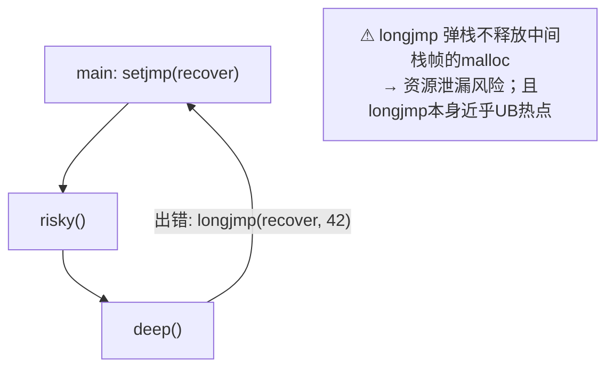

# 错误处理

## C的错误处理哲学

C没有异常机制。错误处理的三大支柱：



设计基调：**错误要么层层上抛让调用者决定，要么立即崩溃——最忌"吞掉错误继续跑"**。

## 返回值约定

```c
/* 约定1：成功返回0，失败返回非0（错误码）——系统调用风格 */
int fd = open("x.txt", O_RDONLY);
if (fd < 0) { /* 失败 */ }

/* 约定2：成功返回指针，失败返回NULL —— 内存/IO类 */
FILE *fp = fopen("x.txt", "r");
if (fp == NULL) { /* 失败 */ }

/* 约定3：返回特殊值：fgets读尽返回NULL、getchar返回EOF、strtoul用endptr */

/* 反面教材：不检查返回值 */
fseek(fp, 0, SEEK_END);      /* 失败了？没人知道 */
strcpy(dst, src);            /* 溢出了？没人知道 */
```

## errno：全局错误码（errno.h）

```c
#include <errno.h>
#include <string.h>
#include <stdio.h>
#include <stdlib.h>

errno = 0;                            /* ① 调用前清零（好习惯） */
FILE *fp = fopen("no_such.txt", "r");
if (fp == NULL) {                     /* ② 失败后 errno 才有意义 */
    printf("open failed: errno=%d (%s)\n",
           errno, strerror(errno));   /* strerror：码→描述 */
    /* 输出：open failed: errno=2 (No such file or directory) */
}
```

规则与细节：

| 规则 | 说明 |
| --- | --- |
| **只有失败才看** | 函数成功时**不保证**清errno（可能是上次残留）——所以"先清零后调用"或"只在失败分支读" |
| 值保留到下次调用 | 读完尽快处理，或立刻拷贝 `int e = errno;` |
| 线程局部 | 现代实现中 errno 是线程局部存储（TLS），多线程安全 |
| 常见值 | `ENOENT`(2) `EACCES`(13) `ENOMEM`(12) `EINVAL`(22) `ERANGE`(34) |

```c
/* perror：顺手打印"前缀: 错误描述" */
fp = fopen("no_such.txt", "r");
if (fp == NULL) {
    perror("fopen");     /* fopen: No such file or directory */
    exit(EXIT_FAILURE);
}

/* strtol + errno 组合拳（完整版） */
errno = 0;
char *end;
long v = strtol(s, &end, 10);
if (end == s)        fprintf(stderr, "not a number\n");
else if (errno == ERANGE)  fprintf(stderr, "out of range\n");
```

## 断言：开发期的看门狗

```c
#include <assert.h>

int binary_search(const int *a, size_t n, int key)
{
    assert(a != NULL);        /* 前置条件：开发期抓bug */
    ...
}

/* 本质：#define assert(e) ((e) ? (void)0 : __assert_fail(#e, __FILE__, __LINE__)) */

/* NDEBUG 关闭：assert 变空操作（release构建惯例） */
/* # gcc -DNDEBUG ⇒ assert全部消失 ⇒ 禁止在assert里放副作用 */
assert(close(fd) == 0);       /* ✘ NDEBUG后close根本不执行！ */
```

**assert vs 错误处理的分工**：

| | assert | 返回错误 |
| --- | --- | --- |
| 抓什么 | **程序员的bug**（不可能发生的情况） | **运行环境的意外**（文件没了、内存光了） |
| 保留到release? | 通常关闭 | 永远在线 |
| 例子 | `assert(p != NULL)`（逻辑保证非空） | `if (malloc == NULL)`（真实会发生） |

**口诀：assert管"我的错"，返回值管"世界的错"。**

## 防御式编程清单

```c
/* 1. 入口校验所有外部输入 */
int parse(const char *s, int *out)
{
    if (s == NULL || out == NULL)   return EINVAL;   /* 错误码直接返回 */
    if (*s == '\0')                 return EINVAL;

    errno = 0;
    char *end;
    long v = strtol(s, &end, 10);
    if (end == s || *end != '\0' || errno == ERANGE)
        return EINVAL;

    *out = (int)v;
    return 0;                        /* 成功约定返回0 */
}

/* 2. 所有资源获取失败立即处理，错误路径同样释放资源 */
int read_cfg(const char *path, char **out)
{
    FILE *fp = fopen(path, "r");       /* 可能失败 */
    if (fp == NULL) return -1;

    char *buf = malloc(4096);          /* 可能失败 */
    if (buf == NULL) { fclose(fp); return -1; }   /* 错误路径也要清理！ */

    size_t n = fread(buf, 1, 4096, fp);
    if (ferror(fp)) { free(buf); fclose(fp); return -1; }

    fclose(fp);
    buf[n] = '\0';      /* 演示省略边界检查 */
    *out = buf;
    return 0;           /* 成功：buf的所有权移交给调用者 */
}

/* 3. goto 收敛清理（内核风格，见控制语句章） */
int init(void)
{
    int err = setup_a();
    if (err) goto fail_a;
    err = setup_b();
    if (err) goto fail_b;
    return 0;
fail_b:  teardown_a();
fail_a:  return err;
}
```

## setjmp/longjmp：C的"异常"（高级）

非局部跳转——从深层函数直接弹回保存点：

```c
#include <setjmp.h>

jmp_buf recover;

int risky(void) { /* 深层出错 */ longjmp(recover, 42); return 0; }

int main(void)
{
    if (setjmp(recover) == 0) {       /* 第一次：返回0，正常流程 */
        risky();                      /* 中途炸了 → 弹回setjmp处 */
        printf("never here\n");
    } else {                          /* longjmp后：返回42，走恢复分支 */
        printf("recovered from error\n");
    }
    return 0;
}
```



**慎用**：会跳过正常清理路径（堆内存泄漏）、可变对象的状态坑。真实项目里，它主要用于**测试框架**（信号崩溃恢复）和**协程库**。日常错误处理老老实实用返回值。

## 致命错误：fail fast

```c
void fatal(const char *msg)
{
    perror(msg);          /* 或 fprintf(stderr, ...) */
    abort();              /* 立即终止并生成core dump，便于事后调试 */
    /* exit(EXIT_FAILURE) 会刷新缓冲+跑atexit，适合"体面退出" */
}

/* OOM（内存耗尽）的处理惯例：无法恢复 → 快死 + core dump */
if (p == NULL) fatal("malloc");
```

## 日志分级（工程实践）

```c
#define LOG(lv, fmt, ...) \
    fprintf(stderr, "[%s|%s:%d] " fmt "\n", lv, __FILE__, __LINE__, __VA_ARGS__)

#define LOG_ERR(fmt, ...)  LOG("ERR ", fmt, __VA_ARGS__)
#define LOG_WARN(fmt, ...) LOG("WARN", fmt, __VA_ARGS__)
/* 约定：错误→stderr（无缓冲），诊断→可重定向文件 */
```

## 小结

1. 返回值三约定：0/非0、NULL、EOF——**每个可能失败的调用都要接**；
2. errno"失败才有效"，用前清零或失败分支再读；`perror/strerror` 人性化输出；
3. assert抓程序员的bug（release关闭），返回值应对世界的意外（永远在线）；
4. 错误路径必须同样清理资源——goto收敛式与"goto done"是内核级验证的模式；
5. setjmp/longjmp是特种武器，日常别用；不可恢复错误 fail fast + core dump。
