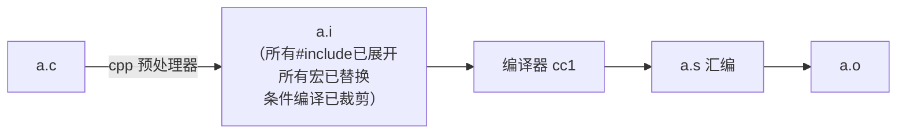

# 预编译

## 预处理器是什么

预处理器在**编译之前**运行，对源文件做**纯文本加工**：展开包含、替换宏、按条件裁剪代码。它不懂C语法，只是一台"文本复印机+剪刀"。



```bash
gcc -E hello.c -o hello.i    # 只跑预处理，观察产物
wc -l hello.i                # stdio.h 展开后动辄上万行
```

## 预处理指令一览

所有指令以 `#` 开头（`#` 后可跟空白）：

| 指令 | 作用 |
| --- | --- |
| `#include` | 文件包含（原地展开） |
| `#define` / `#undef` | 定义/取消宏 |
| `#if` `#ifdef` `#ifndef` `#elif` `#else` `#endif` | 条件编译 |
| `#error` | 编译到这就报错停（检查配置） |
| `#pragma` | 向编译器发指令（非标准） |
| `#line` | 修改行号/文件名（代码生成器用） |

## #include 的两种形式

```c
#include <stdio.h>    /* 系统目录搜索（-I 指定的路径也在内） */
#include "myutil.h"   /* 先在当前源文件目录找，找不到再按 <> 逻辑 */
```

**本质是"原地复制粘贴"**——头文件内容被完整展开进 .i 文件。这就是为什么头文件里只放声明（可以重复）不放定义（重复定义炸链接）。

## 条件编译：一套代码，多份形态

```c
/* 1. 防止重复包含（include guard） */
#ifndef MYHEADER_H
#define MYHEADER_H
/* ...头文件内容... */
#endif

/* 2. 按平台裁剪 */
#ifdef _WIN32
    /* Windows代码 */
#elif defined(__linux__)
    /* Linux代码 */
#else
    #error "unsupported platform"    /* 主动报错，早失败 */
#endif

/* 3. 按调试开关裁剪 */
#ifdef DEBUG
    #define LOG(...) fprintf(stderr, __VA_ARGS__)
#else
    #define LOG(...) ((void)0)       /* 空操作，零开销 */
#endif

/* 4. 数值条件 */
#if SIZE_MAX > 0xFFFFFFFF
    /* 64位环境 */
#endif

/* 5. 版本检查 */
#if __STDC_VERSION__ >= 199901L
    /* C99 及以上可用 */
#endif
```

**注意**：`#if` 只认**整数常量表达式**，不能用 `sizeof`（预处理阶段类型不存在）、不能用 enum 枚举值。

## 预定义宏

| 宏 | 含义 |
| --- | --- |
| `__FILE__` | 当前文件名（字符串） |
| `__LINE__` | 当前行号 |
| `__DATE__` / `__TIME__` | 编译日期/时间 |
| `__func__` | 当前函数名（C99，注意小写） |
| `__STDC__` | 符合标准时为1 |
| `__STDC_VERSION__` | 199901L=C99，201112L=C11，201710L=C17 |
| `__cplusplus` | C++编译器才定义（C/C++混编头文件的开关） |

经典用法——打印位置的诊断日志：

```c
#define LOG(fmt, ...) \
    fprintf(stderr, "[%s:%d %s] " fmt "\n", __FILE__, __LINE__, __func__, __VA_ARGS__)
/* 输出：[main.c:42 run] open file failed: %s → strerror(errno) */
```

## # 运算符：变成字符串

```c
#define STR(x) #x

STR(hello)         /* → "hello" */
STR(1 + 2)         /* → "1 + 2"（先原样字符串化，不计算！） */

/* 宏参数转字符串，配合#define显示变量名 */
#define SHOW_INT(v) printf(#v " = %d\n", (v))
SHOW_INT(count);   /* 输出：count = 42 */
```

## ## 运算符：拼接记号

```c
#define CAT(a, b) a##b

CAT(var, 1)        /* → var1 */
int CAT(var, 1) = 10;    /* 定义了变量 var1 */

/* 生成函数名家族（泛型技巧的基础） */
#define DECLARE_GET(type) \
    type get_##type(void *p) { return *(type *)p; }
DECLARE_GET(int);     /* 生成 int get_int(void*) {...} */
DECLARE_GET(double);  /* 生成 double get_double(void*) {...} */
```

## #pragma 与 _Pragma

```c
#pragma once                    /* 非标准但所有主流编译器支持：替代include guard */
#pragma pack(1)                 /* 结构体按1字节对齐（协议解析常用） */
#pragma warning(disable:4996)   /* MSVC关闭特定警告 */
```

`#pragma` 不认识时编译器**静默忽略**（这是它成为通用扩展机制的原因）。

## 预处理产物观察法

```bash
gcc -E test.c | tail -30       # 看展开后的尾巴（用户代码在最后）
gcc -E -dM test.c | sort       # 列出所有预定义宏（识别编译器/平台）
#   __GNUC__ 有值 → gcc/clang
#   _MSC_VER     → MSVC
#   __x86_64__   → 64位x86
```

**识别平台的正确姿势**不是猜，而是 `gcc -E -dM` 看真值。

## 小结

1. 预处理 = 纯文本加工，不懂C语法；`#include` 是复制粘贴；
2. 条件编译实现多平台/多形态同一份源码；`#error` 用于配置早失败；
3. 预定义宏 `__FILE__/__LINE__/__func__` 是日志三件套；
4. `#` 字符串化、`##` 记号拼接——宏编程的两大底牌（详见[宏定义](宏定义.md)）；
5. `gcc -E` 是理解预处理的最短路径。
