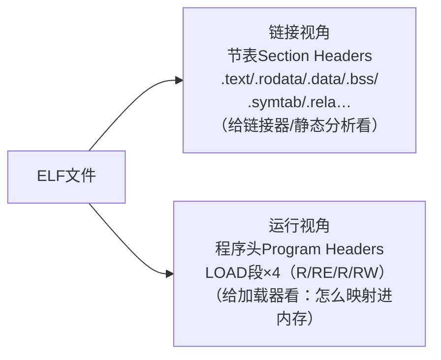

# ELF结构

> 全部数据来自**真实提取**：解剖对象为本库 [crackme01](../../../crackme/crackme01/crackme01.md) 的编译产物（Ubuntu 24.04 / gcc 13.3.0 / x86-64 / PIE）。

## ELF 文件的两种视角

同一份文件，两张"地图"：



## 总体布局

```text
┌─────────────────────────┐ 0x0
│ ELF Header（64字节）     │ 魔数/类型/入口/两个表的偏移
├─────────────────────────┤ 0x40
│ Program Headers（13个）  │ 运行地图
├─────────────────────────┤
│ .interp / .note / .dynsym / .dynstr / .rela… │ 链接信息
├─────────────────────────┤ 0x1000
│ .init / .plt / .text     │ ← 代码（入口0x10e0在这里）
├─────────────────────────┤ 0x2000
│ .rodata                  │ ← 只读数据（密码字符串在这）
├─────────────────────────┤ 0x2d98
│ .data / .bss             │ ← 可写数据（bss不占文件）
├─────────────────────────┤
│ Section Headers（31个）  │ 链接地图（文件尾）
└─────────────────────────┘
```

## ELF Header：文件头（真实输出）

```text
$ readelf -h crackme01.bin
Magic:   7f 45 4c 46 02 01 01 00 …
  Class:                             ELF64          ← 64位
  Data:                              2's complement, little endian ← 小端
  Type:                              DYN (Position-Independent Executable file)
  Machine:                           Advanced Micro Devices X86-64
  Entry point address:               0x10e0         ← 入口！
  Start of program headers:          64 (bytes into file)
  Number of program headers:         13
  Start of section headers:          14200
  Number of section headers:         31
```

逐字段解读：

| 字段 | 值 | 含义 |
| --- | --- | --- |
| Magic | `7f 45 4c 46` | `\x7fELF`——前4字节是身份证明（45 4c 46 = 'E''L''F'） |
| 第5字节 | `02` | 64位（01=32位）——**file命令的依据** |
| 第6字节 | `01` | 小端 |
| Type | `DYN` | **PIE**：位置无关可执行（ET_DYN）。区别于 ET_EXEC（固定基址）。另见 ET_REL（.o）/ET_DYN（.so） |
| Entry | `0x10e0` | ★进程第一条指令地址——**不是main！** 是 `_start`（crt启动代码），它再调 `__libc_start_main` → `main`（见[函数](../../C语言/函数.md)） |

## Program Headers：运行时的内存地图（真实输出）

```text
Program Headers:
  Type     Offset    VirtAddr          FileSiz   MemSiz    Flags  Align
  INTERP   0x318     …                 0x1c                R
      [Requesting program interpreter: /lib64/ld-linux-x86-64.so.2]
  LOAD     0x0       0x0               0x750     0x750     R      0x1000
  LOAD     0x1000    0x1000            0x2b1     0x2b1     R E    0x1000   ← 代码
  LOAD     0x2000    0x2000            0xf8      0xf8      R      0x1000   ← rodata
  LOAD     0x2d98    0x3d98            0x278     0x280     RW     0x1000   ← data+bss
  DYNAMIC  0x2da8    …
```

四个 LOAD 段就是[内存图](../../C语言/内存图.md)里静态区的来源：

| LOAD | 权限 | 内容 | 对应知识库章节 |
| --- | --- | --- | --- |
| 1 | R | ELF头+动态链接信息 | 本章 |
| 2 | **R E** | .text（入口0x10e0在此段） | [堆栈图](../../汇编/堆栈图.md) |
| 3 | R | .rodata（**crackme01密码@0x2004**） | [常量区](../../C语言/常量区.md) |
| 4 | **RW** | .data + .bss | [数组·data与bss](../../C语言/数组.md) |

三个必看细节：

1. **INTERP**：动态链接器的路径——可执行文件其实是个"半成品"，运行时先由 `ld-linux` 接手（见[编译链接与库](../../C语言/编译链接与库.md)的动态库部分）；
2. **第4段 FileSiz=0x278 < MemSiz=0x280**：差8字节就是 **.bss**——文件里没有的内容，加载器用零页补齐。这就是"未初始化全局不占文件体积"的文件级证据；
3. **vaddr与offset的关系**：前三个段 vaddr==offset（**crackme01 直接拿 vaddr 当文件偏移补丁成功的原因**）；第4段 vaddr(0x3d98)≠offset(0x2d98)——**改数据段内容必须换算**：`文件偏移 = vaddr - 0x3d98 + 0x2d98`。

## Section Headers：链接时的文件地图（真实输出节选）

```text
Section Headers:
  [Nr] Name        Type      Address           Offset     Size
  [12] .init       PROGBITS  0x1000            0x1000     0x1b
  [13] .plt        PROGBITS  0x1020            0x1020     0x60
  [15] .plt.sec    PROGBITS  0x1090            0x1090     0x50
  [16] .text       PROGBITS  0x10e0            0x10e0     0x1c2    ← 入口=本节起点
  [18] .rodata     PROGBITS  0x2000            0x2000     …        ← 密码在0x2004
  [20] .data       PROGBITS  …                 …                    ← 已初始化全局
  [21] .bss        NOBITS    …                 …                    ← 文件里不占字节
  [11] .rela.plt   RELA      …                 …                    ← strcmp/printf的重定位
```

节与 .s 文件的对应（你在[汇编·数据类型](../../汇编/汇编中的数据类型.md)见过的指示，落进文件就成了节）：

| .s里的指示 | 节 | 实测证据 |
| --- | --- | --- |
| `.text`（代码） | .text | 入口0x10e0=节首 |
| `.section .rodata` + `.string` | .rodata | "WaterDrop2026"在0x2004 |
| `.data` + `.long` | .data | g_init们（[数组·实验6](../../C语言/数组.md)） |
| `.bss` + `.zero` | .bss（NOBITS） | g_bss们，文件零占用 |
| `.quad 函数名`（表） | .data.rel.ro | [函数指针表](../../C语言/函数指针.md) |

## 动态链接三件套

| 节 | 作用 | 关联章节 |
| --- | --- | --- |
| `.dynsym`/`.dynstr` | 动态符号表：要导出/引用的符号 | `nm -D` |
| `.rela.plt` | **PLT重定位**：printf/strcmp/scanf的地址运行时填 | [编译链接·objdump -r](../../C语言/编译链接与库.md) |
| `.plt`/`.plt.sec` | 跳板代码：`call printf@PLT`的真实去向 | [内存管理·malloc@PLT](../../C语言/内存管理.md) |

## 解剖流程（拿到ELF的标准动作）

```text
1. file prog            → 位数/动态与否
2. readelf -h           → 入口/类型（PIE?）
3. readelf -l           → LOAD段（内存布局、vaddr↔offset换算依据）
4. readelf -S / -d      → 节表/动态依赖（ldd）
5. objdump -d / strings → 代码与字符串（进入crackme流程）
```

## 与PE的速查对照

| ELF | PE（Windows） | 说明 |
| --- | --- | --- |
| ELF Header（64B） | DOS Header + PE Header | PE多了DOS头历史包袱 |
| Program Header（段） | Section Header（节） | **术语互换**：ELF的Segment=PE的Section（内存视角） |
| Section（节） | ——（文件视角映射进节） | ELF双视角，PE基本单视角 |
| `.dynsym`/PLT/GOT | Import Table（IAT） | 动态导入机制 |
| 入口Entry（_start） | AddressOfEntryPoint | 都不是main |

详见[PE解析器](../PE解析器.md)。

## 小结

1. ELF双视角：**节表给链接器看（文件布局），程序头给加载器看（内存映射）**；
2. 魔数 `\x7fELF`+第5字节定位数；Type=DYN 即 PIE；
3. **入口不是main**，是crt的 `_start`；
4. 四个LOAD段=R/RE/R/RW——正好是[内存图](../../C语言/内存图.md)静态区四层；RW段 MemSiz>FileSiz 的差=.bss；
5. 补丁换算：vaddr==offset 只对靠前的段成立，数据段必须按段表换算。
