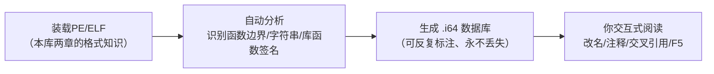

# IDAPro简介

> IDA（Interactive Disassembler）1995年出道，静态分析事实标准。本页速览它的世界观。

## 核心思想：数据库式反汇编

IDA 打开二进制后做的三件事：



与 `objdump` 的区别：objdump 每次从零输出"死文本"；IDA 是**可编辑的知识库**——你给它起的名字、写的注释全部持久化。

## 界面速览（经典布局）

| 窗口 | 内容 | 高频操作 |
| --- | --- | --- |
| **IDA View** | 反汇编主视图 | `Space`切换图形/文本；跳转结构图直接看if/while骨架 |
| **Pseudocode**（F5） | C伪代码 | 读逻辑主力；类型不准按`Y`修 |
| **Strings**（Shift+F12） | 全部字符串 | crackme第一站（见[crackme01](../../crackme/crackme01/crackme01.md)） |
| **Functions** | 函数列表 | 从 `main` 开始逐个啃 |
| **Imports** | 导入表（PE的IAT/ELF的.dynsym） | 程序会干什么的清单 |
| **Segments** | 节/段列表 | 对应[PE结构](../PE解析器/PE结构.md)/[ELF结构](../ELF解析器/ELF结构.md) |
| **Hex View** | 十六进制窗口 | 补丁时精确定位字节 |

## 自动识别的"三板斧后台"

| 技术 | 效果 | 你能感知到的 |
| --- | --- | --- |
| **库签名（FLIRT）** | 匹配静态链接的库函数 | `sub_xxx` 直接显示 `strcpy`——静态链接的巨型程序瞬间瘦身 |
| 函数边界探测 | call目标/序言识别 | 函数列表自动成型（找`push rbp; mov rbp,rsp`——[堆栈图](../汇编/堆栈图.md)的序言知识） |
| 数据类型传播 | 跟踪寄存器/栈槽类型 | F5伪代码里变量类型多半直接正确 |

## 脚本与插件（进阶方向）

| 体系 | 用途 |
| --- | --- |
| **IDC** | 内置脚本语言（老） |
| **IDAPython** | Python驱动IDA——批量分析/自动化CTF解题 |
| Hex-Rays SDK | 给F5写自定义反编译插件 |
| 常见插件 | 常见补丁：`KeyPatch`（改汇编）、`Diaphora`（diff两版本） |

## 典型工作流（把crackme01用IDA重做一遍）

```text
1. Shift+F12 → 找到 "WaterDrop2026"
2. 双击 → 落在 .rodata；按 X → 跳到唯一引用处（check函数）
3. F5 → 看到 if ( !strcmp(pwd, "WaterDrop2026") )
4. 此时你已知道补丁点：那个 jne
5. KeyPatch 或导出地址 → 完成与[crackme01](../../crackme/crackme01/crackme01.md)手工版相同的结论
```

## 学习路径建议

1. 先把本库[汇编板块](../汇编.md)过一遍——IDA输出就是那些指令；
2. 用 crackme01/02 当靶，每个操作都问"手工命令是什么"（strings/objdump/nm 的图形版而已）；
3. 进阶再上 IDAPython——静态分析的最高效形态是"写脚本让IDA干活"。

## 与其他工具的分工

| 工具 | 擅长 | 配合方式 |
| --- | --- | --- |
| IDA | **静态**全景+伪代码 | 先看地图 |
| OllyDbg/x64dbg | **动态**断点观察 | 再进现场 |
| gdb | Linux动态主力（本库实测环境） | 同上 |
| WinDbg | 内核/驱动 | 更深的领域 |
