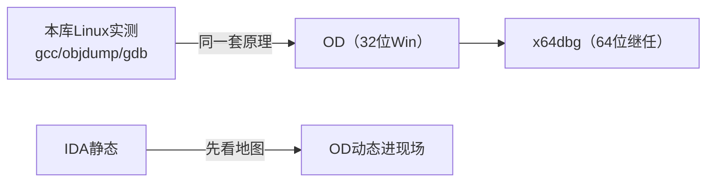

# OllyDbg简介

> OllyDbg：波兰开发者Oleh Yuschuk出品的32位用户态调试器（1.10版免费经典）。滴水逆向教程的主力工具，配套入门教程见 `reference/OllyDB入门教程.chm`。

## 是什么：用户态调试器

* **用户态**：调试普通exe（Ring3），不碰内核（内核是WinDbg的领域）；
* **免安装**：单exe直接跑，绿色到极致；
* **分析能力强**：自带启发式：库函数识别、跳转箭头、调用树——比"裸"调试器贴心；
* **插件生态**：ODBGScript（脚本）、StrongOD（反反调试）、各种脱壳助手。

## 安装与首次运行（32位Windows/虚拟机）

```text
1. 解压 OllyDbg.exe + 帮助文件到任意目录（绿色软件）
2. 选项→界面字体：换成中文/等宽字体（默认太小）
3. 载入目标：文件→打开（F3）
   —— 或附加运行中的进程：文件→附加
4. 停在系统断点（EP附近）→ F9 跑到程序入口/ OEP
```

> 实践建议：逆向Windows样本请在**虚拟机**里进行——本库crackme是无害自编靶，但习惯从第一天养成。

## 界面与核心窗格

| 窗格 | 你看什么 | 前置知识 |
| --- | --- | --- |
| **CPU主窗（反汇编）** | 指令流、跳转箭头（红绿）、当前EIP高亮 | [跳转指令集](../汇编/跳转指令集.md) |
| **寄存器** | EAX/ECX…/EFLAGS各位/段寄存器 | [通用寄存器](../汇编/通用寄存器.md)、[EFLAGS](../汇编/EFLAGS寄存器.md) |
| **内存dump** | 指定地址的十六进制/ASCII视图 | [内存读写](../汇编/内存读写.md) |
| **栈** | ESP附近：返回地址、参数、局部变量 | [堆栈图](../汇编/堆栈图.md) |

**32位的黄金公式在OD里活起来了**：`[ebp+8]`=第1参数（[参数传递](../汇编/参数传递.md)）——栈窗格里直接肉眼验证。

## 选项配置（新手三件套）

| 设置 | 位置 | 为什么 |
| --- | --- | --- |
| 异常处理全不勾 | 选项→异常 | 让异常抛给程序（跟解密流程必须） |
| 显示符号/源码行 | 视图 | 有PDB时切换更友好 |
| U command确认 | —— | 改指令前先备份（补丁纪律） |

## 经典插件

| 插件 | 用途 |
| --- | --- |
| **ODBGScript** | 脚本自动化（类IDAPython） |
| StrongOD / ScyllaHide | 绕过反调试（IsDebuggerPresent等） |
| OllyDump | 脱壳dump+修复输入表 |
| CommandBar | 命令行式下断（`bp GetWindowText`） |

## 常见调试场景（速查）

| 场景 | OD动作 |
| --- | --- |
| 找按钮事件处理函数 | 命令栏 `bp MessageBoxA`/消息断点 |
| 爆破比较跳转 | 断在cmp后jcc → 空格改jmp/Enter反转 → F9 |
| 追字符串来源 | 内存窗右键"断点→访问"（硬件断点跟写入） |
| 过UPX壳 | ESP定律：断在POPAD后单步到OEP → OllyDump |
| 让程序永远不过期 | 找`cmp 日期`的jcc，同crackme01套路 |

## 与本库工具链的关系



> 概念完全平移：OD的F7/F8 = gdb的si/ni；改EAX = `set $eax=0`；栈窗格 = `bt`+`x/32wx $rsp`。**工具会过时，堆栈图/寻址公式/EFLAGS永不贬值。**

## 学习路径

1. 跑一遍[crackme01](../../crackme/crackme01/crackme01.md)的OD版：载入→Shift+F12找字符串→断strcmp→改EAX→F9；
2. 读 `reference/OllyDB入门教程.chm` 的前几章（看懂四窗格）；
3. 配合滴水视频教程（[教程板块](教程.md)）实操 30 集级别起步。
