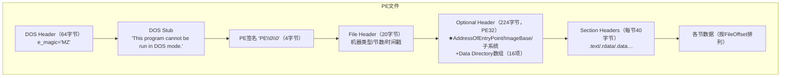

# PE结构

> 本章为**结构知识章**（本机为 Linux 环境，无 PE 样本可实测提取；字段定义以标准为准，配图参考 `reference/PE结构.pdf`）。所有偏移以 32 位 PE（PE32）为主线，64 位（PE32+）差异单独标注。

## 总体布局



## 第一层：DOS Header —— 为什么exe能在DOS里报错

```c
/* 64字节，关键字段只有两个 */
struct DOSHeader {
    WORD e_magic;      /* 'MZ'（0x4D5A）——Mark Zbikowski的缩写 */
    …                  /* 其余在PE时代基本废弃 */
    LONG e_lfanew;     /* ★PE签名的文件偏移（通常0xE0） */
};
```

* `'MZ'` 是PE文件的**第一个身份标识**（对应ELF的 `\x7fELF`）；
* `e_lfanew` 是"通往PE世界的门牌号"——解析器靠它跳过DOS时代遗产；
* DOS Stub 是一段真实可运行的DOS程序：在DOS下执行就打印 "This program cannot be run in DOS mode."——纯历史包袱。

## 第二层：NT Header（PE签名 + File Header + Optional Header）

```c
struct NTHeaders {
    DWORD Signature;          /* 'PE\0\0'（0x00004550） */
    FileHeader    File;       /* 20字节 */
    OptionalHeader Optional;  /* PE32: 224字节 / PE32+: 240字节 */
};
```

### File Header（20字节要点）

| 字段 | 含义 | 对应ELF |
| --- | --- | --- |
| `Machine` | 0x14c=i386 / 0x8664=x64 | `e_machine` |
| `NumberOfSections` | 节数量 | `e_shnum` |
| `TimeDateStamp` | 编译时间戳 | —— |
| `SizeOfOptionalHeader` | Optional头大小（PE32/PE32+判别依据） | —— |
| `Characteristics` | EXE/DLL标志 | `e_type` |

### Optional Header（精华所在，名字"可选"其实必选）

| 字段 | 值（典型32位EXE） | 含义 |
| --- | --- | --- |
| `Magic` | 0x10B=PE32 / 0x20B=PE32+ | 位数标识 |
| `AddressOfEntryPoint` | 如 `0x1000` | ★入口RVA——同样**不是main**（是CRT启动） |
| `ImageBase` | 如 `0x400000` | **默认加载基址**（EXE通常固定；DLL任意） |
| `SectionAlignment`/`FileAlignment` | 0x1000 / 0x200 | 内存/文件对齐粒度 |
| `Subsystem` | 2=GUI / 3=CUI(控制台) | 决定有没有控制台窗口 |
| `DataDirectory[16]` | ★★ | 16张表的"目录索引"（见下） |

### RVA：PE世界的核心概念

**RVA（Relative Virtual Address）= 绝对地址 − ImageBase**。

```text
VA（运行时地址）= ImageBase + RVA
文件偏移（FileOffset）= RVA - 所在节的VirtualAddress + 所在节的PointerToRawData
```

**补丁必用**：OD里看到地址 `0x401011`（VA），要改文件字节就得换算成文件偏移——与[ELF结构](../ELF解析器/ELF结构.md)的"vaddr↔offset换算"完全同一件事，但PE**每个节都要单独换**（ELF通常前几段相等）。

### Data Directory：16张表的索引

| 序号 | 表 | 逆向用途 |
| --- | --- | --- |
| 0 | **导出表 Export** | DLL导出哪些函数（IDA函数名来源） |
| 1 | **导入表 Import** | ★用了哪些外部DLL函数（IAT）——找strcmp/MessageBox的入口 |
| 2 | 资源表 | 图标/字符串资源 |
| 5 | **重定位表 Reloc** | DLL加载基址不对时的修正表（对应ELF的.rela.dyn） |
| 9 | TLS表 | 线程局部存储（反调试常用钩子位） |

## 第三层：Section Headers（节表，每节40字节）

| 字段 | 含义 | 对应ELF的节 |
| --- | --- | --- |
| `Name[8]` | 名字（.text/.rdata/.data/.rsrc/.reloc） | 同名概念 |
| `VirtualAddress` | 内存RVA | `sh_addr` |
| `SizeOfRawData` | 文件中大小 | `sh_size`（文件侧） |
| `PointerToRawData` | 文件偏移 | `sh_offset` |
| `VirtualSize` | 内存中大小（>RawData的差≈bss） | `p_memsz-p_filesz` |
| `Characteristics` | R/W/X标志 | 段权限 |

典型五节与权限：

| 节 | 权限 | 内容 | 对应本库章节 |
| --- | --- | --- | --- |
| `.text` | R X | 代码 | [跳转指令集](../../汇编/跳转指令集.md) |
| `.rdata` | R | 只读数据/导入表 | [常量区](../../C语言/常量区.md) |
| `.data` | RW | 已初始化全局 | [数组·data](../../C语言/数组.md) |
| `.bss`（常并入.data） | RW | 未初始化（VirtualSize>SizeOfRawData） | [变量·bss](../../C语言/C语言变量.md) |
| `.rsrc` | R | 资源 | —— |

## 导入表（IAT）——PE版的重定位


* 编译时 `call MessageBoxA` 变成 **call 间接地址**（IAT的一个槽）；
* 加载器把真实函数地址填进IAT——对应ELF的 PLT/GOT（见[编译链接](../../C语言/编译链接与库.md)）；
* **逆向找API调用**：看导入表知道程序会干什么（网络？注册表？文件？），看IAT交叉引用找到调用点。

## 加载过程（加载器视角）

```text
1. 读DOS头e_lfanew → 定位PE签名
2. 按ImageBase申请内存（EXE通常成功；DLL被占则重定位+修正Reloc表）
3. 按节表把各节映射到 VirtualAddress（FileAlignment→SectionAlignment对齐）
4. 处理导入表：LoadLibrary每个DLL，GetProcAddress填IAT
5. 处理重定位表（若基址变了）
6. 从 AddressOfEntryPoint 开始执行（CRT → main）
```

对照ELF：`ld-linux` 干的事几乎一样（INTERP→映射LOAD→填GOT/PLT→入口）——**加载器的本质工作跨平台通用**。

## 逆向工具操作位

| 任务 | 工具/操作 |
| --- | --- |
| 改入口（劫持执行流） | LordPE改 `AddressOfEntryPoint` |
| 改节属性（.text可写） | 节表 `Characteristics` 加 WRITE 标志 |
| 补丁字节 | OD `Ctrl+E` 内存改 / LordPE文件偏移改 |
| 脱壳后重建 |LordPE dump + 修ImageSize/重定位 |
| 查壳 | 节名异常（UPX0/UPX1）、入口在末节 |

## ELF vs PE 总对照表

| 项 | ELF | PE |
| --- | --- | --- |
| 身份魔数 | `\x7fELF` | `MZ`（+PE\0\0） |
| 位数标识 | Class字段 | Optional.Magic / Machine |
| 入口 | e_entry（_start） | AddressOfEntryPoint（CRT） |
| 内存映射单位 | Program Header的LOAD段 | Section Header（节） |
| 文件↔内存换算 | vaddr−段基址+段offset | RVA−节VA+节RawData指针 |
| 动态导入 | .dynsym + PLT/GOT + .rela | 导入表IAT + 加载器直填 |
| 重定位 | .rela.dyn | .reloc节 |
| 默认基址 | PIE随机（ASLR） | EXE=ImageBase固定 / DLL可移 |
| 历史包袱 | 无 | DOS头+DOS Stub |

## 小结

1. PE三层：DOS头（MZ+e_lfanew）→ NT头（签名/File/Optional含**入口RVA、ImageBase、DataDirectory**）→ 节表；
2. **RVA=VA−ImageBase**；文件偏移按节逐个换算——补丁的核心算术；
3. 术语陷阱：PE的"Section"≈ELF的"Segment"（内存视角）；
4. IAT=PE版GOT：调用外部函数走间接槽，加载器填真值；
5. 加载器五步曲跨平台通用——学完ELF再学PE，成本减半。
