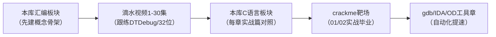

# 教程

> 本板块收录配套教程的导读与学习路线。知识库主体（汇编/C/crackme）已自成体系，教程是"跟视频练手感"的补充。

## 章节

* [汇编、C语言基础教程](教程/汇编、C语言基础教程.md) —— 滴水文字版笔记导读
* [滴水逆向视频教程](教程/滴水逆向视频教程.md) —— 视频课目录与笔记

## 推荐学习路线（把教程嵌入知识库）

## 与知识库的对应关系

| 教程内容 | 知识库对应章节 |
| --- | --- |
| 进制/数据宽度/寄存器 | [汇编板块](汇编.md) 前半 |
| 寻址公式/堆栈图 | [寻址公式](汇编/寻址公式.md)、[堆栈图](汇编/堆栈图.md) |
| C语言本质 | [C语言各章实战篇](C语言.md) |
| 调试器操作 | [DTdebug调试器](DTdebug调试器.md)、[gdb](gdb动态调试.md)、[OllyDbg](OllyDbg.md) |
| PE结构 | [PE解析器](PE解析器.md) |
| crackme实战 | [crackme靶场](../crackme/crackme.md) |

> 说明：视频以32位Windows/DTDebug为主环境；本库实战篇以64位Linux/gcc为主。**两套环境互为印证**（32位经典概念 + 64位真实提取），对照学习效果最佳。
