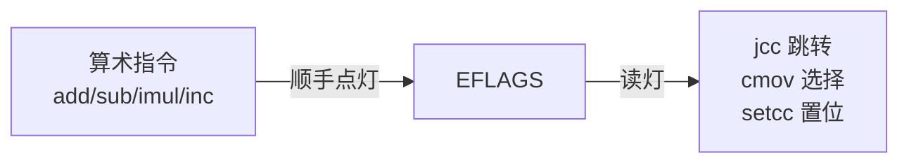

# EFLAGS寄存器

## 状态的"仪表盘"

算术/逻辑指令除了产出结果，还会顺手在 **EFLAGS（标志寄存器）** 上点亮一组"仪表灯"。条件跳转、条件传送、setcc 全靠读这些灯——**没有EFLAGS就没有 if/while/比较**。



## 六个必须秒懂的标志位

| 标志 | 全称 | 何时亮 | 含义 |
| --- | --- | --- | --- |
| **ZF** | Zero Flag | 结果==0 | 上一运算结果为零 |
| **SF** | Sign Flag | 结果最高位=1 | 结果是负数（带符号视角） |
| **CF** | Carry Flag | 无符号进位/借位 | 无符号运算"越界了"（第33位溢出） |
| **OF** | Overflow Flag | 带符号溢出 | 补码世界"越界了"（符号位被顶翻） |
| **PF** | Parity Flag | 低8位中1的个数为偶 | 奇偶校验（老串口时代遗产，少用） |
| **AF** | Auxiliary Flag | BCD半进位 | 古董，忽略 |

**CF与OF是两套世界观**：同一个加法 `0x7FFFFFFF + 1`：

* 无符号看：2147483647+1 没超0xFFFFFFFF → **CF=0**（没进位）；
* 有符号看：INT_MAX+1 溢出了 → **OF=1**（符号位翻成负数）。

硬件同时点两套灯，**用哪套是C程序员/编译器的事**。

## cmp 与 test：只点灯不算数的指令

| 指令 | 本质 | 用途 |
| --- | --- | --- |
| `cmp a, b` | `a - b`（**结果丢弃**，只留标志） | 比较大小/相等 |
| `test a, b` | `a & b`（结果丢弃，只留标志） | 判零/判位 |

```asm
cmp     eax, 100        ; 算了eax-100，结果扔掉，灯留下了
je      equal           ; ZF=1（相等）就跳
```

## jcc 家族：两套条件、一表背完

**带符号族（看SF/OF/ZF）**：

| 指令 | 条件 | C语义 |
| --- | --- | --- |
| `jg` / `jnle` | ZF=0 且 SF=OF | `a > b` |
| `jge` / `jnl` | SF=OF | `a >= b` |
| `jl` / `jnge` | SF≠OF | `a < b` |
| `jle` / `jng` | ZF=1 或 SF≠OF | `a <= b` |

**无符号族（看CF/ZF）**：

| 指令 | 条件 | C语义 |
| --- | --- | --- |
| `ja` / `jnbe` | CF=0 且 ZF=0 | `a > b`（unsigned） |
| `jae` / `jnb` | CF=0 | `a >= b` |
| `jb` / `jnae` | CF=1 | `a < b`（unsigned） |
| `jbe` / `jna` | CF=1 或 ZF=1 | `a <= b` |

**相等族**：`je`（ZF=1）/ `jne`（ZF=0）。

**助记**：g/greater=带符号大，a/above=无符号大，l/less、b/below同理。jl与jb一字之差，就是C里 `int a<b` 与 `unsigned a<b` 的区别（实测见下）。

## 实测：cmp/test 点灯、setcc 读灯（gcc 13.3 / x86-64 / -O2）

```c
int lt(int a, int b)            { return a < b; }     /* 带符号比较 */
int lt_unsigned(unsigned a, unsigned b) { return a < b; } /* 无符号比较 */
int eq0(int x)                  { return x == 0; }    /* 判零 */
int is_neg(int x)               { return x < 0; }     /* 判符号 */
int both_nonzero(int a, int b)  { return a && b; }    /* 短路 */
```

```asm
lt:
    xor     eax, eax          ; 清零（给setcc腾位）
    cmp     edi, esi          ; 点灯：edi-esi
    setl    al                ; ★带符号读灯：SF≠OF → al=1
    ret
lt_unsigned:
    xor     eax, eax
    cmp     edi, esi          ; 同样一条cmp！
    setb    al                ; ★无符号读灯：CF=1 → al=1
    ret
eq0:
    xor     eax, eax
    test    edi, edi          ; ★test自与：x & x——为零则ZF=1
    sete    al                ; ZF=1 → 1
    ret
is_neg:
    mov     eax, edi
    shr     eax, 31           ; ★gcc不走标志位：直接把符号位（第31位）移下来
    ret                          ; ——SF读法被优化成移位，殊途同归
both_nonzero:
    test    edi, edi          ; a != 0 ?
    setne   dl                ; ZF=0 → dl=1（非零为真）
    xor     eax, eax
    test    esi, esi          ; b != 0 ?
    setne   al
    and     eax, edx          ; && 被改造成 两个标志读取再and！
    ret
```

**同一条cmp，setl/setb两种读法**——这正是[C语言·类型转换实战](../C语言/类型转换.md)里"-1 < 1 为真、-1 < 1u 为假"的机器根源：C的比较运算符按操作数符号性选择jcc/setcc族，**数据本身两可，指令一锤定音**。

## cmov：不跳转的"读灯"

```asm
cmp     edi, esi
mov     eax, esi          ; 先备好b
cmovge  eax, edi          ; a>=b（SF=OF）则换成a——无分支版max！
```

实测来自[分支·实战](../C语言/控制语句-分支和跳转.md)的max：**-O2把if/else改写成cmov**，彻底绕开分支预测惩罚。jcc是"读灯后跳"，cmov是"读灯后挑"。

## 标志位与溢出检测

```asm
add     eax, 1            ; 有符号溢出时 OF=1 —— C语言里INT_MAX+1是UB的硬件对应物
add     al, 1             ; 255+1时 ZF=1, CF=1 —— 无符号回绕的硬件对应物
```

大数运算（多精度加法）靠**CF**串联：低32位add后 `jc` 检查进位，决定高32位要不要多加1——CF就是那"第33位"的暂存区（见[数据宽度·溢出三形态](数据宽度.md)）。

## 逆向识别口诀

| 看到 | 推断 |
| --- | --- |
| `cmp + jl/jg/setl/setg` | **带符号**比较（int/long） |
| `cmp + jb/ja/setb/seta` | **无符号**比较（unsigned/size_t/指针比较） |
| `test reg,reg + je/jne` | 判空/判零（`if (p)` / `if (x == 0)`） |
| `test reg,1` / `test reg,mask` | 位测试（`if (x & flag)`） |
| `cmp eax,N + ja` | **范围检查**：`if (x <= N)`——跳转表/数组下标防线（switch边界、位域防越界同款） |
| `cmovXX` | 无分支选择（-O2的if/else小结果） |
| `add/shr 31` | gcc读符号位的替代写法（is_neg同款） |

## 小结

1. EFLAGS是运算指令顺手点的"仪表灯"，jcc/cmov/setcc读灯行动；
2. **两套世界观**：带符号看SF/OF（jg/jl族），无符号看CF（ja/jb族）——je/jne中立；
3. cmp=减法只留灯、test=与法只留灯——比较从不"产出差值"；
4. 同一条cmp，setl/setb给出两种结果——C的`-1 < 1u`为假的全部真相；
5. -O2常用cmov替代跳转、用移位替代读SF——逆向时认识这些"变装"形态。
