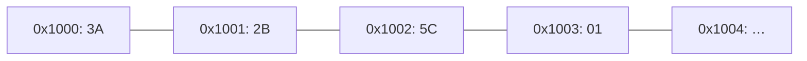

# 内存读写

## 内存模型：一维字节走廊

把内存想象成一条无限长的走廊，**每个房间恰好1字节、房号（地址）唯一递增**：



* **读**：按房号取走内容的**副本**（原物不动）；
* **写**：按房号放入新内容（旧的被覆盖，永久丢失）；
* 多字节数据**低字节放低地址**（小端，x86/x86-64）：

```text
int x = 0x12345678 存在 0x1000：
0x1000: 78  0x1001: 56  0x1002: 34  0x1003: 12
←低位在低地址：读字节流 78 56 34 12
```

大小端判断的经典实验见[联合类型](../C语言/联合类型.md)（`u.i=1; u.c[0]==1` 即小端）。

## mov：唯一的搬运工

Intel语法 `mov 目的, 源`（AT&T相反：`mov 源, 目的`——逆向切换工具时先看语法风格）。

五大搬运路线（全部为真实编译输出）：

```asm
; ① 立即数 → 寄存器
mov     edi, 41                    ; FATAL枚举常量（枚举实战）
mov     DWORD PTR -32[rbp], 100    ; ② 立即数 → 内存：a = 100
mov     eax, DWORD PTR -32[rbp]    ; ③ 内存 → 寄存器：读a
mov     QWORD PTR -24[rbp], rax    ; ④ 寄存器 → 内存：p = rax
mov     eax, edx                   ; ⑤ 寄存器 → 寄存器
```

**做不到的**（x86铁律）：

```asm
mov     [mem1], [mem2]     ; ✘ 内存→内存：必须寄存器中转（两次mov）
mov     [mem], 100         ; ✘ 立即数→内存（带宽度时可以：mov DWORD PTR [rbp-4],100 ✔
                           ;   报错的是不带宽度无法推断尺寸的场景）
```

## 读写的完整周期（以 *p = 200 为例）

```c
int a = 100; int *p = &a; *p = 200;
```

```asm
mov     DWORD PTR -32[rbp], 100     ; 写①：立即数→内存（a=100）
lea     rax, -32[rbp]               ; 算地址（不读写）
mov     QWORD PTR -24[rbp], rax     ; 写②：寄存器→内存（p=&a）
mov     rax, QWORD PTR -24[rbp]     ; 读①：内存→寄存器（取p的值=a的地址）
mov     DWORD PTR [rax], 200        ; 写③：寄存器→间址内存（写穿到a！）
```

**指针读写的机器本质**：间址`[rax]`——先读指针变量拿到地址，再拿地址当房号访问。一级指针一次间址、二级两次（实测：[指针·实战](../C语言/指针.md)）。

## 读写是有"宽度"的

```asm
movzx   eax, BYTE PTR [rdi]     ; 读1字节（且零扩展进32位）
movsx   eax, dil               ; 读1字节寄存器（符号扩展）
mov     eax, DWORD PTR [rdi]   ; 读4字节
movsd   xmm0, QWORD PTR [rdi]  ; 读8字节进浮点寄存器
```

详见[数据宽度](数据宽度.md)、[汇编中的数据类型](汇编中的数据类型.md)。

## mov之外的特殊读写

| 指令 | 语义 | 实测场景 |
| --- | --- | --- |
| `xchg a, b` | 交换（隐式总线锁） | 原子操作基础 |
| `push/pop` | 读写+移动栈顶（rsp±8） | 函数序言/尾声（[堆栈图](堆栈图.md)） |
| `lea dst, [地址表达式]` | 只算地址不访存 | `&a`、取函数地址 |
| `movzx/movsx` | 读窄宽度+扩展 | char/short提升（[类型转换](../C语言/类型转换.md)） |
| `movss/movsd` | SSE浮点读写 | double成员（[结构体](../C语言/结构体.md)） |
| `movd` | 整数↔SSE寄存器搬运 | float位模式（[联合类型](../C语言/联合类型.md)） |
| `rep movsb` | 按字节循环复制（硬件重复前缀） | 大块拷贝/memcpy内幕 |

## 从读写看"变量赋值"的真相

C的一行赋值，机器可能要一次读+一次写+间址：

```c
*p = *q + 1;    /* 间址读 + 加 + 间址写 */
```

```asm
mov     rax, QWORD PTR -32[rbp]     ; 取q
movzx   edx, BYTE PTR [rax]         ; 读*q
lea     edx, 1[rdx]                 ; +1（lea做加法）
mov     rax, QWORD PTR -40[rbp]     ; 取p
mov     BYTE PTR [rax], dl          ; 写*p
```

（实测源自[数组·实验4](../C语言/数组.md) first函数的 arr[0]=arr[0]+1——完全同款）

## 小结

1. 内存=一维字节走廊，每字节一个唯一地址；小端：低字节在低地址；
2. mov五大路线：立即↔寄存器↔内存；**内存→内存必须中转**；
3. `lea`只算地址不取货——与mov配对理解；
4. 读写自带宽度（BYTE/WORD/DWORD PTR），扩展有movsx/movzx；
5. 指针读写=间址`[reg]`：先读指针拿地址，再按地址访问——赋值语句在机器层是多步搬运序列。
