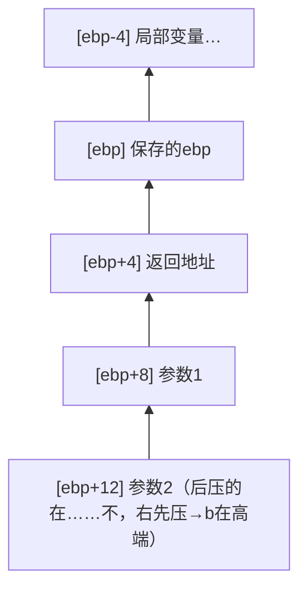

# 参数传递

## 参数怎么进函数

C说"传参"，机器问的是：**参数放哪、谁清理**。这两问的不同答案，构成各调用约定（calling convention）。

## 32位经典：cdecl（滴水/C语言默认）

**参数从右到左压栈，调用方清栈**：

```c
int add(int a, int b) { return a + b; }
/* main: add(1, 2) */
```

```asm
; 调用方 main
push    2                   ; ★先压右参数b
push    1                   ;  再压左参数a
call    add
add     esp, 8              ; ★cdecl签名：调用方清栈（平衡）
; 被调方 add（32位经典形态）
push    ebp
mov     ebp, esp
mov     eax, [ebp+8]        ; ★第1参数在[ebp+8]
add     eax, [ebp+12]       ; ★第2参数在[ebp+12]
pop     ebp
ret
```

32位 cdecl 栈帧布局（**逆向第一反射**）：



**为什么从右到左**：这样最左参数最靠近返回地址，支持**变参函数**（printf靠第一个参数定位后续）——且只有调用方知道自己压了几个参数，所以cdecl由调用方清栈（`add esp,N`），这正是printf能存在的原因。

## 64位现代：System V AMD64（Linux/macOS，gcc实测）

**前6个整型参数走寄存器，第7个起压栈，调用方清栈**（实测：[函数·实战](../C语言/函数.md)）：

```c
int seven(int a, int b, int c, int d, int e, int f, int g) { ... }
/* main: seven(1,2,3,4,5,6,7) */
```

```asm
; 调用方 main（gcc 13.3 / x86-64 实测）
push    7                   ; ★第7参数先压栈（在call之前！）
mov     r9d, 6              ; 参数6 → r9d
mov     r8d, 5              ; 参数5 → r8d
mov     ecx, 4              ; 参数4 → ecx
mov     edx, 3              ; 参数3 → edx
mov     esi, 2              ; 参数2 → esi
mov     edi, 1              ; 参数1 → edi
call    seven
add     rsp, 8              ; 调用方清栈参数（16字节对齐到8）
; 被调方 seven
mov     eax, DWORD PTR 16[rbp]   ; ★第7参数从[rbp+16]读——栈上传来的！
```

寄存器分工表（必背）：

| 位置 | 整型/指针 | 浮点 |
| --- | --- | --- |
| 参数1~6 | **rdi, rsi, rdx, rcx, r8, r9** | xmm0~xmm5（混编时各自独立计数） |
| 参数7+ | 栈（`[rbp+16]`起，8字节/格） | 栈 |
| 返回值 | **rax**（rax:rdx128位） | **xmm0** |
| 栈对齐 | call前rsp必须16字节对齐 | 变参时AL=使用的xmm数量 |

> `[rbp+16]` 与 32位 `[ebp+8]` 的差异来源：64位帧里 `[rbp+8]` 仍是返回地址，但前6个参数根本不在栈上——栈参数区从`[rbp+16]`（跳过被保存的rbx等callee-saved……准确说：序言只push rbp时，第一个栈参数在[rbp+16]）起。

**变参衔接**：寄存器参数被变参函数序言搬进栈上"保存区"，耗尽后va_arg自动切到 `[rbp+16]` 栈区——两套规则无缝拼接（实测：[可变参数·实战](../C语言/可变参数.md)）。

## Windows x64（Microsoft调用约定）

与System V同思路但排布不同（逆向Windows程序必知）：

| 项 | Microsoft x64 | System V AMD64 |
| --- | --- | --- |
| 参数1~4 | **rcx, rdx, r8, r9** | rdi, rsi, rdx, rcx, r8, r9（6个） |
| 参数5+ | 栈（预留32字节shadow space） | 栈 |
| 调用者 | 总是预留0x20字节影子空间 | 无 |
| 32位时代 | `__stdcall`（Win32 API，ret N清栈） | cdecl |

## 谁清栈：三家的签名动作

| 约定 | 清栈方 | 机器签名 | 代价与收益 |
| --- | --- | --- | --- |
| cdecl（32位C默认） | **调用方** | `call f` 后跟 `add esp,N` | 支持变参✔；每次调用多一条指令 |
| stdcall（Win32 API） | **被调方** | `ret N`（ret时顺手esp+=N） | 代码更省；不支持变参 |
| System V x64 | 调用方（栈参数部分） | `add rsp,8` | 寄存器传参为主，清栈罕见 |
| fastcall | 被调方 | 前两参进ecx/edx（32位） | 速度优先的过渡方案 |

**逆向识别**：看到 `ret 8`/`ret 0xC` → stdcall（Win32 API实锤）；看到call后紧跟 `add esp,N` → cdecl。

## 返回值

| 情形 | 通道 | 实测 |
| --- | --- | --- |
| 整型/指针 ≤64位 | rax | `mov eax, 36; ret`（sum被折叠） |
| 128位 | rdx:rax | 罕见 |
| 浮点 | xmm0 | `movsd xmm0, [rdi+16]`（get_d） |
| 小结构体 ≤8字节 | rax位打包 | `sal rsi,32; or rax,rsi`（Pair打包） |
| 小结构体 ≤16字节 | rax:rdx两半 | 拆两个寄存器 |
| 大结构体 | **隐藏指针**：调用方在rdi传目标地址，被调方往里填 | —— |
| void | 不写rax（内容是垃圾，调用方别读） | swap无返回值 |

（结构体各形态实测详见[结构体·实战](../C语言/结构体.md)）

## 实测彩蛋：参数寄存器的"接力"被编译器看穿

```asm
; apply(op, x, y) 在-O2下变成尾跳转（[函数指针·实战]）
apply:
    mov     rax, rdi          ; op
    mov     edi, esi          ; ★x从esi搬到edi——参数左移一格！
    mov     esi, edx          ; y从edx搬到esi
    jmp     rax               ; 尾调用：替目标函数摆好参数直接跳
```

**参数搬家是编译器日常**——看到 `mov edi,esi` 这种"寄存器互搬"连招，多半在给下一次call摆参数。

## 小结

1. 32位cdecl：右→左压栈、`[ebp+8]`起取参、调用方`add esp,N`清栈——变参的唯一温床；
2. 64位System V：**rdi,rsi,rdx,rcx,r8,r9**前6参数、第7起`[rbp+16]`栈区、rax返回；
3. Windows x64：**rcx,rdx,r8,r9**前4+影子空间——两套64位约定别混；
4. `ret N` = stdcall签名（被调方清栈）；`add esp,N` = cdecl签名；
5. 返回值通道按类型分家：rax（整型）/xmm0（浮点）/位打包（小结构体）/隐藏指针（大结构体）。
