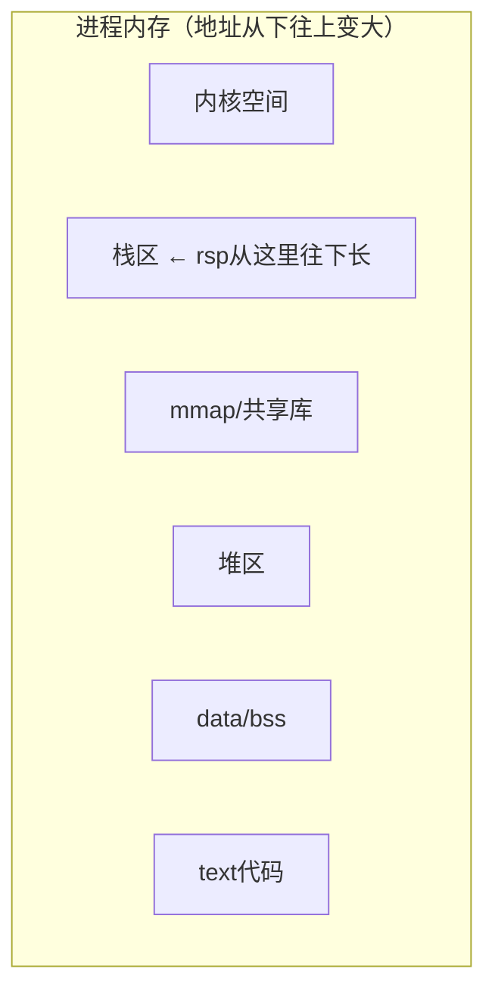
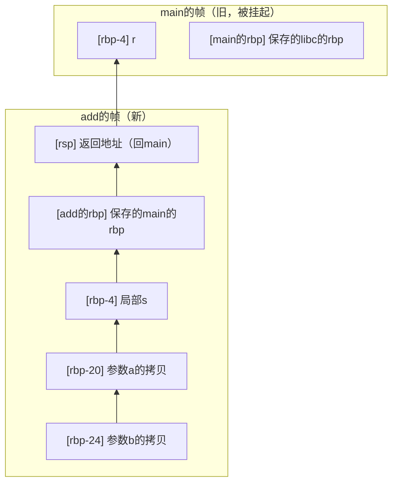

# 堆栈图

## 栈：函数调用的"账本"

栈是一块**向低地址生长**的内存区域（rsp永远指向栈顶），函数调用的一切现场——返回地址、保存的寄存器、局部变量、栈参数——全部记在这里。



## 栈的三条铁律

1. **向低地址生长**：push让rsp减小（地址变小），pop让rsp增大；
2. **后进先出**：最后push的最先pop——函数嵌套天然嵌套回收；
3. **call自动记账**：call压返回地址、ret弹返回地址——这对指令就是栈的日常用户。

## push/pop：一对栈操作指令

```asm
push    rbp                 ; 等价：rsp -= 8; [rsp] = rbp（一次搞定两步）
pop     rbp                 ; 等价：rbp = [rsp]; rsp += 8
```

注意：**一条push干两件事**（移指针+写内存）——这就是它比"mov+sub"两条指令常用的原因（短机器码`55`单字节）。

## 函数序言/尾声：栈帧的标准开场与收场

以实测的 add 函数为例（gcc 13.3 / x86-64 / -O0，[函数·实战](../C语言/函数.md)）：

```asm
main:                           ; ── main的帧 ──
    push    rbp                 ; ①保存调用者（libc启动代码）的rbp
    mov     rbp, rsp            ; ②建立main自己的帧基址
    sub     rsp, 16             ; ③给局部变量开16字节
    mov     esi, 2
    mov     edi, 1
    call    add                 ; ④压返回地址，进入add
                                ;    ↓ 从这往下是add的帧
add:                            ; ── add的帧 ──
    push    rbp                 ; ⑤保存main的rbp（栈上又记一笔）
    mov     rbp, rsp            ; ⑥add的帧基址
    mov     DWORD PTR -20[rbp], edi  ; ⑦参数a搬进自己的局部槽
    mov     DWORD PTR -24[rbp], esi  ;   参数b同上
    mov     edx, DWORD PTR -20[rbp]
    mov     eax, DWORD PTR -24[rbp]
    add     eax, edx            ; ⑧干活
    mov     DWORD PTR -4[rbp], eax   ;   s=
    mov     eax, DWORD PTR -4[rbp]   ; ⑨返回值进eax
    pop     rbp                 ; ⑩恢复main的rbp
    ret                         ; ⑪弹返回地址跳回main
                                ;    ↑ add的帧整体作废（数据还在，但不再受保护）
    mov     DWORD PTR -4[rbp], eax   ; ⑫main从eax接住返回值
    leave                       ;    mov rsp,rbp + pop rbp
    ret                         ; main也返回libc
```

**栈帧逐层堆叠的"账本"视图**（main调用add那一刻）：



关键事实：

* **add读不到main的局部变量**（rbp已切换）——作用域隔离的机器本质；
* 返回后add的帧"作废"但**数据残留**——悬垂指针/返回局部变量地址能"碰巧读到值"的原因（见[指针](../C语言/指针.md)）；
* **递归=同一套序言反复执行**，帧越叠越高，直到栈溢出（实测-O0递归真call：[函数·实验3](../C语言/函数.md)）。

## leave：一指令清帧

```asm
leave       ; 等价两条：mov rsp, rbp（丢局部变量） + pop rbp（恢复调用者rbp）
```

-O0函数尾声标配：`leave; ret`。（-O2常无rbp帧，直接`add rsp,N; ret`或纯`ret`。）

## 金丝雀：栈的防盗栓

含局部数组的函数（Ubuntu默认`-fstack-protector-strong`），序言从 `fs:40` 取8字节随机值存在 `[rbp-8]`，返回前校验（实测：[数组·实战](../C语言/数组.md)）：

```asm
mov     rax, QWORD PTR fs:40       ; 序言：取金丝雀
mov     QWORD PTR -8[rbp], rax     ; 存进帧里
...
mov     rdx, QWORD PTR -8[rbp]     ; 尾声：取回
sub     rdx, QWORD PTR fs:40       ; 与原值比对
je      .L3                        ; 没被越界写破坏 → 放行
call    __stack_chk_fail           ; 被改了 → "*** stack smashing detected ***"
.L3:
leave
ret
```

越界写（如`a[10]`）第一脚踩碎金丝雀→函数退出时报警——这就是对抗"栈溢出覆盖返回地址"的哨兵机制。

## 用栈帧知识逆向一个函数（方法论）

拿到一个陌生函数，按序扫指令即可画出帧图：

```text
1. push rbp; mov rbp,rsp        → 有标准帧
2. mov [rbp-XX], edi/esi/…      → 数一数：几个参数（寄存器来的）
3. mov eax, [rbp+16]            → 有栈参数：+1个起（64位）
4. [rbp-N] 被读写的格子         → 局部变量清单（含类型宽度：DWORD/WORD PTR）
5. fs:40 出现                   → 函数有局部数组
6. call xxx@PLT                 → 调了哪些库函数（printf? malloc? 判功能）
7. 末尾 ret / ret N             → 清栈方（stdcall线索）
```

产出一张"帧图+调用清单"，函数的骨架就还原了——这正是IDA伪代码帮你自动化的事情，但手工会画帧图是看懂它的前提。

## 32位与64位帧图对照

| 槽位 | 32位（cdecl） | 64位（System V） |
| --- | --- | --- |
| 第一个栈参数 | `[ebp+8]` | `[rbp+16]`（前6参数在寄存器） |
| 返回地址 | `[ebp+4]` | `[rbp+8]` |
| 保存的基址 | `[ebp]` | `[rbp]` |
| 局部变量 | `[ebp-4]`起 | `[rbp-4]`起（-O2或无帧：`[rsp+N]`） |
| 参数搬运 | 全部压栈 | 前6个rdi~r9序言搬进局部槽 |

## 小结

1. 栈向低地址生长、后进先出、call/ret自动记返回地址账；
2. 序言三件套 `push rbp; mov rbp,rsp; sub rsp,N` 建帧，`leave; ret` 清帧；
3. **帧=作用域**：rbp一切换，别人的局部变量摸不着；帧"作废"后数据残留——悬垂指针的温床；
4. `[rbp+16]`（64位）/`[ebp+8]`（32位）起是栈参数——逆向数参数的第一依据；
5. 金丝雀守卫局部数组越界；学会手工画帧图=逆向任何函数的第一步。
