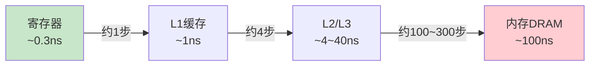
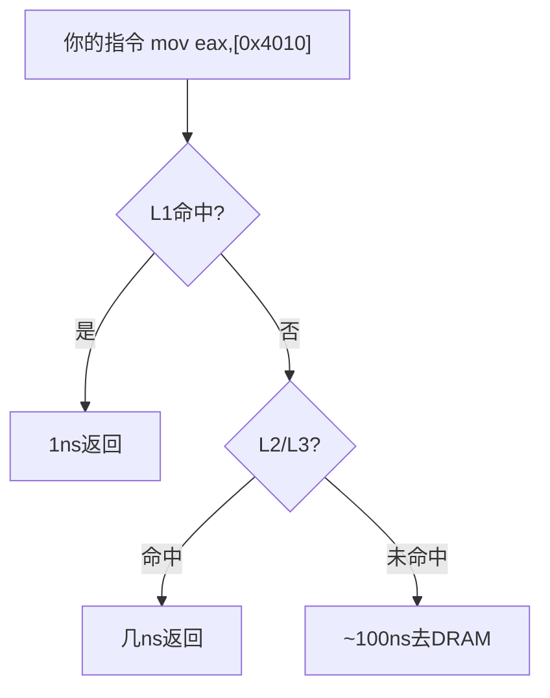

# 寄存器和内存的区别

## 一句话版

**寄存器是CPU的口袋（十几个、超快），内存是远处的仓库（GB级、慢几十倍）**。汇编编程的日常就是"口袋↔仓库"搬运。

## 对照表

| 维度 | 寄存器 | 内存 |
| --- | --- | --- |
| 位置 | CPU内部 | 主板/DRAM |
| 数量 | 16个通用（x86-64） | 以GB计 |
| 容量 | 每个仅8/4/2/1字节 | 理论上整个地址空间 |
| 速度 | 0~1周期（与ALU同频） | ~100周期（缓存未命中时几百） |
| 有地址吗 | **没有地址**（靠名字访问） | 每字节有唯一地址 |
| 掉电保留 | ✘ | ✘（都是易失性） |
| 访问方式 | 名字：`eax`、`rdi` | 地址：`[0x4010]`、`[rbp-4]` |

## 速度差的真实形状



这就是"**能放寄存器就别放内存**"的全部原因——也是-O2拼命把变量提升进寄存器（实测：[变量·volatile](../C语言/C语言变量.md)三次访存 vs 一次读）、循环变量寄存器化（[循环·实测](../C语言/控制语句-循环.md)）的动力。

## 汇编指令层面的体现

**1. 运算只能在寄存器（x86）**

```asm
mov     eax, [rbp-4]      ; 内存 → 寄存器（必须先搬进口袋）
add     eax, [rbp-8]      ; ★例外：add允许"寄存器+内存"（R-M形式）
; add [mem], [mem]        ; ✘ 不存在！内存+内存非法——必须有个寄存器中转
```

**2. mov 是"搬运工"，方向口诀（Intel语法：左目的右源）**

```asm
mov     eax, 100              ; 立即数 → 寄存器
mov     [rbp-4], eax          ; 寄存器 → 内存（写变量）
mov     eax, [rbp-4]          ; 内存 → 寄存器（读变量）
mov     eax, ebx              ; 寄存器 → 寄存器
; mov [mem], [mem]            ; ✘ 内存→内存一条mov做不到（要两条+中转）
```

**3. lea 是"只算地址不取货"**

```asm
lea     eax, -32[rbp]         ; 把"rbp-32这个地址本身"放进eax——不访问内存！
mov     eax, DWORD PTR -32[rbp]  ; 把"rbp-32处的4字节内容"放进eax——真访存
```

实测大量出现：`&a`就是lea（[指针·实战](../C语言/指针.md)）、取函数地址也是lea（[函数指针](../C语言/函数指针.md)）。

## 一个C变量的一生（实测全景）

```c
int a = 100;      /* main里的局部变量 */
int *p = &a;
*p = 200;
```

```asm
mov     DWORD PTR -32[rbp], 100    ; a：名字消失，变成"rbp-32这块内存"
lea     rax, -32[rbp]              ; &a：算地址（不取货）
mov     QWORD PTR -24[rbp], rax    ; p：也是内存（rbp-24），内容是地址
mov     rax, QWORD PTR -24[rbp]    ; 取p：内存→寄存器
mov     DWORD PTR [rax], 200       ; *p=200：间址写内存
```

**C变量 = 内存块 + 编译期名字**；**寄存器 = 编译器临时征用的搬运工**（在-O0里变量住内存、每步都搬；在-O2里变量直接住进寄存器，连内存都省了——见[变量·实战](../C语言/C语言变量.md)的plain_sum：`lea eax,[rdi+rdi*2]`全寄存器完成）。

## "内存"其实有三层

你写的 `[地址]` 未必真去了DRAM——CPU中间架了缓存：



推论（性能设计的地基）：

* 数组**行优先**遍历快——顺序访问让缓存行预取生效（[数组](../C语言/数组.md)）；
* 结构体紧凑（packed）可能反而慢——跨缓存行的未对齐访问（[对齐与位域](../C语言/内存对齐与位域.md)）；
* 一个字节的修改会**整缓存行（64字节）失效**——多线程伪共享问题的根源。

## 逆向工作流的对应物

| 调试器窗口 | 看的就是 |
| --- | --- |
| 寄存器窗口（EAX/EDI…） | 口袋里的当前值 |
| 内存窗口（dump/d命令） | 仓库指定地址的内容 |
| 栈窗口（ESP附近） | 既是内存、又靠rsp/rbp定位——两界交汇处 |

在OD/DTDebug里改一个变量：**要么改寄存器（本次计算变），要么改内存（数据源头变）**——改哪个取决于你要影响哪一层。

## 小结

1. 寄存器：快、少、无地址、按名访问；内存：慢、多、有地址、按址访问——差着两个数量级的速度；
2. x86运算必须至少一个操作数在寄存器；内存↔内存一条指令做不到；
3. `mov`取货、`lea`只算地址——一对黄金搭档；
4. 你以为的"访问内存"其实先问三级缓存——缓存友好是性能优化的第一性原理；
5. 变量住内存（-O0）还是住寄存器（-O2），由优化等级决定——逆向时要意识到-O2代码里"变量"可能根本不存在。
