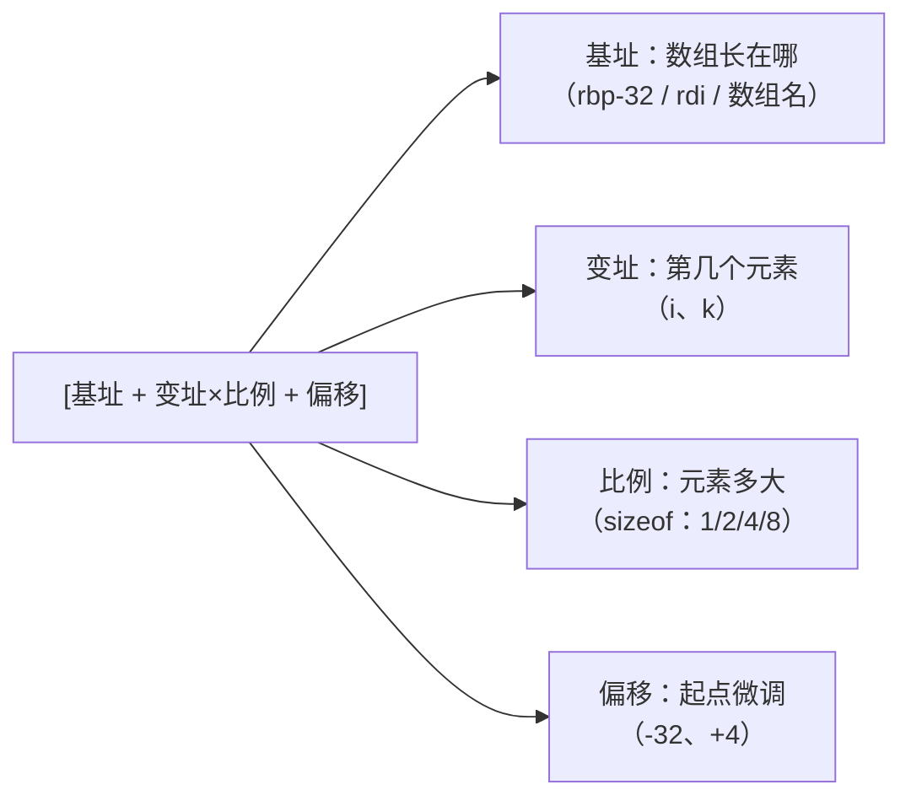

# 寻址公式

## 为什么寻址公式是全库最核心的一页

C语言的数组下标、指针运算、结构体成员、全局变量——**编译后全部坍缩成一条寻址公式**。掌握它，看到任何一行汇编都知道"操作的是C里的谁"。

## 通用公式（SIB寻址）

```text
[ 基址 + 变址 × 比例因子 + 偏移 ]
  reg    reg     1/2/4/8    立即数
```

四个部件**可省略任意个**，得到全部寻址模式：

| 形态 | 汇编写法 | C语言对应 |
| --- | --- | --- |
| 直接地址 | `[0x4010]`（32位）/ `g[rip]`（64位） | 全局变量 |
| 寄存器间接 | `[rdi]` | `*p` |
| 基址+偏移 | `4[rdi]` | `p->i`（成员偏移4） |
| 基址+变址 | `[rdx+rax]` | `*(p+i)` 字节版 |
| 基址+变址×比例 | `[rdi+rsi*4]` | `a[i]`（int数组） |
| 基址+变址×比例+偏移 | `-32[rbp+rax*4]` | 局部数组 `a[i]` |
| RIP相对 | `g[rip]` | 全局变量（64位PIE标配） |

## 实测：一网打尽（gcc 13.3 / x86-64 / -O2 真实输出）

```c
int g = 0x1234;                        /* 全局 */
struct S { char c; int i; };

int imm(void)                { return g; }         /* 全局访问 */
int reg(int *p)              { return *p; }        /* 寄存器间接 */
int base_disp(struct S *s)   { return s->i; }      /* 基址+偏移 */
int base_index(int *a, int i){ return a[i]; }      /* 基址+变址×比例 */
```

```asm
imm:
    mov     eax, DWORD PTR g[rip]        ; ①RIP相对：全局变量（64位PIE）
    ret
reg:
    mov     eax, DWORD PTR [rdi]         ; ②寄存器间接：*p —— p的值就是地址
    ret
base_disp:
    mov     eax, DWORD PTR 4[rdi]        ; ③基址+偏移：s->i（偏移4编译期定死）
    ret
base_index:
    movsx   rsi, esi                     ; 变址i符号扩展（下标是有符号int！）
    mov     eax, DWORD PTR [rdi+rsi*4]   ; ④基址+变址×比例：a[i]
    ret                                  ;    比例4 = sizeof(int)！
```

局部数组版（带全四件套，实测来自[数组·实验1](../C语言/数组.md)）：

```asm
mov     DWORD PTR -32[rbp+rax*4], 200    ; a[i] = 200
;        偏移↑   基址↑ 变址↑比例↑ —— 公式全家福
;        基址rbp-32 = a[0]的槽位
```

## 公式部件的语义



**比例因子只能取 1/2/4/8**（硬件编码限制）——恰好覆盖 char/short/int/long double/指针。所以：

* `char a[i]` → `[base+rax*1]`（比例1常省略成 `[base+rax]`）
* `short a[i]` → `[base+rax*2]`
* `int a[i]` → `[base+rax*4]`
* `double a[i]` → `[base+rax*8]`
* 结构体数组 `s[i].score` → 先 `[base+rax*sizeof(S)]` 定位元素，再 `+offsetof(score)` 二次偏移

**二维数组**就是公式套公式（实测：[数组·实验5](../C语言/数组.md)）：

```asm
sal     rax, 4                     ; i×16（行宽=4列×4字节）
add     rdx, rax                   ; 基址+行偏移
mov     eax, DWORD PTR [rdx+rax*4] ; +j×4（列偏移）
; &a[i][j] = base + i×行宽 + j×元素大小
```

## 常量折叠：能算的编译期全算完

| C写法 | 编译产物 | 说明 |
| --- | --- | --- |
| `a[0]` / `a[3]` | `[rbp-32]` / `[rbp-20]` | 常量下标→偏移折叠，变址消失 |
| `a[9]`（越界！） | `4[rbp]` | 照样折叠——越界也是公式算地址（无检查） |
| `p->i` | `[rdi+4]` | 成员偏移折叠 |
| `g_init[3]` | `g_init[rip+12]` | 全局+常量下标双重折叠 |
| `a[i]`（变量下标） | `[rbp-32+rax*4]` | 只有变量才配拥有变址和比例 |

**逆向推论**：看到 `[reg+N]`（无变址）→ 常量下标/结构体成员/固定偏移；看到 `[reg+reg*4]` → **int数组的变量下标**——SIB形态直接告诉你数据结构。

## 32位 vs 64位寻址对照

| 项 | 32位经典 | 64位实测 |
| --- | --- | --- |
| 全局变量 | `mov eax,[0x4010]` 直接地址 | `mov eax, g[rip]` RIP相对（PIE） |
| 局部变量 | `[ebp-4]` | `[rbp-4]`（-O2常无rbp：`[rsp+8]`） |
| 参数 | `[ebp+8]`起 | 寄存器rdi~r9；栈参数`[rbp+16]`起 |
| 比例因子 | 1/2/4（8少用） | 1/2/4/8 |
| 跳转表 | `jmp [eax*4+表]` | `jmp [rdx+rax*8]` + RIP相对表 |

## 现实陷阱：RIP相对是什么

64位位置无关代码（PIE）里，绝对地址运行时才定，所以**一切符号访问都改成"相对当前指令指针的偏移"**：

```asm
mov     eax, DWORD PTR g[rip]     ; 真实地址 = RIP（本指令下一地址）+ 偏移
                                    ; 链接器/加载器负责填偏移
```

逆向时看到 `[rip+X]`，用 `rip + X` 算出真实地址再查符号——IDA/x64dbg自动帮你算。

## 小结

1. 一条公式 `[基址+变址×比例+偏移]` 覆盖C语言所有数据访问：全局/指针/成员/数组/二维；
2. 比例因子=元素大小（1/2/4/8），变址=下标，偏移=编译期算好的常量；
3. 常量下标/成员偏移全部编译期折叠——**只有变量下标才留下SIB形态**（逆向识别数组）；
4. 64位PIE下全局访问走RIP相对；32位是直接地址；
5. 二维数组=行偏移×行宽+列×元素，公式套公式。
