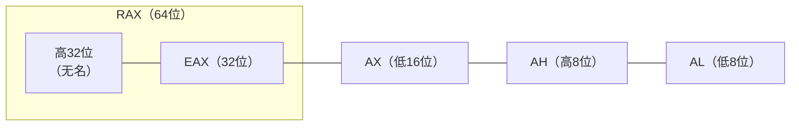

# 数据宽度

## 计算机世界的"尺子"

x86/x86-64 的内存按**字节**编址，但存取按固定宽度成套操作。四代宽度一脉相承：

| 名称 | 英文 | 位数 | 字节数 | 汇编后缀 | C语言大致对应 |
| --- | --- | --- | --- | --- | --- |
| 字节 | Byte | 8 | 1 | `b` (BYTE) | `char` |
| 字 | Word | 16 | 2 | `w` (WORD) | `short` |
| 双字 | Double Word | 32 | 4 | `d` (DWORD) | `int`（32位平台） |
| 四字 | Quad Word | 64 | 8 | `q` (QWORD) | `long long` / 64位指针 |

> x86 的"字"（Word）是16位——历史遗留：8086是16位机，一个"字"就是它的一次完整存取。到了32位时代才引入DWORD，64位时代QWORD。**不要把Word想成"机器字长"**。

## 寄存器的嵌套视图

一个64位寄存器像俄罗斯套娃，低段各有名字：



| 64位 | 32位 | 16位 | 8位高 | 8位低 |
| --- | --- | --- | --- | --- |
| rax | eax | ax | ah | al |
| rbx | ebx | bx | bh | bl |
| rcx | ecx | cx | ch | cl |
| rdx | edx | dx | dh | dl |
| rsi | rsi | si | — | sil |
| rdi | rdi | di | — | dil |
| rbp | ebp | bp | — | bpl |
| rsp | esp | sp | — | spl |
| r8~r15 | r8d | r8w | — | r8b |

## 溢出：位宽决定天花板

n位无符号数能表示 **0 ~ 2ⁿ-1**；有符号（补码）**-2ⁿ⁻¹ ~ 2ⁿ⁻¹-1**：

| 宽度 | 无符号范围 | 有符号范围 |
| --- | --- | --- |
| 8位 | 0 ~ 255 | -128 ~ 127 |
| 16位 | 0 ~ 65535 | -32768 ~ 32767 |
| 32位 | 0 ~ 4294967295 | -2147483648 ~ 2147483647 |
| 64位 | 0 ~ 18446744073709551615 | ±9.2×10¹⁸ |

超界就是**回绕/截断**（实测见下）。

## 溢出的三种真实形态（实测）

**实测环境**：Ubuntu 24.04 / gcc 13.3.0 / x86-64

### 1. 无符号回绕（合法行为）

```c
unsigned char u = 255;
u = u + 1;               /* 0 —— 模256运算，标准保证 */
```

```asm
movzx   eax, dil
add     eax, 1            ; 0x100 → 256
mov     dil, al           ; ★写回8位寄存器：只留低8位 → 0
```

**截断的物理本质**：写窄寄存器/窄内存时，高位直接丢弃——机器没有"越界报警"，多出来的位就是没了。

### 2. 有符号溢出（UB，但机器层面同样回绕）

```text
0x7FFFFFFF + 1 = 0x80000000
  即 2147483647 + 1 = -2147483648（补码回绕成最小负数）
```

C标准说这是UB（见[常见陷阱](../C语言/常见陷阱与未定义行为.md)），但**机器指令的加法行为是确定的**：进位翻转符号位。逆向时看到的"整数上溢绕回负数"漏洞就是它。

### 3. 进位标志 CF（第33位去哪了）

```asm
mov     al, 0xFF
add     al, 1            ; al=0，CF=1 —— 溢出的那一位进了EFLAGS的CF！
```

进位不消失，被EFLAGS的**CF（Carry Flag）**接住——这正是多精度加法（大数运算）的实现原理：低32位相加后查CF，决定高32位要不要多加1。详见[EFLAGS寄存器](EFLAGS寄存器.md)。

## 宽度在指令里的表达：PTR 关键字

同一个地址，用不同宽度读就是不同指令（实测真实输出）：

```asm
mov     al,  BYTE PTR [rdi]      ; 读1字节（get_c / 位域读）
movzx   eax, WORD PTR 8[rdi]     ; 读2字节（short成员s2，见结构体实战）
mov     eax, DWORD PTR 4[rdi]    ; 读4字节（int成员i）
movsd   xmm0, QWORD PTR 16[rdi]  ; 读8字节（double成员d）
```

**汇编没有类型，只有宽度**——`BYTE/WORD/DWORD PTR` 就是它全部的"类型系统"（详见[汇编中的数据类型](汇编中的数据类型.md)）。

## 数据声明指示（.s 文件里的宽度）

真实 `.s` 输出里的数据段声明，宽度一目了然（来自[数组·实验6](../C语言/数组.md)实测）：

| 指示 | 宽度 | 实例 |
| --- | --- | --- |
| `.byte` | 1字节 | — |
| `.word` | 2字节 | — |
| `.long` | 4字节 | `g_init: .long 1`（int数组） |
| `.quad` | 8字节 | `.quad .LC0`（指针）、函数指针表 |
| `.string` | 以\0结尾的字符串 | `.string "hello"` |
| `.zero N` | N字节0（bss） | `.zero 16` |
| `.align N` | 对齐到N字节 | `.align 16` |

## 与C语言的对照实验

```c
printf("%d\n", (int)sizeof(char));    /* 1 = BYTE */
printf("%d\n", (int)sizeof(short));   /* 2 = WORD */
printf("%d\n", (int)sizeof(int));     /* 4 = DWORD */
printf("%d\n", (int)sizeof(void*));   /* 8 = QWORD（64位） */
```

**指针的宽度 = 地址总线宽度**——这就是"64位机"的全部含义：一个地址64位。32位程序的指针是4字节，所以 `[ebp+8]`（32位）与 `[rbp+16]`（64位，前6参数走寄存器）的参数偏移不同（见[参数传递](参数传递.md)）。

## 小结

1. 四代宽度：BYTE(1)→WORD(2)→DWORD(4)→QWORD(8)，Word=16位是历史，别与机器字长混淆；
2. 寄存器套娃：rax⊃eax⊃ax⊃ah/al，写低段不破坏高段（除x86-64写32位自动清零高32位，见[通用寄存器](通用寄存器.md)）；
3. 溢出=高位丢弃：无符号回绕合法、有符号溢出UB、进位进CF；
4. 汇编用 `BYTE/WORD/DWORD PTR` 表达宽度——没有类型只有宽度；
5. `.long/.quad/.zero` 等指示就是数据在文件里的"宽度说明书"。
